# 01 · Neural network basics

> [!NOTE]
> **Colour code for all formulas:** $\textcolor{#3b82f6}{\text{input / data}}$ · $\textcolor{#e8833a}{\text{learned weights}}$ · $\textcolor{#22a06b}{\text{model output}}$ · $\textcolor{#e5484d}{\text{true label}}$ · $\textcolor{#a855f7}{\text{setting you choose}}$

**Why this comes first.** Everything later is built from the same parts. A Transformer is still layers, weights, a loss and gradient descent. If these parts are clear, the rest is just new ways to wire them.

**Course material:** Week 2 lecture (`Week 2/W2_Lecture2_Part1_DeepFeedForwardNetworks.pdf`), Week 2 notebook (`Week 2/L2_Week2_FeedForwardNets.ipynb`), Week 3 lectures (`Week 3/W3_Lecture3_Part1_NeuralNetworkOptimization.pdf`, `Week 3/W3_Lecture3_Part2_Regularization.pdf`).


> [!TIP]
> **Play with it** (interactive, in the browser). Do this before or after reading; seeing it move is the fastest way in.
> - [TensorFlow Playground](https://playground.tensorflow.org/): pick the XOR dataset (top-left, 'exclusive or'). Remove all hidden layers and press play: it fails. Add one hidden layer with ReLU: it works. Then set the learning rate to 3 and watch it explode.
> - [Distill: Why momentum really works](https://distill.pub/2017/momentum/): drag the step-size and momentum sliders and watch the path zig-zag or glide.
> - [MLU-Explain: neural networks](https://mlu-explain.github.io/neural-networks/): a scrolling visual story of neurons, layers and training.
> - [MLU-Explain: bias and variance](https://mlu-explain.github.io/bias-variance/): see underfitting and overfitting change as model complexity grows.
> - [Loss landscape gallery](https://losslandscape.com/): 3-D renders of real network loss surfaces.

---

## 1. What a model is

A model is a function with adjustable numbers inside. The numbers are called **parameters** or **weights**. Training means finding weights that make the outputs useful.

Example: predict a house price from its size.

$$
\textcolor{#22a06b}{\hat{y}} = \textcolor{#e8833a}{w}\cdot\textcolor{#3b82f6}{x} + \textcolor{#e8833a}{b}
$$

<sub>$\hat y$ = predicted price · $x$ = size of the house · $w$ = how much the price rises per square metre · $b$ = base price (bias). Training picks $w$ and $b$ so that $\hat y$ is close to the real price $y$.</sub>

This is linear regression. A neural network does the same thing, but with many more weights and some non-linear steps in between.

## 2. One neuron

A neuron does two things. First, a weighted sum plus a bias:

$$
z = \textcolor{#e8833a}{w_1}\textcolor{#3b82f6}{x_1} + \textcolor{#e8833a}{w_2}\textcolor{#3b82f6}{x_2} + \dots + \textcolor{#e8833a}{w_n}\textcolor{#3b82f6}{x_n} + \textcolor{#e8833a}{b} \;=\; \textcolor{#e8833a}{\mathbf{w}}^\top\textcolor{#3b82f6}{\mathbf{x}} + \textcolor{#e8833a}{b}
$$

<sub>$x_1 \dots x_n$ = the $n$ input numbers · $w_1 \dots w_n$ = one weight per input · $b$ = bias, a constant added at the end · $z$ = the result, one single number · $\mathbf{w}^\top\mathbf{x}$ = short vector notation for the same sum ($\mathbf{w}$, $\mathbf{x}$ = all weights / all inputs as lists, $^\top$ = "transpose", here it just means "multiply pairwise and add up").</sub>

Then an activation function:

$$
\textcolor{#22a06b}{a} = f(z)
$$

<sub>$x_i$ = the inputs · $w_i$ = one weight per input · $b$ = bias · $z$ = the raw score (also called *logit* or *pre-activation*) · $f$ = activation function · $a$ = the neuron's output.</sub>

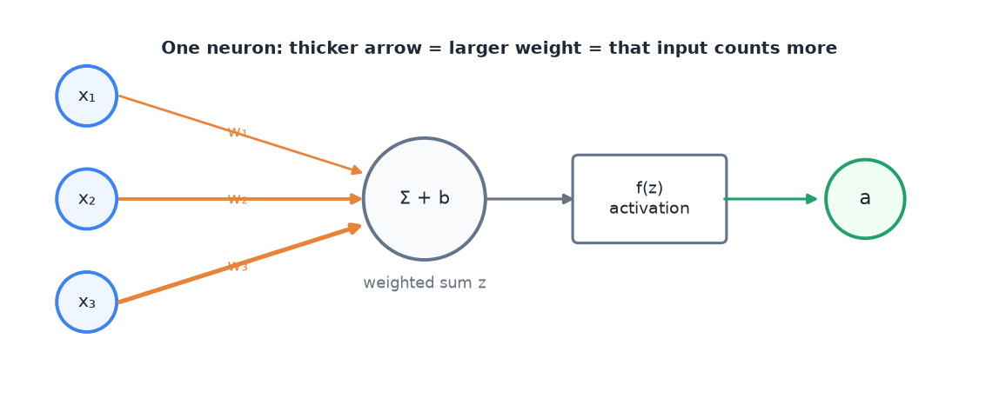
<sub>One neuron as a picture: inputs, weights, sum, activation, output.</sub>

Common activation functions:

| Name | Formula | Output range | Where it is used |
|---|---|---|---|
| Sigmoid | $\sigma(z) = \dfrac{1}{1 + e^{-z}}$ | 0 to 1 | output for yes/no questions |
| tanh | $\tanh(z) = \dfrac{e^{z} - e^{-z}}{e^{z} + e^{-z}}$ | −1 to 1 | inside RNNs |
| ReLU | $\max(0, z)$ | 0 to ∞ | default in hidden layers |
| Softmax | $\dfrac{e^{z_i}}{\sum_j e^{z_j}}$ | each 0 to 1, all sum to 1 | output when exactly one class is correct |

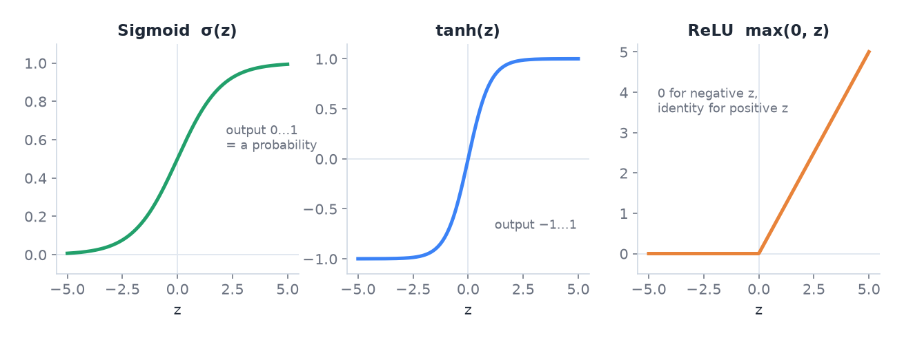
<sub>The three activations you meet most. Sigmoid squashes to 0…1, tanh to −1…1, ReLU cuts off negatives.</sub>

### What an activation function really is (in plain terms)

Yes: it is a **fixed function that you choose before training**. It is not learned. After a layer has computed its weighted sums $z$ (one number per neuron), the same function is applied to **each number separately**. Then the result goes to the next layer.

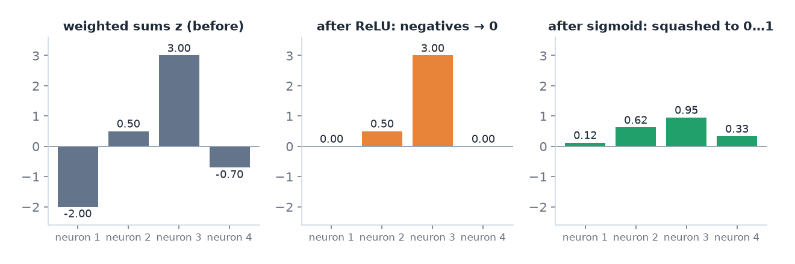
<sub>Four neurons of one layer. Left: their weighted sums $z$. Middle: ReLU sets negatives to 0. Right: sigmoid squashes every value into 0…1.</sub>

```python
import torch
z = torch.tensor([-2.0, 0.5, 3.0, -0.7])   # weighted sums of 4 neurons (W·x + b)
torch.relu(z)      # tensor([0.0000, 0.5000, 3.0000, 0.0000])
torch.sigmoid(z)   # tensor([0.1192, 0.6225, 0.9526, 0.3318])
```

**Why not something simple like $f(z) = 4z$?** Because $4z$ is linear: it only scales. Stack two layers with it and you get $4\,W_2\,(4\,W_1 x) = (16\,W_2 W_1)\,x$, which is again just one matrix times $x$. Ten such layers are still one straight line, so they cannot solve XOR. The activation must **bend** somewhere. ReLU bends at 0, sigmoid and tanh bend smoothly.

<details>
<summary><b>Check it yourself in code</b> (two linear layers collapse into one)</summary>

```python
import torch
W1, W2 = torch.randn(5, 2), torch.randn(1, 5)
x = torch.randn(2)
two_layers = W2 @ (4 * (W1 @ x))     # layer 1, "activation" f(z) = 4z, layer 2
one_layer  = (4 * W2 @ W1) @ x       # one single matrix does exactly the same
print(torch.allclose(two_layers, one_layer))   # True: the extra layer added nothing
torch.allclose(W2 @ torch.relu(W1 @ x), one_layer)  # usually False: ReLU really changes the function
```

</details>

**Why the activation matters.** Without it, stacking layers gives just another linear function. Two linear steps in a row are still one linear step. The non-linearity lets the network learn curved decision boundaries. The classic example is XOR. No straight line separates its classes, but a network with one hidden layer and ReLU can.

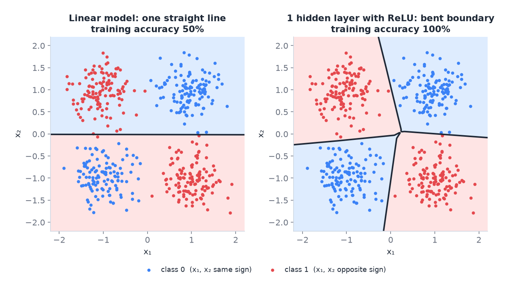
<sub>XOR: blue where x₁ and x₂ have the same sign, red where they differ. A linear model can only draw one straight line and stays at 50%. One hidden layer with ReLU bends the boundary and separates all four clusters.</sub>

> [!NOTE]
> **From the course · Week 3 tutorial, Q2.** A network has one hidden layer $a = \sigma_1(w_1x_1 + w_2x_2 + b)$ and output $y = \sigma_2(w_3 a + b_2)$. Show that if $\sigma_1$ is linear, $\sigma_1(z) = \alpha z$, the network is just a one-layer perceptron.
>
> <sub>$x_1, x_2$ = the two inputs · $w_1, w_2$ = weights into the hidden neuron · $b$ = its bias · $\sigma_1$ ("sigma one") = the hidden neuron's activation function (here $\sigma$ is just a name for *some* activation, not necessarily the sigmoid) · $a$ = the hidden neuron's output · $w_3$ = weight from the hidden neuron to the output · $b_2$ = output bias · $\sigma_2$ = the output's activation · $y$ = the network's output · $\alpha$ ("alpha") = a fixed number; $\sigma_1(z) = \alpha z$ means "the activation only multiplies by $\alpha$", e.g. $\alpha = 4$ is your $4z$.</sub>

<details>
<summary><b>Show the answer</b></summary>

**Idea:** if the hidden activation only multiplies, the two layers can be merged into one.

1. With $\sigma_1(z) = \alpha z$ the hidden output is $a = \alpha(w_1x_1 + w_2x_2 + b)$.
2. Put that $a$ into the output formula and multiply out the brackets:

$$y = \sigma_2\big(\alpha w_3 w_1\,x_1 + \alpha w_3 w_2\,x_2 + (\alpha w_3 b + b_2)\big) = \sigma_2(\omega_1 x_1 + \omega_2 x_2 + \beta)$$

3. Give the products new names: $\omega_1 = \alpha w_3 w_1$, $\omega_2 = \alpha w_3 w_2$, $\beta = \alpha w_3 b + b_2$.

<sub>$\omega_1, \omega_2$ ("omega") = the merged weights, just new names for those products · $\beta$ ("beta") = the merged bias.</sub>

The result $y = \sigma_2(\omega_1 x_1 + \omega_2 x_2 + \beta)$ is **one neuron** (a perceptron): weighted sum of the inputs plus bias, then one activation. The hidden layer added nothing.

**With numbers:** $\alpha = 4,\ w_1 = 1,\ w_2 = 3,\ b = 0.5,\ w_3 = 2,\ b_2 = -1$ gives $\omega_1 = 4\cdot2\cdot1 = 8$, $\omega_2 = 4\cdot2\cdot3 = 24$, $\beta = 4\cdot2\cdot0.5 - 1 = 3$. So the "two-layer" network is exactly $y = \sigma_2(8x_1 + 24x_2 + 3)$.

</details>

## 3. Layers and networks

A layer is many neurons side by side. In matrix form, one layer computes:

$$
\textcolor{#22a06b}{\mathbf{h}} = f\!\left(\textcolor{#e8833a}{W}\,\textcolor{#3b82f6}{\mathbf{x}} + \textcolor{#e8833a}{\mathbf{b}}\right)
$$

<sub>$\mathbf{x}$ = input vector · $W$ = weight matrix, one row per neuron · $\mathbf{b}$ = one bias per neuron · $f$ = activation, applied to each element · $\mathbf{h}$ = the layer's output vector, which is the next layer's input.</sub>

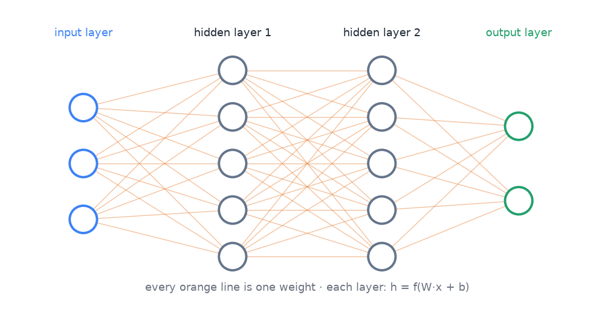
<sub>A feed-forward network with two hidden layers. Every line is one weight that training adjusts.</sub>

- A **feed-forward network** (also called MLP) stacks layers. The output of one layer is the input of the next.
- **Hidden layers** are the layers between input and output.
- **Depth** is the number of layers. **Width** is the number of neurons per layer.
- **Universal approximation theorem:** one hidden layer with enough neurons can approximate any reasonable function. In practice, deeper networks need far fewer neurons for the same job. They also learn features in steps: simple patterns first, complex ones later.

## 4. The output layer and the loss must match the task

The **loss function** measures how wrong the model is on one example. Training minimises the average loss.

| Task | Example | Output layer | Loss |
|---|---|---|---|
| Regression | house price | 1 neuron, no activation | mean squared error (MSE) |
| Binary classification | spam or not | 1 neuron, sigmoid | binary cross-entropy (BCE) |
| Multi-class (one correct class) | digit 0–9 | K neurons, softmax | cross-entropy |
| Multi-label (any number of classes) | techniques in a meme (A2) | K neurons, sigmoid each | BCE for each class, then average |

**Mean squared error** over $N$ examples:

$$
\text{MSE} = \frac{1}{N}\sum_{i=1}^{N}\left(\textcolor{#e5484d}{y_i} - \textcolor{#22a06b}{\hat{y}_i}\right)^2
$$

<sub>$y_i$ = true value · $\hat y_i$ = prediction · squaring makes every error positive and punishes big errors more.</sub>

**Binary cross-entropy** for one example:

$$
\text{BCE} = -\Big[\, \textcolor{#e5484d}{y}\,\log \textcolor{#22a06b}{p} \;+\; (1 - \textcolor{#e5484d}{y})\,\log(1 - \textcolor{#22a06b}{p}) \,\Big]
$$

<sub>$y$ = true label, 0 or 1 · $p$ = predicted probability that the label is 1. Only one of the two terms is active: if $y = 1$ the loss is $-\log p$; if $y = 0$ it is $-\log(1 - p)$.</sub>

Worked example. The true label is 1.
- If the model says $p = 0.9$, the loss is $-\log 0.9 = 0.105$. Small loss, good.
- If the model says $p = 0.1$, the loss is $-\log 0.1 = 2.303$. Large loss, bad.

The log punishes confident mistakes very hard. That is what we want.

**Cross-entropy for K classes** (with softmax output):

$$
\text{CE} = -\sum_{k=1}^{K} \textcolor{#e5484d}{y_k}\,\log \textcolor{#22a06b}{p_k} = -\log \textcolor{#22a06b}{p_{\text{true class}}}
$$

<sub>$y_k$ = 1 for the correct class and 0 for all others (one-hot) · $p_k$ = softmax probability of class $k$. Only the probability of the correct class matters.</sub>

> [!NOTE]
> **From the course · Week 3 tutorial, Q6.** A network must say whether an image contains a cat and/or a dog. Some images contain both. Which output activation and loss?

<details>
<summary><b>Show the answer</b></summary>

Two valid designs:
- **Two sigmoid outputs** (cat yes/no, dog yes/no) and the sum of two binary cross-entropies. This is multi-label, exactly like A2 with 20 techniques instead of 2.
- **Four softmax outputs** for the combinations (none, cat, dog, both) with categorical cross-entropy. This works for 2 labels, but with 20 labels it would need $2^{20}$ classes, so it does not scale.

</details>

**Where these losses come from.** They are not arbitrary. They follow from **maximum likelihood**: choose the weights that make the observed labels most probable. For Bernoulli (yes/no) labels this gives BCE. For Gaussian noise in regression it gives MSE.

## 5. Gradient descent

We want weights with low loss. The **gradient** $\nabla_w L$ is the vector of partial derivatives of the loss with respect to every weight. It points in the direction where the loss grows fastest. So we step the other way:

$$
\textcolor{#e8833a}{w}_{\text{new}} = \textcolor{#e8833a}{w}_{\text{old}} - \textcolor{#a855f7}{\eta}\,\nabla_{w} L
$$

<sub>$w$ = any weight · $\eta$ (eta) = learning rate, the step size · $\nabla_w L$ = gradient of the loss $L$ with respect to $w$, i.e. how much $L$ changes when $w$ changes a little.</sub>

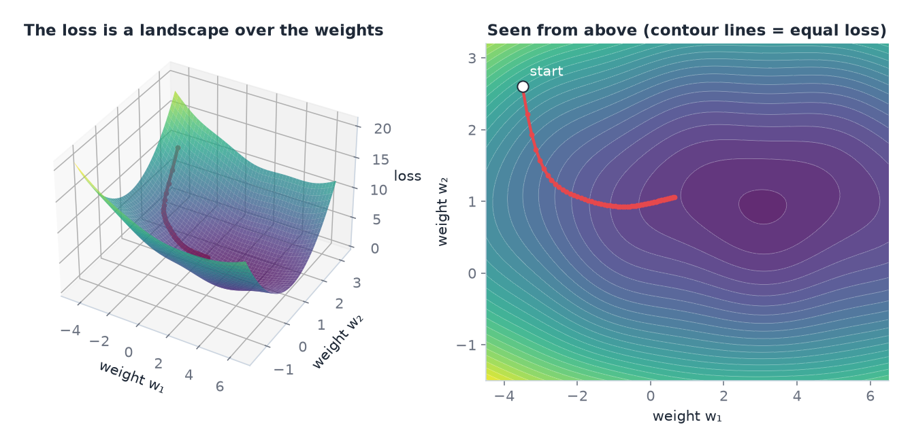
<sub>With two weights, the loss is a landscape. Gradient descent (red) always steps downhill. Real networks have millions of weights, but the picture is the same idea.</sub>

- $\eta$ too small: training is very slow.
- $\eta$ too large: the loss jumps around or explodes. A typical sign of a too-large learning rate is a loss curve that oscillates.

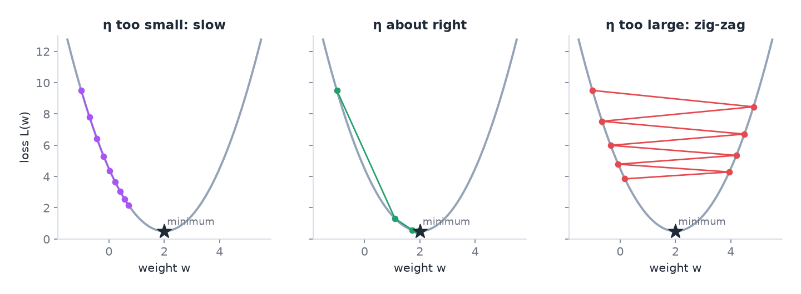
<sub>The same loss, three learning rates. Each dot is one update step, starting at w = −1.</sub>

> [!NOTE]
> **From the course · Week 4 tutorial, Q2.** What goes wrong if the learning rate is too high, and if it is too low? How do you see it?

<details>
<summary><b>Show the answer</b></summary>

- **Too high:** the loss does not converge and can even grow. In the loss-vs-iteration plot it oscillates wildly (right panel of the figure above).
- **Too low:** the loss falls very slowly, almost in a straight line, and may not reach a good minimum in time (left panel).
- Always plot the loss against the iterations to tell which case you have.

</details>

**Mini-batch SGD.** The exact gradient needs the whole dataset. That is slow. Instead we estimate it from a small random batch, for example 16 or 32 examples. The estimate is noisy, but it is cheap, and the noise can even help escape bad regions. One pass over all training data is one **epoch**.

**Better optimisers.**
- **Momentum** keeps a running average of past gradients. It smooths the path and speeds up in consistent directions.
- **RMSProp** divides each weight's step by a running average of its squared gradients. Weights with large gradients take smaller steps.
- **Adam** combines momentum and RMSProp. It is the default choice. **AdamW** is Adam with weight decay done correctly. Transformers use AdamW.

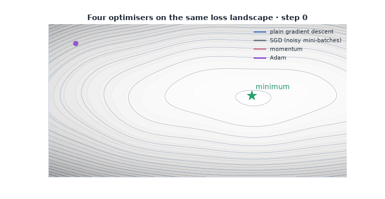
<sub>Animation: plain gradient descent creeps along the flat valley, SGD wobbles because each mini-batch gives a noisy slope, momentum builds up speed, Adam adapts its step per weight.</sub>

**Learning-rate schedules.** Fine-tuning large models often uses a **warm-up**: the learning rate starts near zero and rises over the first steps. Then it slowly decays. Large early steps would otherwise damage the pretrained weights.

## 6. Backpropagation

A network is a chain of functions. The **chain rule** of calculus gives the derivative of the loss with respect to any weight:

$$
\frac{\partial L}{\partial \textcolor{#e8833a}{w}} = \frac{\partial L}{\partial \textcolor{#22a06b}{a}}\cdot\frac{\partial \textcolor{#22a06b}{a}}{\partial z}\cdot\frac{\partial z}{\partial \textcolor{#e8833a}{w}}
$$

<sub>Read it right to left: how $z$ reacts to $w$, times how $a$ reacts to $z$, times how the loss reacts to $a$. Backpropagation multiplies these local derivatives from the output back to the input.</sub>

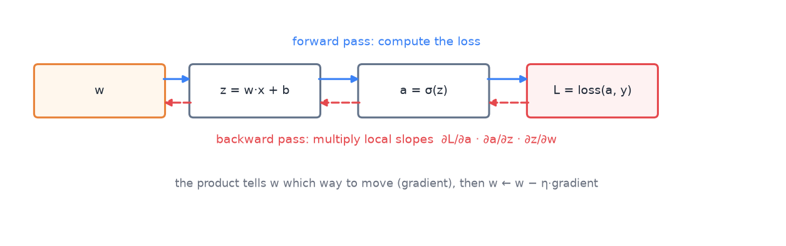
<sub>Forward pass (blue) computes the loss. Backward pass (red) multiplies the local slopes to get the gradient for w.</sub>

> [!NOTE]
> **From the course · Week 4 tutorial, Q1.** Input $x = [1, 2]$, target $y = 3$, MSE loss, three ReLU hidden units, linear output, learning rate 0.1, all biases 0. Hidden weights: unit 1 $(2, 1)$, unit 2 $(1, -2)$, unit 3 $(1, 2)$. Output weights $(-1, 3, 2)$. Compute the gradients.

<details>
<summary><b>Show the answer</b></summary>

**Forward pass**
- $h_1 = \text{ReLU}(2\cdot1 + 1\cdot2) = 4$
- $h_2 = \text{ReLU}(1\cdot1 - 2\cdot2) = \text{ReLU}(-3) = 0$  ← a "dead" unit
- $h_3 = \text{ReLU}(1\cdot1 + 2\cdot2) = 5$
- $\hat y = -1\cdot4 + 3\cdot0 + 2\cdot5 = 6$, loss $= (6-3)^2 = 9$

**Backward pass** (chain rule, $\partial L/\partial\hat y = 2(\hat y - y) = 6$)
- Output weights: $\partial L/\partial w_k = 6\cdot h_k$ → $24,\ 0,\ 30$; output bias $6$.
- Hidden unit 1: $6 \cdot (-1) = -6$, times its inputs → $-6,\ -12$; bias $-6$.
- Hidden unit 2: ReLU was 0, its slope is 0 → all gradients $0$. It does not learn this step.
- Hidden unit 3: $6 \cdot 2 = 12$, times inputs → $12,\ 24$; bias $12$.

**Update:** $w \leftarrow w - 0.1\cdot\text{gradient}$, e.g. output weight 1: $-1 - 0.1\cdot24 = -3.4$.

<sub>$h_1, h_2, h_3$ = outputs of the three hidden neurons · ReLU = max(0, ·) · $\hat y$ ("y hat") = the network's prediction · $y = 3$ = the target · $L$ = the loss, here $(\hat y - y)^2$ · $\partial L/\partial w$ = "how much the loss changes if $w$ changes a little" (the gradient for $w$) · $0.1$ = the learning rate $\eta$ · $\leftarrow$ = "is replaced by".</sub>

</details>

Backpropagation reuses intermediate results, so it costs about as much as one forward pass. In PyTorch you never write it by hand:

```python
loss = loss_fn(model(x), y)
optimizer.zero_grad()   # clear old gradients
loss.backward()         # backpropagation: compute all gradients
optimizer.step()        # gradient descent: update the weights
```

These four lines are the core of every training loop in the course and in A2.

## 7. Practical training details

- **Initialisation.** Weights start random, never all equal. Equal weights would make all neurons learn the same thing. Xavier/He initialisation scales the random values to the layer size, so signals neither shrink nor blow up.
- **Input normalisation.** Scale inputs to similar ranges. Gradient descent works much better on a well-scaled problem.
- **Batch normalisation.** Normalises the activations inside the network for each batch. It stabilises and speeds up training.
- **Exploding gradients.** Gradients can become huge, especially in deep or recurrent networks. **Gradient clipping** caps their size. A2 clips the gradient norm at 1.0.
> [!NOTE]
> **From the course · Week 4 tutorial, Q3 and Q4.** What is a saddle point, and why can SGD help? And: sigmoid units saturate. Does switching to tanh fix it?

<details>
<summary><b>Show the answer</b></summary>

- **Saddle point:** the gradient is zero, but it is neither a minimum nor a maximum (it curves up in one direction and down in another). Plain gradient descent can stall there. SGD's noisy updates push it off.
- **Saturation:** the slope of sigmoid is tiny for large positive or negative $z$, so gradients vanish. **tanh does not fix it**: $\tanh(z) = 2\sigma(2z) - 1$ is just a stretched sigmoid with the same flat ends (<sub>$\sigma$ = the sigmoid function $1/(1+e^{-z})$, $z$ = the neuron's weighted sum</sub>). Its one advantage is that its outputs are centred around 0. ReLU avoids saturation for positive $z$.

</details>

- **Local minima and saddle points.** The loss surface is not a simple bowl. In high dimensions, flat regions and saddle points are the main obstacle, more than bad local minima. Momentum helps get through them.

## 8. Overfitting, underfitting, regularisation

- **Underfitting:** the model is too weak. It is bad on training data and on new data.
- **Overfitting:** the model memorises the training data. It is very good on training data but worse on new data.
- **Generalisation gap:** the difference between training and validation performance.

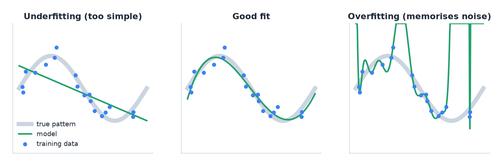
<sub>Grey = the true pattern, blue = noisy training points, green = the model. Too simple misses the pattern; too flexible chases the noise.</sub>

**L2 regularisation / weight decay** adds a penalty for large weights to the loss:

$$
L_{\text{total}} = L_{\text{data}} + \textcolor{#a855f7}{\lambda}\sum_{j} \textcolor{#e8833a}{w_j}^2
$$

<sub>$L_{\text{data}}$ = the normal loss · $\lambda$ = strength of the penalty · $\sum w_j^2$ = sum of all squared weights. Large weights now cost something, so the model prefers simpler solutions.</sub>

| Method | What it does |
|---|---|
| L2 penalty / weight decay | adds a cost for large weights, so the model prefers simple solutions |
| Dropout | randomly switches off neurons during training, so no single neuron can be relied on |
| Data augmentation | creates new training examples by changing existing ones (flip an image, change text case) |
| Early stopping | stops training when the validation score stops improving |
| Smaller model / freezing layers | fewer trainable weights, less capacity to memorise |

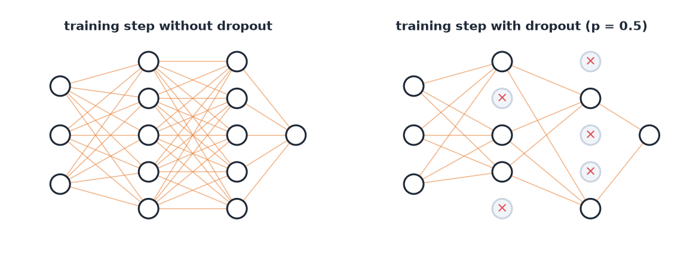
<sub>Dropout: in each training step a random set of neurons is switched off (×). The network cannot rely on any single neuron.</sub>

> [!NOTE]
> **From the course · Week 4 tutorial, Q6.** Why does dropout act as a regulariser?

<details>
<summary><b>Show the answer</b></summary>

- **Model averaging:** with $H$ neurons (<sub>$H$ = number of neurons in the layer</sub>), each step trains one of $2^H$ thinned networks (each neuron is either on or off, so $2 \cdot 2 \cdots 2 = 2^H$ combinations). At test time the full network acts like an average of all of them.
- **No co-adaptation:** a neuron cannot rely on a specific partner neuron being present, so each one must learn something useful on its own.

</details>

Dropout is only active during training. At test time all neurons are used.

> [!NOTE]
> **From the course · Week 2 tutorial, Q6 and Practice exam C.1 (b)–(c).** (1) What happens if you tune the regularisation strength $\lambda$ by looking at the training loss? (2) A CNN gets 72% train / 70% validation accuracy, after a change 96% / 78%. Diagnose both.

<details>
<summary><b>Show the answer</b></summary>

1. The training loss is lowest with $\lambda = 0$ (<sub>$\lambda$ "lambda" = how strongly large weights are punished; 0 = not at all</sub>) and maximum capacity. You would always pick that, which is the overfitting solution. Tune $\lambda$ on **validation** data.
2. **72 / 70:** both low, small gap → underfitting; add capacity. **96 / 78:** large gap → overfitting; add augmentation, dropout or weight decay. Compare with the fitting figure in section 8.

</details>

## 9. Common mistakes

- Using softmax when several labels can be true at once. Use sigmoid per class instead.
- Judging a model by training loss. Only validation and test performance show generalisation.
- Changing several things at once. Then you cannot tell which change helped.
- Forgetting `optimizer.zero_grad()`. PyTorch then adds new gradients to old ones.

## 10. How this appears in A2

- 20 sigmoid outputs and BCE, because a meme can use several techniques.
- AdamW, warm-up then linear decay, gradient clipping, dropout, weight decay, early stopping.
- Class weights in the BCE (`pos_weight`) for rare techniques.

## Watch and read

- 3Blue1Brown, *But what is a neural network?* (19 min): https://www.youtube.com/watch?v=aircAruvnKk
- 3Blue1Brown, *Gradient descent, how neural networks learn*: https://www.youtube.com/watch?v=IHZwWFHWa-w
- 3Blue1Brown, *Backpropagation, intuitively*: https://www.youtube.com/watch?v=Ilg3gGewQ5U
- 3Blue1Brown, *Backpropagation calculus* (optional, maths): https://www.youtube.com/watch?v=tIeHLnjs5U8
- StatQuest, *The essential main ideas of neural networks*: https://www.youtube.com/watch?v=CqOfi41LfDw
- StatQuest, *Backpropagation main ideas*: https://www.youtube.com/watch?v=IN2XmBhILt4
- StatQuest, *ArgMax and SoftMax*: https://www.youtube.com/watch?v=KpKog-L9veg
- StatQuest, *Cross entropy*: https://www.youtube.com/watch?v=6ArSys5qHAU
- DeepLearningAI (Andrew Ng), *Vanishing/exploding gradients*: https://www.youtube.com/watch?v=qhXZsFVxGKo
- Book, free online: *Dive into Deep Learning*, multilayer perceptrons: https://d2l.ai/chapter_multilayer-perceptrons/index.html
- Book, free online: *Dive into Deep Learning*, optimisation: https://d2l.ai/chapter_optimization/index.html

---

## Cheat sheet

> [!IMPORTANT]
> **The 8 things to remember**
> 1. Neuron = weighted sum + bias → activation: $a = f(\mathbf{w}^\top\mathbf{x} + b)$.
> 2. No activation → no depth. Linear ∘ linear = linear.
> 3. **Output layer ↔ loss:** regression → linear + MSE · one class → softmax + CE · many classes → sigmoid each + BCE.
> 4. BCE $= -[y\log p + (1-y)\log(1-p)]$. Confident and wrong = huge loss.
> 5. Update rule: $w \leftarrow w - \eta\,\nabla_w L$. The learning rate $\eta$ is the most important setting.
> 6. Backprop = chain rule from output to input. In code: `zero_grad → backward → step`.
> 7. Adam/AdamW is the default. Warm-up protects pretrained weights.
> 8. Fight overfitting with: weight decay, dropout, augmentation, early stopping, fewer trainable weights.

> [!TIP]
> **Memory hooks**
> - **"Sigmoid = Several, Softmax = Single."** Both start with S; the second letter tells you: *se*veral true labels → sigmoid each, *si*ngle true label → softmax.
> - **Gradient descent = walking downhill in fog.** You only feel the slope under your feet (the gradient) and take a step against it. The learning rate is your stride length: too short and you never arrive, too long and you jump over the valley.
> - **"ZBS" for the training loop:** **Z**ero the grads, **B**ackward, **S**tep.
> - **Dropout = a sports team where random players sit out each match.** Nobody can rely on one star player, so everyone learns to play.
> - **Under/over:** *Under*fitting = *under*-prepared student (bad at practice and exam). *Over*fitting = student who memorised the practice answers (perfect at practice, bad at the new exam).

> [!TIP]
> **How to learn this chapter**
> - **Draw it:** sketch one neuron with three inputs, then a two-layer network. Label every weight and the activation.
> - **Compute by hand once:** the BCE example above with $p = 0.6$ and $p = 0.99$. Feel how the log behaves.
> - **Explain out loud in 60 seconds:** "Why does a deep network need a non-linear activation?" If you stumble, re-read section 2.
> - **Active recall:** close this file and write the table in section 4 from memory.
