# 01 · Neural network basics

> [!NOTE]
> **Colour code for all formulas:** $\textcolor{#3b82f6}{\text{input / data}}$ · $\textcolor{#e8833a}{\text{learned weights}}$ · $\textcolor{#22a06b}{\text{model output}}$ · $\textcolor{#e5484d}{\text{true label}}$ · $\textcolor{#a855f7}{\text{setting you choose}}$

**Why this comes first.** Everything later is built from the same parts. A Transformer is still layers, weights, a loss and gradient descent. If these parts are clear, the rest is just new ways to wire them.

**Course material:** Week 2 lecture (`Week 2/W2_Lecture2_Part1_DeepFeedForwardNetworks.pdf`), Week 2 notebook (`Week 2/L2_Week2_FeedForwardNets.ipynb`), Week 3 lectures (`Week 3/W3_Lecture3_Part1_NeuralNetworkOptimization.pdf`: *Empirical Risk*, *Challenges*, *Momentum*, *RMSprop*, *Adam*, *Parameter Initialization*, *Batch Normalization*; `Week 3/W3_Lecture3_Part2_Regularization.pdf`), Week 3 lab (`Week 3/Lab3_Week3_Optimization.ipynb`: optimisers, learning rates, initialisation, regularisation). Tutorials of Weeks 2, 3 and 4 (`Week 2/COSC2779_Tute2_sol.pdf`, `Week 3/COSC2779_Tute3_sol.pdf`, `Week 4/COSC2779_Tute4_tex.pdf`).


> [!TIP]
> **Play with it** (interactive, in the browser). Do this before or after reading; seeing it move is the fastest way in.
> - [TensorFlow Playground](https://playground.tensorflow.org/): pick the XOR dataset (top-left, 'exclusive or'). Remove all hidden layers and press play: it fails. Add one hidden layer with ReLU: it works. Then set the learning rate to 3 and watch it explode.
> - [Distill: Why momentum really works](https://distill.pub/2017/momentum/): drag the step-size and momentum sliders and watch the path zig-zag or glide.
> - [MLU-Explain: neural networks](https://mlu-explain.github.io/neural-networks/): a scrolling visual story of neurons, layers and training.
> - [MLU-Explain: bias and variance](https://mlu-explain.github.io/bias-variance/): see underfitting and overfitting change as model complexity grows.
> - [Loss landscape gallery](https://losslandscape.com/): 3-D renders of real network loss surfaces.

---

## 1. What a model is

A model is a function with adjustable numbers inside. The numbers are called **parameters** or **weights**. Training means finding weights that make the outputs useful.

Example: predict a house price from its size.

$$
\textcolor{#22a06b}{\hat{y}} = \textcolor{#e8833a}{w}\cdot\textcolor{#3b82f6}{x} + \textcolor{#e8833a}{b}
$$

<sub>$\hat y$ = predicted price · $x$ = size of the house · $w$ = how much the price rises per square metre · $b$ = base price (bias). Training picks $w$ and $b$ so that $\hat y$ is close to the real price $y$.</sub>

This is linear regression. A neural network does the same thing, but with many more weights and some non-linear steps in between.

## 2. One neuron

A neuron does two things. First, a weighted sum plus a bias:

$$
z = \textcolor{#e8833a}{w_1}\textcolor{#3b82f6}{x_1} + \textcolor{#e8833a}{w_2}\textcolor{#3b82f6}{x_2} + \dots + \textcolor{#e8833a}{w_n}\textcolor{#3b82f6}{x_n} + \textcolor{#e8833a}{b} \;=\; \textcolor{#e8833a}{\mathbf{w}}^\top\textcolor{#3b82f6}{\mathbf{x}} + \textcolor{#e8833a}{b}
$$

<sub>$x_1 \dots x_n$ = the $n$ input numbers · $w_1 \dots w_n$ = one weight per input · $b$ = bias, a constant added at the end · $z$ = the result, one single number · $\mathbf{w}^\top\mathbf{x}$ = short vector notation for the same sum ($\mathbf{w}$, $\mathbf{x}$ = all weights / all inputs as lists, $^\top$ = "transpose", here it just means "multiply pairwise and add up").</sub>

Then an activation function:

$$
\textcolor{#22a06b}{a} = f(z)
$$

<sub>$x_i$ = the inputs · $w_i$ = one weight per input · $b$ = bias · $z$ = the raw score (also called *logit* or *pre-activation*) · $f$ = activation function · $a$ = the neuron's output.</sub>


<sub>One neuron as a picture: inputs, weights, sum, activation, output.</sub>

Common activation functions:

| Name | Formula | Output range | Where it is used |
|---|---|---|---|
| Sigmoid | $\sigma(z) = \dfrac{1}{1 + e^{-z}}$ | 0 to 1 | output for yes/no questions |
| tanh | $\tanh(z) = \dfrac{e^{z} - e^{-z}}{e^{z} + e^{-z}}$ | −1 to 1 | inside RNNs |
| ReLU | $\max(0, z)$ | 0 to ∞ | default in hidden layers |
| Softmax | $\dfrac{e^{z_i}}{\sum_j e^{z_j}}$ | each 0 to 1, all sum to 1 | output when exactly one class is correct |


<sub>The three activations you meet most. Sigmoid squashes to 0…1, tanh to −1…1, ReLU cuts off negatives.</sub>

**Simply put:** ReLU: positive stays, negative becomes 0. Sigmoid: squeezes any number into 0…1. tanh: the same, but into −1…1. Softmax: turns a list of scores into percentages that add up to 100%.

### What an activation function really is (in plain terms)

Yes: it is a **fixed function that you choose before training**. It is not learned. After a layer has computed its weighted sums $z$ (one number per neuron), the same function is applied to **each number separately**. Then the result goes to the next layer.


<sub>Four neurons of one layer. Left: their weighted sums $z$. Middle: ReLU sets negatives to 0. Right: sigmoid squashes every value into 0…1.</sub>

```python
import torch
z = torch.tensor([-2.0, 0.5, 3.0, -0.7])   # weighted sums of 4 neurons (W·x + b)
torch.relu(z)      # tensor([0.0000, 0.5000, 3.0000, 0.0000])
torch.sigmoid(z)   # tensor([0.1192, 0.6225, 0.9526, 0.3318])
```

**Why not something simple like $f(z) = 4z$?** Because $4z$ is linear: it only scales. Stack two layers with it and you get $4\,W_2\,(4\,W_1 x) = (16\,W_2 W_1)\,x$, which is again just one matrix times $x$. Ten such layers are still one straight line, so they cannot solve XOR. The activation must **bend** somewhere. ReLU bends at 0, sigmoid and tanh bend smoothly.

<details>
<summary><b>Check it yourself in code</b> (two linear layers collapse into one)</summary>

```python
import torch
W1, W2 = torch.randn(5, 2), torch.randn(1, 5)
x = torch.randn(2)
two_layers = W2 @ (4 * (W1 @ x))     # layer 1, "activation" f(z) = 4z, layer 2
one_layer  = (4 * W2 @ W1) @ x       # one single matrix does exactly the same
print(torch.allclose(two_layers, one_layer))   # True: the extra layer added nothing
torch.allclose(W2 @ torch.relu(W1 @ x), one_layer)  # usually False: ReLU really changes the function
```

</details>

**Why the activation matters.** Without it, stacking layers gives just another linear function. Two linear steps in a row are still one linear step. The non-linearity lets the network learn curved decision boundaries. The classic example is XOR. No straight line separates its classes, but a network with one hidden layer and ReLU can.


<sub>XOR: blue where x₁ and x₂ have the same sign, red where they differ. A linear model can only draw one straight line and stays at 50%. One hidden layer with ReLU bends the boundary and separates all four clusters.</sub>

> [!NOTE]
> **From the course · Week 3 tutorial, Q2.** A network has one hidden layer $a = \sigma_1(w_1x_1 + w_2x_2 + b)$ and output $y = \sigma_2(w_3 a + b_2)$. Show that if $\sigma_1$ is linear, $\sigma_1(z) = \alpha z$, the network is just a one-layer perceptron.
>
> <sub>$x_1, x_2$ = the two inputs · $w_1, w_2$ = weights into the hidden neuron · $b$ = its bias · $\sigma_1$ ("sigma one") = the hidden neuron's activation function (here $\sigma$ is just a name for *some* activation, not necessarily the sigmoid) · $a$ = the hidden neuron's output · $w_3$ = weight from the hidden neuron to the output · $b_2$ = output bias · $\sigma_2$ = the output's activation · $y$ = the network's output · $\alpha$ ("alpha") = a fixed number; $\sigma_1(z) = \alpha z$ means "the activation only multiplies by $\alpha$", e.g. $\alpha = 4$ is your $4z$.</sub>

<details>
<summary><b>Show the answer</b></summary>

**Idea:** if the hidden activation only multiplies, the two layers can be merged into one.

1. With $\sigma_1(z) = \alpha z$ the hidden output is $a = \alpha(w_1x_1 + w_2x_2 + b)$.
2. Put that $a$ into the output formula and multiply out the brackets:

$$y = \sigma_2\big(\alpha w_3 w_1\,x_1 + \alpha w_3 w_2\,x_2 + (\alpha w_3 b + b_2)\big) = \sigma_2(\omega_1 x_1 + \omega_2 x_2 + \beta)$$

3. Give the products new names: $\omega_1 = \alpha w_3 w_1$, $\omega_2 = \alpha w_3 w_2$, $\beta = \alpha w_3 b + b_2$.

<sub>$\omega_1, \omega_2$ ("omega") = the merged weights, just new names for those products · $\beta$ ("beta") = the merged bias.</sub>

The result $y = \sigma_2(\omega_1 x_1 + \omega_2 x_2 + \beta)$ is **one neuron** (a perceptron): weighted sum of the inputs plus bias, then one activation. The hidden layer added nothing.

**With numbers:** $\alpha = 4,\ w_1 = 1,\ w_2 = 3,\ b = 0.5,\ w_3 = 2,\ b_2 = -1$ gives $\omega_1 = 4\cdot2\cdot1 = 8$, $\omega_2 = 4\cdot2\cdot3 = 24$, $\beta = 4\cdot2\cdot0.5 - 1 = 3$. So the "two-layer" network is exactly $y = \sigma_2(8x_1 + 24x_2 + 3)$.

</details>

## 3. Layers and networks

A layer is many neurons side by side. In matrix form, one layer computes:

$$
\textcolor{#22a06b}{\mathbf{h}} = f\!\left(\textcolor{#e8833a}{W}\,\textcolor{#3b82f6}{\mathbf{x}} + \textcolor{#e8833a}{\mathbf{b}}\right)
$$

<sub>$\mathbf{x}$ = input vector · $W$ = weight matrix, one row per neuron · $\mathbf{b}$ = one bias per neuron · $f$ = activation, applied to each element · $\mathbf{h}$ = the layer's output vector, which is the next layer's input.</sub>


<sub>A feed-forward network with two hidden layers. Every line is one weight that training adjusts.</sub>

- A **feed-forward network** (also called MLP) stacks layers. The output of one layer is the input of the next.
- **Hidden layers** are the layers between input and output.
- **Depth** is the number of layers. **Width** is the number of neurons per layer.
- **Universal approximation theorem:** one hidden layer with enough neurons can approximate any reasonable function. In practice, deeper networks need far fewer neurons for the same job. They also learn features in steps: simple patterns first, complex ones later.

## 4. The output layer and the loss must match the task

The **loss function** measures how wrong the model is on one example. Training minimises the average loss.

| Task | Example | Output layer | Loss |
|---|---|---|---|
| Regression | house price | 1 neuron, no activation | mean squared error (MSE) |
| Binary classification | spam or not | 1 neuron, sigmoid | binary cross-entropy (BCE) |
| Multi-class (one correct class) | digit 0–9 | K neurons, softmax | cross-entropy |
| Multi-label (any number of classes) | techniques in a meme (A2) | K neurons, sigmoid each | BCE for each class, then average |

**Mean squared error** over $N$ examples:

$$
\text{MSE} = \frac{1}{N}\sum_{i=1}^{N}\left(\textcolor{#e5484d}{y_i} - \textcolor{#22a06b}{\hat{y}_i}\right)^2
$$

<sub>$y_i$ = true value · $\hat y_i$ = prediction · squaring makes every error positive and punishes big errors more.</sub>

**Binary cross-entropy** for one example:

$$
\text{BCE} = -\Big[\, \textcolor{#e5484d}{y}\,\log \textcolor{#22a06b}{p} \;+\; (1 - \textcolor{#e5484d}{y})\,\log(1 - \textcolor{#22a06b}{p}) \,\Big]
$$

<sub>$y$ = true label, 0 or 1 · $p$ = predicted probability that the label is 1. Only one of the two terms is active: if $y = 1$ the loss is $-\log p$; if $y = 0$ it is $-\log(1 - p)$.</sub>

Worked example. The true label is 1.
- If the model says $p = 0.9$, the loss is $-\log 0.9 = 0.105$. Small loss, good.
- If the model says $p = 0.1$, the loss is $-\log 0.1 = 2.303$. Large loss, bad.

The log punishes confident mistakes very hard. That is what we want.

**Cross-entropy for K classes** (with softmax output):

$$
\text{CE} = -\sum_{k=1}^{K} \textcolor{#e5484d}{y_k}\,\log \textcolor{#22a06b}{p_k} = -\log \textcolor{#22a06b}{p_{\text{true class}}}
$$

<sub>$y_k$ = 1 for the correct class and 0 for all others (one-hot) · $p_k$ = softmax probability of class $k$. Only the probability of the correct class matters.</sub>

> [!NOTE]
> **From the course · Week 3 tutorial, Q6.** A network must say whether an image contains a cat and/or a dog. Some images contain both. Which output activation and loss?

<details>
<summary><b>Show the answer</b></summary>

Two valid designs:
- **Two sigmoid outputs** (cat yes/no, dog yes/no) and the sum of two binary cross-entropies. This is multi-label, exactly like A2 with 20 techniques instead of 2.
- **Four softmax outputs** for the combinations (none, cat, dog, both) with categorical cross-entropy. This works for 2 labels, but with 20 labels it would need $2^{20}$ classes, so it does not scale.

</details>

**Where these losses come from.** They are not arbitrary. They follow from **maximum likelihood**: choose the weights that make the observed labels most probable. For Bernoulli (yes/no) labels this gives BCE. For Gaussian noise in regression it gives MSE.

## 5. Gradient descent

We want weights with low loss. The **gradient** $\nabla_w L$ is the vector of partial derivatives of the loss with respect to every weight. It points in the direction where the loss grows fastest. So we step the other way:

$$
\textcolor{#e8833a}{w}_{\text{new}} = \textcolor{#e8833a}{w}_{\text{old}} - \textcolor{#a855f7}{\eta}\,\nabla_{w} L
$$

<sub>$w$ = any weight · $\eta$ (eta) = learning rate, the step size · $\nabla_w L$ = gradient of the loss $L$ with respect to $w$, i.e. how much $L$ changes when $w$ changes a little.</sub>

**Simply put:** the gradient points uphill. Take a small step the other way. Repeat until the loss stops falling.


<sub>With two weights, the loss is a landscape. Gradient descent (red) always steps downhill. Real networks have millions of weights, but the picture is the same idea.</sub>

- $\eta$ too small: training is very slow.
- $\eta$ too large: the loss jumps around or explodes. A typical sign of a too-large learning rate is a loss curve that oscillates.


<sub>The same loss, three learning rates. Each dot is one update step, starting at w = −1.</sub>

> [!NOTE]
> **From the course · Week 4 tutorial, Q2.** What goes wrong if the learning rate is too high, and if it is too low? How do you see it?

<details>
<summary><b>Show the answer</b></summary>

- **Too high:** the loss does not converge and can even grow. In the loss-vs-iteration plot it oscillates wildly (right panel of the figure above).
- **Too low:** the loss falls very slowly, almost in a straight line, and may not reach a good minimum in time (left panel).
- Always plot the loss against the iterations to tell which case you have.

</details>

**What we actually minimise: the empirical risk.** We want a low loss on *all* data the model will ever see. That expected loss is called the **risk**. But we do not know the true data distribution. We only have the training set. So we minimise the average loss on the training set instead, plus a penalty:

$$
\hat{R}(\textcolor{#e8833a}{w}) = \frac{1}{N}\sum_{i=1}^{N} L\big(\textcolor{#e5484d}{y_i},\ h(\textcolor{#3b82f6}{x_i};\ \textcolor{#e8833a}{w})\big) \;+\; \textcolor{#a855f7}{\lambda}\,R(\textcolor{#e8833a}{w})
$$

<sub>$\hat R$ ("R hat") = the empirical risk, our training objective · $N$ = number of training examples · $x_i, y_i$ = input and true label of example $i$ · $h(x_i; w)$ = the model's prediction with weights $w$ · $L$ = the loss for one example · $R(w)$ = a regularisation penalty, for example the sum of squared weights · $\lambda$ ("lambda") = how strong the penalty is.</sub>

This is called **empirical risk minimisation**. It is the reason a model can do well on training data and badly on new data: we only ever optimised the training average.

**Mini-batch SGD.** The exact gradient needs the whole dataset. That is slow. Instead we estimate it from a small random batch, for example 16 or 32 examples. The estimate is noisy, but it is cheap, and the noise can even help escape bad regions. One pass over all training data is one **epoch**.

**Choosing the batch size** (Week 3 slides):
- Larger batches give a more accurate gradient, but the gain shrinks. The error of an average falls only with $\sqrt{n}$ (<sub>$n$ = batch size</sub>): 4 times more examples only halve the noise.
- Memory grows with the batch size. On GPUs, powers of 2 (16, 32, 64) often run fastest.
- Very small batches leave the GPU idle, but their noise has a mild **regularising** effect.
- **Shuffle the data every epoch.** Then consecutive batches are independent, and the model does not learn the order of the data.

**Better optimisers.**
- **Momentum** keeps a running average of past gradients. It smooths the path and speeds up in consistent directions. It fixes **pathological curvature**: a valley that is steep across and flat along. Plain gradient descent zig-zags across such a valley; momentum cancels the zig-zag and keeps the steady direction.
- **RMSProp** divides each weight's step by a running average of its squared gradients. Weights with large gradients take smaller steps.
- **Adam** combines momentum and RMSProp. It is the default choice. **AdamW** is Adam with weight decay done correctly. Transformers use AdamW.
- **Memory:** plain SGD needs the least. Momentum stores one extra number per weight. Adam stores two (the running average of the gradient and of its square). For very large models this matters, and it is one reason why LoRA (doc 05) saves memory.


<sub>Animation: plain gradient descent creeps along the flat valley, SGD wobbles because each mini-batch gives a noisy slope, momentum builds up speed, Adam adapts its step per weight.</sub>

**Learning-rate schedules.** Fine-tuning large models often uses a **warm-up**: the learning rate starts near zero and rises over the first steps. Then it slowly decays. Large early steps would otherwise damage the pretrained weights.

## 6. Backpropagation

A network is a chain of functions. The **chain rule** of calculus gives the derivative of the loss with respect to any weight:

$$
\frac{\partial L}{\partial \textcolor{#e8833a}{w}} = \frac{\partial L}{\partial \textcolor{#22a06b}{a}}\cdot\frac{\partial \textcolor{#22a06b}{a}}{\partial z}\cdot\frac{\partial z}{\partial \textcolor{#e8833a}{w}}
$$

<sub>Read it right to left: how $z$ reacts to $w$, times how $a$ reacts to $z$, times how the loss reacts to $a$. Backpropagation multiplies these local derivatives from the output back to the input.</sub>

**Simply put:** start at the error and walk backwards. At every weight, ask: how much did you add to the error? That number is the weight's gradient.


<sub>Forward pass (blue) computes the loss. Backward pass (red) multiplies the local slopes to get the gradient for w.</sub>

> [!NOTE]
> **From the course · Week 4 tutorial, Q1.** Input x = (1, 2), target y = 3, MSE loss, three ReLU hidden units, linear output, learning rate 0.1, all biases 0. Hidden weights: unit 1 (2, 1), unit 2 (1, −2), unit 3 (1, 2). Output weights (−1, 3, 2). Compute the gradients.

<details>
<summary><b>Show the answer, as a step-by-step to-do list</b></summary>

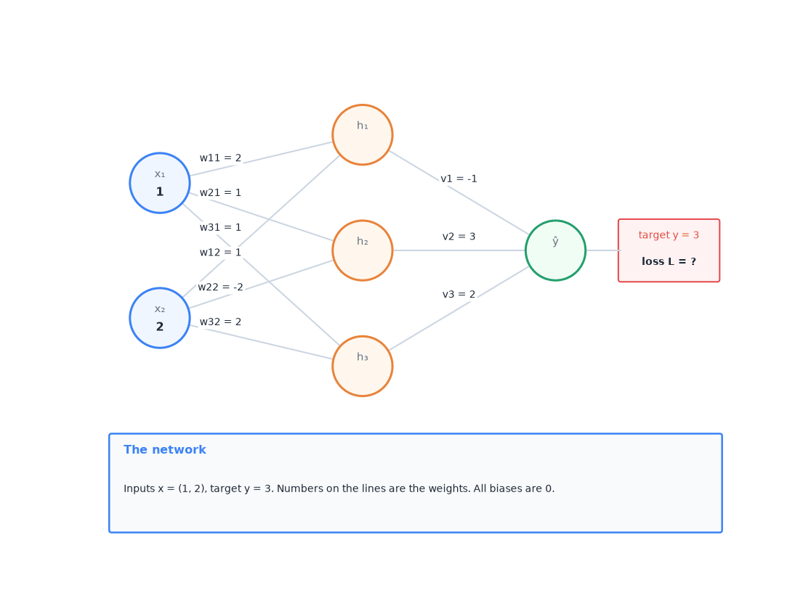
<sub>The animation runs through every step below (about 80 seconds). Orange lines = the weights used in this step. Red = gradients and signals going backwards. Green = new weights after the update.</sub>

**Names.** x₁ = 1 and x₂ = 2 are the inputs. w₁₁ is the weight from x₁ to hidden neuron 1, w₁₂ from x₂ to neuron 1, and so on (first number = neuron, second = input). z₁, z₂, z₃ are the weighted sums of the hidden neurons. h₁, h₂, h₃ are their outputs after ReLU. v₁, v₂, v₃ are the output weights. ŷ ("y hat") is the prediction, y = 3 the target. L is the loss.

**Two words you need:**
- **Signal** at a value (ŷ, h or z) = how much the loss changes when this value goes up by 1. Written ∂L/∂ŷ, ∂L/∂h, ∂L/∂z. Positive = the value should go down. Negative = it should go up.
- **Gradient** of a weight = the same question for a weight: how much the loss changes when this weight goes up by 1.

**Colours:** <span style="color:#3b82f6">blue</span> = inputs x · <span style="color:#e8833a">orange</span> = weights · <span style="color:#22a06b">green</span> = forward values (z, h, ŷ) · <span style="color:#e5484d">red</span> = signals. A number keeps its colour wherever it is used again.

**Part A · Forward pass**

- [ ] **A1–A3 · Hidden neurons:** z = w·x₁ + w·x₂, then ReLU (positive stays, negative → 0).

| neuron | z = w·<span style="color:#3b82f6">x₁</span> + w·<span style="color:#3b82f6">x₂</span> | h = ReLU(z) |
|---|---|---|
| 1 | <span style="color:#e8833a">2</span>·<span style="color:#3b82f6">1</span> + <span style="color:#e8833a">1</span>·<span style="color:#3b82f6">2</span> = <span style="color:#22a06b">4</span> | <span style="color:#22a06b">4</span> |
| 2 | <span style="color:#e8833a">1</span>·<span style="color:#3b82f6">1</span> + <span style="color:#e8833a">(−2)</span>·<span style="color:#3b82f6">2</span> = <span style="color:#22a06b">−3</span> | <span style="color:#22a06b">0</span> |
| 3 | <span style="color:#e8833a">1</span>·<span style="color:#3b82f6">1</span> + <span style="color:#e8833a">2</span>·<span style="color:#3b82f6">2</span> = <span style="color:#22a06b">5</span> | <span style="color:#22a06b">5</span> |

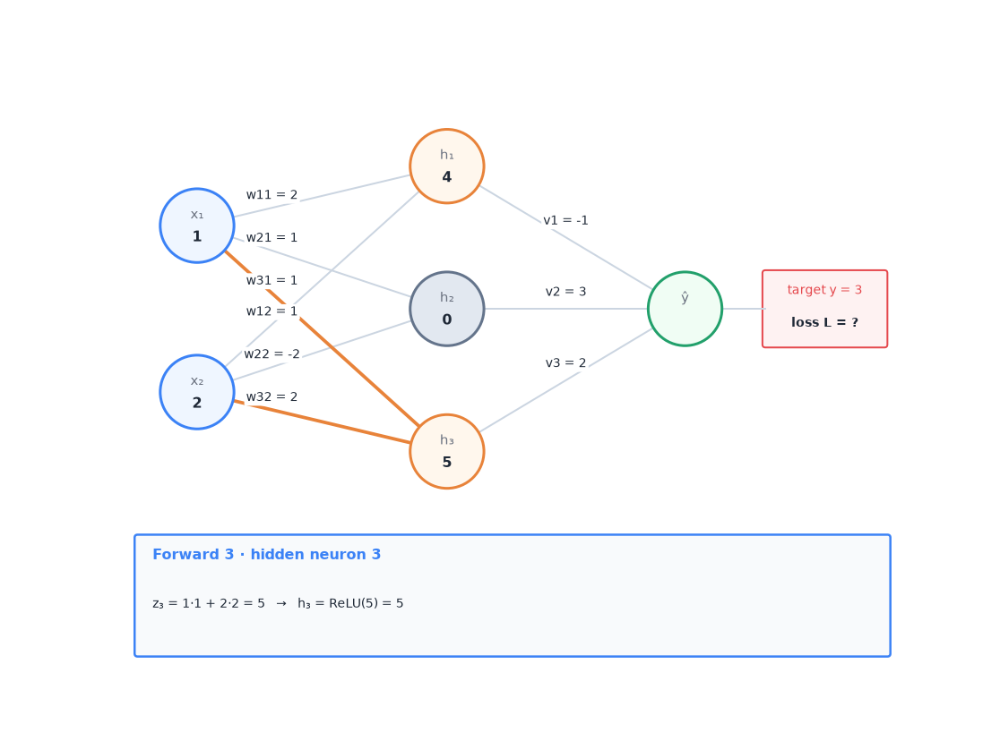


- [ ] **A4–A5 · Output and loss**

| | calculation | result |
|---|---|---|
| ŷ = v₁h₁ + v₂h₂ + v₃h₃ | <span style="color:#e8833a">(−1)</span>·<span style="color:#22a06b">4</span> + <span style="color:#e8833a">3</span>·<span style="color:#22a06b">0</span> + <span style="color:#e8833a">2</span>·<span style="color:#22a06b">5</span> | <span style="color:#22a06b">6</span> |
| L = (ŷ − y)² | (<span style="color:#22a06b">6</span> − 3)² | 9 |

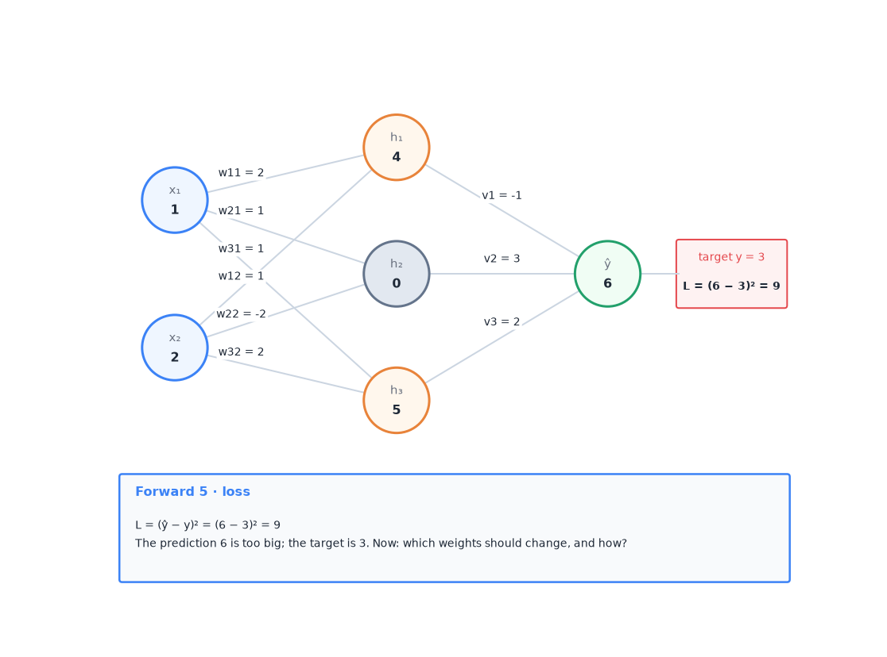


**Part B · Backward pass**

- [ ] **B1 · Signal at ŷ:** 2·(ŷ − y) = 2·(<span style="color:#22a06b">6</span> − 3) = <span style="color:#e5484d">6</span>. ŷ is too big and should go down.

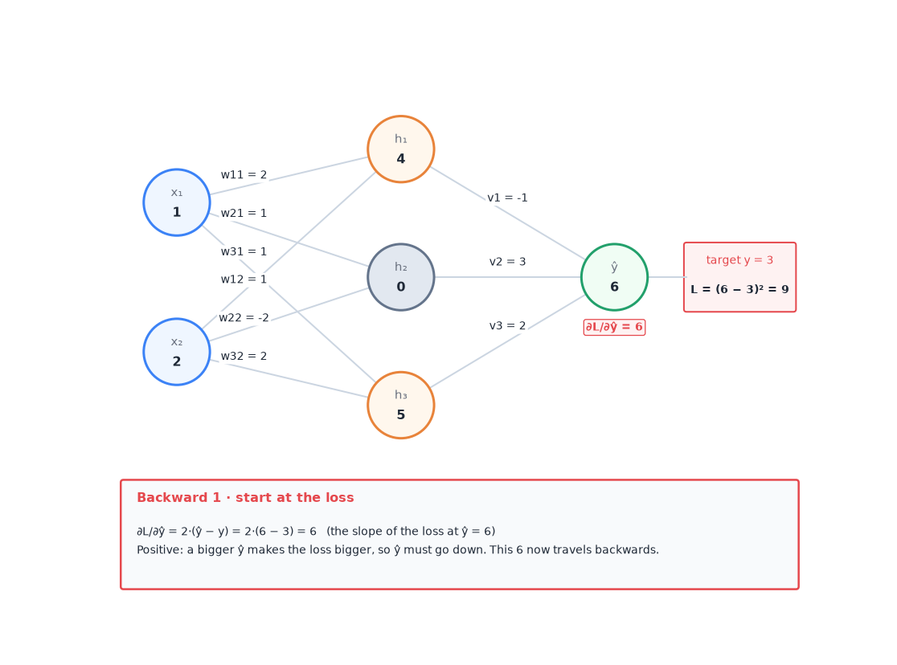


- [ ] **B2 · Output weights:** gradient = <span style="color:#e5484d">signal at ŷ</span> × the h it is multiplied with.

| weight | <span style="color:#e5484d">signal at ŷ</span> × <span style="color:#22a06b">h</span> | gradient |
|---|---|---|
| v₁ = <span style="color:#e8833a">−1</span> | <span style="color:#e5484d">6</span> · <span style="color:#22a06b">4</span> | **24** |
| v₂ = <span style="color:#e8833a">3</span> | <span style="color:#e5484d">6</span> · <span style="color:#22a06b">0</span> | **0** |
| v₃ = <span style="color:#e8833a">2</span> | <span style="color:#e5484d">6</span> · <span style="color:#22a06b">5</span> | **30** |
| output bias | <span style="color:#e5484d">6</span> · 1 | **6** |

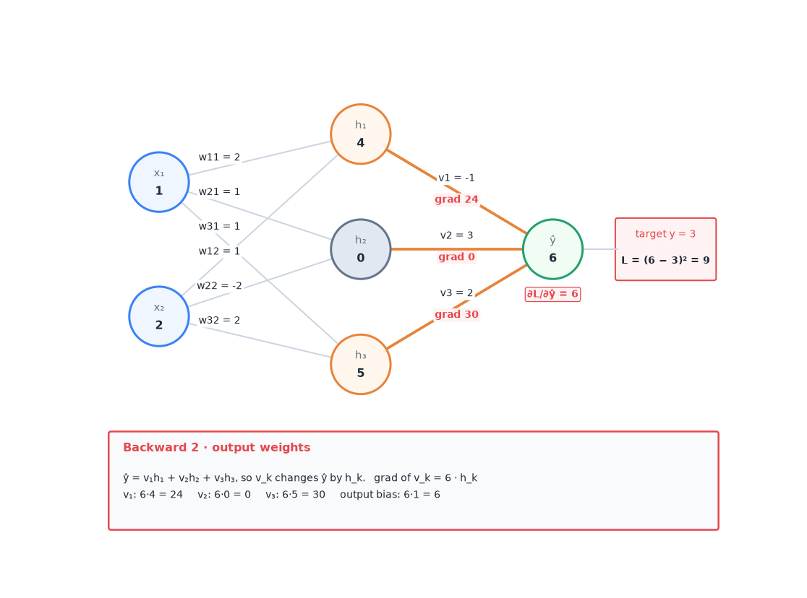


- [ ] **B3–B4 · Signal back to each hidden neuron:** × the weight in between, then through the ReLU (z positive → passes, z negative → 0).

| neuron | signal at h = <span style="color:#e5484d">6</span> × <span style="color:#e8833a">v</span> | z (from A) | ReLU | signal at z |
|---|---|---|---|---|
| 1 | <span style="color:#e5484d">6</span> · <span style="color:#e8833a">(−1)</span> = <span style="color:#e5484d">−6</span> | <span style="color:#22a06b">4</span> | passes | <span style="color:#e5484d">−6</span> |
| 2 | <span style="color:#e5484d">6</span> · <span style="color:#e8833a">3</span> = <span style="color:#e5484d">18</span> | <span style="color:#22a06b">−3</span> | blocks | <span style="color:#e5484d">0</span> |
| 3 | <span style="color:#e5484d">6</span> · <span style="color:#e8833a">2</span> = <span style="color:#e5484d">12</span> | <span style="color:#22a06b">5</span> | passes | <span style="color:#e5484d">12</span> |

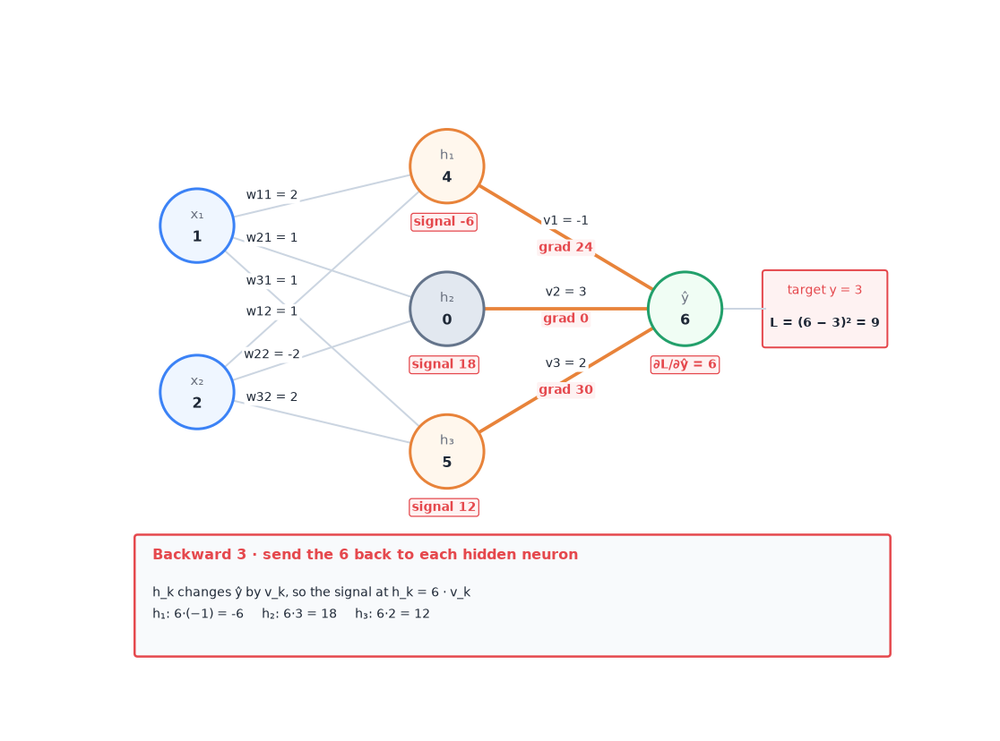

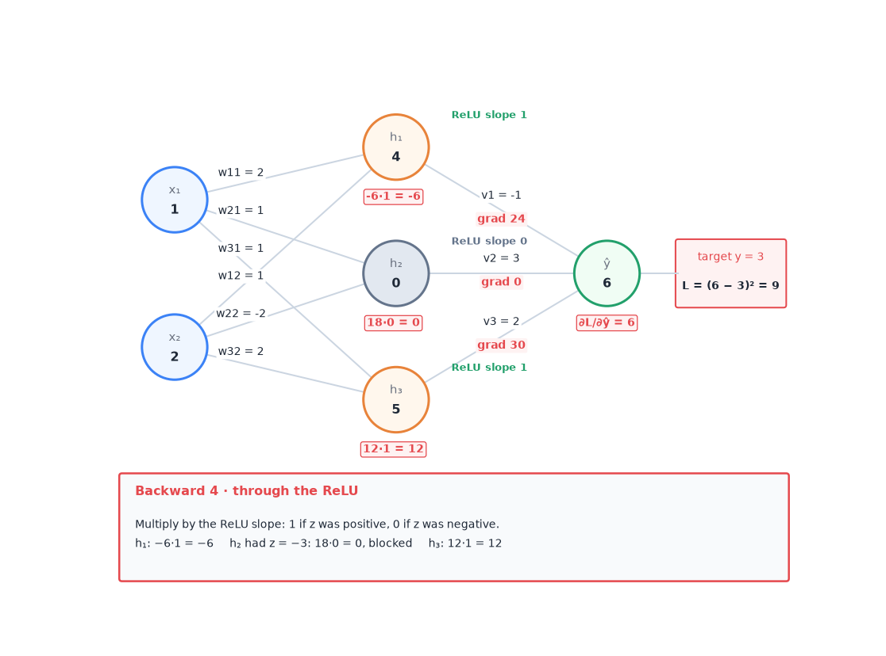


- [ ] **B5 · Hidden weights:** gradient = <span style="color:#e5484d">signal at z</span> × the input it is multiplied with (<span style="color:#3b82f6">x₁ = 1</span>, <span style="color:#3b82f6">x₂ = 2</span>, bias input 1).

| neuron | <span style="color:#e5484d">signal at z</span> | weight from x₁: × <span style="color:#3b82f6">1</span> | weight from x₂: × <span style="color:#3b82f6">2</span> | bias: × 1 |
|---|---|---|---|---|
| 1 | <span style="color:#e5484d">−6</span> | w₁₁: <span style="color:#e5484d">−6</span>·<span style="color:#3b82f6">1</span> = **−6** | w₁₂: <span style="color:#e5484d">−6</span>·<span style="color:#3b82f6">2</span> = **−12** | **−6** |
| 2 | <span style="color:#e5484d">0</span> | w₂₁: **0** | w₂₂: **0** | **0** |
| 3 | <span style="color:#e5484d">12</span> | w₃₁: <span style="color:#e5484d">12</span>·<span style="color:#3b82f6">1</span> = **12** | w₃₂: <span style="color:#e5484d">12</span>·<span style="color:#3b82f6">2</span> = **24** | **12** |

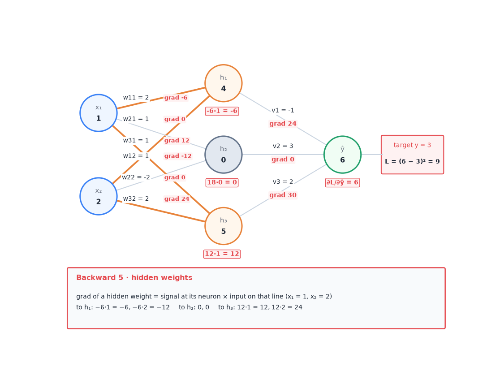


> [!TIP]
> **One rule for all of Part B:** gradient of a weight = <span style="color:#e5484d">signal</span> at its end × the number it is multiplied with. To move a signal one layer back: × the <span style="color:#e8833a">weight</span> in between, and × 0 if the ReLU was off.

**Part C · Update: new = old − 0.1 · gradient**

- [ ] **C1–C3**

| weight | old | gradient | new |
|---|---|---|---|
| v₁ | <span style="color:#e8833a">−1</span> | 24 | −1 − 2.4 = **−3.4** |
| v₂ | <span style="color:#e8833a">3</span> | 0 | 3 (unchanged) |
| v₃ | <span style="color:#e8833a">2</span> | 30 | 2 − 3.0 = **−1.0** |
| output bias | 0 | 6 | 0 − 0.6 = **−0.6** |
| w₁₁ | <span style="color:#e8833a">2</span> | −6 | 2 + 0.6 = **2.6** |
| w₁₂ | <span style="color:#e8833a">1</span> | −12 | 1 + 1.2 = **2.2** |
| bias₁ | 0 | −6 | 0 + 0.6 = **0.6** |
| w₃₁ | <span style="color:#e8833a">1</span> | 12 | 1 − 1.2 = **−0.2** |
| w₃₂ | <span style="color:#e8833a">2</span> | 24 | 2 − 2.4 = **−0.4** |
| bias₃ | 0 | 12 | 0 − 1.2 = **−1.2** |
| neuron 2 | (1, −2) | 0 | unchanged |

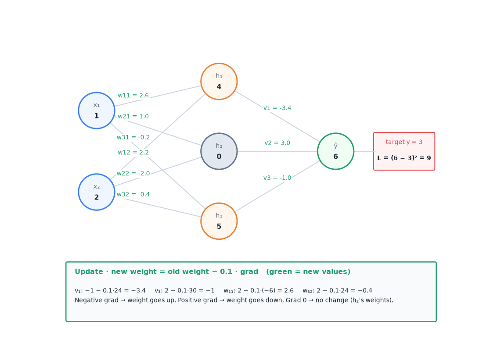


- [ ] **C4 · Read the signs.** Negative gradient → weight goes up. Positive gradient → weight goes down. Every change pushes ŷ down, towards 3.

**Part D · Check (beyond the tutorial)**
- [ ] **D1.** Run the forward pass again with the new weights: h₁ = 2.6·1 + 2.2·2 + 0.6 = 7.6, h₂ = 0, h₃ = ReLU(−0.2 − 0.8 − 1.2) = 0, so ŷ = −3.4·7.6 − 0.6 = **−26.4**. The direction was right, but the step was far too big: ŷ jumped from 6 past 3 to −26.4, and the loss went from 9 to 867.
- [ ] **D2.** With learning rate 0.001 instead, ŷ = 5.57 and the loss falls from 9 to 6.6. **The gradient gives the direction; the learning rate decides the step size.** This is exactly the "learning rate too high" problem of the next tutorial question.

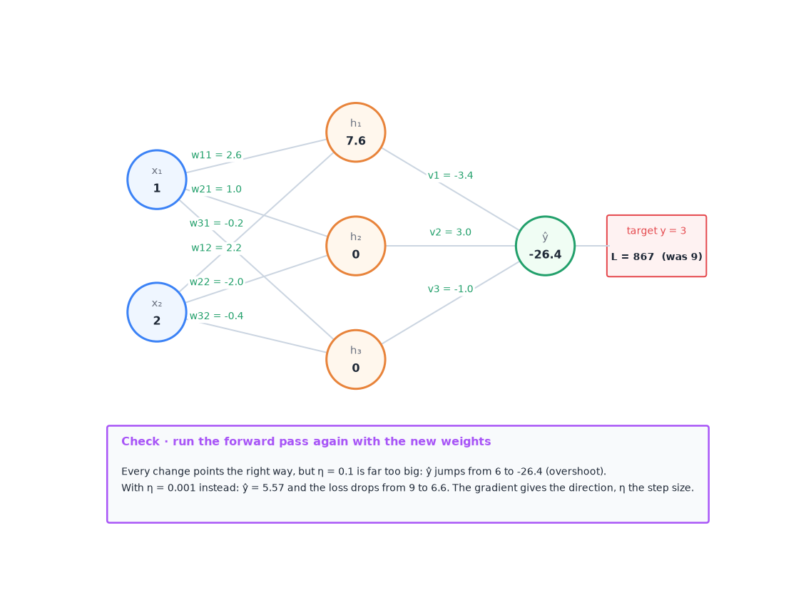

</details>

Backpropagation reuses intermediate results, so it costs about as much as one forward pass. In PyTorch you never write it by hand:

```python
loss = loss_fn(model(x), y)
optimizer.zero_grad()   # clear old gradients
loss.backward()         # backpropagation: compute all gradients
optimizer.step()        # gradient descent: update the weights
```

These four lines are the core of every training loop in the course and in A2.

## 7. Practical training details

### 7.1 Initialisation

Gradient descent must start somewhere. The starting weights decide whether training works at all, how fast it converges, and which minimum it ends in.

**Rule 1: break the symmetry.** Two neurons with the same inputs and the same starting weights compute the same output. They then get the same gradient and stay identical forever. So weights start **random**, never all equal. Biases can start at 0.

**Rule 2: get the scale right.** Each layer multiplies the signal by its weights.
- Weights too small: the signal shrinks layer by layer. Gradients vanish and learning is very slow.
- Weights too large: the signal grows layer by layer. Gradients explode and training is unstable.
- Goal: activations keep mean 0 and the **same variance in every layer**.

$$
\textcolor{#e8833a}{W^{(l)}} \sim \mathcal{N}\!\Big(0,\ \frac{1}{n^{(l-1)}}\Big)\ \ \text{(Xavier)} \qquad\qquad \textcolor{#e8833a}{W^{(l)}} \sim \mathcal{N}\!\Big(0,\ \frac{2}{n^{(l-1)}}\Big)\ \ \text{(He, for ReLU)}
$$

<sub>$W^{(l)}$ = the weight matrix of layer $l$ · $\sim \mathcal{N}(0, v)$ = "drawn at random from a normal (bell-curve) distribution with mean 0 and variance $v$" · $n^{(l-1)}$ = number of neurons in the previous layer, i.e. how many inputs each neuron adds up. More inputs → smaller weights, so the sum keeps the same size. He uses 2 instead of 1 because ReLU sets about half of the values to 0.</sub>

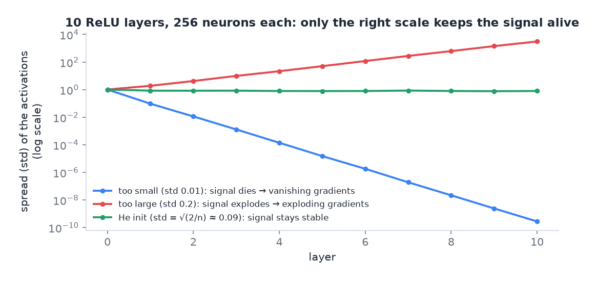
<sub>A real experiment with 10 ReLU layers. Too small: the spread of the activations drops by a factor of 10 per layer. Too large: it grows by about 2 per layer. He initialisation keeps it at about 1.</sub>

> [!NOTE]
> **From the course · Week 3 lecture, revision question.** What happens if all the weights of a neural network are initialised to 0?

<details>
<summary><b>Show the answer</b></summary>

All neurons in a layer compute the same output and receive the same gradient, so they stay identical: the layer behaves like a single neuron. (With ReLU and zero weights, the gradients of the hidden weights are even exactly 0, so they never move.) Random initialisation breaks this symmetry.

</details>

### 7.2 Normalisation

**Input normalisation.** Scale every input feature to mean 0 and standard deviation 1, using statistics from the **training** data only:

$$
\tilde{x}_j = \frac{\textcolor{#3b82f6}{x_j} - \mu_j}{\sigma_j}
$$

<sub>$x_j$ = feature $j$ of one example · $\mu_j$ ("mu") = mean of feature $j$ over the training set · $\sigma_j$ ("sigma") = its standard deviation · $\tilde x_j$ ("x tilde") = the normalised feature. Gradient descent works much better when all features have similar ranges.</sub>

**Batch normalisation (BatchNorm).** Do the same *inside* the network. For each neuron, normalise its weighted sums $z$ over the current mini-batch, then let the network rescale them:

$$
\mu_B = \frac{1}{m}\sum_{i=1}^{m} z_i, \qquad \sigma_B^2 = \frac{1}{m}\sum_{i=1}^{m}(z_i - \mu_B)^2, \qquad
\hat{z}_i = \frac{z_i - \mu_B}{\sqrt{\sigma_B^2 + \epsilon}}, \qquad
\tilde{z}_i = \textcolor{#e8833a}{\gamma}\,\hat{z}_i + \textcolor{#e8833a}{\beta}
$$

<sub>$z_i$ = the weighted sum of one neuron for example $i$ of the batch · $m$ = batch size · $\mu_B$, $\sigma_B^2$ = mean and variance of that neuron over the batch · $\epsilon$ ("epsilon") = a tiny number such as $10^{-5}$ that prevents division by zero · $\hat z_i$ = normalised value (mean 0, variance 1) · $\gamma$ ("gamma") and $\beta$ ("beta") = two **learned** numbers per neuron that scale and shift again. They let the network undo the normalisation if that is better. (Here $\beta$ is a shift, not the momentum setting.)</sub>

**Simply put:** inside the network, rescale each neuron's numbers so they sit around 0 with a spread of about 1. Then let the network stretch and shift them again if that helps.

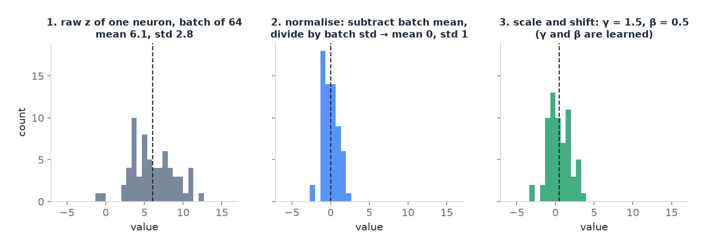
<sub>BatchNorm for one neuron over a batch of 64: raw values, normalised values, then scaled and shifted by the learned γ and β.</sub>

- **At test time** there may be only one example, so there is no batch to average over. During training BatchNorm keeps a **running average** of $\mu_B$ and $\sigma_B^2$. At test time it uses these fixed averages. In PyTorch, `model.eval()` switches this on.
- **Effects:** faster and more stable training, larger learning rates possible, less sensitivity to initialisation, and a small regularising effect (the batch statistics are a bit noisy).
- **Where:** the Week 3 slides normalise $z$, i.e. after the affine step and **before** the activation. ResNet puts BatchNorm after every convolution.
- **BatchNorm vs LayerNorm:** BatchNorm averages one feature **across the examples of a batch**. LayerNorm (Transformers, doc 04) averages **across the features of one example**. LayerNorm does not depend on the batch, so it works with batch size 1 and with padded sequences of different lengths.

> [!NOTE]
> **From the course · Week 4 tutorial, Q5 (and Week 3 revision question).** What happens if you use BatchNorm after an affine layer with a bias, $z = Wx + b$? What effect does increasing the bias have?

<details>
<summary><b>Show the answer</b></summary>

None. BatchNorm subtracts the batch mean, and the mean of $Wx + b$ is $\text{mean}(Wx) + b$. So
$\hat z = \dfrac{Wx + b - \text{mean}(Wx) - b}{\sqrt{\sigma^2 + \epsilon}}$: the $b$ cancels. Increasing the bias changes nothing. The learned shift $\beta$ takes over its job, so layers followed by BatchNorm are usually built **without** a bias (`bias=False` in PyTorch).

<sub>$W$ = weight matrix · $x$ = layer input · $b$ = bias · mean(·) = average over the batch · $\sigma^2$ = batch variance · $\epsilon$ = tiny constant · $\beta$ = BatchNorm's learned shift.</sub>

</details>

### 7.3 Steep cliffs and exploding gradients

Deep and recurrent networks can have **cliffs** in the loss surface: regions so steep that one gradient step throws the weights far away. Gradients can also grow huge when many layers multiply them. **Gradient clipping** caps the length (norm) of the gradient vector before the update: if it is longer than a threshold, it is scaled down to the threshold, keeping its direction. A2 clips the gradient norm at 1.0.

**Simply put:** if a step would be too big, cut it down to a maximum length. The direction stays the same.

> [!NOTE]
> **From the course · Week 4 tutorial, Q3 and Q4.** What is a saddle point, and why can SGD help? And: sigmoid units saturate. Does switching to tanh fix it?

<details>
<summary><b>Show the answer</b></summary>

- **Saddle point:** the gradient is zero, but it is neither a minimum nor a maximum (it curves up in one direction and down in another). Plain gradient descent can stall there. SGD's noisy updates push it off.
- **Saturation:** the slope of sigmoid is tiny for large positive or negative $z$, so gradients vanish. **tanh does not fix it**: $\tanh(z) = 2\sigma(2z) - 1$ is just a stretched sigmoid with the same flat ends (<sub>$\sigma$ = the sigmoid function $1/(1+e^{-z})$, $z$ = the neuron's weighted sum</sub>). Its one advantage is that its outputs are centred around 0. ReLU avoids saturation for positive $z$.

</details>

- **Local minima and saddle points.** The loss surface is not a simple bowl. In high dimensions, real local minima are rare, and for large networks most of them have a low loss anyway. Flat regions and saddle points are the main obstacle. Momentum and SGD noise help get through them. To check whether you are stuck at a critical point, plot the length of the gradient over time: if it does not shrink, the problem is not a minimum or saddle.

## 8. Overfitting, underfitting, regularisation

- **Underfitting:** the model is too weak. It is bad on training data and on new data.
- **Overfitting:** the model memorises the training data. It is very good on training data but worse on new data.
- **Generalisation gap:** the difference between training and validation performance.


<sub>Grey = the true pattern, blue = noisy training points, green = the model. Too simple misses the pattern; too flexible chases the noise.</sub>

**Capacity** is how complex the functions are that a model can fit. More layers, more neurons and less regularisation mean more capacity.

### 8.1 The bias–variance trade-off

Imagine training the same kind of model many times, each time on a different training set from the same source. Two things can go wrong:
- **Bias:** error from assumptions that are too simple. The model is wrong *in the same way* every time, whatever the training set. High bias → **underfitting**.
- **Variance:** error from being too sensitive to the particular training set. Each training set gives a quite different model, because the model also fits the noise. High variance → **overfitting**.

The expected error on new data splits into three parts:

$$
\text{expected test error} = \text{bias}^2 + \text{variance} + \text{noise}
$$

<sub>**bias** = how far the *average* model (over many training sets) is from the truth · **variance** = how much the individual models scatter around that average · **noise** = randomness in the labels themselves; no model can remove it ("irreducible error"). bias² means bias squared. The split is exact for the squared error; for other losses it is the same idea.</sub>

**Simply put:** bias = the model is too simple and misses in the same way every time. Variance = the model is too jumpy and changes a lot with every new training set.

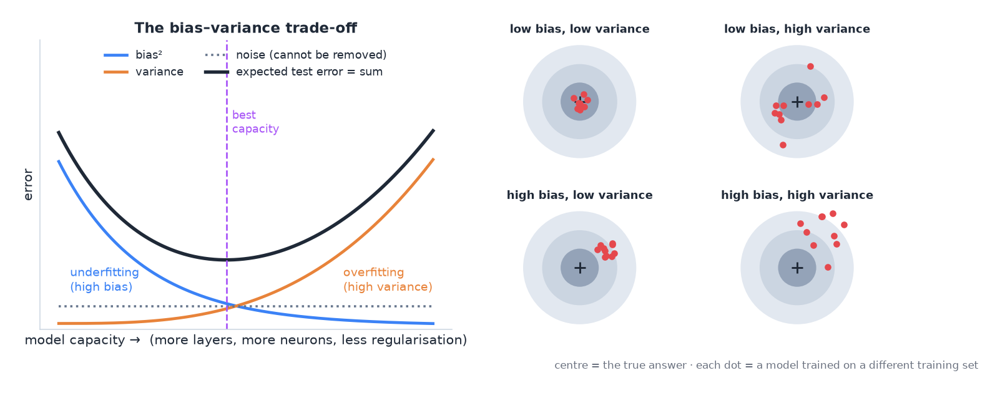
<sub>Left: more capacity lowers the bias but raises the variance; the total error is lowest in between. Right: each red dot is one model trained on a different training set; the centre is the true answer.</sub>

Making the model more complex lowers the bias and raises the variance. Regularising it does the opposite. You want the point where the sum is smallest. You find it with **validation** data, never with training data.

| Change | Bias | Variance | Why |
|---|---|---|---|
| More hidden units / wider or deeper layers | ↓ | ↑ | more capacity |
| Regularise the weights (L1, L2) | ↑ | ↓ | simpler functions preferred |
| Dropout | ↑ | ↓ | a form of regularisation |
| Early stopping | ↑ | ↓ | less time to fit the noise |
| More training data | no change | ↓ | the noise of single examples averages out |
| Data augmentation | ≈ no change | ↓ | acts like more data |

> [!NOTE]
> **From the course · Week 2 tutorial, Q4; Week 3 tutorial, Q1; Week 4 tutorial, Q8.** (1) What is the trade-off between bias and variance? (2) What does adding hidden units to a one-hidden-layer network do to bias and variance? (3) What do weight regularisation, wider layers, dropout and more training data do to them?

<details>
<summary><b>Show the answer</b></summary>

1. **Bias** is error from too simple assumptions; it causes underfitting. **Variance** is error from too much complexity; the model follows the noise of its training set and overfits. Test error ≈ bias² + variance + irreducible noise. More complexity trades lower bias for higher variance, so you look for the complexity where the total is lowest (on validation data).
2. More hidden units = more complex model: **bias down, variance up**.
3. Regularising the weights: bias ↑, variance ↓. Wider layers: bias ↓, variance ↑. Dropout: bias ↑, variance ↓. More training data: bias unchanged, variance ↓.

</details>

### 8.2 Regularisation

**Regularisation** is any change to the learning algorithm that aims to lower the error on new data, not the training error (Goodfellow, ch. 7). Most methods limit the model's capacity. They trade a little more bias for less variance.

**L2 regularisation / weight decay** adds a penalty for large weights to the loss:

$$
L_{\text{total}} = L_{\text{data}} + \textcolor{#a855f7}{\lambda}\sum_{j} \textcolor{#e8833a}{w_j}^2
$$

<sub>$L_{\text{data}}$ = the normal loss · $\lambda$ = strength of the penalty · $\sum w_j^2$ = sum of all squared weights. Large weights now cost something, so the model prefers simpler solutions. The penalty is usually put on the weights only, not on the biases.</sub>

**Simply put:** big weights cost extra. So the model keeps its weights small unless they really help.

**Why "weight decay"?** Take the gradient of $L_{\text{total}}$. The penalty $\lambda w^2$ adds $2\lambda w$. Put that into the update rule:

$$
\textcolor{#e8833a}{w} \leftarrow \textcolor{#e8833a}{w} - \textcolor{#a855f7}{\eta}\Big(\frac{\partial L_{\text{data}}}{\partial w} + 2\textcolor{#a855f7}{\lambda}\textcolor{#e8833a}{w}\Big) = \underbrace{(1 - 2\textcolor{#a855f7}{\eta\lambda})\,\textcolor{#e8833a}{w}}_{\text{shrink first}} \;-\; \textcolor{#a855f7}{\eta}\,\frac{\partial L_{\text{data}}}{\partial w}
$$

<sub>$\eta$ = learning rate · $\partial L_{\text{data}}/\partial w$ = the normal gradient · $(1 - 2\eta\lambda)$ = a number slightly below 1. Many books write the penalty as $\frac{\lambda}{2}\sum w_j^2$; then the 2 cancels and the factor is $(1 - \eta\lambda)$, as in the tutorial answer.</sub>

Before each normal step, every weight is multiplied by a number slightly below 1. So it **decays** towards 0, unless the data keeps pushing it away.

> [!NOTE]
> **From the course · Week 4 tutorial, Q7.** Why is L2 regularisation called "weight decay"? Derive an expression.

<details>
<summary><b>Show the answer</b></summary>

With the penalty $\frac{\lambda}{2}\sum_j w_j^2$ the gradient gains $\lambda w$, so the update becomes $w \leftarrow w - \eta\left(\frac{\partial L}{\partial w} + \lambda w\right) = (1 - \eta\lambda)\,w - \eta\frac{\partial L}{\partial w}$. Since $\lambda \ll 1$ and $\eta\lambda < 1$, every iteration first multiplies $w$ by a factor slightly below 1. The weight is pushed ("decays") towards zero at every step.

<sub>$w$ = one weight · $\eta$ = learning rate · $\lambda$ = regularisation strength · $\ll$ = much smaller than · $\partial L/\partial w$ = gradient of the data loss.</sub>

</details>

**L1 regularisation** penalises absolute values instead: $\lambda\sum_j |w_j|$ (<sub>$|w_j|$ = size of weight $j$ without its sign</sub>). It pushes unimportant weights to **exactly zero**. The result is **sparse**: L1 acts as a feature selector. L2 shrinks all weights a bit but rarely makes them exactly zero.

| Method | What it does |
|---|---|
| L2 penalty / weight decay | adds a cost for large weights, so the model prefers simple solutions |
| L1 penalty | drives unimportant weights to exactly zero (sparse weights) |
| Dropout | randomly switches off neurons during training, so no single neuron can be relied on |
| Data augmentation | creates new training examples by changing existing ones (flip an image, change text case) |
| More training data | the most reliable cure for overfitting, if you can get it |
| Early stopping | stops training when the validation score stops improving |
| Smaller model / freezing layers | fewer trainable weights, less capacity to memorise |


<sub>Dropout: in each training step a random set of neurons is switched off (×). The network cannot rely on any single neuron.</sub>

> [!NOTE]
> **From the course · Week 4 tutorial, Q6.** Why does dropout act as a regulariser?

<details>
<summary><b>Show the answer</b></summary>

- **Model averaging:** with $H$ neurons (<sub>$H$ = number of neurons in the layer</sub>), each step trains one of $2^H$ thinned networks (each neuron is either on or off, so $2 \cdot 2 \cdots 2 = 2^H$ combinations). At test time the full network acts like an average of all of them.
- **No co-adaptation:** a neuron cannot rely on a specific partner neuron being present, so each one must learn something useful on its own.

</details>

Dropout is only active during training. At test time all neurons are used.

**The dropout rate $p$** is the probability that a neuron is switched off (for example $p = 0.5$). With half of the neurons off, the next layer would receive smaller sums in training than at test time. So during training the surviving activations are divided by $(1 - p)$. The expected value then stays the same in training and testing, and nothing needs to change at test time. PyTorch's `nn.Dropout` does this automatically.

> [!NOTE]
> **From the course · Week 2 tutorial, Q6 and Practice exam C.1 (b)–(c).** (1) What happens if you tune the regularisation strength $\lambda$ by looking at the training loss? (2) A CNN gets 72% train / 70% validation accuracy, after a change 96% / 78%. Diagnose both.

<details>
<summary><b>Show the answer</b></summary>

1. The training loss is lowest with $\lambda = 0$ (<sub>$\lambda$ "lambda" = how strongly large weights are punished; 0 = not at all</sub>) and maximum capacity. You would always pick that, which is the overfitting solution. Tune $\lambda$ on **validation** data.
2. **72 / 70:** both low, small gap → underfitting; add capacity. **96 / 78:** large gap → overfitting; add augmentation, dropout or weight decay. Compare with the fitting figure in section 8.

**Kurzfassung (Deutsch)**

*Begriffe*
- **Train / Validation Accuracy:** Anteil richtiger Vorhersagen auf Trainingsdaten bzw. auf ungesehenen Validierungsdaten.
- **Training Loss:** Durchschnittlicher Loss (z. B. Cross-Entropy) auf den Trainingsdaten. Misst auch, *wie sicher* das Modell richtig liegt, nicht nur richtig/falsch.
- Beispiel, richtige Klasse „Katze“: Vorhersage 0.55 → richtig, Loss ≈ 0.60. Vorhersage 0.95 → richtig, Loss ≈ 0.05. Gleiche Accuracy, anderer Loss.

*(1) $\lambda$ nach Training Loss tunen*
- Regularisierung bestraft starkes Anpassen an die Trainingsdaten → mehr $\lambda$ = höherer Training Loss.
- Training Loss ist also immer bei $\lambda = 0$ am besten → man wählt nie Regularisierung → Overfitting.
- Richtig: $\lambda$ auf dem **Validation Set** tunen. Das **Test Set** nur einmal ganz am Ende nutzen, sonst ist der Testwert zu optimistisch.

*(2) CNN 72/70 → 96/78*
- **72 / 70:** beide niedrig, kleine Lücke → **Underfitting** (high bias) → mehr Kapazität.
- **96 / 78:** Train fast perfekt, Lücke 18 Punkte → **Overfitting** (high variance) → Dropout, Weight Decay, Augmentation, mehr Daten, Early Stopping.
- Die Änderung hat trotzdem geholfen: Val 70 → 78. Bewertet wird am Validation-Wert.

</details>

## 9. Common mistakes

- Using softmax when several labels can be true at once. Use sigmoid per class instead.
- Judging a model by training loss. Only validation and test performance show generalisation.
- Changing several things at once. Then you cannot tell which change helped.
- Forgetting `optimizer.zero_grad()`. PyTorch then adds new gradients to old ones.
- Initialising all weights to the same value (for example 0). The neurons never become different.
- Giving a layer a bias right before BatchNorm. BatchNorm removes it; the learned shift β does that job.
- Forgetting `model.eval()` at test time. Dropout stays on and BatchNorm uses the statistics of the test batch.
- Saying "more data reduces bias". It reduces variance; the bias of the model class stays.

## 10. How this appears in A2

- 20 sigmoid outputs and BCE, because a meme can use several techniques.
- AdamW, warm-up then linear decay, gradient clipping, dropout, weight decay, early stopping.
- Class weights in the BCE (`pos_weight`) for rare techniques.

## Watch and read

**Official course videos** (from the Canvas week pages; Canvas Studio links need your RMIT login). Watch these first: the exam is built on this material.
- **Week 2 pre-recorded lectures** (deep feed-forward networks, output units and losses, hardware and software): [part 1](https://rmit-arc.instructuremedia.com/embed/80a54c44-180e-4419-ba12-d4404c9ff937) · [part 2](https://rmit-arc.instructuremedia.com/embed/ef3415a3-0957-4014-9a4d-f5e21949b667) · [part 3](https://rmit-arc.instructuremedia.com/embed/e254040b-eb6e-4e8b-9c7a-5fe471b331a9) · [part 4](https://rmit-arc.instructuremedia.com/embed/c9ffe666-89be-4fb0-aac0-b7ad86326f06) · [part 5](https://rmit-arc.instructuremedia.com/embed/a3ce709c-ff48-4c72-9467-9dd5965d71e7) · [part 6](https://rmit-arc.instructuremedia.com/embed/f7e71040-f763-4075-81f3-e76f43e50a7b)
- **Week 3 pre-recorded lectures** (neural network optimisation and regularisation): [part 1](https://rmit-arc.instructuremedia.com/embed/cfa4ef85-4070-430a-a2d2-b2b37df5b893) · [part 2](https://rmit-arc.instructuremedia.com/embed/f98bba70-e864-46b3-b05d-350ce32b0780) · [part 3](https://rmit-arc.instructuremedia.com/embed/451fd8ed-faa2-4a4b-a23f-d25500ea911f) · [part 4](https://rmit-arc.instructuremedia.com/embed/f5cf5f24-8758-448d-9217-691b10537254) · [part 5](https://rmit-arc.instructuremedia.com/embed/6edb354f-619b-4c00-a8af-7114a8c6343e) · [part 6](https://rmit-arc.instructuremedia.com/embed/42ca975f-f91f-48ab-9765-d1545b34192c) · [part 7](https://rmit-arc.instructuremedia.com/embed/89461ea3-831e-4ba0-bcd0-449ee59387e9) · [part 8](https://rmit-arc.instructuremedia.com/embed/c0789d9a-731d-4153-b00e-c2aab3b6e663) · [part 9](https://rmit-arc.instructuremedia.com/embed/a14d0484-d665-41ac-9595-6ebaa2de2d8c)

**More videos and readings:**

- 3Blue1Brown, *But what is a neural network?* (19 min): https://www.youtube.com/watch?v=aircAruvnKk
- 3Blue1Brown, *Gradient descent, how neural networks learn*: https://www.youtube.com/watch?v=IHZwWFHWa-w
- 3Blue1Brown, *Backpropagation, intuitively*: https://www.youtube.com/watch?v=Ilg3gGewQ5U
- 3Blue1Brown, *Backpropagation calculus* (optional, maths): https://www.youtube.com/watch?v=tIeHLnjs5U8
- StatQuest, *The essential main ideas of neural networks*: https://www.youtube.com/watch?v=CqOfi41LfDw
- StatQuest, *Backpropagation main ideas*: https://www.youtube.com/watch?v=IN2XmBhILt4
- StatQuest, *ArgMax and SoftMax*: https://www.youtube.com/watch?v=KpKog-L9veg
- StatQuest, *Cross entropy*: https://www.youtube.com/watch?v=6ArSys5qHAU
- DeepLearningAI (Andrew Ng), *Vanishing/exploding gradients*: https://www.youtube.com/watch?v=qhXZsFVxGKo
- DeepLearningAI (Andrew Ng), *Weight initialization in a deep network*: https://www.youtube.com/watch?v=s2coXdufOzE
- DeepLearningAI (Andrew Ng), *Normalizing activations in a network* (batch norm): https://www.youtube.com/watch?v=tNIpEZLv_eg
- DeepLearningAI (Andrew Ng), *Why does batch norm work?*: https://www.youtube.com/watch?v=nUUqwaxLnWs
- StatQuest, *Bias and variance*: https://www.youtube.com/watch?v=EuBBz3bI-aA
- *Dive into Deep Learning*, numerical stability and initialisation: https://d2l.ai/chapter_multilayer-perceptrons/numerical-stability-and-init.html
- *Dive into Deep Learning*, weight decay: https://d2l.ai/chapter_linear-regression/weight-decay.html
- *Dive into Deep Learning*, batch normalisation: https://d2l.ai/chapter_convolutional-modern/batch-norm.html
- Book, free online: *Dive into Deep Learning*, multilayer perceptrons: https://d2l.ai/chapter_multilayer-perceptrons/index.html
- Book, free online: *Dive into Deep Learning*, optimisation: https://d2l.ai/chapter_optimization/index.html

---

## Cheat sheet

> [!IMPORTANT]
> **The 12 things to remember**
> 1. Neuron = weighted sum + bias → activation: $a = f(\mathbf{w}^\top\mathbf{x} + b)$.
> 2. No activation → no depth. Linear ∘ linear = linear.
> 3. **Output layer ↔ loss:** regression → linear + MSE · one class → softmax + CE · many classes → sigmoid each + BCE.
> 4. BCE $= -[y\log p + (1-y)\log(1-p)]$. Confident and wrong = huge loss.
> 5. Update rule: $w \leftarrow w - \eta\,\nabla_w L$. The learning rate $\eta$ is the most important setting.
> 6. Backprop = chain rule from output to input. In code: `zero_grad → backward → step`.
> 7. Adam/AdamW is the default. Momentum fixes zig-zag in narrow valleys. Warm-up protects pretrained weights.
> 8. Fight overfitting with: weight decay, dropout, augmentation, more data, early stopping, fewer trainable weights.
> 9. **Init:** random (break symmetry), scaled by fan-in: Xavier $1/n$, He $2/n$ for ReLU. All zeros = all neurons identical.
> 10. **BatchNorm:** $\hat z = (z - \mu_B)/\sqrt{\sigma_B^2 + \epsilon}$, then $\gamma\hat z + \beta$ (learned). Test time uses running averages. A bias before BN is useless.
> 11. **Bias–variance:** error = bias² + variance + noise. More capacity: bias ↓ variance ↑. Regularisation/dropout: bias ↑ variance ↓. More data: variance ↓ only.
> 12. **Weight decay:** $w \leftarrow (1 - \eta\lambda)w - \eta\,\partial L/\partial w$. L1 → sparse weights (exact zeros).

> [!TIP]
> **Memory hooks**
> - **"Sigmoid = Several, Softmax = Single."** Both start with S; the second letter tells you: *se*veral true labels → sigmoid each, *si*ngle true label → softmax.
> - **Gradient descent = walking downhill in fog.** You only feel the slope under your feet (the gradient) and take a step against it. The learning rate is your stride length: too short and you never arrive, too long and you jump over the valley.
> - **"ZBS" for the training loop:** **Z**ero the grads, **B**ackward, **S**tep.
> - **Dropout = a sports team where random players sit out each match.** Nobody can rely on one star player, so everyone learns to play.
> - **Under/over:** *Under*fitting = *under*-prepared student (bad at practice and exam). *Over*fitting = student who memorised the practice answers (perfect at practice, bad at the new exam).
> - **Bias vs variance = the dartboard.** Bias: all darts land together, but off-centre. Variance: darts scattered all over. More data steadies the hand (less scatter), it does not move the aim.
> - **BatchNorm = grading on a curve per batch,** then the network chooses its own curve (γ, β).
> - **Weight decay = a tax on every weight, every step.** Weights the data does not need slowly shrink away.

> [!TIP]
> **How to learn this chapter**
> - **Draw it:** sketch one neuron with three inputs, then a two-layer network. Label every weight and the activation.
> - **Compute by hand once:** the BCE example above with $p = 0.6$ and $p = 0.99$. Feel how the log behaves.
> - **Explain out loud in 60 seconds:** "Why does a deep network need a non-linear activation?" If you stumble, re-read section 2.
> - **Active recall:** close this file and write the table in section 4 from memory.
> - **Fill the bias/variance table** in section 8.1 from memory (6 rows, ↑ or ↓).
> - **Compute:** with $\eta = 0.1$ and $\lambda = 0.01$, by what factor does weight decay shrink each weight per step? (Answer with the $\frac{\lambda}{2}$ convention: $1 - 0.001 = 0.999$.)
> - **Explain in 3 sentences** why BatchNorm needs running averages at test time.
