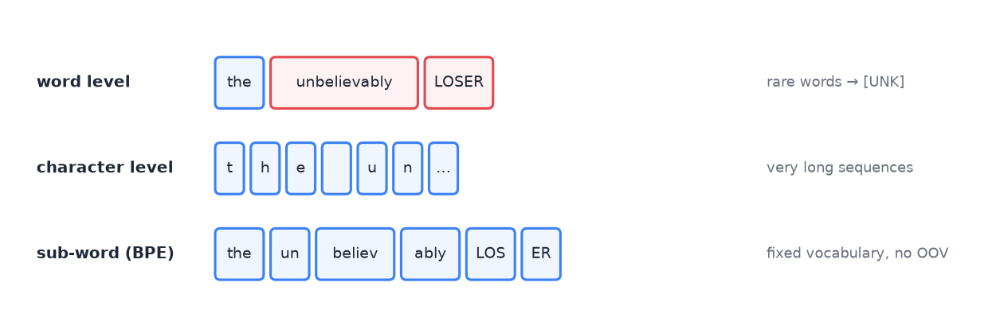
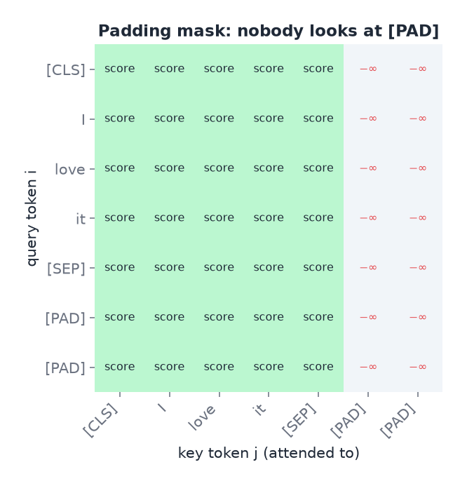
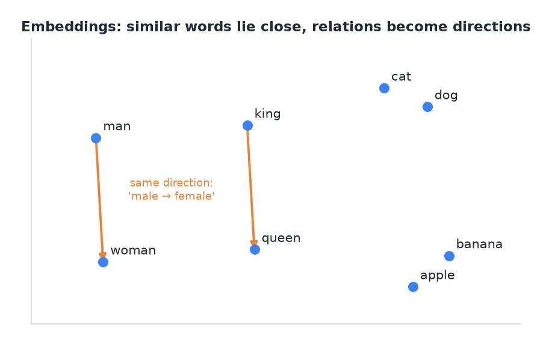

# 02 · From text to numbers: tokens and embeddings

> [!NOTE]
> **Colour code for all formulas:** $\textcolor{#3b82f6}{\text{input / data}}$ · $\textcolor{#e8833a}{\text{learned weights}}$ · $\textcolor{#22a06b}{\text{model output}}$ · $\textcolor{#e5484d}{\text{true label}}$ · $\textcolor{#a855f7}{\text{setting you choose}}$

**The problem.** A network only does arithmetic. Text is a string of characters. So before any model runs, text must become a list of numbers. How we do this decides what the model can and cannot see.

**Course material:** Week 7 notebook, section *Representing tokens: one-hot vs. embeddings* (`Week 7/Lecture_Week07_RNN.ipynb`). Week 8 slides, *BERT: input representation* (`Week 8/main_transformers_week8.pdf`). Week 9 notebook, *Part 1, Static vs contextual embeddings* (`Week 9/Lecture_Week09_SSL_LoRA.ipynb`). Week 8 tutorial, question (a) (`Week 8/COSC2779_Tute8_tex_answers.pdf`).

> [!TIP]
> **Play with it** (interactive, in the browser). Do this before or after reading; seeing it move is the fastest way in.
> - [Tiktokenizer](https://tiktokenizer.vercel.app/): type 'loser', 'LOSER' and 'unbelievably' and watch how they split into tokens.
> - [Tokenizer playground (Hugging Face)](https://huggingface.co/spaces/Xenova/the-tokenizer-playground): compare the tokenisers of different models on the same sentence.
> - [TensorFlow Embedding Projector](https://projector.tensorflow.org/): search for 'king' and see its nearest neighbours in a real embedding space, rotated in 3-D.

---

## 1. Step one: tokenisation

**Tokenisation** cuts text into units called **tokens**. Each token gets an integer ID from a fixed **vocabulary**.

There are three main ways to cut:

**Word level.** "the cat sat" → `[the] [cat] [sat]`.
- Easy to understand.
- Problem: the vocabulary gets huge (every name, typo and verb form is a new word).
- Problem: a word not seen during training has no ID. This is the **out-of-vocabulary (OOV)** problem. Usually it becomes a single `[UNK]` token, and its meaning is lost.

**Character level.** "cat" → `[c] [a] [t]`.
- No OOV problem: every word is made of known letters.
- Problem: sequences get very long, and a single letter carries little meaning.

**Sub-word level** (BPE, WordPiece, SentencePiece). This is what modern models use.
- Frequent words stay whole: `[the]`.
- Rare words are split into frequent pieces: "unbelievably" → `[un] [believ] [ably]`.
- The vocabulary has a fixed, moderate size, often 30,000 to 50,000.
- Any word can be built from pieces, so there is no OOV problem.

The same text cut three ways. Red tokens are rare and risk becoming [UNK].

**How BPE (byte-pair encoding) builds its vocabulary.** Start with single characters. Count which pair of neighbouring symbols occurs most often in a large text. Merge that pair into a new symbol. Repeat until the vocabulary has the desired size. Frequent words end up as one token. Rare words stay split.

Example from A2. The same words tokenise differently by case:
- "loser" may be one token.
- "LOSER" is rarer in the training text, so it may become `[LOS] [ER]`.

Half the memes in A2 are in capitals. So capital letters really do change what the model sees.

> [!NOTE]
> **From the course · Week 8 tutorial, (a).** Customer messages must go into a Transformer. Why not just split on whitespace and one-hot encode each word?

<b>Show the answer</b>

- Whitespace words give a huge vocabulary and an out-of-vocabulary problem for product names and typos. **Sub-word tokenisation** has a fixed vocabulary and splits unknown words into known pieces.
- One-hot vectors are huge, sparse and treat all words as equally different. **Dense learned embeddings** are small and capture similarity.
- Add special tokens: [CLS] at the front as a summary slot, [SEP] at the end.

## 2. Special tokens

Models add a few tokens with special jobs:
- **[CLS]** at the start. Its output vector is trained to summarise the whole sequence. It is used for sequence classification. RoBERTa calls it `<s>`.
- **[SEP]** at the end, or between two sentences. RoBERTa calls it `</s>`.
- **[PAD]** to fill short sequences up to the batch length.
- **[MASK]** to hide a token during masked-language-model pretraining (see doc 05).

## 3. Padding and attention masks

Training uses batches. All sequences in a batch must have the same length. Short ones are filled with [PAD].

The model must ignore the padding. An **attention mask** marks real tokens with 1 and padding with 0. Inside attention, the score of every padded position is replaced before the softmax:

$$
\text{score}_{ij} \;\leftarrow\; \begin{cases} \text{score}_{ij} & \text{if token } j \text{ is real} \\ -\infty & \text{if token } j \text{ is padding} \end{cases}
\qquad\Rightarrow\qquad e^{-\infty} = 0
$$

$\text{score}_{ij}$ = how much token $i$ wants to look at token $j$. After the softmax, a score of $-\infty$ becomes a weight of exactly 0, so padding contributes nothing.

**Simply put:** mask 1 = read this token. Mask 0 = ignore it, it is only filler.

Each row is one query token. Columns of [PAD] get −∞, so after the softmax their weight is 0.

**Dynamic padding** pads each batch only to its own longest sequence, not to a global maximum. Memes are short (median 28 tokens), so this saves a lot of compute in A2.

> [!NOTE]
> **From the course · Week 8 tutorial, (h).** Messages have very different lengths, but training uses batches. What must attention handle, and how?

<b>Show the answer</b>

Pad every message in the batch to the same length, then use a **padding mask**: set the attention scores of padded positions to $-\infty$ before the softmax. Real tokens then give padding a weight of exactly 0.

**Truncation** cuts sequences that are longer than the model's maximum (often 512 tokens).

## 4. Offsets: mapping tokens back to characters

Fast tokenisers can return an **offset mapping**. For each token it gives the character positions (start, end) in the original text.

Example: "SO BERNIE BROS"

| Token | `[SO]` | `[BERN]` | `[IE]` | `[BROS]` |
|---|---|---|---|---|
| Characters | 0–2 | 3–7 | 7–9 | 10–14 |

This matters whenever labels are attached to characters. In A2, each technique is marked as a character span, for example characters 3 to 14 are "Name calling". With the offsets we can:
1. turn character spans into token labels for training, and
2. turn token predictions back into character spans for scoring.

Only "fast" tokenisers give offsets. That is why BERTweet was dropped from A2: it has no fast tokeniser.

## 5. Step two: from token IDs to vectors

**One-hot encoding.** A token with ID 7 in a vocabulary of $V$ tokens becomes a vector of length $V$ with a single 1:

$$
\textcolor{#3b82f6}{\mathbf{o}_7} = (0, 0, 0, 0, 0, 0, 0, 1, 0, \dots, 0) \in \{0,1\}^{V}
$$

$\mathbf{o}_7$ = the one-hot vector of token 7 · the single 1 sits at position 7 (counting from 0) · $V$ = vocabulary size, e.g. 50,000 · $\{0,1\}^V$ = "a list of $V$ numbers, each 0 or 1".

- Huge and sparse.
- Every pair of words is equally different. "cat" is as far from "dog" as from "democracy".

**Embeddings.** Each token ID maps to a dense learned vector. An embedding layer is a table $E$ with one row per token:

$$
\textcolor{#3b82f6}{\mathbf{e}_7} = \textcolor{#3b82f6}{\mathbf{o}_7}^\top\,\textcolor{#e8833a}{E}, \qquad \textcolor{#e8833a}{E} \in \mathbb{R}^{V \times \textcolor{#a855f7}{d}}
$$

$\mathbf{o}_7$ = one-hot vector of token 7 · $E$ = embedding table, $V$ rows (one per token) and $d$ columns (for example 768) · $\mathbf{e}_7$ = row 7 of the table. Multiplying by a one-hot vector just picks one row, so in practice the layer is a fast lookup.

**Simply put:** an embedding layer is a lookup table. Token ID 7 → row 7 → a list of numbers.

- The values are learned. Words used in similar contexts end up with similar vectors.
- Similarity is measured with the cosine similarity:

$$
\cos(\mathbf{a}, \mathbf{b}) = \frac{\mathbf{a}^\top\mathbf{b}}{\lVert\mathbf{a}\rVert\,\lVert\mathbf{b}\rVert} \in [-1, 1]
$$

$\mathbf{a}^\top\mathbf{b}$ = dot product · $\lVert\mathbf{a}\rVert$ = length of $\mathbf{a}$. 1 means same direction (similar meaning), 0 means unrelated, −1 means opposite.

## 6. Static versus contextual embeddings

**Static embeddings** (word2vec, GloVe) give one vector per word, fixed forever.
- word2vec learns them by predicting a word from its neighbours, or the neighbours from the word.
- They capture similarity. The famous example:

$$
\mathbf{e}_{\text{king}} - \mathbf{e}_{\text{man}} + \mathbf{e}_{\text{woman}} \approx \mathbf{e}_{\text{queen}}
$$

$\mathbf{e}_{\text{word}}$ = the embedding vector of that word · $\approx$ = "is close to". Subtracting "man" and adding "woman" moves along the male → female direction.

A 2-D sketch of an embedding space. Related words cluster, and a relation like male → female is roughly the same arrow everywhere.

- The weakness: one vector per word, whatever the context. "bank" (river) and "bank" (money) share one vector.

**Contextual embeddings** (BERT, RoBERTa, DeBERTa) compute a new vector for each token in each sentence.
- The vector for "bank" depends on the other words in the sentence.
- A Transformer produces them (doc 04).
- This is why pretrained Transformers beat averaged word2vec vectors on most tasks. The Week 9 notebook shows it directly: GloVe gives one vector for a word, BERT gives different vectors by context.

**Simply put:** static = one fixed vector per word. Contextual = the vector changes with the sentence around the word.

> [!NOTE]
> **From the course · Week 9 tutorial, (a).** Legal emails: why is a contextual representation from a pretrained Transformer better than averaging word2vec/GloVe vectors?

<b>Show the answer</b>

- word2vec/GloVe give **one vector per word**. "bond" (rental deposit) and "bond" (financial) get the same vector.
- A Transformer computes each word's vector **from the whole email**, so meaning adapts to context.
- Averaging also throws away word order. Self-attention plus positional encodings keep it.

**Averaging word vectors** to represent a sentence also throws away word order. "dog bites man" and "man bites dog" get the same average.

## 7. Common mistakes

- Thinking a token is a word. It is often a piece of a word.
- Forgetting the attention mask. The model then reads padding as real input.
- Comparing token counts across different tokenisers. Each model has its own vocabulary.
- Assigning a word-level label to only one sub-word without a clear rule. Pick a rule (label the first piece, or label all pieces) and use it consistently.

## 8. How this appears in A2

- DeBERTa-v3 tokeniser with offsets. Labels go from character spans to tokens and back.
- Dynamic padding, attention masks, maximum length 160 tokens (the longest meme is 142).
- C4 measures how many sub-word pieces Australian slang needs compared to the 2020 memes. More pieces per word usually means less familiar text.

## Watch and read

**Official course videos** (from the Canvas week pages; Canvas Studio links need your RMIT login). Watch these first: the exam is built on this material.
- **Week 7 pre-recorded lectures** (sequence data, word embeddings, text classification): listed in [doc 03](03_sequences_and_rnns.md#watch-and-read).

**More videos and readings:**

- StatQuest, *Word embedding and word2vec, clearly explained*: https://www.youtube.com/watch?v=viZrOnJclY0
- AssemblyAI, *A complete overview of word embeddings*: https://www.youtube.com/watch?v=5MaWmXwxFNQ
- Jay Alammar, *The illustrated word2vec* (blog): https://jalammar.github.io/illustrated-word2vec/
- Hugging Face course, *Byte-pair encoding tokenization*: https://huggingface.co/learn/llm-course/chapter6/5

---

## Cheat sheet

> [!IMPORTANT]
> **The 7 things to remember**
> 1. Pipeline: **text → tokens → IDs → embeddings → model.**
> 2. Sub-word tokenisation (BPE/WordPiece): fixed vocabulary, rare words split into pieces, **no OOV problem**.
> 3. Special tokens: [CLS] = summary for classification, [SEP] = separator, [PAD] = filler, [MASK] = hidden token for pretraining.
> 4. Padding + **attention mask**: padded scores set to $-\infty$ → weight 0.
> 5. **Offsets** map tokens ↔ characters. Needed for span labels (A2 Part B).
> 6. One-hot = huge, sparse, no similarity. Embedding = dense learned row of a table.
> 7. **Static** (word2vec, GloVe): one vector per word. **Contextual** (BERT): a new vector per sentence.

> [!TIP]
> **Memory hooks**
> - **BPE = "Build Pieces Endlessly":** keep merging the most frequent pair until the vocabulary is full.
> - **Tokeniser = a butcher.** Common words stay as whole cuts; rare words get chopped into standard pieces.
> - **Static vs contextual = a dictionary vs a translator.** A dictionary gives "bank" one entry. A translator reads the whole sentence first.
> - **Padding mask = earplugs for the model.** It cannot hear the [PAD] tokens.

> [!TIP]
> **How to learn this chapter**
> - **Try it:** in Python, run a tokenizer on "unbelievably", "LOSER" and "loser" and compare the pieces.
> - **Explain the difference** between one-hot and embedding vectors to someone without using the word "vector".
> - **Active recall:** list the four special tokens and their jobs without looking.
