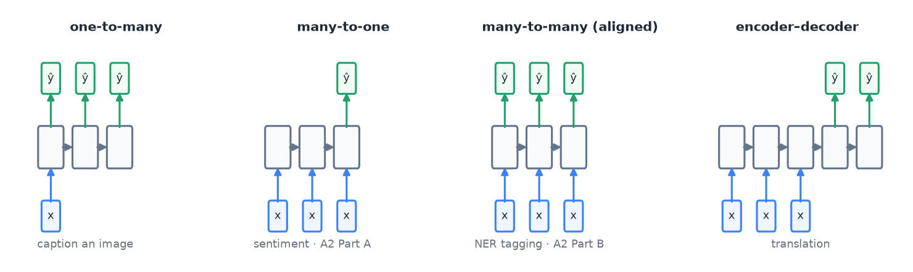
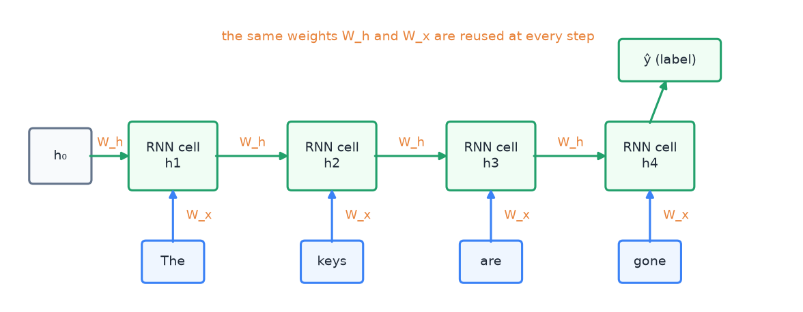
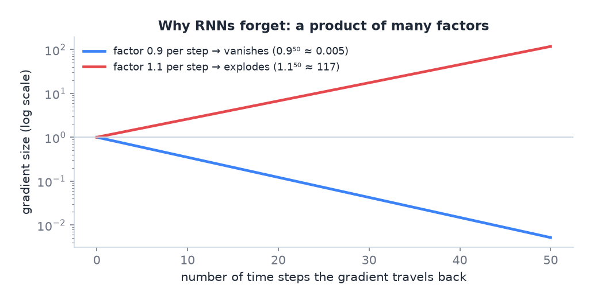
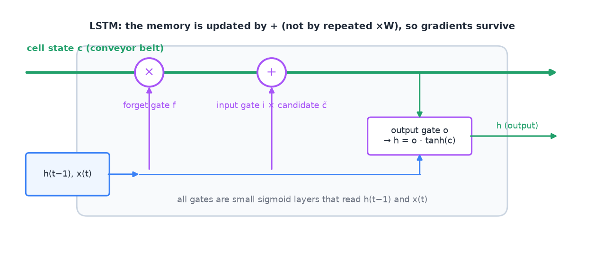

# 03 · Sequences and recurrent networks (RNN, LSTM, GRU)

> [!NOTE]
> **Colour code for all formulas:** $\textcolor{#3b82f6}{\text{input / data}}$ · $\textcolor{#e8833a}{\text{learned weights}}$ · $\textcolor{#22a06b}{\text{model output / state}}$ · $\textcolor{#e5484d}{\text{true label}}$ · $\textcolor{#a855f7}{\text{setting you choose}}$

**The problem.** In a sentence, a time series or a sound, order carries meaning. "dog bites man" is not "man bites dog". A plain feed-forward network has a fixed input size and no notion of order. We need a model that reads a sequence of any length and remembers what came before.

**Course material:** Week 7 notebook (`Week 7/Lecture_Week07_RNN.ipynb`): *A memoryless baseline*, *An RNN, from scratch*, *The long-range problem: vanishing gradients*, *GRU and LSTM*, *Part 2, Token classification*. Week 7 lab (`Week 7/week7_sequence_models_lab.ipynb`). Week 3 slides on *Long-term dependencies* and *Exploding gradients*.

> [!TIP]
> **Play with it** (interactive, in the browser). Do this before or after reading; seeing it move is the fastest way in.
> - [Distill: Visualizing memorization in RNNs](https://distill.pub/2019/memorization-in-rnns/): hover over a sentence and see which earlier words an LSTM or GRU still uses.
> - [Distill: Attention and augmented RNNs](https://distill.pub/2016/augmented-rnns/): animated diagrams of encoder–decoder RNNs and how attention looks back.
> - [Chris Olah: Understanding LSTM networks](https://colah.github.io/posts/2015-08-Understanding-LSTMs/): the step-by-step LSTM diagrams most courses copy.

---

## 1. What makes sequence data special

- **Variable length.** One meme has 5 words, another has 70.
- **Order matters.** Shuffling the words changes the meaning.
- **Long-range dependencies.** A word can depend on another word far away: "The *keys* that I left on the table yesterday *are* gone."

A **bag-of-words** model ignores order. It just counts or averages the words. It is a useful baseline. The Week 7 notebook starts with one and shows where it fails.

## 2. Task shapes

The first design question is: how many inputs and how many outputs?

| Shape | Input → output | Example |
|---|---|---|
| one-to-one | one vector → one label | ordinary classification (no sequence) |
| one-to-many | one input → a sequence | image captioning, music generation from a seed |
| many-to-one | a sequence → one label | sentiment of a review, genre of a music clip, **A2 Part A** |
| many-to-many, aligned | a sequence → one label per element | named-entity tagging, **A2 Part B** |
| many-to-many, not aligned | a sequence → a different sequence | translation, summarisation |

Blue = inputs, grey = the recurrent cell over time, green = outputs. Count the green boxes to name the shape.

> [!NOTE]
> **From the course · Practice exam, A.3.** Predict the genre of short music clips of different lengths. Which RNN shape fits?

<b>Show the answer</b>

**Many-to-one.** A whole clip (a sequence of any length) goes in, one genre label comes out. The varying length does not make it many-to-many; the number of outputs decides.

Rule of thumb: count the outputs you need. Variable input length alone does not decide the shape.

## 3. The recurrent neural network (RNN)

An RNN reads one element at a time. It keeps a **hidden state** $\mathbf{h}$, a vector that acts as memory. At each time step $t$:

$$
\textcolor{#22a06b}{\mathbf{h}_t} = \tanh\!\left(\textcolor{#e8833a}{W_h}\,\textcolor{#22a06b}{\mathbf{h}_{t-1}} + \textcolor{#e8833a}{W_x}\,\textcolor{#3b82f6}{\mathbf{x}_t} + \textcolor{#e8833a}{\mathbf{b}}\right)
\qquad
\textcolor{#22a06b}{\hat{\mathbf{y}}_t} = \textcolor{#e8833a}{W_y}\,\textcolor{#22a06b}{\mathbf{h}_t}
$$

$\mathbf{x}_t$ = input at step $t$ (for example a word embedding) · $\mathbf{h}_{t-1}$ = memory from the previous step · $W_h$ = how the old memory is mixed in · $W_x$ = how the new input is mixed in · $\tanh$ squashes values to −1…1 · $\hat{\mathbf{y}}_t$ = optional output at step $t$.

Key point: **the same weights $W_h$, $W_x$ are used at every step.** This is parameter sharing over time.
- The model works for any sequence length.
- The number of weights does not grow with the length.
- Something learned at position 3 also applies at position 30.

**Many-to-one:** read the whole sequence, then classify from the last hidden state.
**Many-to-many aligned:** produce an output at every step.

An RNN unrolled over four words. Every cell is the same network with the same weights; only the memory h changes.

## 4. Training: backpropagation through time (BPTT)

To train, we **unroll** the RNN: draw one copy of the cell per time step, all sharing weights. This is now an ordinary deep feed-forward network, one layer per time step. Backpropagation runs through it from the last step to the first. This is called backpropagation through time.

## 5. Vanishing and exploding gradients

During BPTT, the gradient for an early step is a product of many factors, one per step in between:

$$
\frac{\partial L}{\partial \textcolor{#22a06b}{\mathbf{h}_1}} = \frac{\partial L}{\partial \textcolor{#22a06b}{\mathbf{h}_T}}\;\prod_{t=2}^{T}\frac{\partial \textcolor{#22a06b}{\mathbf{h}_t}}{\partial \textcolor{#22a06b}{\mathbf{h}_{t-1}}}
\qquad\text{each factor contains } \textcolor{#e8833a}{W_h} \text{ and } \tanh' \le 1
$$

$T$ = length of the sequence · $\prod$ = product of $T-1$ factors · $\tanh'$ = derivative of tanh, never above 1. Many factors below 1 shrink the product; many above 1 blow it up.

- Factors mostly smaller than 1 → the product shrinks towards 0. This is the **vanishing gradient**. Early words get almost no learning signal. The RNN cannot learn long-range dependencies.
- Factors mostly larger than 1 → the product grows without bound. This is the **exploding gradient**. Training becomes unstable and the loss may turn into NaN.

Multiply 50 factors and the result either disappears or explodes. Log scale on the y-axis.

Numeric intuition: $0.9^{50} \approx 0.005$, but $1.1^{50} \approx 117$.

Fixes:
- Exploding: **gradient clipping**. If the gradient norm is larger than a threshold $\textcolor{#a855f7}{c}$, scale it down: $\;\mathbf{g} \leftarrow \mathbf{g}\cdot \textcolor{#a855f7}{c}/\lVert\mathbf{g}\rVert$.
- Vanishing: **gated** architectures (LSTM, GRU), better initialisation, shorter sequences, and later **attention**.

Clipping does not fix vanishing gradients. This is a common exam trap.

## 6. LSTM: long short-term memory

The LSTM adds a second memory, the **cell state** $\mathbf{c}_t$, and three **gates**. A gate is a sigmoid layer. Its output between 0 and 1 says how much of something to let through.

$$
\begin{aligned}
\text{forget gate:}\quad & \mathbf{f}_t = \sigma(\textcolor{#e8833a}{W_f}[\textcolor{#22a06b}{\mathbf{h}_{t-1}}, \textcolor{#3b82f6}{\mathbf{x}_t}] + \textcolor{#e8833a}{\mathbf{b}_f}) \\
\text{input gate:}\quad & \mathbf{i}_t = \sigma(\textcolor{#e8833a}{W_i}[\textcolor{#22a06b}{\mathbf{h}_{t-1}}, \textcolor{#3b82f6}{\mathbf{x}_t}] + \textcolor{#e8833a}{\mathbf{b}_i}) \\
\text{output gate:}\quad & \mathbf{o}_t = \sigma(\textcolor{#e8833a}{W_o}[\textcolor{#22a06b}{\mathbf{h}_{t-1}}, \textcolor{#3b82f6}{\mathbf{x}_t}] + \textcolor{#e8833a}{\mathbf{b}_o}) \\
\text{candidate:}\quad & \tilde{\mathbf{c}}_t = \tanh(\textcolor{#e8833a}{W_c}[\textcolor{#22a06b}{\mathbf{h}_{t-1}}, \textcolor{#3b82f6}{\mathbf{x}_t}] + \textcolor{#e8833a}{\mathbf{b}_c}) \\[4pt]
\textbf{cell update:}\quad & \textcolor{#22a06b}{\mathbf{c}_t} = \mathbf{f}_t \odot \textcolor{#22a06b}{\mathbf{c}_{t-1}} \;+\; \mathbf{i}_t \odot \tilde{\mathbf{c}}_t \\
\textbf{new state:}\quad & \textcolor{#22a06b}{\mathbf{h}_t} = \mathbf{o}_t \odot \tanh(\textcolor{#22a06b}{\mathbf{c}_t})
\end{aligned}
$$

$\sigma$ = sigmoid, gives values 0…1 · $[\mathbf{h}_{t-1}, \mathbf{x}_t]$ = the old state and the new input glued together · $\odot$ = element-wise multiplication · $\mathbf{f}_t$ = what to keep from the old cell · $\mathbf{i}_t$ = how much new information to write · $\tilde{\mathbf{c}}_t$ = the new information itself · $\mathbf{o}_t$ = what to show as output.

The cell state runs along the top like a conveyor belt. Gates (purple) only scale or add to it.

**Why this helps.** The cell state is updated by **addition**, not by repeated multiplication with a weight matrix. If the forget gate stays near 1, information and gradients flow through many steps almost unchanged. The network learns when to remember and when to forget.

## 7. GRU: gated recurrent unit

A simpler gated design:
- An **update gate** decides how much of the old state to keep versus replace.
- A **reset gate** decides how much of the old state to use when computing the new candidate.
- No separate cell state.

$$
\textcolor{#22a06b}{\mathbf{h}_t} = (1 - \mathbf{z}_t)\odot\textcolor{#22a06b}{\mathbf{h}_{t-1}} \;+\; \mathbf{z}_t \odot \tilde{\mathbf{h}}_t
$$

$\mathbf{z}_t$ = update gate (0 = keep the old state, 1 = take the new candidate) · $\tilde{\mathbf{h}}_t$ = candidate state, computed with the reset gate. Again an additive mix, which keeps gradients alive.

GRUs have fewer weights than LSTMs and often perform about the same. Choose by experiment.

## 8. Variants

- **Stacked (deep) RNN:** several RNN layers on top of each other. Higher layers see more abstract patterns.
- **Bidirectional RNN:** one RNN reads left to right, another right to left. Their states are joined: $\mathbf{h}_t = [\overrightarrow{\mathbf{h}}_t, \overleftarrow{\mathbf{h}}_t]$. Each position then knows both its left and its right context.
  - Good for tagging and classification, where the whole text is available.
  - Not usable for generating text, because the future is not known yet.

## 9. Encoder–decoder (seq2seq) and its bottleneck

For translation, input and output lengths differ. The **encoder–decoder** design uses two RNNs:
1. The **encoder** reads the source sentence. Its final state is a summary vector.
2. The **decoder** starts from that vector and generates the output one token at a time.

**The bottleneck.** The whole source sentence must fit into one fixed-size vector. For long sentences, information is lost. Translation quality drops with sentence length.

> [!NOTE]
> **From the course · Practice exam, B.2.** In a recurrent encoder–decoder without attention, the decoder only gets the final encoder state. What limitation does this cause, and how does attention help?

<b>Show the answer</b>

One fixed-size vector must hold the whole input. For long sequences it cannot keep everything, so quality drops. Attention lets the decoder look back at **all** encoder states at every step and weight the relevant ones, instead of relying on the last state only.

**Attention** fixes this. At each output step $s$, the decoder takes a weighted average of all encoder states:

$$
\mathbf{c}_s = \sum_{t=1}^{T} \alpha_{s,t}\,\textcolor{#22a06b}{\mathbf{h}_t}, \qquad \alpha_{s,t} = \text{softmax}_t\big(\text{score}(\text{decoder state}_s, \textcolor{#22a06b}{\mathbf{h}_t})\big)
$$

$\mathbf{h}_t$ = encoder state for source word $t$ · $\alpha_{s,t}$ = attention weight, how relevant source word $t$ is for output step $s$; the weights sum to 1 · $\mathbf{c}_s$ = context vector the decoder uses at step $s$.

The decoder no longer depends on one summary vector. This idea led to the Transformer (doc 04).

## 10. Token classification with RNNs

For aligned many-to-many tasks, put a small classifier on every hidden state. Each position gets a label. With a bidirectional RNN each label uses context from both sides. Week 7 Part 2 builds exactly this and visualises true versus predicted tags.

> [!NOTE]
> **From the course · Week 7 lecture notebook, Part 2.** The notebook builds a recurrent tagger that outputs a label for every step and visualises true vs. predicted tags. Which shape is that, and what does a bidirectional version add?

<b>Show the answer</b>

Aligned many-to-many (one output per input step). A bidirectional RNN gives every step context from both sides, which helps whenever a tag depends on words that come later.

## 11. RNNs versus Transformers in one table

| | RNN / LSTM | Transformer |
|---|---|---|
| Reads the sequence | step by step | all positions at once |
| Training speed | slow, cannot parallelise over time | fast on GPUs |
| Path between distant words | many steps, gradient must survive all of them | one step (direct attention) |
| Cost in sequence length $n$ | $O(n)$ | $O(n^2)$ (attention matrix) |
| Built-in sense of order | yes | no, needs positional encoding |

## 12. Common mistakes

- Saying gradient clipping fixes vanishing gradients. It only fixes exploding gradients.
- Using a bidirectional model for text generation.
- Picking many-to-many just because inputs vary in length.
- Thinking an LSTM has no vanishing-gradient problem at all. It reduces it, it does not remove it completely.

## 13. How this appears in A2

A2 uses Transformers, not RNNs. But the task shapes come from this chapter:
- Part A is many-to-one: one meme → a set of techniques.
- Part B is aligned many-to-many: one decision per token.
- C3 compares the two outputs of one model.

## Watch and read

- StatQuest, *Recurrent neural networks, clearly explained*: https://www.youtube.com/watch?v=AsNTP8Kwu80
- StatQuest, *Long short-term memory (LSTM), clearly explained*: https://www.youtube.com/watch?v=YCzL96nL7j0
- The AI Hacker, *Illustrated guide to recurrent neural networks*: https://www.youtube.com/watch?v=LHXXI4-IEns
- DeepLearningAI (Andrew Ng), *Vanishing/exploding gradients*: https://www.youtube.com/watch?v=qhXZsFVxGKo
- StatQuest, *Sequence-to-sequence encoder-decoder networks*: https://www.youtube.com/watch?v=L8HKweZIOmg
- Chris Olah, *Understanding LSTM networks* (the classic diagrams): https://colah.github.io/posts/2015-08-Understanding-LSTMs/
- Andrej Karpathy, *The unreasonable effectiveness of RNNs*: http://karpathy.github.io/2015/05/21/rnn-effectiveness/
- *Dive into Deep Learning*, RNN chapter: https://d2l.ai/chapter_recurrent-neural-networks/index.html and LSTM: https://d2l.ai/chapter_recurrent-modern/lstm.html

---

## Cheat sheet

> [!IMPORTANT]
> **The 8 things to remember**
> 1. **Count the outputs** to pick the shape: one-to-many, many-to-one, many-to-many (aligned or not).
> 2. RNN: $\mathbf{h}_t = \tanh(W_h\mathbf{h}_{t-1} + W_x\mathbf{x}_t + \mathbf{b})$, **same weights at every step**.
> 3. Training = backprop through time over the unrolled network.
> 4. Long products of factors → **vanishing** (< 1) or **exploding** (> 1) gradients.
> 5. **Clipping fixes exploding only.** Gates (LSTM/GRU) and attention fix vanishing.
> 6. LSTM: forget, input, output gates; cell update is **additive**: $\mathbf{c}_t = \mathbf{f}_t\odot\mathbf{c}_{t-1} + \mathbf{i}_t\odot\tilde{\mathbf{c}}_t$.
> 7. Bidirectional = context from both sides → tagging yes, generation no.
> 8. Seq2seq squeezes everything into one vector (bottleneck) → attention looks at all encoder states.

> [!TIP]
> **Memory hooks**
> - **LSTM gates = "FIO" like a bouncer at a club:** **F**orget who leaves, **I**nput who gets in, **O**utput who is shown on the dance floor.
> - **Vanishing gradient = Chinese whispers.** A message passed through 50 people arrives as almost nothing.
> - **Cell state = a conveyor belt.** Information rides along it and only small, gated changes are added or removed.
> - **Bidirectional = reading the whole sentence before you answer.** Fine for an exam question, impossible when you speak in real time.
> - $0.9^{50} \approx 0$ and $1.1^{50} \approx 117$: one line that explains both gradient problems.

> [!TIP]
> **How to learn this chapter**
> - **Draw the unrolled RNN** for a 4-word sentence. Mark where the same weights are reused.
> - **Draw the LSTM cell** from memory: three sigmoid gates, one tanh candidate, the conveyor belt.
> - **Classify five tasks** by shape (spam filter, speech-to-text, NER, music generation, translation). Check with the table.
