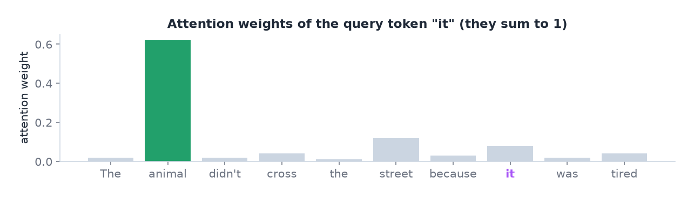
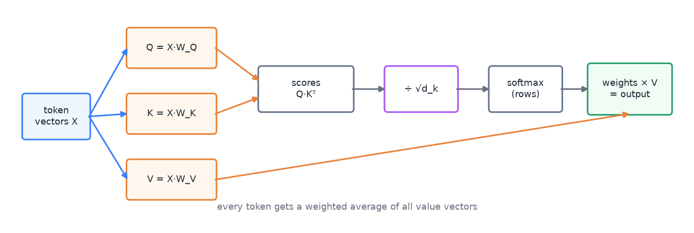
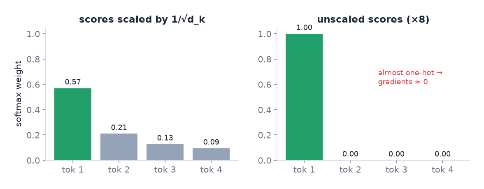
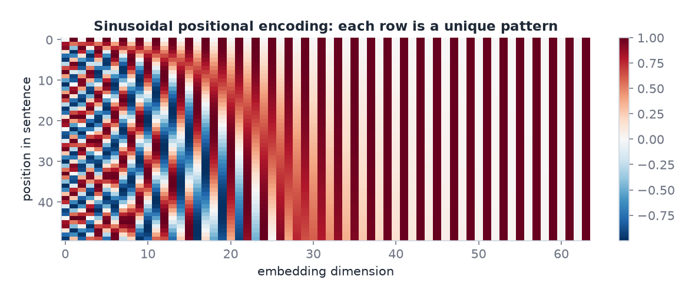
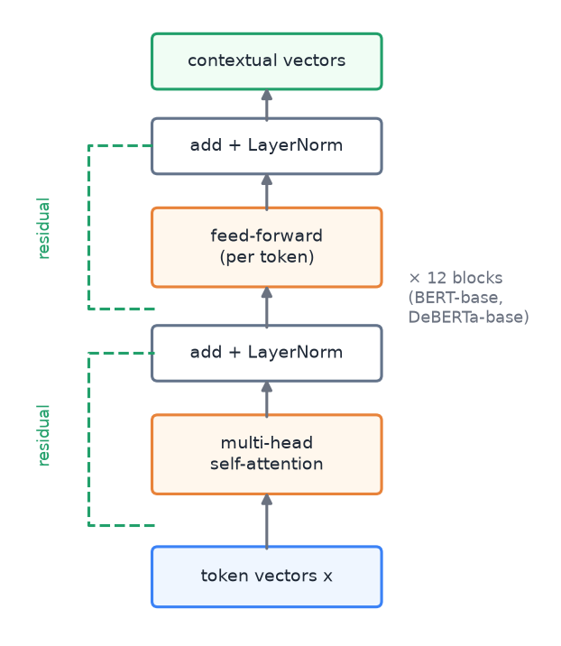
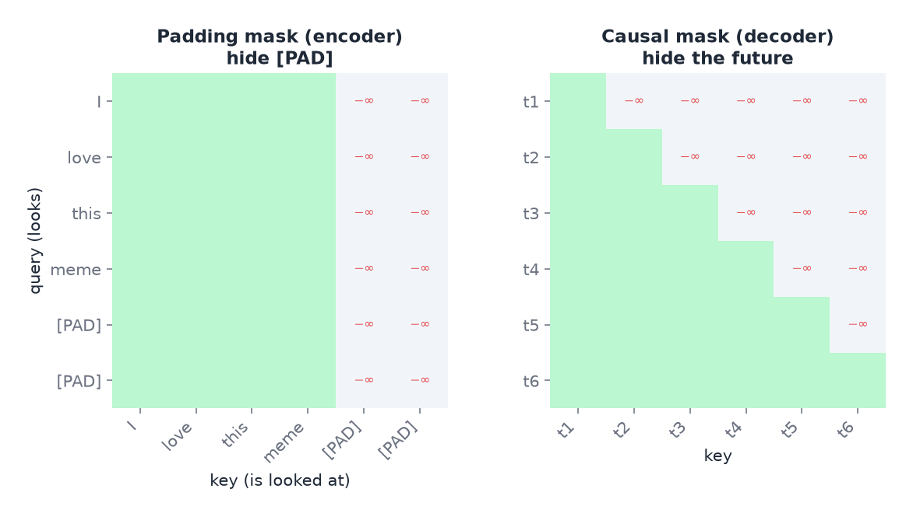

# 04 · Attention and Transformers

> [!NOTE]
> **Colour code for all formulas:** $\textcolor{#3b82f6}{\text{input / data}}$ · $\textcolor{#e8833a}{\text{learned weights}}$ · $\textcolor{#22a06b}{\text{model output}}$ · $\textcolor{#e5484d}{\text{true label}}$ · $\textcolor{#a855f7}{\text{setting you choose}}$

**The problem.** RNNs read one word after another. This is slow to train, and information from far back fades. The Transformer drops recurrence. Every token looks at every other token directly, in one step. It is the architecture behind BERT, GPT, Gemini and the model in A2.

**Course material:** Week 8 slides (`Week 8/main_transformers_week8.pdf`), from *Path length: why long-range is hard* to *Architectural refinements*. Week 8 notebook (`Week 8/Lecture_Week08_Transformers.ipynb`), which builds an encoder piece by piece: *Positional encoding*, *Scaled dot-product attention*, *Multi-head attention*, *The encoder block*, *a [CLS] classifier*, *Visualising attention*. Week 8 lab (`Week 8/week8_transformers_lab.ipynb`). Week 8 tutorial (`Week 8/COSC2779_Tute8_tex_answers.pdf`).

> [!TIP]
> **Play with it** (interactive, in the browser). Do this before or after reading; seeing it move is the fastest way in.
> - [Transformer Explainer](https://poloclub.github.io/transformer-explainer/): type your own sentence and click through embeddings, Q/K/V, attention scores, softmax and the next-word prediction of a real GPT-2.
> - [LLM visualisation (Brendan Bycroft)](https://bbycroft.net/llm): a 3-D walk through every matrix of a small GPT, step by step.
> - [Jay Alammar: The illustrated Transformer](https://jalammar.github.io/illustrated-transformer/): the classic picture-by-picture explanation.
> - [BertViz](https://github.com/jessevig/bertviz): a tool that draws attention between tokens for every head and layer (runs in a notebook).

---

## 1. The idea of attention in one sentence

To compute a new representation of a word, take a **weighted average of all words** in the sentence. The weights say how relevant each word is to this one.

Example: "The animal didn't cross the street because **it** was too tired."
To understand "it", the model should put a high weight on "animal" and a low weight on "street". Attention learns these weights from data.

Illustrative attention weights for the token "it": most of the weight goes to "animal".

## 2. Queries, keys and values

Each token's embedding $\mathbf{x}$ is turned into three vectors by three learned weight matrices:

$$
\mathbf{q} = \textcolor{#3b82f6}{\mathbf{x}}\,\textcolor{#e8833a}{W_Q} \qquad \mathbf{k} = \textcolor{#3b82f6}{\mathbf{x}}\,\textcolor{#e8833a}{W_K} \qquad \mathbf{v} = \textcolor{#3b82f6}{\mathbf{x}}\,\textcolor{#e8833a}{W_V}
$$

$\mathbf{q}$ (query) = what this token is looking for · $\mathbf{k}$ (key) = what this token offers to others · $\mathbf{v}$ (value) = the content this token passes on · $W_Q, W_K, W_V$ = three learned matrices, shared by all tokens.

Analogy: a library search. Your query is the search text. Each book has a key (its catalogue entry). You score every key against your query. You then read the books (values) in proportion to the scores.

## 3. Scaled dot-product attention

For all tokens at once, stacked as matrices $Q$, $K$, $V$:

$$
\boxed{\;\text{Attention}(Q, K, V) = \text{softmax}\!\left(\frac{Q K^\top}{\sqrt{\textcolor{#a855f7}{d_k}}}\right) V\;}
$$

$Q, K, V$ = all queries, keys and values as matrices (one row per token) · $QK^\top$ = every query dotted with every key, an $n \times n$ table of scores · $d_k$ = length of each key vector · softmax is applied row by row, so each token's weights sum to 1 · multiplying by $V$ mixes the value vectors with those weights.

The full computation of one attention layer, left to right.

Step by step for one token $i$:
1. **Scores.** Dot product of $\mathbf{q}_i$ with every key $\mathbf{k}_j$. A high dot product means a good match.
2. **Scale.** Divide each score by $\sqrt{d_k}$.
3. **Softmax.** Turn the scores into weights that are positive and sum to 1.
4. **Mix.** The output is the weighted sum of all value vectors.

**Tiny worked example.** Two tokens, $d_k = 2$. Query of token 1: $\mathbf{q} = (1, 0)$. Keys: $\mathbf{k}_1 = (1, 0)$, $\mathbf{k}_2 = (0, 1)$.
- Scores: $\mathbf{q}\cdot\mathbf{k}_1 = 1$, $\mathbf{q}\cdot\mathbf{k}_2 = 0$.
- Scaled by $\sqrt{2}$: $0.71$ and $0$.
- Softmax: $\dfrac{e^{0.71}}{e^{0.71} + e^{0}} \approx 0.67$ and $0.33$.
- Output: $0.67\,\mathbf{v}_1 + 0.33\,\mathbf{v}_2$. Token 1 mostly copies its own value, with a bit of token 2.

**Why divide by $\sqrt{d_k}$?** A dot product of two random vectors with $d_k$ dimensions has a variance of about $d_k$. With $d_k = 64$, raw scores can be large, like 20 or −15. Softmax of large numbers is almost one-hot: one weight is ≈ 1 and the rest are ≈ 0. In that saturated region the gradients are almost zero, and training stalls. Dividing by $\sqrt{d_k}$ keeps the scores around size 1.

The same four scores, with and without scaling. Unscaled, the softmax becomes nearly one-hot.

## 4. Multi-head attention

One attention computes one set of weights per token. But a word relates to others in several ways at once: grammar, meaning, nearby words, references.

**Multi-head attention** runs $h$ attentions in parallel and joins their outputs:

$$
\text{MultiHead}(X) = \big[\,\text{head}_1;\ \text{head}_2;\ \dots;\ \text{head}_{\textcolor{#a855f7}{h}}\,\big]\,\textcolor{#e8833a}{W_O},
\qquad \text{head}_i = \text{Attention}(X\textcolor{#e8833a}{W_Q^{(i)}},\, X\textcolor{#e8833a}{W_K^{(i)}},\, X\textcolor{#e8833a}{W_V^{(i)}})
$$

$h$ = number of heads (12 in BERT-base) · each head has its own $W_Q^{(i)}, W_K^{(i)}, W_V^{(i)}$ and works in a smaller dimension $d/h$ · $[\cdot;\cdot]$ = concatenation · $W_O$ = output matrix that mixes the heads back together.

- Each head can specialise in a different relation.
- The total cost is about the same as one full-width attention.

> [!NOTE]
> **From the course · Week 8 tutorial, (d).** Why use multi-head attention instead of a single attention?

<b>Show the answer</b>

One attention gives one weighting per token. Several heads can attend to several relations at once (syntax, coreference, local vs. long-range). Each head has its own $W_Q, W_K, W_V$ with $d_k = d/h$; the heads are concatenated and mixed by $W_O$, so the cost is about the same as one full-width attention.

$W_Q, W_K, W_V$ = the learned matrices that make queries, keys and values · $d$ = size of a token vector (e.g. 768) · $h$ = number of heads (e.g. 12) · $d_k = d/h$ = size of each head's vectors (768/12 = 64) · $W_O$ = output matrix that mixes the heads.

## 5. Positional encoding

Attention by itself ignores order. If you shuffle the input tokens, the outputs are shuffled the same way, but otherwise identical. Self-attention treats a sentence as a **set**. "cancel my plan" and "plan my cancel" would look the same.

Fix: add a **positional encoding** $\mathbf{p}_{pos}$ to each token embedding before the first layer. The original sinusoidal version:

$$
p_{pos,\,2i} = \sin\!\left(\frac{pos}{10000^{2i/d}}\right) \qquad p_{pos,\,2i+1} = \cos\!\left(\frac{pos}{10000^{2i/d}}\right)
$$

$pos$ = position of the token in the sentence · $i$ = index of the dimension · $d$ = embedding size. Each dimension is a wave with its own frequency, so every position gets a unique pattern, and nearby positions get similar patterns.

Rows = positions, columns = dimensions. Left columns change fast with position, right columns slowly.

- **Sinusoidal** (above): fixed, no training needed.
- **Learned**: one trainable vector per position (BERT).
- **Relative**: encode the distance between two tokens instead of their absolute positions. DeBERTa (A2's model) separates content and relative position inside attention.

> [!NOTE]
> **From the course · Week 8 tutorial, (e).** Self-attention is a set operation. Why is that a problem for customer messages, and how is it fixed?

<b>Show the answer</b>

"cancel my plan" and "plan my cancellation" contain the same words but mean different things. Without order, attention sees the same bag. Fix: add a **positional encoding** (sinusoidal or learned) to every token embedding.

## 6. The Transformer block

One encoder block has two sub-layers, each wrapped in a residual connection and layer normalisation:

$$
\begin{aligned}
\mathbf{z} &= \text{LayerNorm}\big(\textcolor{#3b82f6}{\mathbf{x}} + \text{MultiHead}(\textcolor{#3b82f6}{\mathbf{x}})\big) \\
\textcolor{#22a06b}{\mathbf{y}} &= \text{LayerNorm}\big(\mathbf{z} + \text{FFN}(\mathbf{z})\big), \qquad \text{FFN}(\mathbf{z}) = \textcolor{#e8833a}{W_2}\,\text{ReLU}(\textcolor{#e8833a}{W_1}\mathbf{z} + \textcolor{#e8833a}{\mathbf{b}_1}) + \textcolor{#e8833a}{\mathbf{b}_2}
\end{aligned}
$$

$\mathbf{x} + \ldots$ = residual connection: the input is added back, so gradients flow easily through many blocks · LayerNorm = rescales each token vector to a stable range · FFN = small two-layer network applied to each token separately.

One encoder block. The dashed green lines are the residual connections.

A full model stacks many blocks, for example 12 in BERT-base and DeBERTa-base. Each block refines the contextual vector of every token.

## 7. Three ways to use the block

| Family | Attention pattern | Good at | Examples |
|---|---|---|---|
| **Encoder-only** | every token sees all tokens (bidirectional) | understanding: classification, tagging, embeddings | BERT, RoBERTa, DeBERTa |
| **Decoder-only** | **causal mask**: a token sees only earlier tokens | generating text one token at a time | GPT, Gemini, Llama |
| **Encoder–decoder** | encoder bidirectional; decoder causal plus **cross-attention** | sequence to sequence: translation, summarisation | original Transformer, T5, BART |

- **Causal mask:** set the scores for future positions ($j > i$) to $-\infty$ before the softmax. The model cannot peek at the word it must predict.
- **Cross-attention:** queries come from the decoder, keys and values come from the encoder output. The decoder "reads" the source while writing.

Green = allowed, −∞ = blocked. Left: the encoder ignores padding. Right: the decoder cannot look ahead.

For A2 we need understanding, and every token needs left and right context. So an encoder-only model is the right choice.

## 8. Getting outputs for a task

The encoder outputs one contextual vector per token. The task decides what to do with them:
- **Sequence classification** (one label per text): use the [CLS] vector, or average all vectors, and add a small classifier. Softmax for one class, sigmoid per class for multi-label.
- **Token classification** (one label per token): apply the same small classifier to every token vector. Because the vectors are contextual, the same word can get different labels in different sentences.
- **Generation:** use a decoder.

A2 adds its own label head: **label-wise attention**. Each technique $k$ gets a learned query vector $\mathbf{u}_k$:

$$
\alpha_{k,t} = \text{softmax}_t\!\left(\frac{\textcolor{#e8833a}{\mathbf{u}_k}^\top \mathbf{h}_t}{\sqrt{d}}\right), \qquad \mathbf{s}_k = \sum_t \alpha_{k,t}\,\mathbf{h}_t, \qquad \textcolor{#22a06b}{p_k} = \sigma(\textcolor{#e8833a}{\mathbf{w}_k}^\top\mathbf{s}_k + \textcolor{#e8833a}{b_k})
$$

$\mathbf{h}_t$ = encoder vector of token $t$ · $\mathbf{u}_k$ = learned query of technique $k$ · $\alpha_{k,t}$ = how much technique $k$ looks at token $t$ · $\mathbf{s}_k$ = the technique's own summary of the meme · $p_k$ = probability that the meme uses technique $k$.

So "Name calling" can focus on an insult and "Whataboutism" on a "what about…" clause.

> [!NOTE]
> **From the course · Week 8 tutorial, (f) and (g).** From the same encoder output, produce (i) one intent label per message and (ii) an entity tag for every word. Which model family would you start from?

<b>Show the answer</b>

- (i) Take the final **[CLS]** vector → linear layer → softmax over the intents.
- (ii) Apply one shared linear layer to **every token vector** → a tag per token (BIO). The vectors are contextual, so the same word can get different tags.
- Start from a pretrained **encoder-only** model (BERT-style): both are understanding tasks that need left and right context. Fine-tune it with the two heads. This is the same design as A2.

## 9. Why Transformers beat RNNs

- **Parallel training.** All positions are computed at once. GPUs are fully used.
- **Short paths.** Any two tokens are one attention step apart. In an RNN they are as many steps apart as their distance.
- **Scale.** Transformers keep improving with more data and parameters, which made huge pretrained models possible (doc 05).

## 10. The cost: $O(n^2)$

Attention compares every token with every other token. For $n$ tokens that is an $n \times n$ matrix. Memory and compute grow with the square of the length. 512 tokens is fine. 50,000 tokens is a problem.

Remedies: truncate or split long texts into chunks, or use efficient attention variants (sparse or windowed attention, as in Longformer).

> [!NOTE]
> **From the course · Week 8 tutorial, (k).** Some transcripts are thousands of tokens long and training runs out of memory. Why, and what can you do?

<b>Show the answer</b>

Attention compares every token with every other one: memory and compute grow with $n^2$. Truncate or split long texts into chunks, or use an efficient/sparse attention model built for long inputs (e.g. Longformer).

## 11. Transformers for images: ViT

The Vision Transformer cuts an image into patches, for example 16 × 16 pixels. Each patch is flattened and linearly projected to an embedding. A [CLS] token and positional encodings are added. The rest is a standard encoder.

The catch: ViT has little built-in knowledge about images. CNNs assume local patterns and translation invariance. ViT has to learn this. So ViT needs much more data or large-scale pretraining.

## 12. Common mistakes

- Thinking attention knows word order. It needs positional encoding.
- Thinking attention cost is linear in length. It is quadratic.
- Mixing up the masks: the **padding mask** hides padding; the **causal mask** hides future tokens.
- Using a decoder-only model "because it is bigger" for a pure tagging task. Encoders fit understanding tasks better at the same size.
- Reading attention weights as a full explanation of a prediction (see doc 08).

## 13. How this appears in A2

- DeBERTa-v3-base: 12 encoder blocks, 768-dimensional vectors, relative positions.
- Two heads on one encoder: a label head (Part A) and a token head (Part B).
- The label head is our own label-wise attention module.
- The zero-shot competitors in C2 (Gemini, Ornith) are decoder-only models.

## Watch and read

- 3Blue1Brown, *Transformers, the tech behind LLMs*: https://www.youtube.com/watch?v=wjZofJX0v4M
- 3Blue1Brown, *Attention in transformers, step-by-step*: https://www.youtube.com/watch?v=eMlx5fFNoYc
- StatQuest, *Attention for neural networks, clearly explained*: https://www.youtube.com/watch?v=PSs6nxngL6k
- StatQuest, *Transformer neural networks, clearly explained*: https://www.youtube.com/watch?v=zxQyTK8quyY
- StatQuest, *Decoder-only transformers*: https://www.youtube.com/watch?v=bQ5BoolX9Ag
- Google Cloud Tech, *Transformers, explained* (short overview): https://www.youtube.com/watch?v=SZorAJ4I-sA
- Umar Jamil, *BERT explained: training, inference, [CLS] token, fine-tuning*: https://www.youtube.com/watch?v=90mGPxR2GgY
- Andrej Karpathy, *Let's build GPT: from scratch, in code* (2 h, for deep understanding): https://www.youtube.com/watch?v=kCc8FmEb1nY
- Jay Alammar, *The illustrated Transformer*: https://jalammar.github.io/illustrated-transformer/
- Jay Alammar, *Visualizing seq2seq models with attention*: https://jalammar.github.io/visualizing-neural-machine-translation-mechanics-of-seq2seq-models-with-attention/
- Lilian Weng, *Attention? Attention!* (survey blog): https://lilianweng.github.io/posts/2018-06-24-attention/
- Original paper, *Attention is all you need*: https://arxiv.org/abs/1706.03762
- *Dive into Deep Learning*, attention and Transformers: https://d2l.ai/chapter_attention-mechanisms-and-transformers/index.html

---

## Cheat sheet

> [!IMPORTANT]
> **The 9 things to remember**
> 1. $\text{Attention}(Q,K,V) = \text{softmax}(QK^\top/\sqrt{d_k})\,V$ = weighted average of values.
> 2. Q = what I look for, K = what I offer, V = what I pass on.
> 3. **÷ √d_k** keeps scores small → softmax not saturated → gradients alive.
> 4. Multi-head = several relations in parallel, same total cost.
> 5. Attention has **no sense of order** → add positional encoding (sinusoidal, learned or relative).
> 6. Block = attention + FFN, each with **residual + LayerNorm**.
> 7. Encoder-only → understand (BERT). Decoder-only → generate, causal mask (GPT). Encoder–decoder → translate, cross-attention (T5).
> 8. Sequence label from [CLS] / pooling; token labels from every token vector.
> 9. Cost is **$O(n^2)$** in sequence length.

> [!TIP]
> **Memory hooks**
> - **QKV = a dating app.** Your **Q**uery is what you are looking for, other people's **K**eys are their profiles, and their **V**alues are who they really are once you meet.
> - **"Scale before you soft(max)."** Divide by $\sqrt{d_k}$ first, or the softmax becomes a hard max.
> - **Causal mask = no spoilers.** While writing word 5 you may not read words 6, 7, 8.
> - **Attention without positions = a bag of Scrabble tiles.** All letters are there, the order is gone.
> - **E**ncoder = **E**xplain (understand), **D**ecoder = **D**raft (generate).

> [!TIP]
> **How to learn this chapter**
> - **Compute the worked example** in section 3 yourself with $\mathbf{q} = (2, 0)$. What happens to the weights? (They get sharper.)
> - **Draw one encoder block** with arrows for both residual paths.
> - **Fill this table from memory:** model family → mask → example → task.
