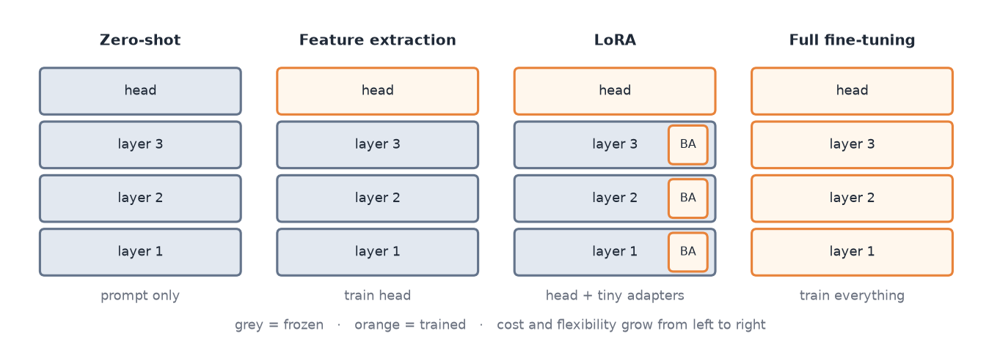
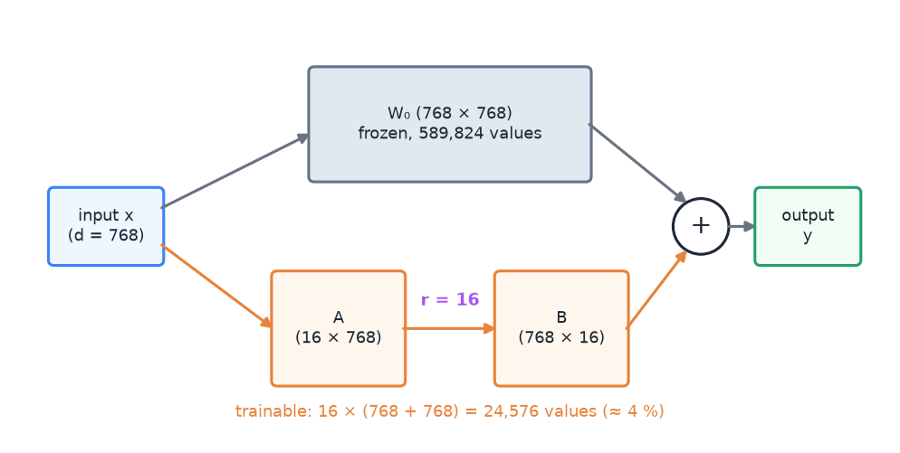

# 05 · Pretraining, foundation models and adaptation (transfer learning, LoRA)

> [!NOTE]
> **Colour code for all formulas:** $\textcolor{#3b82f6}{\text{input / data}}$ · $\textcolor{#e8833a}{\text{learned weights}}$ · $\textcolor{#22a06b}{\text{model output}}$ · $\textcolor{#e5484d}{\text{true label}}$ · $\textcolor{#a855f7}{\text{setting you choose}}$ · $\textcolor{#64748b}{\text{frozen weights}}$

**The problem.** Good deep models need a lot of labelled data. Labels are expensive. A2 has only 750 labelled memes. The solution is to learn general knowledge first from huge amounts of unlabelled data, and then adapt it with the few labels we have.

**Course material:** Week 5 notebook, *The transfer learning pipeline* with its seven steps (`Week 5/L5_Week5_TransferLearning.ipynb`). Week 9 slides (`Week 9/main_week9_representation_foundation.pdf`), from *Transfer Learning* to *Bias and responsible use*. Week 9 notebook (`Week 9/Lecture_Week09_SSL_LoRA.ipynb`): *Part 2, Self-supervised learning* and *Part 3, Feature extraction, fine-tuning and LoRA*. Week 9 tutorial (`Week 9/COSC2779_Tute9_tex_answers.pdf`).

> [!TIP]
> **Play with it** (interactive, in the browser). Do this before or after reading; seeing it move is the fastest way in.
> - [Jay Alammar: The illustrated BERT](https://jalammar.github.io/illustrated-bert/): pictures of pretraining (masked words) and then fine-tuning with a new head.
> - [Transformer Explainer](https://poloclub.github.io/transformer-explainer/): see what a pretrained model already 'knows' before any fine-tuning: its next-word probabilities.

---

## 1. Transfer learning: the basic idea

A network trained on a large task learns features that are useful for many other tasks.
- A CNN trained on ImageNet learns edges in early layers, textures in middle layers and object parts in late layers.
- A language model trained on billions of words learns grammar, word meaning and some world knowledge.

**Transfer learning** reuses those learned weights for a new task with less data.

The standard recipe (Week 5, same idea for text in Week 9):
1. Pick a related source task with lots of data.
2. Get a model trained on it (usually download it).
3. Find the feature layer, the last layer before the task-specific output.
4. Remove the old output layer ("head"). Attach a new head for your task.
5. Freeze the pretrained layers.
6. Train only the new head.
7. Optionally unfreeze some top layers and fine-tune them with a **small learning rate**.

**Why a small learning rate for pretrained layers?** Their weights are already good. Large updates would destroy what they learned, especially early in training while the new head is still random.

> [!NOTE]
> **From the course · Practice exam, A.2 and C.1 (e).** Which steps belong to fine-tuning in transfer learning? How would you adapt an ImageNet-pretrained ResNet to six waste categories?

<b>Show the answer</b>

- Replace the classification head with a new 6-class head.
- Freeze the pretrained layers and train the head first.
- Then optionally unfreeze some **top** layers and fine-tune them with a **smaller learning rate**. Both head and base weights can be trained in this phase. Keeping every base layer frozen forever is feature extraction, not fine-tuning.

## 2. Self-supervised learning (SSL)

How do you pretrain without labels? You let the data label itself. Hide part of the input and ask the model to predict it.

**Masked language modelling (MLM),** used by BERT: mask about 15% of the tokens and predict them from the rest. "The [MASK] sat on the mat" → "cat".

$$
L_{\text{MLM}} = -\sum_{t \in \mathcal{M}} \log \textcolor{#22a06b}{p}\big(\textcolor{#e5484d}{x_t} \mid \textcolor{#3b82f6}{\mathbf{x}_{\setminus \mathcal{M}}}\big)
$$

$\mathcal{M}$ = the set of masked positions · $x_t$ = the original token at position $t$ (the "free" label) · $\mathbf{x}_{\setminus\mathcal{M}}$ = the sentence with those tokens hidden · $p(\cdot)$ = the model's predicted probability. It is just cross-entropy on the hidden words.

**Next-token prediction,** used by GPT: predict each token from all previous ones.

$$
L_{\text{LM}} = -\sum_{t} \log \textcolor{#22a06b}{p}\big(\textcolor{#e5484d}{x_t} \mid \textcolor{#3b82f6}{x_1, \dots, x_{t-1}}\big)
$$

$t$ = position in the text · $x_t$ = the true token at position $t$ · $x_1 \dots x_{t-1}$ = all tokens before it · $p(\cdot \mid \cdot)$ = the model's probability for $x_t$ given ("$\mid$") the earlier tokens · $\sum_t$ = add up over all positions.

**Contrastive learning,** used by CLIP and SimCLR: pull matching pairs together (an image and its caption, two crops of the same photo) and push non-matching pairs apart.

The labels are free, so the model can train on billions of examples. To solve these tasks well, it has to learn grammar, meaning and context.

## 3. Foundation models

A **foundation model** is a large model pretrained on broad data at scale, usually with self-supervision, that can be adapted to many downstream tasks. Examples: BERT, GPT, Gemini, CLIP.

Why they dominate:
- **Few labels needed.** The model already "knows" language or images.
- **Pay once, reuse often.** Pretraining is very expensive but done once. Adapting is cheap.
- **They work across tasks and even across modalities** (text, images, audio).

## 4. The adaptation spectrum, from cheapest to most expensive

| Strategy | What is trained | Advantages | Disadvantages |
|---|---|---|---|
| **Zero-shot** | nothing; you only write a prompt | no labels, instant baseline | sensitive to wording; usually worse than a tuned model; output format can break; inherits the model's blind spots |
| **Feature extraction** | only a new head; the backbone is frozen | fast; few parameters; robust on tiny data | the representation cannot adapt to the task |
| **PEFT, e.g. LoRA** | a small number of extra parameters; the backbone is frozen | about 1% of parameters; small memory; one tiny adapter per task | slightly less capacity than full fine-tuning |
| **Full fine-tuning** | every weight | usually the best accuracy with enough data | expensive; one full model copy per task; can overfit; **catastrophic forgetting** |

What is trained in each strategy. Grey layers are frozen, orange ones are trained.

**Catastrophic forgetting:** fine-tuning on a new task can overwrite what the model knew before.

> [!NOTE]
> **From the course · Week 9 tutorial, (d)–(f) and Practice exam, B.3.** 2,000 labelled emails, a modest GPU. Which adaptation strategy, and why? What are the pros and cons of feature extraction vs. full fine-tuning?

<b>Show the answer</b>

- Try **feature extraction and/or LoRA** first: few trainable parameters, cheap, less overfitting on 2,000 examples. Run zero-shot as a quick baseline.
- **Feature extraction:** + fast, robust on small data; − the representation cannot adapt.
- **Full fine-tuning:** + best accuracy with enough data; − expensive, one model copy per task, can overfit, catastrophic forgetting.
- Always validate empirically. (In A2, full fine-tuning won even on 750 memes.)

**Which to pick?** It depends on data size, compute budget and how many tasks you serve.
- Tiny data and little compute: feature extraction or LoRA.
- Enough data: full fine-tuning usually wins.
- Many tasks on one server: LoRA, because each task needs only a small adapter.
- Always check by experiment, and always run zero-shot as a cheap baseline.

## 5. LoRA in detail

**Observation:** when you fine-tune, the change in each weight matrix, $\Delta W$, has a simple structure. It can be approximated by a matrix of low rank.

**LoRA** (low-rank adaptation) keeps the pretrained matrix frozen and learns only the change, in a factored form:

$$
\boxed{\; W = \textcolor{#64748b}{W_0} + \Delta W = \textcolor{#64748b}{W_0} + \frac{\textcolor{#a855f7}{\alpha}}{\textcolor{#a855f7}{r}}\,\textcolor{#e8833a}{B}\,\textcolor{#e8833a}{A} \;}
\qquad
\textcolor{#64748b}{W_0} \in \mathbb{R}^{d \times k},\;\; \textcolor{#e8833a}{B} \in \mathbb{R}^{d \times r},\;\; \textcolor{#e8833a}{A} \in \mathbb{R}^{r \times k},\;\; \textcolor{#a855f7}{r} \ll \min(d, k)
$$

$W_0$ = pretrained weight matrix, frozen · $A$, $B$ = the two small trainable matrices · $r$ = rank, the "width" of the update (for example 8 or 16) · $\alpha$ = scaling factor that sets the strength of the update · $d, k$ = the matrix's output and input sizes.

Applied to an input $\mathbf{x}$, the layer computes:

$$
\textcolor{#22a06b}{\mathbf{y}} = \textcolor{#64748b}{W_0}\,\textcolor{#3b82f6}{\mathbf{x}} + \frac{\textcolor{#a855f7}{\alpha}}{\textcolor{#a855f7}{r}}\,\textcolor{#e8833a}{B}\big(\textcolor{#e8833a}{A}\,\textcolor{#3b82f6}{\mathbf{x}}\big)
$$

The original path is untouched. A thin side path first squeezes $\mathbf{x}$ down to $r$ numbers ($A\mathbf{x}$) and then expands it back ($B\cdot$).

LoRA for one 768 × 768 matrix: the frozen path stays as it is; a thin trainable side path (A then B) adds the update.

**Parameter count, worked example.** For a 768 × 768 matrix:

$$
\underbrace{768 \times 768}_{\text{full fine-tuning}} = 589{,}824
\qquad\text{vs.}\qquad
\underbrace{\textcolor{#a855f7}{r}\,(d + k) = 16 \times (768 + 768)}_{\text{LoRA},\ r = 16} = 24{,}576 \;\;(\approx 4\%)
$$

$d \times k$ = 768 × 768, the size of the original matrix · $r$ = LoRA rank (16) · $r(d+k)$ = values in $A$ ($r \times k$) plus values in $B$ ($d \times r$).

Applied only to the query and value matrices in each layer, LoRA trains well under 1% of the whole model.

> [!NOTE]
> **From the course · Week 9 tutorial, (g)–(h).** Why is full fine-tuning costly when you serve many tasks, how does LoRA fix it, and what does the rank $r$ control?

<b>Show the answer</b>

- Full fine-tuning stores a full copy of every weight per task. LoRA freezes $W_0$ and learns $\Delta W = BA$ with $r \ll \min(d,k)$; adapters are tiny, swappable and mergeable (no extra latency).

$W_0$ = the pretrained weight matrix (frozen) · $\Delta W$ ("delta W") = the change learned for this task · $B$, $A$ = the two small trainable matrices · $r$ = rank · $\ll$ = "much smaller than" · $d, k$ = the matrix's two sizes.
- $r$ sets the capacity of the update and the parameter count $r(d+k)$ per layer: too small underfits, larger gives a bit more accuracy with diminishing returns.

More details:
- **Initialisation.** $B$ starts at zero, so $BA = 0$. Training starts exactly from the pretrained model.
- **Rank $r$** sets the capacity of the update. Too small and the model underfits. Larger is a bit better, with diminishing returns and more parameters.
- **No extra cost at inference.** After training, $BA$ can be added into $W_0$ once. The model then has the original size and speed.
- **Where to put it.** Usually the query and value projections of attention.

In A2, LoRA is implemented from scratch (`LoRALinear` in the notebook). The Week 9 notebook does the same.

## 6. Intermediate and domain-adaptive training

Sometimes there is related labelled or unlabelled data that is closer to the target than general text.
- **Domain-adaptive pretraining:** continue self-supervised training on text from the target domain. Twitter-RoBERTa is RoBERTa after extra MLM training on tweets.
- **Intermediate-task training:** first fine-tune on a related labelled task, then on the target task. A2's experiment E9 does this with the PTC corpus (propaganda in news articles), then fine-tunes on memes.

## 7. Zero-shot with large language models

You can prompt a generative model: "Which of these 20 techniques does this meme use? Answer in JSON."
- No training data needed.
- Results depend on the prompt wording.
- Answers can come in the wrong shape and need careful parsing.
- With temperature above 0, the same input can give different answers.
- **Data contamination:** if public test data was in the model's training data, its score is too optimistic.
- Hosted models send the data to an outside server, which may be forbidden (privacy).

## 8. Risks of foundation models

- **Inherited bias** from web-scale training data. This can cause different error rates for different groups.
- **Distribution shift.** The model can fail confidently on inputs unlike its training data.
- **Shortcut learning** and **hallucination** for generative models.
- **Mitigations:** evaluate per group (disaggregated metrics), curate the adaptation data, keep humans in the loop for important decisions.

## 9. Common mistakes

- "LoRA makes inference slower." No, the adapter can be merged.
- "With little data, always freeze." Not always. Test it. In A2 full fine-tuning won even with 750 examples.
- Using the same learning rate for a fresh head and for pretrained layers. The head needs a larger one.
- Comparing methods unfairly. Each method needs its usual hyperparameters. LoRA, for example, typically needs a larger learning rate than full fine-tuning.

## 10. How this appears in A2

- Pretrained encoder: DeBERTa-v3 (pretrained by its authors with self-supervision, no persuasion labels).
- Experiment E2 compares frozen encoder, LoRA and full fine-tuning on the same folds.
- Experiment E9 tests intermediate training on PTC news data.
- C2 compares our trained model with zero-shot LLMs (Gemini Pro, Gemini Flash-Lite, Ornith 9B).

## Watch and read

- Jay Alammar, *The illustrated BERT, ELMo and co.* (how NLP cracked transfer learning): https://jalammar.github.io/illustrated-bert/
- Umar Jamil, *BERT explained: training, inference, fine-tuning*: https://www.youtube.com/watch?v=90mGPxR2GgY
- Andrej Karpathy, *Intro to large language models* (1 h talk): https://www.youtube.com/watch?v=zjkBMFhNj_g
- Sebastian Raschka, *Parameter-efficient LLM fine-tuning with LoRA* (blog): https://sebastianraschka.com/blog/2023/llm-finetuning-lora.html
- Hugging Face PEFT docs, *LoRA conceptual guide*: https://huggingface.co/docs/peft/conceptual_guides/lora
- Hugging Face course, *Fine-tuning a pretrained model*: https://huggingface.co/learn/llm-course/chapter3/1
- LoRA paper (Hu et al., 2021): https://arxiv.org/abs/2106.09685
- BERT paper (Devlin et al., 2018): https://arxiv.org/abs/1810.04805
- *Dive into Deep Learning*, NLP pretraining: https://d2l.ai/chapter_natural-language-processing-pretraining/index.html

---

## Cheat sheet

> [!IMPORTANT]
> **The 8 things to remember**
> 1. Transfer recipe: **new head → freeze → train head → (unfreeze top, small LR)**.
> 2. Self-supervision = labels from the data itself: masked tokens (BERT), next token (GPT), matching pairs (CLIP).
> 3. Foundation model = pretrained at scale, adapted to many tasks.
> 4. Spectrum, cheap → expensive: **zero-shot → feature extraction → LoRA → full fine-tuning**.
> 5. LoRA: $W = W_0 + BA$, $W_0$ frozen, $r \ll d$, params $= r(d+k)$ per matrix, $B$ starts at 0.
> 6. LoRA adds **no inference cost** (merge $BA$ into $W_0$).
> 7. Full fine-tuning: best with enough data, but expensive and can forget.
> 8. Zero-shot LLMs: prompt-sensitive, format can break, stochastic, may be contaminated, may break privacy rules.

> [!TIP]
> **Memory hooks**
> - **Transfer learning = hiring an experienced chef.** You do not teach them to cook. You only teach your restaurant's menu (the new head).
> - **Feature extraction vs fine-tuning = renting a flat vs renovating it.** Renting: you only bring furniture (the head). Renovating: you may knock down walls (change the backbone).
> - **LoRA = sticky notes on a textbook.** The book ($W_0$) stays untouched. You add small notes ($BA$). Later you can copy the notes into the book (merge).
> - **"Low rank, low cost."**
> - **Catastrophic forgetting = cramming for one exam and forgetting last semester.**

> [!TIP]
> **How to learn this chapter**
> - **Compute** the LoRA parameter count for a 1024 × 4096 matrix with $r = 8$. (Answer: $8 \times 5120 = 40{,}960$.)
> - **Order the four strategies** by cost from memory, and give one pro and one con for each.
> - **Explain to a friend** why masked-word prediction teaches a model grammar without any labels.
