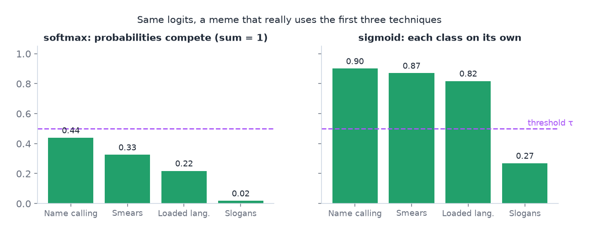
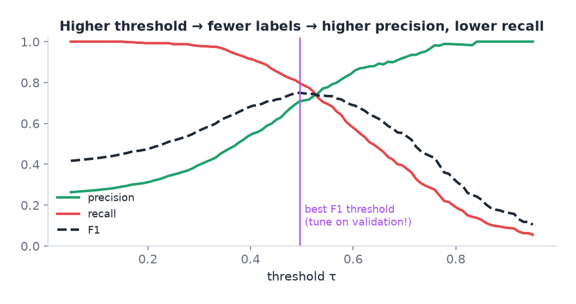
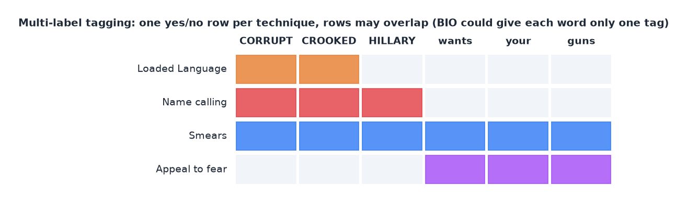

# 06 · Framing the task: multi-class, multi-label, token tagging, multi-task

> [!NOTE]
> **Colour code for all formulas:** $\textcolor{#3b82f6}{\text{input / data}}$ · $\textcolor{#e8833a}{\text{learned weights}}$ · $\textcolor{#22a06b}{\text{model output}}$ · $\textcolor{#e5484d}{\text{true label}}$ · $\textcolor{#a855f7}{\text{setting you choose}}$

**Why this matters.** Before choosing a model, you must state exactly what goes in and what comes out. This decides the output layer, the loss and the metric. A wrong framing cannot be fixed by a better model.

**Course material:** Week 2 slides on loss functions for binary, multi-class and regression tasks (`Week 2/W2_Lecture2_Part1_DeepFeedForwardNetworks.pdf`). Week 7 notebook, *Part 2, Token classification* (`Week 7/Lecture_Week07_RNN.ipynb`). Week 8 slides, *Sequence classification – use the [CLS] token* and *Token classification – use every token embedding* (`Week 8/main_transformers_week8.pdf`). Week 8 tutorial, questions (f) and (g).

> [!TIP]
> **Play with it** (interactive, in the browser). Do this before or after reading; seeing it move is the fastest way in.
> - [MLU-Explain: logistic regression](https://mlu-explain.github.io/logistic-regression/): watch the sigmoid curve and the decision threshold move.
> - [Hugging Face: token classification](https://huggingface.co/learn/llm-course/chapter7/2): worked NER example with the label alignment shown token by token.

---

## 1. Four kinds of classification

| Kind | Labels per example | Output layer | Loss | Decision |
|---|---|---|---|---|
| Binary | one of two | 1 sigmoid | binary cross-entropy | $p \ge$ threshold |
| Multi-class | exactly one of $K$ | $K$ logits + softmax | cross-entropy | argmax |
| **Multi-label** | any number of $K$ (0 to $K$) | $K$ logits, sigmoid each | BCE per class | $p_k \ge$ threshold, for each $k$ separately |
| Token / sequence tagging | one or more labels per token | the same head on every token | loss per token | per token |

**Softmax versus sigmoid**, for logits $z_1, \dots, z_K$:

$$
\text{softmax:}\quad \textcolor{#22a06b}{p_k} = \frac{e^{z_k}}{\sum_{j=1}^{K} e^{z_j}} \;\;\Rightarrow\;\; \sum_k p_k = 1
\qquad\qquad
\text{sigmoid:}\quad \textcolor{#22a06b}{p_k} = \frac{1}{1 + e^{-z_k}} \;\;\Rightarrow\;\; \text{each } p_k \text{ on its own}
$$

$z_k$ = raw score (logit) of class $k$ · $p_k$ = predicted probability of class $k$. Softmax divides by the sum of all classes, so raising one class lowers the others. Sigmoid looks at one class at a time.

Same raw scores, two output functions. Softmax spreads one unit of probability; sigmoid lets all three true techniques pass the threshold.

- Softmax makes the $K$ probabilities compete. That is right when exactly one class is true.
- Sigmoid treats each class as its own yes/no question. Several can be near 1 at the same time.

Example from A2: a meme can be *Name calling* and *Smears* and *Loaded Language* at once. Softmax would force the model to split probability between them. So A2 uses 20 sigmoids.

> [!NOTE]
> **From the course · Week 3 tutorial, Q6.** Images may contain a cat, a dog, or both. Output activation and loss?

<b>Show the answer</b>

Two sigmoid outputs with two binary cross-entropies (multi-label), or four softmax outputs for the combinations. The sigmoid version scales to many labels; the combination version explodes ($2^K$ classes).

**Multi-label loss** = binary cross-entropy for each class, averaged:

$$
L = -\frac{1}{K}\sum_{k=1}^{K}\Big[\textcolor{#e5484d}{y_k}\log\textcolor{#22a06b}{p_k} + (1-\textcolor{#e5484d}{y_k})\log(1-\textcolor{#22a06b}{p_k})\Big]
$$

$y_k$ = 1 if the example has label $k$, else 0 · $p_k$ = sigmoid output for class $k$ · $K$ = number of classes (20 in A2).

## 2. Thresholds in multi-label problems

Sigmoid outputs are probabilities. To show labels, you need a threshold $\tau$:

$$
\textcolor{#22a06b}{\hat{y}_k} = \begin{cases}1 & \text{if } \textcolor{#22a06b}{p_k} \ge \textcolor{#a855f7}{\tau} \\ 0 & \text{otherwise}\end{cases}
$$

$p_k$ = predicted probability for class $k$ · $\tau$ ("tau") = the threshold you choose · $\hat y_k$ = the final yes (1) / no (0) decision for class $k$.

- 0.5 is a default, not a rule.
- A higher threshold gives fewer labels: higher precision, lower recall.

Moving the threshold trades precision against recall. The dashed F1 curve peaks in between.

- The best threshold is tuned on validation data, never on test data.
- You can use one global threshold or one per class. Per-class thresholds can overfit for rare classes, because they are estimated from very few positives. A2's experiment E7 found that one global threshold was better.

## 3. Token classification (sequence tagging)

Some tasks need a label for every token. The best-known one is **named-entity recognition (NER)**: mark persons, places and organisations.

| Barack | Obama | visited | Paris |
|---|---|---|---|
| B-PER | I-PER | O | B-LOC |

**The BIO scheme:**
- **B**-X: the first token of an entity of type X.
- **I**-X: a later token inside the same entity.
- **O**: outside any entity.

BIO lets you separate two neighbouring entities of the same type. "Paris London" → `[B-LOC] [B-LOC]`, not one long entity.

**The model:** an encoder produces one vector $\mathbf{h}_t$ per token. The same small classifier is applied to each token vector:

$$
\textcolor{#22a06b}{\mathbf{p}_t} = \text{softmax}\big(\textcolor{#e8833a}{W}\,\mathbf{h}_t + \textcolor{#e8833a}{\mathbf{b}}\big)\quad\text{for every token } t
$$

$\mathbf{h}_t$ = contextual vector of token $t$ · $W, \mathbf{b}$ = one shared classifier for all positions · $\mathbf{p}_t$ = probabilities over the tags (B-PER, I-PER, O, …) for token $t$.

> [!NOTE]
> **From the course · Week 8 tutorial, (f).** Mark every product, location and account ID in a message (a label for every word). How?

<b>Show the answer</b>

Apply one shared linear layer + softmax to every token vector and predict a BIO tag per token. This works because entities do not overlap there. In A2 they do, so we switch to one sigmoid per technique per token.

## 4. When BIO is not enough: overlapping spans

BIO gives each token exactly **one** tag. But in A2 the same words often carry several techniques at once. "CORRUPT CROOKED HILLARY" can be *Name calling* and *Smears* and *Loaded Language*. There are 1,379 overlapping span pairs in the data.

The solution in A2 is **multi-label tagging**: for every token, 20 separate yes/no decisions, one per technique:

$$
\textcolor{#22a06b}{p_{t,k}} = \sigma\big(\textcolor{#e8833a}{\mathbf{w}_k}^\top\mathbf{h}_t + \textcolor{#e8833a}{b_k}\big) \qquad\text{"is token } t \text{ inside technique } k\text{?"}
$$

$t$ = token position · $k$ = technique (1…20) · $\sigma$ = sigmoid · one weight vector $\mathbf{w}_k$ per technique, shared across all tokens.

Each technique gets its own row of yes/no decisions per word. The rows overlap freely.

This is called IO tagging per technique (inside or outside).
- Overlaps are no problem: a token can be inside several techniques.
- The cost: two neighbouring spans of the same technique merge into one. In A2 this affects about 3% of spans. A round-trip check (gold spans → token tags → spans) scores 1.00 with the official metric, so nothing is lost in practice.
- An alternative would be BIO per technique: 20 × 3 outputs per token.

**Turning token predictions back into spans:** for each technique, every maximal run of consecutive tokens with $p_{t,k} \ge \tau$ becomes one span. Its start is the first token's start character, and its end is the last token's end character.

## 5. Sub-words and labels

Tokenisers split words into pieces. Labels are usually given per word or per character. You need a rule:
- label every piece of a word, or
- label only the first piece and ignore the rest in the loss.

A2 labels a token as inside a span if any of its characters fall inside the span.

## 6. Optional: a CRF layer on top

A **conditional random field** (CRF) on top of the token outputs scores whole tag sequences, not single tags. It can forbid invalid sequences such as `O → I-PER`. It is common in classic NER. A2 does not use it.

## 7. Multi-task learning

**Multi-task learning** trains one model on several related tasks at once: one shared encoder, one head per task, and a combined loss:

$$
L_{\text{total}} = \textcolor{#a855f7}{\alpha}\,L_{\text{label}} + \textcolor{#a855f7}{\lambda}\,L_{\text{span}}
$$

$L_{\text{label}}$ = loss of the meme-level head (Part A) · $L_{\text{span}}$ = loss of the token-level head (Part B) · $\alpha, \lambda$ = weights you choose (A2 uses 1 and 1). Both losses update the same shared encoder.

Why it can help:
- **Shared knowledge.** Both tasks need to recognise persuasive language.
- **Regularisation.** With little data, a second task gives extra training signal and makes overfitting harder.
- **Efficiency.** One forward pass gives both outputs.

The risk is **negative transfer**: if the tasks conflict, each can hurt the other. So you test it.

A2 uses a joint model: one DeBERTa encoder, a label head (Part A) and a span head (Part B). Experiment E3 compares it with a label-only model, a span-only model and a model that derives labels from spans.

## 8. Self-test of your understanding

Try each before looking at doc `QUESTIONS_AND_SUMMARY.md`:
- A clip can belong to exactly one of 10 music genres. Which output layer and loss?
- An X-ray can show any of 14 findings. Which output layer and loss?
- Why can a standard BIO tagger not represent A2's labels?
- What is lost when IO tagging merges neighbouring spans?

## 9. How this appears in A2

- Part A: 20 sigmoids + BCE (multi-label). One global threshold.
- Part B: 20 sigmoids per token + BCE, decoded into character spans.
- One encoder, two heads, joint loss. C3 measures how often the two heads disagree.

## Watch and read

- StatQuest, *ArgMax and SoftMax*: https://www.youtube.com/watch?v=KpKog-L9veg
- StatQuest, *Cross entropy*: https://www.youtube.com/watch?v=6ArSys5qHAU
- Hugging Face course, *Token classification* (NER with Transformers, including label alignment for sub-words): https://huggingface.co/learn/llm-course/chapter7/2
- Hugging Face course, *How do Transformers work?* (encoder vs decoder use cases): https://huggingface.co/learn/llm-course/chapter1/4

---

## Cheat sheet

> [!IMPORTANT]
> **The 7 things to remember**
> 1. **One true label → softmax + CE. Several possible → sigmoid each + BCE.**
> 2. Multi-label needs a **threshold** per decision; tune it on validation data.
> 3. Token tagging = the same classifier on every token vector.
> 4. **BIO:** B = begin, I = inside, O = outside; separates neighbouring entities of one type.
> 5. BIO = one tag per token → **cannot represent overlapping spans**. Then use sigmoid per class per token (IO per technique).
> 6. IO merges adjacent same-class spans; in A2 that costs almost nothing.
> 7. Multi-task: one encoder, several heads, $L = \alpha L_1 + \lambda L_2$; helps with little data, watch for negative transfer.

> [!TIP]
> **Memory hooks**
> - **Softmax = a single-choice exam question. Sigmoid = a tick-all-that-apply question.**
> - **BIO = "Begin, Inside, Out"** like walking through a door: you step in (B), you are inside (I), you are out (O).
> - **Overlapping spans = highlighting with several colours on the same words.** One highlighter pen per technique, not one pen for everything.
> - **Multi-task = learning Spanish and Italian together.** Shared roots help both, unless they confuse you.

> [!TIP]
> **How to learn this chapter**
> - **Frame five tasks** (spam, music genre, X-ray findings, NER, A2 memes): output layer, loss, decision rule.
> - **Tag one sentence by hand** in BIO, then the A2 example with three overlapping colours.
> - **Explain in two sentences** why softmax is wrong for A2.
