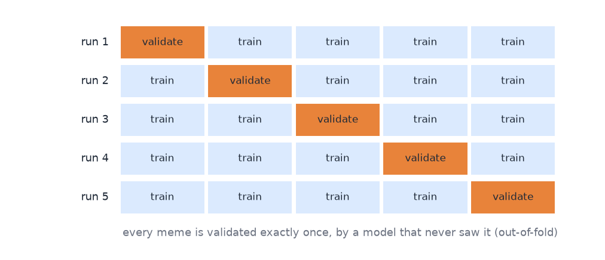
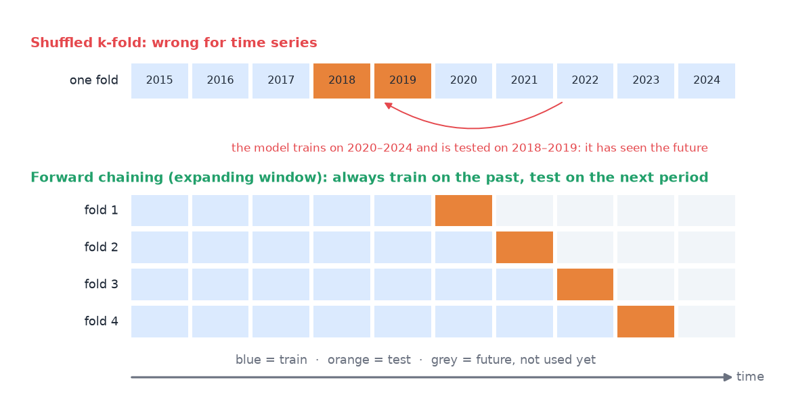
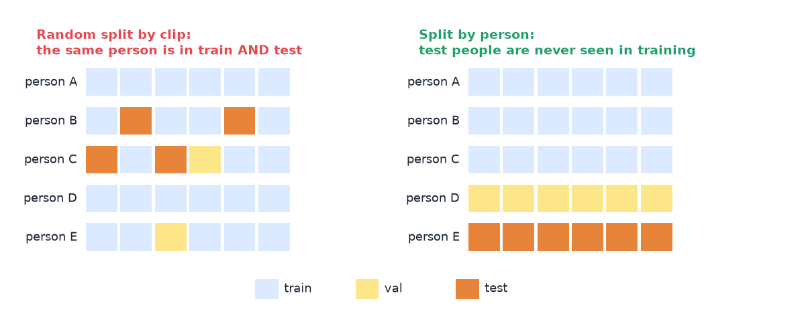
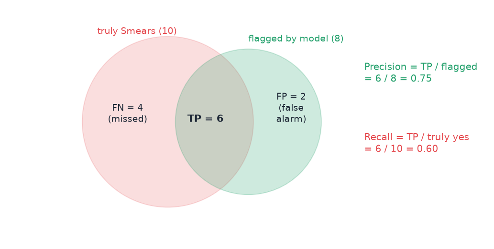
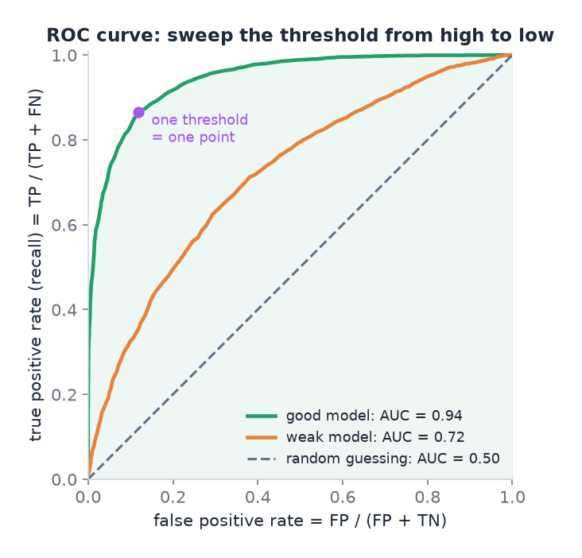
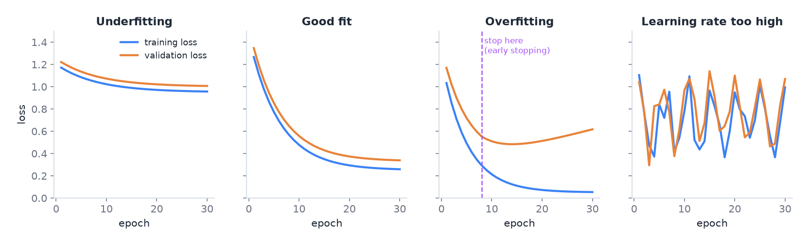
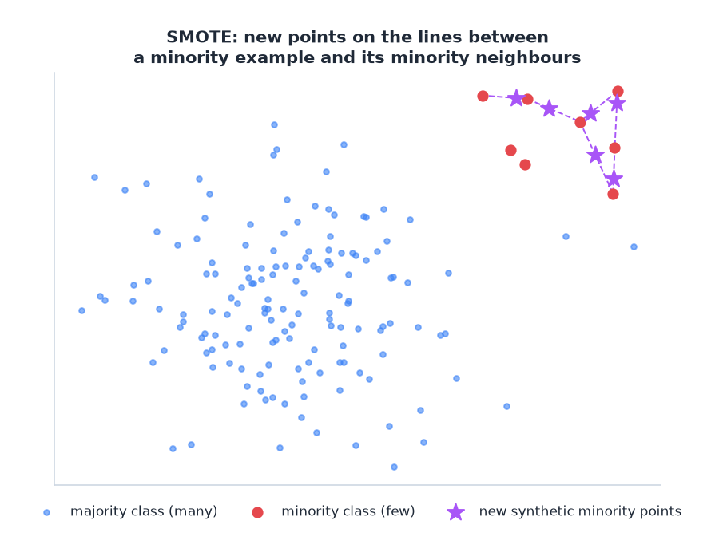

# 07 · Evaluation and the practical workflow

> [!NOTE]
> **Colour code for all formulas:** $\textcolor{#3b82f6}{\text{input / data}}$ · $\textcolor{#e8833a}{\text{learned weights}}$ · $\textcolor{#22a06b}{\text{model output}}$ · $\textcolor{#e5484d}{\text{true label}}$ · $\textcolor{#a855f7}{\text{setting you choose}}$

**Why this matters.** A model is only as good as the evidence for it. Most mistakes in practice are not in the network. They are in the data split, the metric or the way results are compared. Both assignments and many exam case studies are graded on exactly this.

**Course material:** Week 1 slides (`Week 1/W1_Lecture1_Part2_v2.pdf`): *Generalization*, *Under-fitting and Over-fitting*, *Hyperparameters and Validation Sets*, *Cross-Validation*, *ML Evaluation Framework*. Week 1 notebook (`Week 1/L1_Week1_MLBasics.ipynb`), especially *The Golden Rule of Data Splitting*. Week 2 notebook, *Managing Dataset Imbalance* and *Performance Measures*. Week 6 notebook (`Week 6/L6_Week6_IterativeWorkflow.ipynb`): Steps 1–4 and *Hyperparameter tuning*. Week 7 tutorial (`Week 7/COSC2779_Tute7_ans.pdf`) on splits, metrics and reading learning curves. Week 2 tutorial (`Week 2/COSC2779_Tute2_sol.pdf`): task/experience/performance, imbalance, validation for time series. Week 2 notebook, *SMOTE*. Week 11 lab (`Week 11/Lab11_Week11_RepresentationLearning.ipynb`), *Task 6.4 ROC curve*.

> [!TIP]
> **Play with it** (interactive, in the browser). Do this before or after reading; seeing it move is the fastest way in.
> - [MLU-Explain: train, test and validation sets](https://mlu-explain.github.io/train-test-validation/): why the test set is only touched once, as a scrolling story.
> - [MLU-Explain: cross-validation](https://mlu-explain.github.io/cross-validation/): animated k-fold splits.
> - [MLU-Explain: precision and recall](https://mlu-explain.github.io/precision-recall/): drag the threshold and watch precision and recall trade off.
> - [MLU-Explain: bias and variance](https://mlu-explain.github.io/bias-variance/): under- and overfitting as model complexity grows.
> - [MLU-Explain: double descent](https://mlu-explain.github.io/double-descent/): the modern twist on overfitting from the week 1 slides.

---

## 0. What machine learning is (Week 1)

**Definition (Tom Mitchell).** A program **learns** from experience **E** with respect to a task **T** and a performance measure **P**, if its performance at T, measured by P, improves with E.
- **T, the task:** the unknown function we want, $y = f(x)$. For example "given today's weather data, predict tomorrow's".
- **E, the experience:** the dataset of examples, $D = \{(x^{(i)}, y^{(i)})\}_{i=1}^{N}$ ($x^{(i)}$ = input of example $i$ · $y^{(i)}$ = its target · $N$ = number of examples).
- **P, the performance measure:** a number that says how well the model does, for example accuracy or mean squared error, measured on data the model did not train on.

The model is a **hypothesis** $h$ chosen from a **hypothesis space** $H$ (all functions the model could represent, for example all weight settings of one network). Learning means picking the $h$ in $H$ that best approximates $f$.

**The four ingredients of almost every ML algorithm:** a dataset, a model (hypothesis space), a cost function, and an optimisation procedure. Change one ingredient and you get a different algorithm.

**Three errors you must keep apart:**
- **Training error:** measured on the data used for fitting.
- **Generalisation (test) error:** measured on held-out data from the same distribution. It estimates the next one.
- **True risk:** the expected error over all possible data. It cannot be observed; the test error estimates it.

**Common problem types:** classification (which of $k$ categories?), regression (a number), anomaly detection (flag unusual events), synthesis and sampling (generate new examples, doc 11), denoising (clean a corrupted input), machine translation (sequence to sequence, doc 03/04).

> [!NOTE]
> **From the course · Week 2 tutorial, Q1 and Q2.** (1) A learning algorithm is fed historical weather data to predict the weather. What are T and P? (2) You predict tomorrow's price of a stock in dollars. Classification or regression?

<b>Show the answer</b>

1. **T** = the weather prediction task. **P** = for example the probability (rate) of correctly predicting a future date's weather. (E = the historical weather data.)
2. **Regression**: the target is a number on a continuous scale.

## 1. The workflow (Week 6)

1. **Define the goal and the metric.** What decision will the model support? Which error is worse?
2. **Build a simple baseline.** For example, always predict the most common class. Now every later number has a reference.
3. **Set up instrumentation.** Log training and validation loss and metrics every epoch. Plot them.
4. **Read the curves and decide the next move.** Underfitting? Overfitting? Unstable?
5. **Change one thing at a time** and measure again.
6. **Test once at the end.**

## 2. Data splits

| Split | Used for | Touched how often |
|---|---|---|
| Training | fitting the weights | every step |
| Validation | choosing models, hyperparameters, thresholds, epochs | many times |
| Test | final, unbiased estimate | **once**, at the very end |

**The golden rule:** no decision may use the test set. If you pick the model that scores best on the test set, the test score is no longer an honest estimate. It is optimistic.

**The validation and test data should look like the deployment data.** If the model will be used on images from microscope C, then validation and test must contain images from C. Training can contain all microscopes. In A2 the test set is 2020 US memes. So it says little about Australian memes in 2026. That gap is studied separately in C4.

> [!NOTE]
> **From the course · Week 7 tutorial, (a).** 10,000 cell images from microscopes A (5,000), B (2,500) and C (2,500). The doctors will use the model on microscope C. How do you split?

<b>Show the answer</b>

Roughly 90 / 5 / 5. Validation and test must both come from **C**, because that is the deployment data. Training should also contain C images (more than val/test), plus all of A and B.

## 3. Cross-validation

With little data, one validation split is noisy. One lucky or unlucky split can decide the result.

**k-fold cross-validation:**
1. Split the data into $k$ parts (folds), for example $k = 5$.
2. Train $k$ models. Each time, one fold is the validation set and the other $k − 1$ are for training.
3. Every example is predicted exactly once by a model that never saw it. These are **out-of-fold** predictions.
4. Report the mean and the spread over folds:

$$
\bar{s} = \frac{1}{\textcolor{#a855f7}{k}}\sum_{f=1}^{k} s_f \qquad\qquad \text{sd} = \sqrt{\frac{1}{k-1}\sum_{f=1}^{k}(s_f - \bar{s})^2}
$$

$s_f$ = score on fold $f$ · $\bar s$ = mean score · sd = standard deviation across folds, a measure of how noisy the estimate is.

**Simply put:** take turns. Every part is the validation part once. Then average the results.

5-fold cross-validation: five training runs, each with a different validation fold.

**Stratification:** make every fold have the same class proportions. For multi-label data, simple stratification does not work. **Iterative stratification** (Sechidis et al., 2011) assigns the rarest label first, then the next rarest, so that each label is spread evenly.

A2 uses 5-fold iterative stratification on 750 memes. The official 63-meme dev set is too small: one meme changes the F1 by about one point.

**Group k-fold.** If several examples come from the same person, patient or recording session, put the whole group into one fold (see section 4, group leakage). scikit-learn calls this `GroupKFold`.

**Time series need a different split.** Data points in a time series are ordered, not shuffled at random. A pattern from 2023 must not help predict 2019. Plain k-fold mixes past and future, so the model trains on the future and is tested on the past. Use **forward chaining** (an expanding window) instead:
- fold 1: train on period 1, test on period 2;
- fold 2: train on periods 1–2, test on period 3;
- fold 3: train on periods 1–3, test on period 4; and so on.

A **sliding window** (train only on the last $k$ periods) is another option when old data is no longer relevant.

Top: shuffled k-fold puts later years into training and earlier years into the test fold. Bottom: forward chaining tests every fold on the period right after its training data.

> [!NOTE]
> **From the course · Week 2 tutorial, Q8.** What validation technique would you use on a time series dataset?

<b>Show the answer</b>

Not standard k-fold: a time series is ordered in time, and a shuffled split lets the model learn from the future. Use **forward chaining**: fold 1 trains on [1] and tests on [2], fold 2 trains on [1, 2] and tests on [3], fold 3 trains on [1, 2, 3] and tests on [4], and so on. A sliding window is another option.

## 4. Data leakage

Leakage means information from the evaluation data gets into training. The results then look better than they are. Common forms:
- The **same example** in train and test. A2 found one: meme `474_batch_2` is in both. It was removed from training.
- **Near-duplicates** (the same meme with a different crop or capitalisation).
- Computing normalisation statistics on **all** data instead of only training data.
- **Information from the future** in time series.
- Tuning on the test set (see the golden rule).
- **Augmenting before splitting.** Two flipped copies of one image land in train and test. Split first, then augment the training part only.
- **Group leakage:** the same **person, patient or recording session** appears in train and test.

A sign of leakage: suspiciously good validation results, or validation loss far below training loss.

**Group leakage in detail.** In Assignment 1, colleagues recorded the hand gestures. Each person performed many clips. A random split by clip puts clips of the same person into training and test. The model can then recognise the person (body shape, clothes, background, lighting) instead of the gesture. The test score looks great, but a new person at the delivery site gets much worse results. **Split by person:** all clips of a person go into exactly one split. The test people are then truly new, like the client's staff at the demo. The same rule holds for patients in medical data and speakers in audio.

Left: a random split by clip puts persons B and C into both training and test (and E into training and validation). Right: split by person, so validation and test people are never seen during training.

## 5. Metrics

**Confusion counts for one class:**

| | truly yes | truly no |
|---|---|---|
| **predicted yes** | TP (true positive) | FP (false alarm) |
| **predicted no** | FN (miss) | TN (true negative) |

**Definitions:**

$$
\text{Accuracy} = \frac{TP + TN}{TP + TN + FP + FN}
\qquad
\text{Precision} = \frac{TP}{TP + FP}
\qquad
\text{Recall} = \frac{TP}{TP + FN}
\qquad
F_1 = \frac{2 \cdot \text{P} \cdot \text{R}}{\text{P} + \text{R}}
$$

**Precision**: when the model says yes, how often is it right? · **Recall**: of all true cases, how many did it find? · **F1**: harmonic mean; it is high only if both are high. · **Accuracy** is misleading with imbalance: if 95% of emails are not spam, "never spam" scores 95%.

**Simply put:** precision = when the model says yes, is it right? Recall = did it find all the real yeses? F1 = one number that is only high if both are high.

**Worked example.** 10 memes truly use *Smears*. The model flags 8 memes, and 6 of them are correct.
- TP = 6, FP = 2, FN = 4.
- Precision = 6/8 = 0.75. Recall = 6/10 = 0.60.
- $F_1 = \dfrac{2 \cdot 0.75 \cdot 0.60}{0.75 + 0.60} = \dfrac{0.90}{1.35} = 0.67$.

The worked example as a picture. Precision looks at the green circle, recall at the red one.

**Several classes: micro versus macro.**

$$
\text{micro-}F_1 = F_1\Big(\sum_k TP_k,\ \sum_k FP_k,\ \sum_k FN_k\Big)
\qquad\qquad
\text{macro-}F_1 = \frac{1}{K}\sum_{k=1}^{K} F_{1,k}
$$

micro = add up the counts over all classes first, then compute one F1, so frequent classes dominate · macro = compute F1 per class $k$, then average, so every class counts the same and rare classes matter.

Example from A2: always predicting *Loaded Language* gives micro-F1 0.38 but macro-F1 0.03. Micro-F1 alone would hide that the model knows only one class.

**Per-class scores and the confusion matrix** show which classes work and which get confused. In multi-label problems you can build a "confusion" table differently: when gold class *a* was missed, which wrong class *b* was predicted for the same example?

> [!NOTE]
> **From the course · Week 7 tutorial, (c) and Practice exam, C.1 (d).** (1) Which metric for pixel-wise cell segmentation? (2) Accuracy is good overall, but how do you see whether every one of six classes works and which ones get confused?

<b>Show the answer</b>

1. A pixel-wise measure that handles class imbalance, e.g. **F1**. Cell pixels and background pixels are not balanced, so accuracy would mislead.
2. **Per-class** precision/recall/F1 shows which classes work. A **confusion matrix** shows which classes are mixed up.

**ROC curve and AUC.** Most classifiers output a score, and you choose a threshold. Each threshold gives one pair of numbers:

$$
\text{TPR} = \frac{TP}{TP + FN} \qquad\qquad \text{FPR} = \frac{FP}{FP + TN}
$$

TPR = true positive rate, the same as recall: the share of true cases that are found · FPR = false positive rate: the share of true negatives that get a false alarm.

The **ROC curve** plots TPR against FPR for every threshold, from very strict (bottom left, nothing flagged) to very loose (top right, everything flagged). The **AUC** (area under the curve) summarises it in one number:
- AUC = 1.0: a perfect ranking. Every positive gets a higher score than every negative.
- AUC = 0.5: no better than random guessing (the diagonal).
- AUC is the probability that a random positive example gets a higher score than a random negative one.

Each point on a curve is one threshold. The better the model, the closer its curve hugs the top-left corner and the larger the area under it.

AUC does not depend on the threshold, so it is good for comparing models (Week 6 notebook uses `roc_auc_score`; the Week 11 lab plots the ROC curve of an anomaly detector). With strong class imbalance, the ROC can still look good while precision is poor, because FPR divides by the many negatives. Then also look at precision, recall and F1.

**Cohen's kappa** (listed in the Week 2 tutorial) compares the accuracy with the accuracy you would get by chance from the class frequencies. 0 means "no better than chance", 1 means perfect agreement.

**Choose the metric from the costs.** In a classroom, falsely accusing a meme of smearing someone is worse than missing a technique. So precision deserves extra attention there.

## 6. Reading learning curves

The four curve shapes you must recognise. Blue = training loss, orange = validation loss.

| What you see | Diagnosis | What to try |
|---|---|---|
| Training and validation both poor, close together | underfitting | bigger model, train longer, better features or a pretrained model, check the learning rate |
| Training very good, validation clearly worse; validation loss rises again | overfitting | early stopping, dropout, weight decay, data augmentation, more data, smaller model, freeze layers, lower learning rate |
| Both losses jump up and down | learning rate too high, unstable training | lower learning rate, warm-up, gradient clipping, larger batches |
| Validation loss below training loss | not necessarily a bug | dropout and other regularisation act only during training; training loss is averaged during the epoch while validation loss is measured at its end; the validation set may be easier; or there is leakage |

Fine-tuning a large pretrained model often overfits within one or two epochs. Early stopping is essential.

> [!NOTE]
> **From the course · Week 7 tutorial, (f) and (g).** (1) Training and validation loss both oscillate. What do you change? (2) The final validation loss is below the training loss. Why can that happen?

<b>Show the answer</b>

1. Lower the **learning rate** (see the right panel of the learning-curve figure).
2. Regularisation such as dropout is active only in training; training loss is averaged during the epoch while validation loss is measured at its end; the validation set may be easier; or there is leakage.

## 7. Hyperparameter tuning

Hyperparameters are settings you choose, not weights the model learns: learning rate, batch size, dropout, number of layers.
- Tune them on validation data or with cross-validation.
- The **learning rate** usually matters most. Tune it first.
- **Grid search** tries all combinations. **Random search** samples combinations and often finds good values faster.
- **Greedy (coordinate-wise) search** tunes one setting at a time and fixes it before the next. It is cheap but can miss interactions. A2 uses it, with a pre-stated decision rule for each step.

## 8. Comparing models fairly

**Noise.** With small data, results change with the random seed and the split. A difference of one F1 point can be pure chance.

**Paired comparison.** Evaluate both models on the same folds. Look at the difference fold by fold:

$$
d_f = s_f^{(A)} - s_f^{(B)}, \qquad \text{A is better only if}\;\; \bar{d} > \text{sd}(d_f)
$$

$s_f^{(A)}, s_f^{(B)}$ = scores of models A and B on fold $f$ · $d_f$ = their difference on that fold · $\bar d$ = mean difference. A hard fold is hard for both models, so this noise cancels. The rule "mean advantage larger than its spread" is the tie rule used in A2.

**Bootstrap confidence interval** for a test score:
1. Draw $n$ test examples with replacement from the $n$ test examples.
2. Compute the metric on this resample.
3. Repeat 1,000 times.
4. The 2.5th and 97.5th percentiles form a 95% interval.

It shows how much the score would move with a different test sample of the same size.

**Baselines.** Always report a trivial baseline (majority class, random by class frequency). Without it, "F1 = 0.56" means nothing.

## 9. Class imbalance

When some classes are rare:
- Use precision, recall and F1, not accuracy.
- **Weighted loss:** give positive examples of rare classes a larger weight:

$$
L = -\Big[\,\textcolor{#a855f7}{\alpha_1}\,\textcolor{#e5484d}{y}\,\log \textcolor{#22a06b}{p} + \textcolor{#a855f7}{\alpha_0}\,(1 - \textcolor{#e5484d}{y})\,\log(1 - \textcolor{#22a06b}{p})\,\Big]
$$

$\alpha_1$ = weight for positive examples (large for rare classes) · $\alpha_0$ = weight for negative examples. A2 sets $\alpha_1 = \sqrt{N_{\text{neg}}/N_{\text{pos}}}$ and $\alpha_0 = 1$; the square root is gentler than the raw ratio.

- **Focal loss:** multiplies the loss by a factor that shrinks for easy examples:

$$
L_{\text{focal}} = -(1 - p_t)^{\textcolor{#a855f7}{\gamma}}\,\log p_t
$$

$p_t$ = predicted probability of the true class · $\gamma$ = focus strength (often 2). If the model is already sure ($p_t \approx 1$), the factor is ≈ 0, so easy examples barely count.

- **Resampling:** show rare examples more often (**oversampling**) or drop some common examples (**undersampling**). Oversampling copies can be memorised; undersampling throws data away.
- **Synthetic samples: SMOTE** (Week 2 notebook). For a minority example, pick one of its nearest minority neighbours and create a new point somewhere on the line between them:

$$
\textcolor{#3b82f6}{x_{\text{new}}} = \textcolor{#3b82f6}{x_i} + \textcolor{#a855f7}{\lambda}\,\big(\textcolor{#3b82f6}{x_{\text{nn}}} - \textcolor{#3b82f6}{x_i}\big), \qquad \textcolor{#a855f7}{\lambda} \in [0, 1] \text{ random}
$$

$x_i$ = a minority example (a feature vector) · $x_{\text{nn}}$ = one of its nearest neighbours from the same minority class · $\lambda$ = a random number between 0 and 1, so $x_{\text{new}}$ lies somewhere between the two. (This $\lambda$ has nothing to do with the regularisation $\lambda$ in doc 01.)

SMOTE: each purple star lies on a line between a red minority example and one of its minority neighbours.

SMOTE works for tabular features. For images, use data augmentation instead. Apply it to the **training** split only.
- **Tune the thresholds.**
- **Collect more data** of the rare class, if at all possible.
- **Treat it as anomaly detection** when the rare class is extremely rare: model only the normal class and flag what does not fit (doc 11, autoencoders).

> [!NOTE]
> **From the course · Week 2 tutorial, Q7.** 286 patients, 201 without and 85 with recurrence of breast cancer. How would you handle the imbalance?

<b>Show the answer</b>

About 70% of the data is in one class, so accuracy can look good while the model has no power on the other class. Options: collect more data; choose suitable metrics (confusion matrix, precision, recall, F1, kappa, ROC); resample (over- or undersampling); generate synthetic samples (SMOTE); use a penalised (weighted) loss that makes errors on the minority class cost more; or treat it as anomaly detection. The key is to recognise what damage the imbalance does and to counter it.

## 10. Common mistakes

- Using the test set to choose the threshold or the epoch.
- Reporting accuracy on imbalanced data.
- Reporting only micro-F1 when rare classes matter.
- Declaring a winner from a difference smaller than the seed-to-seed noise.
- Forgetting that in-distribution test data does not prove the model works in a new setting.
- Splitting clips or images of the **same person** randomly into train and test (group leakage).
- Using shuffled k-fold on **time series**. Use forward chaining.
- Applying SMOTE or augmentation **before** splitting.
- Reading AUC = 0.9 as "90% accuracy". AUC is a ranking quality, not an accuracy.

## 11. How this appears in A2

- Official test set used once. 5-fold iterative stratified CV for all choices.
- Leakage found and fixed (`474_batch_2`). Label noise documented (same text, different labels).
- Micro-F1, macro-F1, per-technique F1, span F1 (official SemEval metric, verified against the official scorer).
- Majority and prior-random baselines.
- Paired fold comparison with a tie rule. Seed-variance check. Bootstrap intervals on the test set.

## Watch and read

**Official course videos** (from the Canvas week pages; Canvas Studio links need your RMIT login). Watch these first: the exam is built on this material.
- **Week 1 pre-recorded lectures** (introduction to deep learning, review of machine-learning fundamentals): [part 1](https://rmit-arc.instructuremedia.com/embed/6463473d-55e6-4550-857f-418a7e386cc3)
- Week 1: Bloomberg Originals, *This Canadian genius created modern AI* (Geoffrey Hinton, background story): https://www.youtube.com/watch?v=l9RWTMNnvi4
- **Week 6 pre-recorded lectures** (practical methodology and hyperparameter tuning): [part 1](https://rmit-arc.instructuremedia.com/embed/a44485d6-a91a-4856-a0b5-a5415beb2744) · [part 2](https://rmit-arc.instructuremedia.com/embed/db995f45-2bed-4958-828a-8aa422b8d5fb) · [part 3](https://rmit-arc.instructuremedia.com/embed/6e666542-504a-4064-9bef-b44c6a8d9fdb)

**More videos and readings:**

- StatQuest, *Cross validation*: https://www.youtube.com/watch?v=fSytzGwwBVw
- StatQuest, *Bias and variance*: https://www.youtube.com/watch?v=EuBBz3bI-aA
- StatQuest, *Regularization part 1: Ridge (L2)*: https://www.youtube.com/watch?v=Q81RR3yKn30
- Google ML crash course, *Accuracy, precision, recall*: https://developers.google.com/machine-learning/crash-course/classification/precision-and-recall
- Google ML crash course, *Thresholds and the confusion matrix*: https://developers.google.com/machine-learning/crash-course/classification/thresholding
- Google ML crash course, *Overfitting*: https://developers.google.com/machine-learning/crash-course/overfitting/overfitting
- scikit-learn guide, *Cross-validation* (clear diagrams, including `GroupKFold` and `TimeSeriesSplit`): https://scikit-learn.org/stable/modules/cross_validation.html
- Google ML crash course, *ROC and AUC*: https://developers.google.com/machine-learning/crash-course/classification/roc-and-auc
- MLU-Explain, *ROC and AUC* (interactive): https://mlu-explain.github.io/roc-auc/
- SMOTE paper (Chawla et al., 2002): https://arxiv.org/abs/1106.1813
- Goodfellow, Bengio, Courville, *Deep Learning*, chapter 11 *Practical methodology* (free online): https://www.deeplearningbook.org/

---

## Cheat sheet

> [!IMPORTANT]
> **The 12 things to remember**
> 0. ML = improve at task **T**, measured by **P**, with experience **E**. Ingredients: data, model, cost, optimiser.
> 1. Workflow: **goal + metric → baseline → instrument → read curves → change one thing → test once.**
> 2. Train = fit, validation = choose, **test = once**. Val/test must look like deployment.
> 3. Small data → **k-fold CV**; multi-label → iterative stratification; groups → **group k-fold**; time series → **forward chaining**.
> 4. Leakage: duplicates, near-duplicates, global normalisation, future info, tuning on test, **same person in train and test**, augmenting before splitting.
> 5. P = TP/(TP+FP), R = TP/(TP+FN), F1 = 2PR/(P+R). Accuracy lies under imbalance.
> 6. **Micro** = pool counts (frequent classes rule). **Macro** = average per class (rare classes count).
> 7. Curves: both bad → underfit; big gap → overfit; zig-zag → LR too high; val < train → regularisation, timing, easier val, or leakage.
> 8. Compare **paired** on the same folds; a win must beat the noise. Report bootstrap CIs.
> 9. Imbalance: weighted BCE ($\alpha_1$ up for rare positives), focal loss, resampling, SMOTE, tuned thresholds, more data, anomaly detection.
> 10. **ROC** = TPR vs FPR over all thresholds; **AUC** 0.5 = random, 1.0 = perfect ranking; threshold-free.
> 11. SMOTE: $x_{\text{new}} = x_i + \lambda(x_{\text{nn}} - x_i)$, training split only.

> [!TIP]
> **Memory hooks**
> - **Precision = "how Pure are my alarms?" Recall = "how many did I Recover?"**
> - **Test set = a sealed exam paper.** If you peek, your grade means nothing.
> - **Micro = majority rules. Macro = every class gets one vote.**
> - **Learning curves as a doctor's chart:** two low lines = weak patient (underfit); lines drifting apart = memorising patient (overfit); a fever curve = learning rate too hot.
> - **Bootstrap = "what if I had drawn a different class of 200 students?"**

> [!TIP]
> **How to learn this chapter**
> - **Compute** P, R and F1 for: 20 true cases, 25 flagged, 15 correct. (P = 0.60, R = 0.75, F1 = 0.67.)
> - **Sketch the four learning-curve shapes** from section 6 and write the diagnosis under each.
> - **Find the leak:** list three ways a time-series model could see the future by accident.
> - **Draw forward chaining** for 5 years of data, with 4 folds.
> - **Explain in 3 sentences** why gesture clips must be split by person, as for an exam answer.
