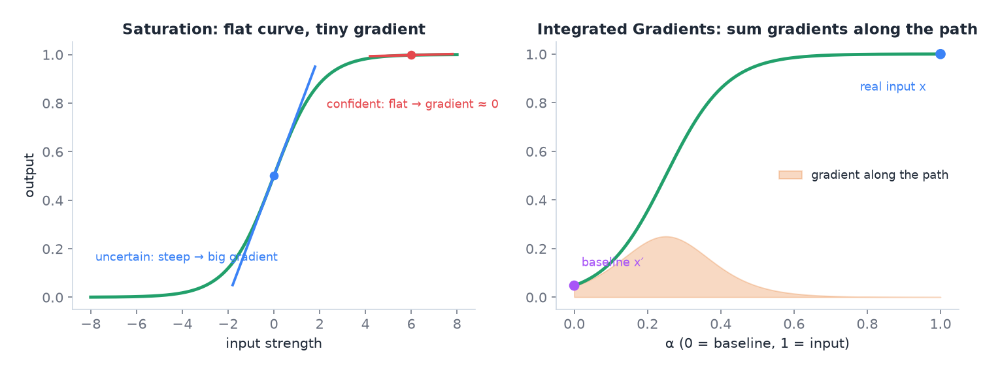
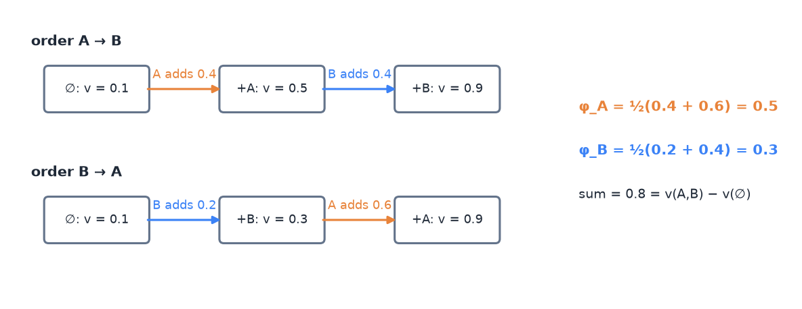
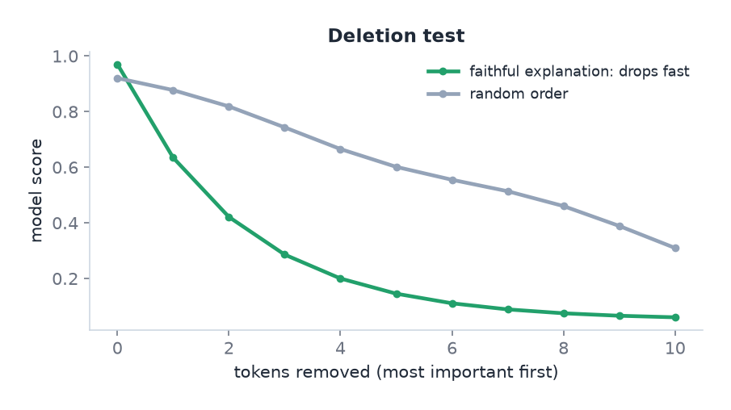

# 08 · Interpretability: why did the model decide this?

> [!NOTE]
> **Colour code for all formulas:** $\textcolor{#3b82f6}{\text{input / data}}$ · $\textcolor{#e8833a}{\text{learned weights}}$ · $\textcolor{#22a06b}{\text{model output}}$ · $\textcolor{#e5484d}{\text{true label}}$ · $\textcolor{#a855f7}{\text{setting you choose}}$

**The problem.** A deep network makes a prediction, but it does not say why. In high-stakes settings (medicine, schools, law) people must be able to check the reasoning. Explanations also catch bugs: a model can be right for the wrong reason.

**Course material:** Week 11 slides (`Week 11/main_week11_interpretability.pdf`), the whole deck. Week 11 notebook (`Week 11/L11_Week11_Interpretability.ipynb`): *Perturbation methods* (leave-one-out, LIME, SHAP, KernelSHAP), *Gradient methods*, *Transformer-specific methods*, *Which explanations are faithful?*, *When "removing" is out-of-distribution*. Week 11 tutorial (`Week 11/COSC2779_Tute11_QA.pdf`). Week 12 lab (`Week 12/Lab12_Week12_Explainability.ipynb`): Grad-CAM, bias, attention, counterfactuals.

> [!TIP]
> **Play with it** (interactive, in the browser). Do this before or after reading; seeing it move is the fastest way in.
> - [Distill: Visualizing the impact of feature attribution baselines](https://distill.pub/2020/attribution-baselines/): change the IG baseline and see the explanation change.
> - [Distill: Feature visualization](https://distill.pub/2017/feature-visualization/): what single neurons of a CNN 'look for'.
> - [CNN Explainer](https://poloclub.github.io/cnn-explainer/): see the feature maps that Grad-CAM weights.

---

## 1. Basic vocabulary

- **Interpretable vs explainable.** An interpretable model is simple enough to understand directly (a small decision tree). An explanation is extra output that describes a complex model's behaviour.
- **Local explanation:** explains one prediction. "For this image, these pixels led to *melanoma*."
- **Global explanation:** describes behaviour across many inputs. "The concept *irregular border* generally raises the melanoma score."
- **Post-hoc:** explain an already-trained model from outside.
- **Interpretable by design:** build the model so its reasoning is visible (concept bottleneck models, below).
- **Model-specific vs model-agnostic:** some methods need the weights and gradients. Others need only inputs and outputs, so they also work on a black-box API.

## 2. Why explanations matter

1. **Trust and accountability.** Experts must be able to check and justify decisions.
2. **Debugging.** Find **shortcut learning**: a spurious feature that happens to correlate with the label. Classic example: a skin-lesion model looks at a ruler that doctors place next to suspicious lesions, not at the lesion itself.
3. **Fairness.** Detect whether a model reacts to protected attributes such as names or groups.

## 3. Feature visualisation (mostly for CNNs)

- **Visualise filters** of the first layer: they look like edge and colour detectors.
- **Visualise activations:** which inputs make a neuron fire strongly.
- **Gradient ascent on the input:** start from noise and change the image to maximise one neuron or class. The result shows what the unit "looks for".

## 4. Attribution methods: which parts of the input mattered?

### 4.1 Occlusion and leave-one-out (perturbation)

Remove or cover one part $i$ of the input and see how much the prediction drops:

$$
\text{LOO}_i = f(\textcolor{#3b82f6}{x}) - f(\textcolor{#3b82f6}{x}_{\setminus i})
$$

$f(x)$ = model score for the full input · $x_{\setminus i}$ = the input with part $i$ removed or covered. A big drop means part $i$ was important.

- Simple and model-agnostic.
- Slow for many parts.
- **Weakness:** it double-counts interactions (see the SHAP example below).

> [!NOTE]
> **From the course · Week 11 tutorial, (b).** Grad-CAM heatmaps of a melanoma classifier highlight a ruler and ink marks next to the lesion. What does that show, and what do you do?

<b>Show the answer</b>

**Shortcut learning:** suspicious lesions are photographed with rulers more often, so the model uses the ruler. It will fail where that correlation does not hold. Clean or crop the images, collect data with markings in both classes, retrain, and check again with the explanation and with a test set split by "marking / no marking".

### 4.2 Saliency maps (gradients)

Compute the gradient of the class score with respect to each input feature. **Gradient × input** multiplies it by the input value:

$$
\text{saliency}_i = \frac{\partial f(\textcolor{#3b82f6}{x})}{\partial \textcolor{#3b82f6}{x_i}} \qquad\qquad \text{grad} \times \text{input}_i = \textcolor{#3b82f6}{x_i}\cdot\frac{\partial f(\textcolor{#3b82f6}{x})}{\partial \textcolor{#3b82f6}{x_i}}
$$

$\partial f / \partial x_i$ = how much the score would change if feature $i$ changed a little.

**Weakness: saturation.** When the model is very confident, the output curve is flat (the sigmoid or softmax is saturated). Then the gradients are close to zero, even for very important inputs. The explanation looks empty exactly when the model is most sure.

### 4.3 CAM and Grad-CAM (CNNs)

Grad-CAM takes the feature maps $A^k$ of the last convolutional layer and weights each by its average gradient:

$$
\alpha_k^{c} = \frac{1}{Z}\sum_{i,j}\frac{\partial y^c}{\partial A^k_{ij}}, \qquad \text{Grad-CAM}^c = \text{ReLU}\Big(\sum_k \alpha_k^c\,A^k\Big)
$$

$A^k$ = feature map number $k$ · $y^c$ = score of class $c$ · $\alpha_k^c$ = importance of map $k$ for class $c$ (gradient averaged over all $Z$ positions) · ReLU keeps only the parts that push towards class $c$. The result is a coarse heatmap over the image.

- Needs access to feature maps and gradients. It does not work with a black-box API.
- Shows *where* the model looked, at low resolution.

### 4.4 Integrated Gradients (IG)

IG fixes saturation. It does not use one gradient at the input. It averages gradients along a straight path from a **baseline** $x'$ to the real input $x$:

$$
\boxed{\;\text{IG}_i(\textcolor{#3b82f6}{x}) = (\textcolor{#3b82f6}{x_i} - \textcolor{#a855f7}{x'_i}) \cdot \int_{0}^{1} \frac{\partial f\big(\textcolor{#a855f7}{x'} + \alpha\,(\textcolor{#3b82f6}{x} - \textcolor{#a855f7}{x'})\big)}{\partial x_i}\, d\alpha\;}
$$

$x$ = real input · $x'$ = baseline, a "neutral" input (black image; for text all tokens replaced by [PAD]) · $\alpha$ runs from 0 (baseline) to 1 (real input) · the integral averages the gradient along that path. In practice it is a sum over about 32 steps.

Left: on the flat part of the curve the gradient is almost 0, even though the input matters. Right: IG walks from the baseline to the input and collects the gradient (orange) on the way, where the curve is steep.

- **Why it works:** along the path, the model passes through regions that are not saturated, where gradients carry information.
- **Completeness:** the attributions add up exactly to the change in output:

$$
\sum_i \text{IG}_i(\textcolor{#3b82f6}{x}) = f(\textcolor{#3b82f6}{x}) - f(\textcolor{#a855f7}{x'})
$$

$\text{IG}_i$ = attribution of feature $i$ · $\sum_i$ = added over all features · $f(x)$ = model score for the real input · $f(x')$ = score for the baseline. All the credit together explains exactly the change in score.

- **Caveat:** the baseline defines "important compared to what". Different baselines can give different explanations.

> [!NOTE]
> **From the course · Week 11 tutorial, (h).** Gradient × input on a text model gives near-zero scores for every token when the model is very confident. Why, and how does Integrated Gradients fix it?

<b>Show the answer</b>

The output is saturated, so the local gradient is almost zero even for important tokens. IG integrates the gradient along the path from a baseline (e.g. all [PAD]) to the input; on the way it passes non-saturated regions. Its scores sum to $f(x) - f(x')$, and the baseline defines "important compared to what".

### 4.5 LIME (model-agnostic)

LIME explains one prediction with a simple local model:
1. Split the input into parts (superpixels for images, words for text).
2. Create many perturbed versions by randomly switching parts off. Encode each as a 0/1 vector $z$.
3. Ask the black-box model for its prediction $f(z)$ on each version.
4. Weight each version by how similar it is to the original: $\pi(z)$.
5. Fit a small linear model $g(z) = \mathbf{w}^\top z$ that copies $f$ near the original:

$$
\min_{\mathbf{w}} \sum_{z} \pi(z)\,\big(f(z) - \mathbf{w}^\top z\big)^2 + \text{(penalty for many non-zero weights)}
$$

$\min_{\mathbf{w}}$ = choose the weights $\mathbf{w}$ that make the rest as small as possible · $z$ = one perturbed version (0/1 per part) · $f(z)$ = black-box output · $\mathbf{w}^\top z$ = the simple linear model's output · $\pi(z)$ ("pi") = closeness weight · the square measures how badly the simple model copies the black box.

6. The largest positive weights are the explanation.

$z$ = which parts are switched on · $f(z)$ = black-box prediction · $\pi(z)$ = closeness to the original input · $\mathbf{w}$ = one weight per part, the explanation.

Strengths: works with any model, including an API. Weaknesses: results can change between runs, and the perturbed inputs can be unrealistic.

### 4.6 SHAP and Shapley values (model-agnostic)

From game theory. Features are "players" who together produce the prediction. A feature's Shapley value is its average **marginal contribution** over all orders in which features could be added:

$$
\phi_i = \sum_{S \subseteq N \setminus \{i\}} \frac{|S|!\,(|N| - |S| - 1)!}{|N|!}\,\Big[v(S \cup \{i\}) - v(S)\Big]
$$

$N$ = all features · $S$ = a subset of the other features · $v(S)$ = model output when only the features in $S$ are present · $v(S \cup \{i\}) - v(S)$ = what feature $i$ adds to $S$ · the fraction weights each subset so that every order of adding features counts equally.

**Worked example with two parts, A and B:**

| $v(\emptyset)$ | $v(\{A\})$ | $v(\{B\})$ | $v(\{A, B\})$ |
|---|---|---|---|
| 0.1 | 0.5 | 0.3 | 0.9 |

With two features there are two orders (A first, or B first), so each gets weight ½:

$$
\begin{aligned}
\phi_A &= \tfrac12\big[(v(A) - v(\emptyset)) + (v(A,B) - v(B))\big] = \tfrac12\,[0.4 + 0.6] = \mathbf{0.5} \\
\phi_B &= \tfrac12\big[(v(B) - v(\emptyset)) + (v(A,B) - v(A))\big] = \tfrac12\,[0.2 + 0.4] = \mathbf{0.3} \\
\phi_A + \phi_B &= 0.8 = v(A,B) - v(\emptyset) \quad\text{(efficiency)}
\end{aligned}
$$

$\phi_A, \phi_B$ ("phi") = Shapley values of parts A and B · $v(\cdot)$ = model output with only those parts present · $\emptyset$ = the empty set, no part present · $\tfrac12$ because there are two possible orders.

The two orders of adding A and B. Shapley averages what each part adds over both orders.

> [!NOTE]
> **From the course · Week 11 tutorial, (c) and (d).** The worked example above is exactly tutorial question (d). Question (c) asks: the classifier is only available as an API (no weights, no gradients). Can you use Grad-CAM? How would LIME work?

<b>Show the answer</b>

No Grad-CAM: it needs internal feature maps and gradients. Use LIME: segment the image into superpixels, switch random superpixels off, send each perturbed image to the API, weight the samples by closeness to the original, fit a sparse linear model; the largest positive weights are the explanation.

Leave-one-out for comparison: A gets $0.9 - 0.3 = 0.6$, B gets $0.9 - 0.5 = 0.4$. The sum is 1.0, more than the real change of 0.8. The parts interact (together they add more than separately). Leave-one-out gives each part the full interaction. SHAP splits it fairly.

Exact Shapley values need all $2^n$ subsets, which is too slow for many features. **KernelSHAP** approximates them by sampling.

## 5. Concepts instead of pixels

- **TCAV** (testing with concept activation vectors): measures how much a human concept, such as "striped", pushes the prediction for a class. Global explanation.
- **Concept bottleneck model (CBM):** two stages. First, the input is mapped to human concepts (for example the dermatology 7-point checklist). Then only the concepts are used to predict the label: $\hat{y} = f(g(x))$. The concepts are the explanation.
  - **Test-time intervention:** an expert can correct a wrong concept, and the prediction updates.
  - Limits: needs concept labels for all training data; the concept list may be incomplete; soft concept scores can leak extra information.

## 6. Explaining Transformers

**Raw attention weights** show where information flows in one layer and one head. They are **not** a full explanation:
- They ignore the value vectors, the residual connections and the feed-forward layers.
- There are many heads and many layers.
- Very different attention patterns can lead to the same prediction ("attention is not explanation").

Better options:
- **Attention rollout:** combine attention across all layers, including the residual paths.
- **Gradient-weighted attention** (Chefer et al.): weight attention by its gradient, which makes it class-specific.
- **Integrated Gradients, LIME or SHAP over tokens.**
- **Probing:** train a small classifier on a layer's vectors to test what that layer encodes.

**Self-explanations of LLMs** ("I chose this because…") are generated text. They sound plausible but are not guaranteed to describe what the model actually used. Plausible is not the same as faithful.

> [!NOTE]
> **From the course · Week 11 tutorial, (g) and (i).** (1) A colleague shows attention weights as the explanation of a text classifier. Justified? (2) A vision–language model writes a fluent explanation of its own decision. Is that an explanation for free?

<b>Show the answer</b>

1. Only partly. Attention shows where information flows, not how much each token mattered; it ignores values, residuals and feed-forward layers. Better: attention rollout, gradient-weighted attention, IG or SHAP over tokens.
2. No. It is generated text, optimised to sound right. **Plausible is not faithful**; treat it as a claim and test it (with open weights you can check it with IG or relevance maps).

## 7. Is an explanation faithful? How to test it

- **Deletion test:** remove inputs in order of attributed importance. A faithful explanation makes the score drop faster than a random order.

A faithful explanation removes the important tokens first, so the score falls faster than with a random order.

- **Model randomisation (sanity check):** randomise the model's weights and recompute. If the explanation barely changes, it explains the input (for example edges), not the model.
- **Counterfactual check:** change the evidence the explanation points to and see if the prediction changes.
- **Agreement across methods:** trust conclusions more when several methods agree.

**The out-of-distribution pitfall.** Perturbation methods "remove" parts by replacing them, for example with a black patch. The model never saw such inputs in training. Its reaction may be about the strange patch, not about the missing information. Use natural baselines (blur, mean colour, in-painting), compare several baselines, or train with masking so removal is familiar.

## 8. Common mistakes

- Treating an attention map as proof of the model's reasoning.
- Using Grad-CAM on a black-box API (it needs gradients).
- Trusting gradient × input on very confident predictions (saturation).
- Forgetting that IG depends on the baseline.
- Treating a fluent LLM explanation as faithful.

## 9. How this appears in A2

- Integrated Gradients on the label head, with a [PAD] baseline.
- A quantitative check: does attribution fall inside the gold span more than a uniform spread would?
- The label-wise attention weights of our head give a second view, with the caveat above.
- C3 compares what the label head says with what the span head marks.

## Watch and read

- Christoph Molnar, *Interpretable Machine Learning* (free book), chapters:
  - LIME: https://christophm.github.io/interpretable-ml-book/lime.html
  - Shapley values: https://christophm.github.io/interpretable-ml-book/shapley.html
  - SHAP: https://christophm.github.io/interpretable-ml-book/shap.html
  - Pixel attribution (saliency, Grad-CAM, IG): https://christophm.github.io/interpretable-ml-book/pixel-attribution.html
- Distill, *Visualizing the impact of feature attribution baselines* (why the IG baseline matters, interactive): https://distill.pub/2020/attribution-baselines/
- Integrated Gradients paper (Sundararajan et al., 2017): https://arxiv.org/abs/1703.01365
- *Attention is not explanation* (Jain and Wallace, 2019): https://arxiv.org/abs/1902.10186

---

## Cheat sheet

> [!IMPORTANT]
> **The 9 things to remember**
> 1. Local = one prediction; global = overall behaviour. Post-hoc vs by design. Model-specific vs agnostic.
> 2. Explanations are for **trust, debugging (shortcuts) and fairness**.
> 3. Gradient × input **fails when saturated**.
> 4. **IG:** average gradients from a baseline to the input; $\sum_i \text{IG}_i = f(x) - f(x')$; depends on the baseline.
> 5. **Grad-CAM** needs feature maps + gradients → not for black-box APIs.
> 6. **LIME:** perturb, query, weight by closeness, fit a sparse linear model.
> 7. **SHAP:** average marginal contribution over all orders; fair with interactions; LOO double-counts.
> 8. **Attention ≠ explanation.** Use rollout, gradient-weighted attention or IG.
> 9. Test faithfulness: **deletion test, randomisation check, counterfactuals**. Beware OOD perturbations.

> [!TIP]
> **Memory hooks**
> - **Saturation = asking a fully confident person "would a tiny change convince you otherwise?"** The answer is always "no", so the gradient says nothing. IG asks along the whole way from "no evidence" to "all evidence".
> - **SHAP = splitting a restaurant bill fairly** when two friends' dishes were cheaper as a combo. Leave-one-out bills each of them for the whole discount.
> - **LIME = "Local Imitation"**: a simple model imitates the black box only near this one example.
> - **Grad-CAM = "Gradients needed, CAMera inside the CNN"**: you must open the box.
> - **Ruler in skin images = the classic shortcut.** Right answer, wrong reason.

> [!TIP]
> **How to learn this chapter**
> - **Compute Shapley values** for $v(\emptyset)=0, v(A)=0.2, v(B)=0.4, v(A,B)=1.0$. (Answer: 0.4 and 0.6.)
> - **Make a 2 × 2 table:** methods (Grad-CAM, IG, LIME, SHAP) × "needs gradients?" / "works on an API?".
> - **Explain to a friend** why an LLM's own explanation is not proof of its reasoning.
