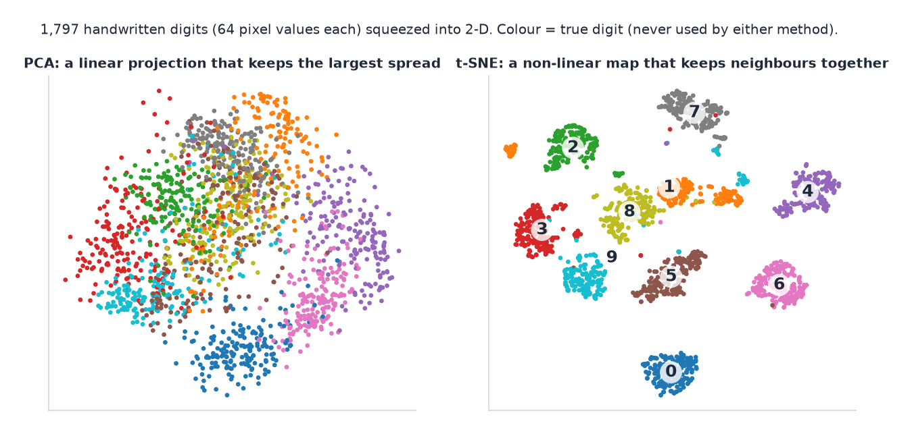
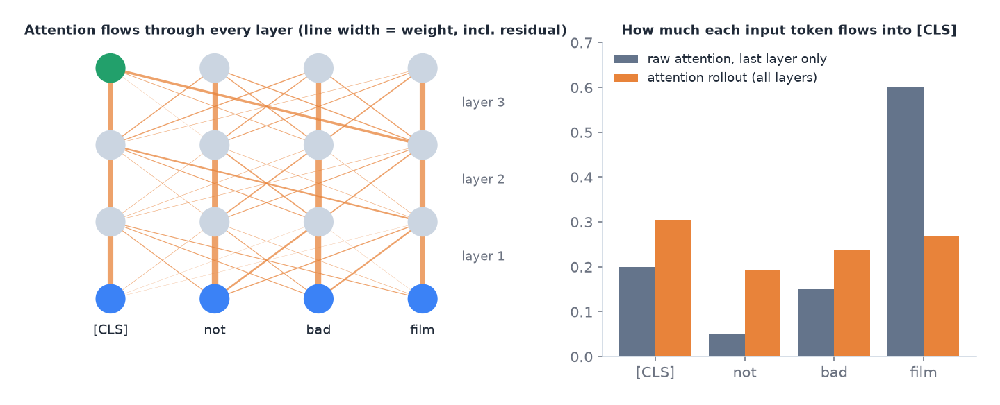
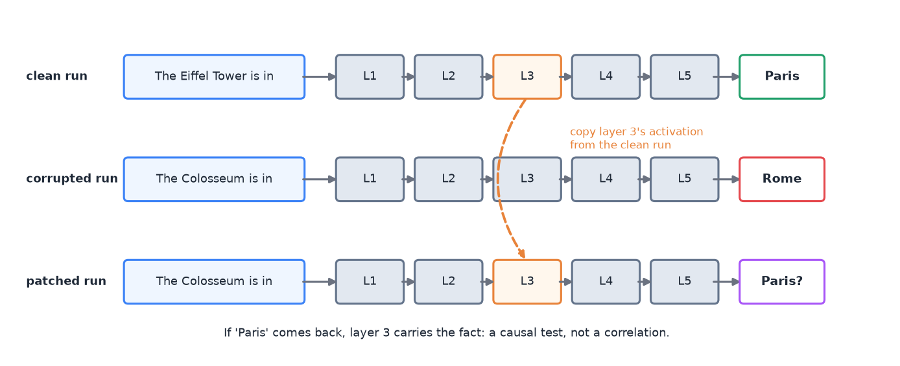
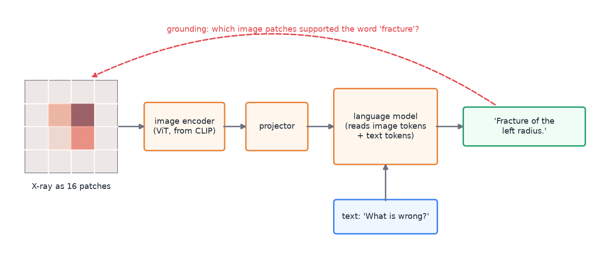

# 08 · Interpretability: why did the model decide this?

> [!NOTE]
> **Colour code for all formulas:** $\textcolor{#3b82f6}{\text{input / data}}$ · $\textcolor{#e8833a}{\text{learned weights}}$ · $\textcolor{#22a06b}{\text{model output}}$ · $\textcolor{#e5484d}{\text{true label}}$ · $\textcolor{#a855f7}{\text{setting you choose}}$

**The problem.** A deep network makes a prediction, but it does not say why. In high-stakes settings (medicine, schools, law) people must be able to check the reasoning. Explanations also catch bugs: a model can be right for the wrong reason.

**Course material:** Week 11 slides (`Week 11/main_week11_interpretability.pdf`), the whole deck. Week 11 notebook (`Week 11/L11_Week11_Interpretability.ipynb`): *Perturbation methods* (leave-one-out, LIME, SHAP, KernelSHAP), *Gradient methods*, *Transformer-specific methods*, *Which explanations are faithful?*, *When "removing" is out-of-distribution*. Week 11 tutorial (`Week 11/COSC2779_Tute11_QA.pdf`). Week 12 lab (`Week 12/Lab12_Week12_Explainability.ipynb`): Grad-CAM, bias, attention, counterfactuals. PCA and t-SNE of learned features: Week 6 notebook (*Analysis*), Week 10 lab (*Task 3.5*), Week 11 lab (*Part 5 Latent space analysis*).

> [!TIP]
> **Play with it** (interactive, in the browser). Do this before or after reading; seeing it move is the fastest way in.
> - [Distill: Visualizing the impact of feature attribution baselines](https://distill.pub/2020/attribution-baselines/): change the IG baseline and see the explanation change.
> - [Distill: Feature visualization](https://distill.pub/2017/feature-visualization/): what single neurons of a CNN 'look for'.
> - [CNN Explainer](https://poloclub.github.io/cnn-explainer/): see the feature maps that Grad-CAM weights.

---

## 1. Basic vocabulary

- **Interpretable vs explainable.** An interpretable model is simple enough to understand directly (a small decision tree). An explanation is extra output that describes a complex model's behaviour.
- **Local explanation:** explains one prediction. "For this image, these pixels led to *melanoma*."
- **Global explanation:** describes behaviour across many inputs. "The concept *irregular border* generally raises the melanoma score."
- **Post-hoc:** explain an already-trained model from outside.
- **Interpretable by design:** build the model so its reasoning is visible (concept bottleneck models, below).
- **Model-specific vs model-agnostic:** some methods need the weights and gradients. Others need only inputs and outputs, so they also work on a black-box API.

## 2. Why explanations matter

1. **Trust and accountability.** Experts must be able to check and justify decisions.
2. **Debugging.** Find **shortcut learning**: a spurious feature that happens to correlate with the label. Classic example: a skin-lesion model looks at a ruler that doctors place next to suspicious lesions, not at the lesion itself.
3. **Fairness.** Detect whether a model reacts to protected attributes such as names or groups.

## 3. Feature visualisation (mostly for CNNs)

Feature visualisation asks: *what has the network learned?* It is a **global** view.

- **Visualise filters** of the first layer: they look like edge and colour detectors (for example the 64 filters of 7 × 7 × 3 in ResNet-50). Filters of middle layers are hard to read.
- **Visualise activations:** pass one image through and plot the output channels of a middle layer. Looking at one channel over many images shows what it reacts to.
- **Gradient ascent on the input:** start from noise and change the image to maximise one neuron or class:

$$
I^{*} = \arg\max_{I}\; f_{l,c}(I) - \textcolor{#a855f7}{\lambda}\,R(I)
$$

$I$ = an input image · $f_{l,c}(I)$ = activation of channel $c$ in layer $l$ for that image · $R(I)$ = a penalty that keeps the image natural (for example smooth) · $\lambda$ = its weight · $\arg\max_I$ = "the image $I$ that makes this largest". Repeat: forward pass, backpropagate to the **pixels** (the weights stay fixed), update the pixels.

- **Map the last layer's features in 2-D** with PCA or t-SNE. If the classes form separate clusters, the features separate them well.

**PCA vs t-SNE.** Both squeeze many numbers per example into two, so you can plot them.
- **PCA** is linear. It keeps the directions with the largest spread. Distances are meaningful, but curved structure gets squashed.
- **t-SNE** is non-linear. It keeps **neighbours** together. Clusters show up clearly. But distances *between* clusters and cluster sizes mean little, and the picture changes with its settings (perplexity, random seed).

The same 64-number digit images in 2-D. PCA mixes several digits; t-SNE separates them into clean islands. Neither method used the labels; the colours were added afterwards.

**Pros and cons (Week 11 slides).** Feature visualisation gives unique insight: networks learn simple edge and texture detectors first and more abstract part and object detectors in higher layers. It also helps explain networks to non-experts. But many visualisations are not interpretable at all, there are far too many units to look at, and a pretty picture can give an *illusion* of understanding.

## 4. Attribution methods: which parts of the input mattered?

### 4.1 Occlusion and leave-one-out (perturbation)

Remove or cover one part $i$ of the input and see how much the prediction drops:

$$
\text{LOO}_i = f(\textcolor{#3b82f6}{x}) - f(\textcolor{#3b82f6}{x}_{\setminus i})
$$

$f(x)$ = model score for the full input · $x_{\setminus i}$ = the input with part $i$ removed or covered. A big drop means part $i$ was important.

- Simple and model-agnostic.
- Slow for many parts.
- **Weakness:** it double-counts interactions (see the SHAP example below).

> [!NOTE]
> **From the course · Week 11 tutorial, (b).** Grad-CAM heatmaps of a melanoma classifier highlight a ruler and ink marks next to the lesion. What does that show, and what do you do?

<b>Show the answer</b>

**Shortcut learning:** suspicious lesions are photographed with rulers more often, so the model uses the ruler. It will fail where that correlation does not hold. Clean or crop the images, collect data with markings in both classes, retrain, and check again with the explanation and with a test set split by "marking / no marking".

### 4.2 Saliency maps (gradients)

Compute the gradient of the class score with respect to each input feature. **Gradient × input** multiplies it by the input value:

$$
\text{saliency}_i = \frac{\partial f(\textcolor{#3b82f6}{x})}{\partial \textcolor{#3b82f6}{x_i}} \qquad\qquad \text{grad} \times \text{input}_i = \textcolor{#3b82f6}{x_i}\cdot\frac{\partial f(\textcolor{#3b82f6}{x})}{\partial \textcolor{#3b82f6}{x_i}}
$$

$\partial f / \partial x_i$ = how much the score would change if feature $i$ changed a little.

**Simply put:** change each input a tiny bit and see how much the score moves. Big move = important input.

For images, the slides take the absolute value of the gradient and the maximum over the three colour channels, which gives one heatmap value per pixel. One backward pass is enough, so it is cheap.

**Sanity check (Week 11 slides):** compute the saliency map also for a network with **random** weights. If it looks almost the same, the map shows edges of the image, not what the trained model uses.

**Weakness: saturation.** When the model is very confident, the output curve is flat (the sigmoid or softmax is saturated). Then the gradients are close to zero, even for very important inputs. The explanation looks empty exactly when the model is most sure.

### 4.3 CAM and Grad-CAM (CNNs)

**CAM (class activation maps).** Modern CNNs such as ResNet and GoogLeNet end with: last conv layer → global average pooling → one linear layer. Each feature map is like an "attribute detector" (for example "dog face"), and it still knows *where* the attribute is. The linear layer's weight for class $c$ says how important each attribute is. So CAM = the feature maps, weighted by the class's linear weights, summed. It only works for this GAP + linear architecture.

**Grad-CAM** generalises CAM to any CNN. It takes the feature maps $A^k$ of the last convolutional layer and weights each by its average gradient:

$$
\alpha_k^{c} = \frac{1}{Z}\sum_{i,j}\frac{\partial y^c}{\partial A^k_{ij}}, \qquad \text{Grad-CAM}^c = \text{ReLU}\Big(\sum_k \alpha_k^c\,A^k\Big)
$$

$A^k$ = feature map number $k$ · $y^c$ = score of class $c$ · $\alpha_k^c$ = importance of map $k$ for class $c$ (gradient averaged over all $Z$ positions) · ReLU keeps only the parts that push towards class $c$. The result is a coarse heatmap over the image.

**Simply put:** the gradient says which feature maps matter for this class. The feature maps say where in the image they fire. Weight, add up, keep the positive part, and lay it over the image.

- Needs access to feature maps and gradients. It does not work with a black-box API.
- Shows *where* the model looked, at low resolution.

### 4.4 Integrated Gradients (IG)

IG fixes saturation. It does not use one gradient at the input. It averages gradients along a straight path from a **baseline** $x'$ to the real input $x$:

$$
\boxed{\;\text{IG}_i(\textcolor{#3b82f6}{x}) = (\textcolor{#3b82f6}{x_i} - \textcolor{#a855f7}{x'_i}) \cdot \int_{0}^{1} \frac{\partial f\big(\textcolor{#a855f7}{x'} + \alpha\,(\textcolor{#3b82f6}{x} - \textcolor{#a855f7}{x'})\big)}{\partial x_i}\, d\alpha\;}
$$

$x$ = real input · $x'$ = baseline, a "neutral" input (black image; for text all tokens replaced by [PAD]) · $\alpha$ runs from 0 (baseline) to 1 (real input) · the integral averages the gradient along that path. In practice it is a sum over about 32 steps.

**Simply put:** fade the input in from "nothing" (the baseline) to the real input. Add up how much the score rose because of each feature along the way.

Left: on the flat part of the curve the gradient is almost 0, even though the input matters. Right: IG walks from the baseline to the input and collects the gradient (orange) on the way, where the curve is steep.

- **Why it works:** along the path, the model passes through regions that are not saturated, where gradients carry information.
- **Completeness:** the attributions add up exactly to the change in output:

$$
\sum_i \text{IG}_i(\textcolor{#3b82f6}{x}) = f(\textcolor{#3b82f6}{x}) - f(\textcolor{#a855f7}{x'})
$$

$\text{IG}_i$ = attribution of feature $i$ · $\sum_i$ = added over all features · $f(x)$ = model score for the real input · $f(x')$ = score for the baseline. All the credit together explains exactly the change in score.

- **Caveat:** the baseline defines "important compared to what". Different baselines can give different explanations.

> [!NOTE]
> **From the course · Week 11 tutorial, (h).** Gradient × input on a text model gives near-zero scores for every token when the model is very confident. Why, and how does Integrated Gradients fix it?

<b>Show the answer</b>

The output is saturated, so the local gradient is almost zero even for important tokens. IG integrates the gradient along the path from a baseline (e.g. all [PAD]) to the input; on the way it passes non-saturated regions. Its scores sum to $f(x) - f(x')$, and the baseline defines "important compared to what".

### 4.5 LIME (model-agnostic)

LIME explains one prediction with a simple local model:
1. Split the input into parts (superpixels for images, words for text).
2. Create many perturbed versions by randomly switching parts off. Encode each as a 0/1 vector $z$.
3. Ask the black-box model for its prediction $f(z)$ on each version.
4. Weight each version by how similar it is to the original: $\pi(z)$.
5. Fit a small linear model $g(z) = \mathbf{w}^\top z$ that copies $f$ near the original:

$$
\min_{\mathbf{w}} \sum_{z} \pi(z)\,\big(f(z) - \mathbf{w}^\top z\big)^2 + \text{(penalty for many non-zero weights)}
$$

$\min_{\mathbf{w}}$ = choose the weights $\mathbf{w}$ that make the rest as small as possible · $z$ = one perturbed version (0/1 per part) · $f(z)$ = black-box output · $\mathbf{w}^\top z$ = the simple linear model's output · $\pi(z)$ ("pi") = closeness weight · the square measures how badly the simple model copies the black box.

6. The largest positive weights are the explanation.

$z$ = which parts are switched on · $f(z)$ = black-box prediction · $\pi(z)$ = closeness to the original input · $\mathbf{w}$ = one weight per part, the explanation.

**Simply put:** switch parts of the input off at random, watch how the prediction changes, and fit a simple model that copies the big model near this one example.

Strengths: works with any model, including an API. Weaknesses: results can change between runs, and the perturbed inputs can be unrealistic.

### 4.6 SHAP and Shapley values (model-agnostic)

From game theory. Features are "players" who together produce the prediction. A feature's Shapley value is its average **marginal contribution** over all orders in which features could be added:

$$
\phi_i = \sum_{S \subseteq N \setminus \{i\}} \frac{|S|!\,(|N| - |S| - 1)!}{|N|!}\,\Big[v(S \cup \{i\}) - v(S)\Big]
$$

$N$ = all features · $S$ = a subset of the other features · $v(S)$ = model output when only the features in $S$ are present · $v(S \cup \{i\}) - v(S)$ = what feature $i$ adds to $S$ · the fraction weights each subset so that every order of adding features counts equally.

**Simply put:** split the prediction fairly among the features, like splitting a team bonus by how much each player added on average.

**Worked example with two parts, A and B:**

| $v(\emptyset)$ | $v(\{A\})$ | $v(\{B\})$ | $v(\{A, B\})$ |
|---|---|---|---|
| 0.1 | 0.5 | 0.3 | 0.9 |

With two features there are two orders (A first, or B first), so each gets weight ½:

$$
\begin{aligned}
\phi_A &= \tfrac12\big[(v(A) - v(\emptyset)) + (v(A,B) - v(B))\big] = \tfrac12\,[0.4 + 0.6] = \mathbf{0.5} \\
\phi_B &= \tfrac12\big[(v(B) - v(\emptyset)) + (v(A,B) - v(A))\big] = \tfrac12\,[0.2 + 0.4] = \mathbf{0.3} \\
\phi_A + \phi_B &= 0.8 = v(A,B) - v(\emptyset) \quad\text{(efficiency)}
\end{aligned}
$$

$\phi_A, \phi_B$ ("phi") = Shapley values of parts A and B · $v(\cdot)$ = model output with only those parts present · $\emptyset$ = the empty set, no part present · $\tfrac12$ because there are two possible orders.

The two orders of adding A and B. Shapley averages what each part adds over both orders.

> [!NOTE]
> **From the course · Week 11 tutorial, (c) and (d).** The worked example above is exactly tutorial question (d). Question (c) asks: the classifier is only available as an API (no weights, no gradients). Can you use Grad-CAM? How would LIME work?

<b>Show the answer</b>

No Grad-CAM: it needs internal feature maps and gradients. Use LIME: segment the image into superpixels, switch random superpixels off, send each perturbed image to the API, weight the samples by closeness to the original, fit a sparse linear model; the largest positive weights are the explanation.

Leave-one-out for comparison: A gets $0.9 - 0.3 = 0.6$, B gets $0.9 - 0.5 = 0.4$. The sum is 1.0, more than the real change of 0.8. The parts interact (together they add more than separately). Leave-one-out gives each part the full interaction. SHAP splits it fairly.

Exact Shapley values need all $2^n$ subsets, which is too slow for many features. **KernelSHAP** approximates them by sampling.

## 5. Concepts instead of pixels

- **TCAV** (testing with concept activation vectors): measures how much a human concept, such as "striped", pushes the prediction for a class. Global explanation.
- **Concept bottleneck model (CBM):** two stages. First, the input is mapped to human concepts (for example the dermatology 7-point checklist). Then only the concepts are used to predict the label: $\hat{y} = f(g(x))$. The concepts are the explanation.
  - **Test-time intervention:** an expert can correct a wrong concept, and the prediction updates.
  - Limits: needs concept labels for all training data; the concept list may be incomplete; soft concept scores can leak extra information.

TCAV is **post-hoc** (it asks a trained model "do you use concept c?"). A CBM is **interpretable by design** (the concepts are built into the model).

> [!NOTE]
> **From the course · Week 11 tutorial, (f).** Dermatologists want a model that reasons with the 7-point checklist (pigment network, streaks, blue-whitish veil, …) and that they can correct. Propose an interpretable-by-design model: its structure, how a clinician intervenes, and one limitation.

<b>Show the answer</b>

A **concept bottleneck model**. Stage 1, $g$: image → predicted concept scores $\hat c$ (one per checklist feature). Stage 2, $f$: concepts → diagnosis, $\hat y = f(g(x))$. The prediction depends on the image only through the concepts, so the concept layer *is* the explanation. **Intervention:** if the clinician sees a wrong concept (for example "no streaks" although streaks are present), they overwrite that value and $f$ recomputes the diagnosis. **Limitations:** every training image needs concept labels (expensive expert work); the concept set may be incomplete and cost accuracy; soft concept scores can leak extra information, so the concepts may not tell the whole story.

$x$ = the image · $g$ = the first network (image → concepts) · $\hat c$ = predicted concept scores · $f$ = the second model (concepts → diagnosis) · $\hat y$ = predicted diagnosis.

## 6. Explaining Transformers

**Raw attention weights** show where information flows in one layer and one head. They are **not** a full explanation:
- They ignore the value vectors, the residual connections and the feed-forward layers.
- There are many heads and many layers.
- Very different attention patterns can lead to the same prediction ("attention is not explanation").

The debate has a second half: **"Attention is not *not* explanation"** (Wiegreffe and Pinter, 2019). The very different attention patterns were found adversarially, and a model trained with them may behave differently. Practical take-away from the slides: attention shows where information **flows**, not how much it **mattered**. Treat raw attention as a hint and verify it with gradients or perturbations.

Better options:
- **Integrated Gradients, LIME or SHAP over tokens** (sections 4.4–4.6). For text, gradients are taken with respect to the token **embeddings**, because tokens themselves are discrete. Typical IG baselines: all-zero embeddings, or every token replaced by [PAD] or [MASK].
- **Attention rollout** and **gradient-weighted attention**, below.
- **Probing**, the **logit lens** and **mechanistic tools**, below.

### 6.1 Attention rollout

After layer 1, every position is already a mixture of all tokens. So one layer's attention says little about the *input* tokens. Rollout follows the flow back through **all** layers (Abnar and Zuidema, 2020):

$$
\hat{A}^{(l)} = \tfrac{1}{2}\big(\bar{A}^{(l)} + I\big), \qquad \tilde{A} = \hat{A}^{(L)}\,\hat{A}^{(L-1)} \cdots \hat{A}^{(1)}
$$

$\bar A^{(l)}$ = attention matrix of layer $l$, averaged over its heads (row $i$ = how much token $i$ attends to each token) · $I$ = identity matrix; adding it accounts for the residual connection, which passes each token's own vector straight on · $\tfrac12$ = mix both equally (rows are re-normalised to sum to 1) · $L$ = number of layers · $\tilde A$ = the product through all layers. The **[CLS] row** of $\tilde A$ says how much each input token flowed into the classification token.

A made-up 3-layer example for "not bad film". The last layer alone suggests that [CLS] looks almost only at "film" (0.60). Following the flow through all layers (rollout) shows that "not" and "bad" also reached [CLS] (0.19 and 0.24).

Rollout is **class-agnostic**: it gives the same map whichever class you ask about.

### 6.2 Gradient-weighted attention (Chefer et al., 2021)

Weight each attention map by its gradient towards the target class, keep only the positive part, average over heads, and propagate through the layers like rollout. It is the **Grad-CAM idea applied to attention**: feature map ↔ attention map, gradient weights ↔ gradient of attention. It is **class-specific** (different maps for "cat" and "dog"), works for ViT patches too, and is defined for text–image attention.

### 6.3 What do the layers know? Probing and the logit lens

- **Probing classifiers:** freeze the model and train a small (usually linear) classifier on one layer's vectors to predict a property: part of speech, syntax depth, sentiment. High probe accuracy means the information is **linearly decodable** at that layer. Classic finding: lower layers encode surface and syntax, higher layers more meaning. **Caveat: decodable ≠ used.** The model may hold information that it never uses for its prediction.
- **Logit lens:** in a language model, apply the final output layer (the "unembedding") to an **intermediate** layer's hidden state. You read off "what the model would predict if it stopped here", and watch the answer form layer by layer. For example, the correct next word often appears only in later layers.

Both are **global** tools: they describe what the network represents, not why one particular output happened.

### 6.4 A taste of mechanistic interpretability

**Goal:** reverse-engineer the algorithm inside the network: not only where it looks, but what it computes.
- **Circuits:** small sub-networks of heads and neurons that implement one behaviour. Example: **induction heads** (Olsson et al., 2022) copy patterns of the form "A B … A → B". They are one mechanism behind in-context learning (doc 05).
- **Sparse autoencoders (SAEs):** single neurons are often **polysemantic** (they fire for several unrelated things). An SAE trained on the activations finds directions that are more interpretable ("DNA sequences", "legal text").
- **Activation patching (causal tracing):**
  1. Run a clean input and a corrupted input.
  2. Copy one component's activation from the clean run into the corrupted run.
  3. If the correct output comes back, that component is causally important.

Activation patching. Copying layer 3's activation from the clean run into the corrupted run tests whether layer 3 carries the fact "Eiffel Tower → Paris".

Patching is an **intervention**, not a correlation. That makes it the strongest evidence for faithfulness.

### 6.5 Choosing a method for Transformers

| Method | Needs weights? | Class-specific? | Cost | Main caveat |
|---|---|---|---|---|
| Raw attention | yes | no | 1 pass | flow, not importance |
| Attention rollout | yes | no | 1 pass | same map for every class |
| Leave-one-out / LIME / SHAP | no | yes | many passes | slow; LOO misses interactions |
| Integrated Gradients | yes | yes | 20–300 passes | choice of baseline |
| Gradient-weighted attention | yes | yes | 1 forward + 1 backward | heuristic combination |
| Probing / logit lens | yes | — | cheap | decodable ≠ used |
| Activation patching | yes | yes | many passes | needs clean/corrupted pairs |

- Local question ("why this prediction?"): IG, gradient-weighted attention, or LIME/SHAP.
- Global question ("what has the model learned?"): probing, logit lens, mechanistic tools.
- Always sanity-check: delete the top tokens. Does the prediction actually change?

**Self-explanations of LLMs** ("I chose this because…") are generated text. They sound plausible but are not guaranteed to describe what the model actually used. Plausible is not the same as faithful.

> [!NOTE]
> **From the course · Week 11 tutorial, (g).** A colleague shows attention weights as the explanation of why a referral letter was flagged urgent. Justified? Suggest better alternatives.

<b>Show the answer</b>

Only partly. Attention shows where information flows, not how much each token mattered; it ignores values, residual connections and feed-forward layers; one head or layer is only part of the picture; and very different attention patterns can give the same prediction. Better: attention rollout (all layers, with residuals), gradient-weighted attention (class-specific), or IG / SHAP / LIME over tokens.

## 7. Explaining vision–language models (VLMs)

A typical VLM (for example LLaVA or Qwen-VL) has three parts:
1. an **image encoder**, often the ViT from CLIP, turns the image into **patch tokens**;
2. a **projector** maps them into the language model's embedding space;
3. a **language model** reads image tokens and text tokens together and generates the answer.

A VLM answers a question about an X-ray. Grounding asks which image patches supported a generated word, here "fracture".

Two questions you can ask:
- **Grounding:** which image regions supported this word or answer?
- **Reasoning:** why did it give this answer?

**Grounding methods.** Everything from this chapter transfers, now across modalities:
- **Attention from text to image tokens:** for an output word, which patches did it attend to? Reshape to the patch grid to get a heatmap. Same caveats as raw attention.
- **Gradient-weighted relevance** (Chefer et al.) across the text–image attention: word-specific maps.
- **CLIP similarity maps:** Grad-CAM on the image–text similarity score shows where "a fracture" appears in the image.
- **Perturbation:** mask image regions and watch the answer change.

**Self-explanations.** You can simply ask: "Is there a fracture? Explain your answer." The model gives a fluent, expert-sounding reason. But:
- **Plausible** = convincing to a human. **Faithful** = reflects the computation that actually produced the output. These are different.
- Language models can give fluent reasons that ignore the factor that truly drove the answer, for example a biasing cue in the prompt (Turpin et al., 2023).
- Treat a self-explanation as a **claim to be tested**, especially in medicine.

**Your access decides your tools:**

| Method | Open weights | Closed API |
|---|---|---|
| Self-explanation | ✓ | ✓ |
| Perturbation / LIME / SHAP | ✓ | ✓ |
| Attention maps | ✓ | ✗ |
| Gradients, Integrated Gradients | ✓ | ✗ |
| Probing, activation patching | ✓ | ✗ |

With a closed model you are limited to black-box methods and to what the model chooses to say.

> [!NOTE]
> **From the course · Week 11 tutorial, (i).** A VLM, asked "Is this lesion suspicious? Explain your answer", gives a fluent, clinically worded justification. The committee asks: "Doesn't this give us explanations for free?" Respond, and explain how open weights vs a closed API change what you can do.

<b>Show the answer</b>

The text explanation costs only a prompt, but it is **not guaranteed to be faithful**: it is generated text, optimised to sound right, and it may describe evidence the model did not use or hallucinate findings. Plausible ≠ faithful, so it is a claim to test. **Open weights:** you can compute text-to-image attention or relevance maps, gradients, Integrated Gradients, probing and activation patching, and use them to check the self-explanation. **Closed API:** you are limited to black-box perturbation (LIME/SHAP-style masking) and the self-explanations.

## 8. Is an explanation faithful? How to test it

- **Deletion test:** remove inputs in order of attributed importance. A faithful explanation makes the score drop faster than a random order.

A faithful explanation removes the important tokens first, so the score falls faster than with a random order.

- **Model randomisation (sanity check):** randomise the model's weights and recompute. If the explanation barely changes, it explains the input (for example edges), not the model.
- **Counterfactual check:** change the evidence the explanation points to and see if the prediction changes.
- **Agreement across methods:** trust conclusions more when several methods agree.

> [!NOTE]
> **From the course · Week 11 tutorial, (j).** Several explanation methods produce different heatmaps for the same images. Describe two tests to decide which explanations are faithful.

<b>Show the answer</b>

**Deletion test:** remove regions or tokens in order of attributed importance and track the prediction; a faithful explanation makes the score drop fastest, compared with a random order. **Model randomisation:** randomise the weights and recompute; if the explanation barely changes, it reflects the input (for example edges), not the model. Also: counterfactual checks (edit the cited evidence and see whether the prediction changes) and agreement across methods.

**The out-of-distribution pitfall.** Perturbation methods "remove" parts by replacing them, for example with a black patch. The model never saw such inputs in training. Its reaction may be about the strange patch, not about the missing information. Use natural baselines (blur, mean colour, in-painting), compare several baselines, or train with masking so removal is familiar.

> [!NOTE]
> **From the course · Week 11 tutorial, (e).** In LIME and SHAP, "removing" a region means replacing it with something (a black patch, a blur). Why can this make an explanation misleading, and how can you reduce the problem?

<b>Show the answer</b>

Images with black patches are **out-of-distribution**: the model never saw anything like them, so its response may reflect the artificial patch rather than the missing information. The explanation then describes the model's reaction to the perturbation, not its reasoning on real images. Reduce it with more natural baselines (blur, mean colour, in-painting, content from a background dataset), by comparing several baselines (distrust conclusions that change with the baseline), or by training with masking augmentation so "removed" regions are in-distribution.

## 9. Common mistakes

- Treating an attention map as proof of the model's reasoning.
- Using Grad-CAM on a black-box API (it needs gradients).
- Trusting gradient × input on very confident predictions (saturation).
- Forgetting that IG depends on the baseline.
- Treating a fluent LLM explanation as faithful.
- Reading distances between t-SNE clusters as meaningful. t-SNE keeps neighbours, not global distances.
- Concluding from a high probe accuracy that the model *uses* that information. Decodable ≠ used.
- Expecting attention rollout to give a different map per class. It is class-agnostic; use gradient-weighted attention for that.

## 10. How this appears in A2

- Integrated Gradients on the label head, with a [PAD] baseline.
- A quantitative check: does attribution fall inside the gold span more than a uniform spread would?
- The label-wise attention weights of our head give a second view, with the caveat above.
- C3 compares what the label head says with what the span head marks.

## Watch and read

**Official course videos** (from the Canvas week pages; Canvas Studio links need your RMIT login). Watch these first: the exam is built on this material.
- **Week 11 pre-recorded lectures** (neural network model interpretation, explainable AI): [part 1](https://rmit-arc.instructuremedia.com/embed/2763e26e-3072-4b75-b901-52f813e9351d) · [part 2](https://rmit-arc.instructuremedia.com/embed/1d307094-7d05-4000-a163-09c3b0945a29) · [part 3](https://rmit-arc.instructuremedia.com/embed/bc5343be-48f2-48aa-bddb-e5c798f1eec1) · [part 4](https://rmit-arc.instructuremedia.com/embed/2761aa67-258e-4f22-8f4b-06c320804598)
- Week 11: MLconf, *Interpretability beyond feature attribution* (the TCAV talk, section 5): https://www.youtube.com/watch?v=Ff-Dx79QEEY

**More videos and readings:**

- Christoph Molnar, *Interpretable Machine Learning* (free book), chapters:
  - LIME: https://christophm.github.io/interpretable-ml-book/lime.html
  - Shapley values: https://christophm.github.io/interpretable-ml-book/shapley.html
  - SHAP: https://christophm.github.io/interpretable-ml-book/shap.html
  - Pixel attribution (saliency, Grad-CAM, IG): https://christophm.github.io/interpretable-ml-book/pixel-attribution.html
- Distill, *Visualizing the impact of feature attribution baselines* (why the IG baseline matters, interactive): https://distill.pub/2020/attribution-baselines/
- Integrated Gradients paper (Sundararajan et al., 2017): https://arxiv.org/abs/1703.01365
- *Attention is not explanation* (Jain and Wallace, 2019): https://arxiv.org/abs/1902.10186
- *Attention is not not explanation* (Wiegreffe and Pinter, 2019): https://arxiv.org/abs/1908.04626
- Attention rollout (Abnar and Zuidema, 2020): https://arxiv.org/abs/2005.00928 · gradient-weighted attention (Chefer et al., 2021): https://arxiv.org/abs/2103.15679
- TCAV (Kim et al., 2018): https://arxiv.org/abs/1711.11279 · concept bottleneck models (Koh et al., 2020): https://arxiv.org/abs/2007.04612
- nostalgebraist, *Interpreting GPT: the logit lens*: https://www.lesswrong.com/posts/AcKRB8wDpdaN6v6ru/interpreting-gpt-the-logit-lens
- Anthropic, *In-context learning and induction heads*: https://transformer-circuits.pub/2022/in-context-learning-and-induction-heads/index.html · *Towards monosemanticity* (sparse autoencoders): https://transformer-circuits.pub/2023/monosemantic-features
- Turpin et al., *Language models don't always say what they think* (unfaithful self-explanations): https://arxiv.org/abs/2305.04388
- Distill, *How to use t-SNE effectively* (interactive): https://distill.pub/2016/misread-tsne/
- StatQuest, *t-SNE, clearly explained*: https://www.youtube.com/watch?v=NEaUSP4YerM

---

## Cheat sheet

> [!IMPORTANT]
> **The 12 things to remember**
> 1. Local = one prediction; global = overall behaviour. Post-hoc vs by design. Model-specific vs agnostic.
> 2. Explanations are for **trust, debugging (shortcuts) and fairness**.
> 3. Gradient × input **fails when saturated**.
> 4. **IG:** average gradients from a baseline to the input; $\sum_i \text{IG}_i = f(x) - f(x')$; depends on the baseline.
> 5. **Grad-CAM** needs feature maps + gradients → not for black-box APIs.
> 6. **LIME:** perturb, query, weight by closeness, fit a sparse linear model.
> 7. **SHAP:** average marginal contribution over all orders; fair with interactions; LOO double-counts.
> 8. **Attention ≠ explanation** (flow, not importance). **Rollout** $\tilde A = \prod_l \tfrac12(\bar A^{(l)} + I)$: all layers, class-agnostic. **Gradient-weighted attention**: class-specific (Grad-CAM for attention).
> 9. Test faithfulness: **deletion test, randomisation check, counterfactuals**, agreement. Beware OOD perturbations.
> 10. **Feature visualisation** (global): first-layer filters, activations, gradient ascent on the pixels, PCA/t-SNE of features (t-SNE keeps neighbours, not distances).
> 11. **Probing / logit lens** = what layers *encode* (decodable ≠ used). **Activation patching** = causal test: copy a clean activation into a corrupted run.
> 12. **VLMs:** ViT encoder → projector → LM. Grounding = which patches support a word (text→image attention, relevance, CLIP Grad-CAM, masking). Self-explanations: plausible ≠ faithful. Closed API → only black-box methods.

> [!TIP]
> **Memory hooks**
> - **Saturation = asking a fully confident person "would a tiny change convince you otherwise?"** The answer is always "no", so the gradient says nothing. IG asks along the whole way from "no evidence" to "all evidence".
> - **SHAP = splitting a restaurant bill fairly** when two friends' dishes were cheaper as a combo. Leave-one-out bills each of them for the whole discount.
> - **LIME = "Local Imitation"**: a simple model imitates the black box only near this one example.
> - **Grad-CAM = "Gradients needed, CAMera inside the CNN"**: you must open the box.
> - **Ruler in skin images = the classic shortcut.** Right answer, wrong reason.

> [!TIP]
> **How to learn this chapter**
> - **Compute Shapley values** for $v(\emptyset)=0, v(A)=0.2, v(B)=0.4, v(A,B)=1.0$. (Answer: 0.4 and 0.6.)
> - **Make a 2 × 2 table:** methods (Grad-CAM, IG, LIME, SHAP) × "needs gradients?" / "works on an API?".
> - **Explain to a friend** why an LLM's own explanation is not proof of its reasoning.
> - **Fill the access table** for VLMs (open weights vs closed API, five methods) from memory.
> - **Describe activation patching** in three steps, and say why it is stronger evidence than an attention map.
