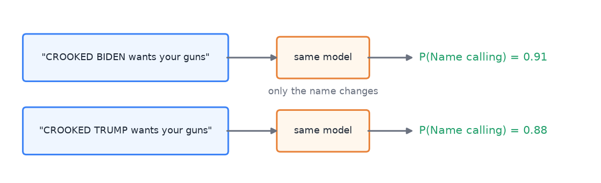
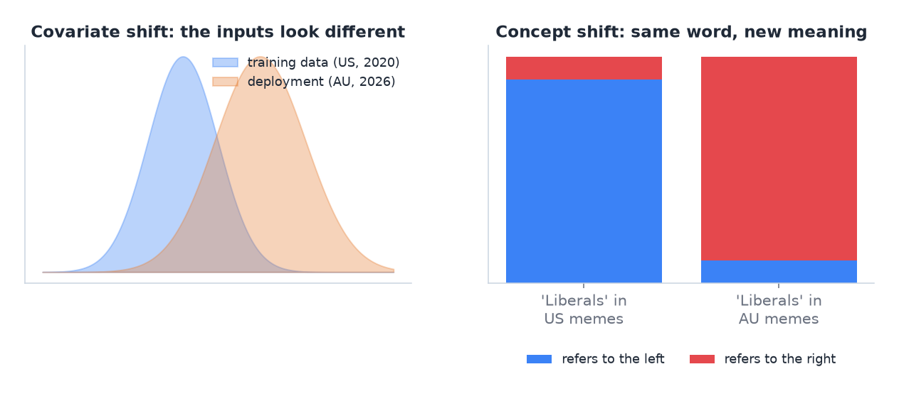

# 09 · Bias, distribution shift and deployment

> [!NOTE]
> **Colour code for all formulas:** $\textcolor{#3b82f6}{\text{input / data}}$ · $\textcolor{#e8833a}{\text{learned weights}}$ · $\textcolor{#22a06b}{\text{model output}}$ · $\textcolor{#e5484d}{\text{true label}}$ · $\textcolor{#a855f7}{\text{setting you choose}}$

**The problem.** A model can score well on its test set and still fail people in practice. It may treat groups unequally. It may meet data that looks different from its training data. It may be impossible to deploy because of privacy, cost or speed. Part C of A2 is entirely about these questions, and the exam asks about them in case studies.

**Course material:** Week 9 slides, *Foundation models fail too* and *Bias and responsible use* (`Week 9/main_week9_representation_foundation.pdf`). Week 9 tutorial, question (j). Week 12 lab, *Part 3: Detecting bias and spurious correlations*, *Part 8: Counterfactual explanations*, *Part 9: Bias and fairness* (`Week 12/Lab12_Week12_Explainability.ipynb`). Week 7 tutorial, question (a) on splitting by the target domain.

> [!TIP]
> **Play with it** (interactive, in the browser). Do this before or after reading; seeing it move is the fastest way in.
> - [Google ML crash course: fairness](https://developers.google.com/machine-learning/crash-course/fairness): short visual lessons on types of bias and how to measure them.
> - [MLU-Explain](https://mlu-explain.github.io/): visual stories on evaluation; read the precision–recall one with groups in mind.

---

## 1. Where bias comes from

Bias can enter at three points:

1. **The data and the labels.**
   - Who collected the data, where and when? A2's memes come from 26 US and Canadian Facebook groups in 2020.
   - Who labelled it, and how were disagreements settled? In A2, six annotators reached consensus by discussion. One annotator agreed with the final labels much less than the others.
   - "Correct" then means "agrees with this team's reading". A model can only learn that reading.
2. **The model.** It can learn **shortcuts**: features that correlate with the label in the training data but are not the real cause. For example, a politician's name may co-occur with insults, so the model may label the name itself.
3. **The deployment.** The model is used on a different population than it was trained on.

## 2. Measuring bias

**Disaggregated metrics.** Compute the metrics separately for each group $g$, not only overall. The most telling ones are the error rates:

$$
\text{FPR}_g = \frac{FP_g}{FP_g + TN_g} \qquad\qquad \text{FNR}_g = \frac{FN_g}{FN_g + TP_g}
$$

$\text{FPR}_g$ = false positive rate in group $g$: how often the model flags something that is not there · $\text{FNR}_g$ = false negative rate: how often it misses something that is there. A fair tool has similar rates for all groups.

- A false positive here means accusing a meme of a technique it does not use. If this happens more for one political side, the tool is unfair to that side.
- With small groups, the confidence intervals are wide. A "no difference found" result may just mean the test had too little data. Always report the interval.

**Counterfactual tests.** Take one input and change only the group attribute, for example swap "Trump" and "Biden" in the same meme. Score both versions and compare:

$$
\Delta_i = \textcolor{#22a06b}{p}\big(\text{swap}(\textcolor{#3b82f6}{x_i})\big) - \textcolor{#22a06b}{p}(\textcolor{#3b82f6}{x_i}), \qquad \bar{\Delta} = \frac{1}{n}\sum_i \Delta_i \;\stackrel{?}{\approx}\; 0
$$

$x_i$ = meme $i$ · swap($x_i$) = the same meme with the names of the other side · $p$ = predicted probability of a technique · $\Delta_i$ = change caused by the swap alone · $\bar\Delta$ = average change; a fair model gives about 0 in both swap directions.

A counterfactual pair. Illustrative numbers: a small change is fine, a large one points to bias.

- The rhetoric stays the same. Only the side changes.
- Any change in the output is caused by the side alone.
- Because each meme is compared with itself, this test needs far fewer examples than a group comparison. It is a **paired** test.

**Template tests.** Write neutral sentences with no technique, such as "{X} held a press conference today." Fill X with names from different groups. A fair model should predict nothing for all of them. Any probability it assigns comes from the name itself.

**A bias you looked for and did not find is still a result.** Report how the test was designed, why it could have detected the bias, and how large an effect it could have missed.

> [!NOTE]
> **From the course · Week 9 tutorial, (j).** Triage of legal emails is high-stakes and fairness-sensitive. Name two risks of using a foundation model and one mitigation.

<b>Show the answer</b>

- **Inherited bias** from web-scale pretraining → different error rates for groups (dialect, names, postcodes).
- **Distribution shift / shortcut learning / hallucination** → confident but wrong routing on unusual emails.
- **Mitigation:** disaggregated metrics per group, curated adaptation data, and human oversight for the decision.

## 3. Distribution shift

The deployment data differs from the training data. In probability terms, training data comes from $P_{\text{train}}(x, y)$ and deployment data from $P_{\text{deploy}}(x, y) \neq P_{\text{train}}(x, y)$. Main types:

| Type | What changes | Example |
|---|---|---|
| **Covariate shift** | the inputs $P(x)$ | slang, lower-case instead of capitals, new names, emoji, new topics |
| **Label / concept shift** | the meaning $P(y \mid x)$ | "Liberals" are left-wing in US usage but the conservative party in Australia |
| **Temporal drift** | both, over time | a 2020 model does not know 2026 events |

Left: deployment inputs drift away from the training inputs. Right: the same word means something else (illustrative).

**How to get evidence without labelled target data:**
- **Controlled transformations of labelled data.** Change the text in a way that keeps the labels valid, for example replace US names with Australian ones, or lower-case everything. Then measure the score change.
- **A small probe set** of target-like examples, clearly marked as constructed. Use it to find failure modes, such as false alarms on harmless content. Do not use it to claim an accuracy figure.
- **Label-free signals:** the share of words the model has never seen (out-of-vocabulary rate), how many sub-word pieces words break into, and how confident the model is. A model that is confident on unfamiliar inputs is the dangerous case.

> [!NOTE]
> **From the course · Week 12 lab, Parts 3, 8 and 9.** The lab checks a sentiment model by changing single words (counterfactuals) and by comparing groups. What is the logic of a counterfactual test?

<b>Show the answer</b>

Change only one attribute of the input (a name, a group word) and keep everything else. If the prediction moves, that attribute caused it. This is the same idea as A2's Trump↔Biden swap in C1.

## 4. Deployment constraints

- **Privacy.** Sending user data to a hosted API may be forbidden. In A2 the users are minors, so a local model is required.
- **Hardware and speed.** The model must fit the target machine (A2: one T4 GPU, 16 GB) and answer in time. Measure the memory and the latency per example.
- **Stability.** A deterministic model gives the same answer to the same input. A sampled LLM may not, which confuses users.
- **Monitoring.** Watch the model after launch, because the data drifts.
- **Human oversight.** For sensitive decisions, the model suggests and a human decides.

## 5. Presenting outputs responsibly

- Show **uncertainty**: "possible" versus "likely", not only a verdict.
- Show **evidence**: highlight the words behind a label.
- Say what the tool **cannot** do: unsupported techniques, unfamiliar topics.
- Allow **correction**: a teacher can override, and overrides are logged.
- Be careful with **people's identities**: a label on a meme from a student's family's political side can feel like a personal judgement. Frame it as "this technique", not "this side".

## 6. Common mistakes

- Reporting one overall score as proof of fairness.
- Concluding "no bias" from a test with too little data to detect it.
- Treating an in-distribution test score as a deployment estimate.
- Forgetting that the labels themselves can carry bias.

## 7. How this appears in A2

- **C1:** group error rates with bootstrap intervals, a counterfactual name and party swap, neutral templates.
- **C2:** zero-shot LLMs score well but cannot be deployed (privacy). The deployable local LLM is much weaker.
- **C3:** a display rule for when the label head and the span head disagree.
- **C4:** US→AU entity swap, style changes, an Australian probe set, out-of-vocabulary rate and confidence.

## Watch and read

- Google ML crash course, *Fairness* module: https://developers.google.com/machine-learning/crash-course/fairness
- Christoph Molnar, *Interpretable Machine Learning* (counterfactual explanations and more): https://christophm.github.io/interpretable-ml-book/
- *Beyond accuracy: behavioral testing of NLP models with CheckList* (Ribeiro et al., 2020), the idea behind template and counterfactual tests: https://arxiv.org/abs/2005.04118

---

## Cheat sheet

> [!IMPORTANT]
> **The 8 things to remember**
> 1. Bias sources: **data & labels**, **model shortcuts**, **deployment population**.
> 2. Measure per group: FPR and FNR, with confidence intervals.
> 3. **Counterfactual swap** = paired test, same input with only the group changed. Strong with little data.
> 4. **Template test** = neutral sentences; any prediction is bias attached to a name.
> 5. "No bias found" needs a test that could have found it.
> 6. Shift types: **covariate** (inputs), **concept** (meaning), **temporal** (time).
> 7. No target labels → transform labelled data, small probe set, OOV rate, confidence.
> 8. Deployment: privacy, hardware and latency, stability, monitoring, **human in the loop**.

> [!TIP]
> **Memory hooks**
> - **Counterfactual swap = a blind taste test.** Same drink, different label on the bottle. If the rating changes, the label caused it.
> - **Template test = an empty stage with only a name tag.** Nothing happens, so any reaction is to the name.
> - **Covariate shift = new accent, same words. Concept shift = same words, new meaning** ("Liberals").
> - **"DMD":** bias lives in **D**ata, **M**odel, **D**eployment.

> [!TIP]
> **How to learn this chapter**
> - **Design a fairness test** for a CV-screening model: which attribute, which swap, which templates?
> - **Name the shift type** for: a speech model moved from adults to children; a spam filter in 2030; "sick" meaning "great" in teen slang.
> - **Write two sentences** on why A2's test score does not prove the tool works in Australian classrooms.
