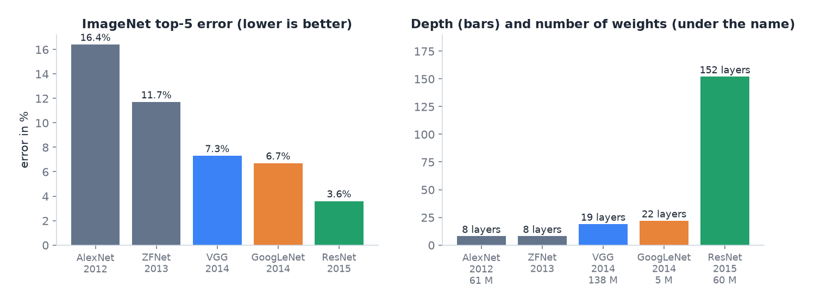
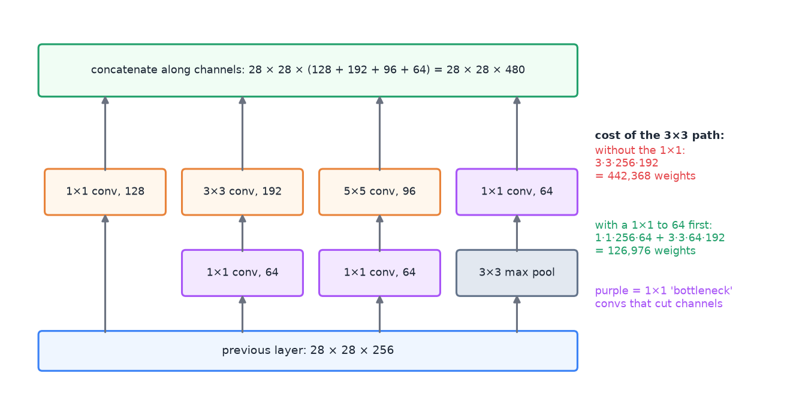
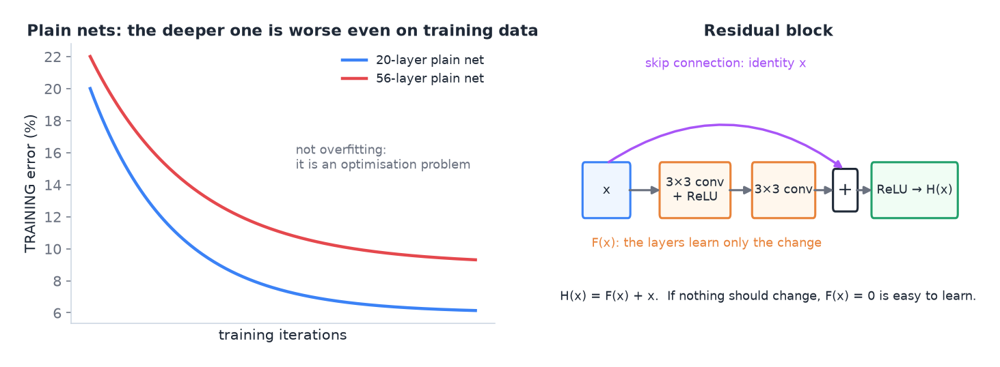
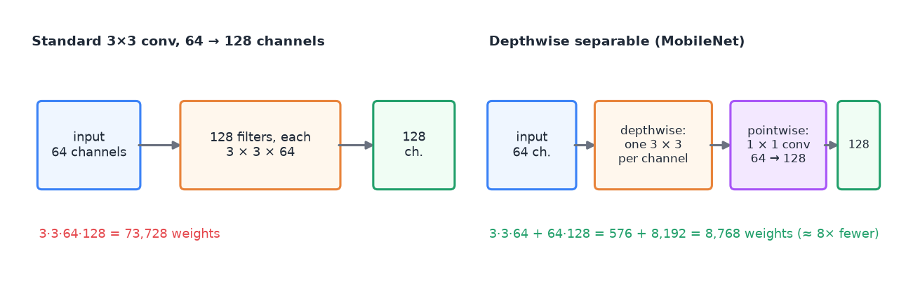
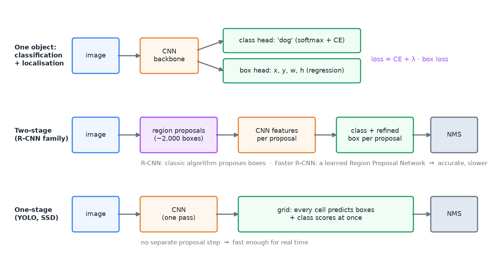
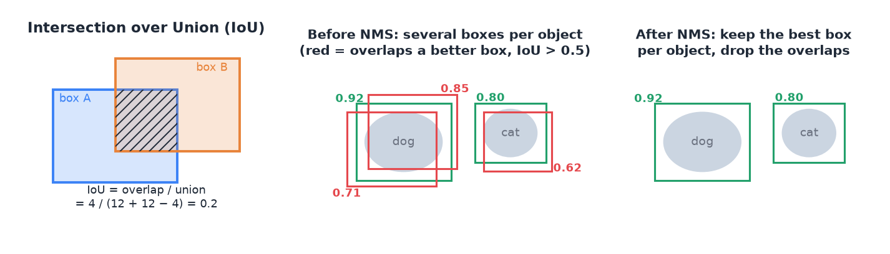
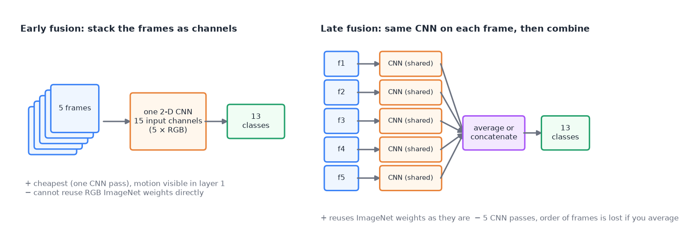

# 10 · Convolutional neural networks and computer vision

> [!NOTE]
> **Colour code for all formulas:** $\textcolor{#3b82f6}{\text{input / data}}$ · $\textcolor{#e8833a}{\text{learned weights}}$ · $\textcolor{#22a06b}{\text{model output}}$ · $\textcolor{#e5484d}{\text{true label}}$ · $\textcolor{#a855f7}{\text{setting you choose}}$

**The problem.** An image is a grid of numbers. A 224 × 224 colour image has 150,528 values. A fully connected layer with 1,000 neurons on this input needs 150 million weights. It would also have to learn "a cat in the top left" and "a cat in the bottom right" as two separate things. CNNs fix both problems by using the structure of images.

**Course material:** Week 4 slides (`Week 4/DeepLearninig_Lecture4_p1_2250.pdf`): *Sparse Connectivity*, *Parameter Sharing*, *2D Convolution*, *Padding*, *Stride*, *Multiple Input Channels*, *Pooling*, *Receptive Field*, *Dilated* and *Transpose Convolution*. Week 4 notebook (`Week 4/L4_Week4_PyTorch.ipynb`): MLP vs 1D conv vs 2D conv vs regularised model, error analysis. Week 5 slides part 1 (`Week 5/DeepLearninig_Lecture5_p1_2650.pdf`): *AlexNet*, *VGGNet*, *GoogLeNet*, *ResNet*, *Vision Transformers*, *Object Detection & Segmentation*. Week 5 slides (`Week 5/DeepLearninig_Lecture5_v2_2650.pdf`) and notebook (`Week 5/L5_Week5_TransferLearning.ipynb`) on transfer learning. Week 6 tutorial (`Week 6/COSC2779_6_tex.pdf`) on famous architectures. Week 6 notebook (`Week 6/L6_Week6_IterativeWorkflow.ipynb`): MobileNetV2 for a low-power device. Week 7 tutorial (`Week 7/COSC2779_Tute7_ans.pdf`) on segmentation with U-Net. Assignment 1 spec (`Assignment 1/Assignment 1_ Instructions and Notebook Submission.pdf`).

> [!TIP]
> **Play with it** (interactive, in the browser). Do this before or after reading; seeing it move is the fastest way in.
> - [CNN Explainer](https://poloclub.github.io/cnn-explainer/): click any neuron of a real CNN to see the convolution, ReLU and pooling it computes.
> - [3-D CNN visualisation (Adam Harley)](https://adamharley.com/nn_vis/cnn/3d.html): draw a digit and watch every layer light up.
> - [2-D CNN visualisation (Adam Harley)](https://www.cs.ryerson.ca/~aharley/vis/conv/): the flat version, easier to follow.

---

## 1. Two ideas that make CNNs work

**Sparse connectivity (local features).** A neuron looks only at a small patch of the input, for example 3 × 3 pixels. Edges, corners and textures are local, so this is enough for early layers.

**Parameter sharing.** The same small set of weights (a **filter** or **kernel**) slides over the whole image. The detector for a vertical edge is the same everywhere.

Together:
- far fewer weights than a fully connected layer;
- a pattern learned in one place is recognised everywhere;
- the network uses the spatial structure of images instead of ignoring it.

> [!NOTE]
> **From the course · Practice exam, A.1, B.1 and C.1 (a).** Which properties make CNNs better than fully connected layers for images?

<b>Show the answer</b>

**Sparse connectivity** (local features), **parameter sharing** (the same filter everywhere) and **pooling** (less redundancy, some shift invariance). Together they use the spatial structure of images and need far fewer parameters. Dense connectivity is a property of fully connected layers, not of CNNs.

## 2. The convolution operation

Slide a small filter over the image. At each position, multiply the filter values with the pixels under it and sum the products:

$$
\textcolor{#22a06b}{S(i, j)} = \sum_{m}\sum_{n} \textcolor{#3b82f6}{I(i+m,\ j+n)}\;\textcolor{#e8833a}{K(m, n)} + \textcolor{#e8833a}{b}
$$

$I$ = input image · $K$ = the filter (kernel), for example 3 × 3 learned weights · $(i, j)$ = position of the filter on the image · $(m, n)$ = position inside the filter · $S$ = output feature map. (Deep-learning libraries call this "convolution", though mathematically it is cross-correlation.)

**Simply put:** slide a small stamp over the image. At each spot, multiply and add up. A high number means "the stamp's pattern is here".

**Worked example.** A 3 × 3 image patch and a vertical-edge filter:

$$
\underbrace{\begin{bmatrix} 10 & 10 & 0 \\ 10 & 10 & 0 \\ 10 & 10 & 0 \end{bmatrix}}_{\text{patch}}
\;\ast\;
\underbrace{\begin{bmatrix} 1 & 0 & -1 \\ 1 & 0 & -1 \\ 1 & 0 & -1 \end{bmatrix}}_{\text{filter}}
= (10+10+10)\cdot 1 + 0 + (0+0+0)\cdot(-1) = 30
$$

$\ast$ = convolution: multiply the numbers at the same positions and add everything up · left column of the patch × 1, middle × 0, right × (−1).

A strong response: there is a vertical edge (bright left, dark right).

The worked example on a full 5 × 5 image. Each output cell is one placement of the filter.

**Settings:**
- **Kernel size $k$:** for example 3 × 3 or 5 × 5.
- **Stride $s$:** how far the filter moves each step. Stride 2 halves the output size.
- **Padding $p$:** add zeros around the border so the output keeps the input size ("same" padding) and border pixels are used fully.
- **Channels:** a colour image has 3 input channels (red, green, blue). A filter spans all input channels.
- **Number of filters:** each filter produces one output channel. 64 filters give 64 feature maps.

**Output size** for one dimension:

$$
\boxed{\;W_{\text{out}} = \frac{W_{\text{in}} - \textcolor{#a855f7}{k} + 2\,\textcolor{#a855f7}{p}}{\textcolor{#a855f7}{s}} + 1\;}
$$

$W_{\text{in}}$ = input width (or height) · $k$ = kernel size · $p$ = padding on each side · $s$ = stride. Example: $W_{\text{in}} = 32, k = 3, p = 1, s = 1$ → $(32 - 3 + 2)/1 + 1 = 32$.

**Number of weights** in a conv layer:

$$
\#\text{params} = \textcolor{#a855f7}{C_{\text{out}}}\cdot\big(\textcolor{#a855f7}{k}\cdot\textcolor{#a855f7}{k}\cdot C_{\text{in}} + 1\big)
$$

$C_{\text{out}}$ = number of filters · $k \cdot k \cdot C_{\text{in}}$ = weights per filter (it spans all input channels) · $+1$ = one bias per filter.

Example: 64 filters of size 3 × 3 on a 3-channel input → $64 \cdot (3 \cdot 3 \cdot 3 + 1) = 1{,}792$ weights. A fully connected layer from a 32 × 32 × 3 image to 64 neurons needs $64 \cdot (3{,}072 + 1) = 196{,}672$.

> [!NOTE]
> **From the course · Week 5 tutorial, Q3 and Q4.** LeNet-style network on a 32 × 32 × 1 input: conv 6@5×5 → avg-pool 2 → conv 16@5×5 → avg-pool 2 → flatten → dense 120 → dense 84 → dense 10. Output shapes, parameters, and the receptive field of the second conv layer?

<b>Show the answer</b>

| Layer | Output shape | Parameters |
|---|---|---|
| conv 6@5×5 | 28 × 28 × 6 | 6 · (5·5·1 + 1) = 156 |
| avg-pool 2 | 14 × 14 × 6 | 0 |
| conv 16@5×5 | 10 × 10 × 16 | 16 · (5·5·6 + 1) = 2,416 |
| avg-pool 2 | 5 × 5 × 16 | 0 |
| flatten | 400 | 0 |
| dense 120 | 120 | 120 · (400 + 1) = 48,120 |
| dense 84 | 84 | 84 · (120 + 1) = 10,164 |
| dense 10 | 10 | 10 · (84 + 1) = 850 |

Total ≈ 61,706 parameters. Receptive field of the second conv: $5 + (2-1) + (5-1)\cdot 2 = 14$, so **14 × 14** pixels (18 × 18 if the first conv had dilation 2).

Reading the receptive-field sum: the first conv sees 5 pixels; the 2-wide pooling adds 1 more; the second conv adds $(5-1)$ more steps, and each step is now 2 original pixels wide because of the pooling stride, hence $\cdot 2$. "@" in "6@5×5" means "6 filters of size 5 × 5".

## 3. Stacking layers: from edges to objects

Each layer builds on the previous one:
- early layers detect edges and colours;
- middle layers detect textures and simple shapes;
- late layers detect object parts and whole objects.

The **receptive field** of a neuron is the area of the original image it can "see". It grows with each layer. Two stacked 3 × 3 convolutions (stride 1) already see a 5 × 5 area; three see 7 × 7. Deep networks therefore combine local details into global understanding.

**The link to the brain** (Week 4, *neuro-scientific basis*). The filters that CNNs learn in their first layer look like **Gabor filters**: small striped edge detectors at different angles. Simple cells in the primary visual cortex (V1) respond to similar patterns. In classic computer vision such filters (Sobel, Gabor) were designed by hand. A CNN learns them from data.

## 4. Pooling

**Max pooling** takes the largest value in each small window, for example 2 × 2 with stride 2:

$$
\begin{bmatrix} 1 & 3 \\ 2 & 9 \end{bmatrix} \;\xrightarrow{\ \max\ }\; 9
$$

One 2 × 2 window of a feature map → its largest value.

**Simply put:** keep the biggest number in each small square and throw the rest away.

2 × 2 max pooling: each coloured window keeps only its largest value.

- It halves the width and height, so later layers need less compute.
- Some **invariance to small shifts**: if a feature moves by one pixel, the maximum often stays the same.
> [!NOTE]
> **From the course · Week 5 tutorial, Q2.** Apply 3 × 3 max pooling with stride 2 to a 7 × 7 input. How large is the output?

<b>Show the answer</b>

$(7 - 3)/2 + 1 = 3$, so a **3 × 3** output. Each value is the maximum of one 3 × 3 window; the windows overlap by one row/column because the stride (2) is smaller than the window (3).

- **Average pooling** takes the mean instead. **Global average pooling** averages each feature map to one number at the end of the network.

Strided convolutions can replace pooling. They also shrink the maps, but with learned weights.

## 5. Special convolutions

- **1D convolution:** slides along one dimension. Used for signals, audio and sometimes text.
- **Dilated convolution:** the filter has gaps. It sees a larger area with the same number of weights.
- **Transpose convolution:** the reverse direction. It makes feature maps larger. Used in decoders that must output an image, for example in segmentation.

## 6. Architectures

The Week 5 lecture is a case study: how did CNNs for image classification get better? Each famous network added one main idea. The yardstick was the **ImageNet** challenge (ILSVRC): 1.2 million images in 1,000 classes. **Top-5 error** = the share of images where the true class is not among the model's 5 best guesses.

Error fell from 16.4% to 3.6% in four years, while the networks went from 8 to 152 layers. GoogLeNet got there with far fewer weights than AlexNet or VGG.

### 6.1 LeNet

An early small CNN for digits: conv → pool → conv → pool → fully connected. The Week 5 tutorial (above) computes its shapes and parameters.

### 6.2 AlexNet (2012): CNNs win

The first deep CNN to win ImageNet, by a large margin. Five conv layers (with max pooling) and then three fully connected layers.
- **New:** ReLU instead of sigmoid/tanh (faster training), dropout, heavy data augmentation, training on GPUs.
- About **61 million** weights. Most of them sit in the fully connected layers.
- **Fixed input size.** The fully connected layers expect a vector of fixed length. A larger input image gives larger feature maps, so the flattened vector no longer fits. AlexNet cannot simply take another image size.

**Worked example (Week 5 slides).** Input 227 × 227 × 3. Layer 1: 96 filters of 11 × 11, stride 4, no padding.
- Output size: $(227 - 11 + 2\cdot 0)/4 + 1 = 55$ → **55 × 55 × 96**.
- Weights: $11 \cdot 11 \cdot 3 \cdot 96 + 96 = 34{,}944$.
- Then 3 × 3 max pooling with stride 2: $(55 - 3)/2 + 1 = 27$ → 27 × 27 × 96, and **0** weights (pooling learns nothing).

### 6.3 VGG (2014): small filters, more depth

VGG uses only one kind of block: **3 × 3 convolutions** (stride 1, padding 1) and **2 × 2 max pooling** (stride 2). It stacks them 16 or 19 layers deep.

**Why only 3 × 3?** Three stacked 3 × 3 convs see a 7 × 7 area, like one 7 × 7 conv. But:

$$
3 \cdot (3 \cdot 3 \cdot C \cdot C) = 27C^2 \qquad\text{vs.}\qquad 7 \cdot 7 \cdot C \cdot C = 49C^2
$$

$C$ = number of channels in and out (kept equal here) · $3 \cdot 3 \cdot C \cdot C$ = weights of one 3 × 3 conv layer (biases ignored).

So the stack has **fewer weights** and **three non-linearities instead of one**, which makes the function more expressive. VGG is very large (about 138 million weights, again mostly in its fully connected layers).

### 6.4 GoogLeNet / Inception (2014): wide and efficient

**Problem:** which kernel size should a layer use? Large kernels suit information spread over a large area; small kernels suit local detail. Objects appear at very different scales.

**Inception module:** use them all in parallel. 1 × 1, 3 × 3 and 5 × 5 convolutions and a 3 × 3 max pooling run side by side on the same input. Their outputs are **concatenated along the channel dimension**.

**New problem:** this is expensive, and the channels add up with every module. **Fix: 1 × 1 convolutions as a "bottleneck".** A 1 × 1 convolution looks at one pixel position at a time and mixes its channels. It is like a small fully connected layer applied at every pixel. It keeps width and height but can **reduce the number of channels** cheaply before the expensive 3 × 3 and 5 × 5 convs.

An Inception module (Week 5 slides). Purple 1 × 1 convs cut 256 channels to 64 before the expensive filters. The four outputs are stacked into 480 channels.

**Worked example (Week 5 slides).** Input 28 × 28 × 256, the 3 × 3 path has 192 filters:
- without a bottleneck: $3 \cdot 3 \cdot 256 \cdot 192 = 442{,}368$ weights;
- with a 1 × 1 conv to 64 channels first: $1 \cdot 1 \cdot 256 \cdot 64 + 3 \cdot 3 \cdot 64 \cdot 192 = 16{,}384 + 110{,}592 = 126{,}976$ weights, about 3.5 times fewer.

Two more ideas:
- **Global average pooling (GAP) instead of fully connected layers.** Each final feature map is averaged to one number. Only one small linear layer follows. GoogLeNet has about **5 million** weights: 12 times fewer than AlexNet, 27 times fewer than VGG-16. GAP also lets the network accept other input sizes, because the GAP output length depends only on the number of channels.
- **Auxiliary classifiers.** With 22 layers, the gradient reaching the early layers is weak (vanishing gradients). GoogLeNet attaches two small extra classifiers to middle layers. Their losses inject extra gradient directly into the lower layers. They are used only during training:

$$
L = \text{CE}_{\text{final}} + \textcolor{#a855f7}{\lambda_1}\,\text{CE}_{\text{aux 1}} + \textcolor{#a855f7}{\lambda_2}\,\text{CE}_{\text{aux 2}}
$$

CE = cross-entropy loss of the main classifier and of the two auxiliary ones · $\lambda_1, \lambda_2$ = weights for the auxiliary losses (0.3 in the original paper).

### 6.5 ResNet (2015): go very deep

**Observation:** simply stacking more layers made networks *worse*. A 56-layer plain network had a higher error than a 20-layer one, **even on the training data**. So it is not overfitting. Deep plain networks are just hard to optimise. (In theory the deeper network could copy the shallow one and set its extra layers to the identity, but gradient descent does not find that.)

**Residual block:** the layers learn only the *change* to their input:

$$
\textcolor{#22a06b}{H(\mathbf{x})} = F(\textcolor{#3b82f6}{\mathbf{x}};\ \textcolor{#e8833a}{W}) + \textcolor{#3b82f6}{\mathbf{x}}
$$

$\mathbf{x}$ = the block's input · $F$ = two 3 × 3 conv layers with weights $W$ · $H(\mathbf{x})$ = the block's output. The input is added back through a **skip connection**. If the best thing is to change nothing, $F = 0$ is easy to learn (weight decay even pushes towards it).

**Simply put:** the block only learns what to add to its input. If nothing helps, it can learn to add 0 and just pass the input on.

Left: the 56-layer plain network has a higher *training* error than the 20-layer one (schematic of the result in He et al.). Right: a residual block.

- Gradients flow straight through the "+" to the early layers, so 152 layers (and 1,202 on CIFAR) become trainable. Transformers use the same trick.
- Very deep ResNets use **bottleneck blocks**: 1 × 1 (256 → 64 channels), 3 × 3 (64), 1 × 1 (64 → 256). The expensive 3 × 3 works on few channels.
- Every few blocks the number of filters doubles and a **stride-2** convolution halves the width and height.
- BatchNorm after every convolution, He initialisation (doc 01), GAP and a single linear layer at the end.

> [!NOTE]
> **From the course · Week 6 tutorial, Q1–Q3.** (1a) Why does the Inception module have multiple paths? (1b) Why does Inception-v2 replace a 5 × 5 conv by two 3 × 3 convs? (1c) What do GoogLeNet's auxiliary classifiers do? (1d) What is GoogLeNet's final loss? (2) How does ResNet shrink the spatial size? (3) Why do global-average-pooling models have far fewer parameters than VGG?

<b>Show the answer</b>

1. (a) Choosing one kernel size is hard: large kernels suit information spread over a large area, small kernels suit local information. So filters of several sizes run on the same level. (b) Two stacked 3 × 3 convs see the same 5 × 5 area but cost less: one 5 × 5 conv costs 25/9 = 2.78 times as much as one 3 × 3, and two 3 × 3 convs need 2·9 = 18 instead of 25 weights per channel pair. They also add an extra non-linearity. (c) They give extra training signal (gradient) to the early layers, against vanishing gradients. (d) $L = \text{CE}_{\text{final}} + \lambda_1\text{CE}_{\text{branch 1}} + \lambda_2\text{CE}_{\text{branch 2}}$.
2. Some residual blocks use **strided** convolutions, with a strided 1 × 1 conv on the skip path so the shapes still match.
3. GAP turns each feature map into one number, so the big bank of fully connected layers is replaced by one small layer.

CE = cross-entropy · $\lambda_1, \lambda_2$ = weights of the two auxiliary losses.

### 6.6 MobileNet: CNNs for small devices

The Week 6 notebook uses **MobileNetV2** because the final model must run on a low-power device. (Assignment 1 had the same constraint: one modest 2-D CNN on an embedded board.) MobileNets save compute with **depthwise separable convolutions**, which split a normal convolution into two cheap steps:
1. **Depthwise:** one $k \times k$ filter per input channel. Each channel is filtered on its own.
2. **Pointwise:** a 1 × 1 convolution mixes the channels and sets the output channel count.

A 3 × 3 conv from 64 to 128 channels: 73,728 weights as a normal conv, 8,768 as a depthwise separable conv.

### 6.7 Vision Transformers

ViT cuts the image into patches and treats them like tokens (doc 04, section 11). It has less built-in knowledge about images than a CNN, so it needs a lot of (pre)training data.

### 6.8 Encoder–decoder / U-Net

For **segmentation** (a label for every pixel): the encoder shrinks the image into features, the decoder expands back to full size. **Skip connections** copy detailed features from the encoder to the decoder so boundaries stay sharp. U-Net works well with little data, for example in medical imaging.

U-Net: shrink to understand, grow back to locate, and copy details across with skip connections.

## 7. Vision tasks: classification, detection, segmentation

| Task | Output | Typical model |
|---|---|---|
| Image classification | one label per image | CNN + global pooling + classifier |
| Classification + localisation | one label + one box | CNN + class head + box head |
| Object detection | a box and a label for **every** object | two-stage (Faster R-CNN) or one-stage (YOLO, SSD) |
| Semantic segmentation | one label per pixel | encoder–decoder (FCN, SegNet, U-Net) |
| OCR (reading text in images) | a character sequence | CNN features + a sequence model |

Segmentation is the image version of token tagging: a label for every element instead of one per input. The Week 5 slides call detection and segmentation "special cases of image classification": classify a box, or classify a pixel.

### 7.1 One object: classification plus localisation

A box is four numbers, for example its centre and size $[b_x, b_y, w, h]$. Take any classification CNN and give it **two heads**:
- a **class head** (softmax, cross-entropy loss): *what* is it?
- a **box head** (4 outputs, a regression loss such as MSE): *where* is it?

$$
L = \text{CE}(\textcolor{#e5484d}{c}, \textcolor{#22a06b}{\hat{c}}) + \textcolor{#a855f7}{\lambda}\,\big\lVert \textcolor{#e5484d}{\mathbf{b}} - \textcolor{#22a06b}{\hat{\mathbf{b}}} \big\rVert^2
$$

$c$ = true class · $\hat c$ = predicted class probabilities · $\mathbf b$ = true box (4 numbers) · $\hat{\mathbf b}$ = predicted box · $\lambda$ = how much the box error counts compared with the class error.

### 7.2 Many objects: object detection

Now the number of objects is unknown. The network must output a variable number of boxes.

Three pipelines. Two-stage detectors first propose candidate boxes, then classify each one. One-stage detectors predict all boxes in a single pass.

**Two-stage detectors (R-CNN family).**
1. **Region proposals:** find candidate boxes that might contain an object (around 2,000 per image). R-CNN used a classic computer-vision algorithm for this. **Faster R-CNN** replaced it with a learned **Region Proposal Network** that shares the CNN backbone.
2. Treat every proposal as a single-object problem: classify it (including "background") and refine its box.

Accurate, but slower. The original R-CNN ran a CNN on every proposal; later versions compute the features once and reuse them.

**One-stage detectors (YOLO, SSD).** Skip the proposal step. Lay a grid over the image. Every grid cell directly predicts a few boxes with a confidence and class scores, all in one forward pass. Fast enough for real time (YOLO = "You Only Look Once").

**Both need non-maximum suppression (NMS)**, because several boxes fire on the same object. NMS uses the **Intersection over Union**:

$$
\text{IoU}(A, B) = \frac{\text{area}(A \cap B)}{\text{area}(A \cup B)}
$$

$A, B$ = two boxes · $A \cap B$ = their overlap · $A \cup B$ = the area covered by at least one of them · IoU = 1 for identical boxes, 0 for boxes that do not touch.

NMS, for each class:
1. Sort the boxes by confidence.
2. Keep the best box.
3. Delete every remaining box with IoU above a threshold (for example 0.5) with it: they describe the same object.
4. Repeat with the next best remaining box.

Left: IoU of two boxes. Middle: several boxes per object. Right: after NMS, one box per object remains.

IoU is also how detections are scored: a predicted box counts as correct if its IoU with a true box is above, say, 0.5.

### 7.3 Segmentation

**Semantic segmentation** gives every pixel a class. The output has the same width and height as the input.
- **Fully convolutional networks (FCN):** replace the fully connected layers by convolutions, so the output stays a map. Upsample back to full size with transpose convolutions.
- **Encoder–decoder (SegNet, deconvolution networks, U-Net):** the encoder shrinks, the decoder grows back; U-Net adds skip connections (section 6.8).
- *Instance* segmentation goes one step further and separates two objects of the same class (two dogs get two masks). It combines detection and segmentation.

> [!NOTE]
> **From the course · Week 6 tutorial, Q4.** What are the main types of object detection networks? Explain the major novelties.

<b>Show the answer</b>

- **Two-stage (R-CNN → Fast/Faster R-CNN):** first propose candidate regions, then classify each region and refine its box. R-CNN's novelty: use CNN features to classify region proposals. Faster R-CNN's novelty: a learned Region Proposal Network that shares the backbone, so detection becomes one end-to-end network. Accurate but slower.
- **One-stage (YOLO, SSD):** no proposal step; a single network predicts boxes and class scores for a grid of positions (SSD at several feature-map scales) in one pass. Novelty: real-time speed, at some cost in accuracy, especially for small objects.
- Both use **non-maximum suppression** to remove duplicate boxes, based on IoU.

## 8. Transfer learning for images

Training a deep CNN from scratch needs a lot of labelled images. Instead:
1. Take a CNN pretrained on ImageNet (1.2 million images, 1,000 classes).
2. Replace its last layer with a new head for your classes.
3. Freeze the pretrained layers and train the head.
4. Optionally unfreeze the top layers and fine-tune with a small learning rate.

Early layers (edges, textures) transfer to almost any image task. Late layers are more specific to ImageNet. With very different images (medical scans), fine-tune more layers.

> [!NOTE]
> **From the course · Week 7 tutorial, (b), (d) and (e).** Cell segmentation: which augmentations, which architecture and which loss?

<b>Show the answer</b>

- Augment with crops, noise, contrast changes, blur, flips and rotations (all keep the mask valid if applied to the mask too).
- Architecture: an encoder–decoder such as **U-Net**, which works well with little medical data.
- Loss: binary cross-entropy per pixel, **weighted** for class imbalance: $L = -\sum \big[\alpha_1 y\log\hat y + \alpha_0(1-y)\log(1-\hat y)\big]$.

$y$ = true pixel label (1 = cell, 0 = background) · $\hat y$ = predicted probability of "cell" · $\alpha_1$ = weight for cell pixels (larger, because they are rarer) · $\alpha_0$ = weight for background pixels · $\sum$ = over all pixels.

## 9. Data augmentation for images

Create new training images from existing ones, with the same label:
- flips, small rotations, crops, scaling;
- colour, brightness and contrast changes;
- noise or blur.

Only use changes that keep the label correct. A rotated "6" can become a "9". A horizontally flipped "move to the left" gesture becomes "move to the right".

## 10. Several images per example (Assignment 1)

In Assignment 1, one example was a gesture performance of **5 frames**, and only a **2-D CNN** was allowed (no RNNs, no 3-D convolutions, no video Transformers). So the model must combine five images. There are two basic ways:

Early fusion stacks the frames before the CNN. Late fusion runs one shared CNN on every frame and combines the features afterwards.

- **Early fusion:** stack the 5 RGB frames as 15 input channels. One CNN pass, and the first layer can already see motion between frames. But an ImageNet backbone expects 3 channels, so its first layer must be changed (for example by repeating or averaging its weights).
- **Late fusion:** run the same CNN (shared weights) on each frame, then average or concatenate the 5 feature vectors and classify. It reuses ImageNet weights unchanged. Averaging loses the order of the frames; concatenating keeps it but needs more weights in the head.

Other lessons from A1 that make good exam answers:
- **Split by person**, not by clip (doc 07, group leakage). The demo is with a stranger.
- **Size and speed matter on embedded hardware.** Report the number of weights and the time per example. Prefer small backbones such as MobileNet (section 6.6).
- **Augmentation must keep the label.** Flips change the meaning of left/right gestures. Small crops, brightness changes and small rotations are safe.
- **Little data → transfer learning** from ImageNet, first with a frozen backbone, then fine-tune the top layers with a small learning rate.

## 11. Common mistakes

- Thinking a CNN is fully connected. It is sparse and shares parameters.
- Forgetting that a filter spans all input channels.
- Using augmentation that changes the meaning of the label.
- Training a big CNN from scratch on a few hundred images instead of using transfer learning.
- Using accuracy for segmentation with few foreground pixels. Use a per-pixel F1 or Dice score, and a weighted loss.
- Feeding a larger image to a network with fully connected layers (AlexNet, VGG). The flattened vector no longer fits. GAP networks accept other sizes.
- Calling the poor training error of a very deep plain network "overfitting". It is an optimisation problem; ResNet's skip connections fix it.
- Forgetting non-maximum suppression in detection: one object then gets many boxes.

## 12. How this connects to other topics

- Residual connections return in Transformers (doc 04).
- Transfer learning returns for text in week 9 (doc 05).
- Grad-CAM explains CNNs using their feature maps (doc 08).
- U-Net returns as the denoiser in diffusion models (doc 11).
- BatchNorm and He initialisation (doc 01) made ResNet trainable.
- Assignment 1 used CNNs and transfer learning on gesture images (section 10).

## Watch and read

**Official course videos** (from the Canvas week pages; Canvas Studio links need your RMIT login). Watch these first: the exam is built on this material.
- **Week 4 pre-recorded lectures** (convolution, pooling, variants of convolution): [part 1](https://rmit-arc.instructuremedia.com/embed/68fdb787-9bc7-4943-91ce-fa7308edfb8b) · [part 2](https://rmit-arc.instructuremedia.com/embed/4aacc785-048e-45be-935a-6ea9b8b6b54f) · [part 3](https://rmit-arc.instructuremedia.com/embed/2ede975a-eb78-42ae-bc55-e7262c131f37) · [part 4](https://rmit-arc.instructuremedia.com/embed/b26f14de-6759-4bbd-94e7-5f9982cda05b) · [part 5](https://rmit-arc.instructuremedia.com/embed/24955216-9944-4b75-b0ee-f5e04d78cbcf) · [part 6](https://rmit-arc.instructuremedia.com/embed/6d40b14d-d30a-4b2d-8044-c334603a5b99) · [part 7](https://rmit-arc.instructuremedia.com/embed/c9e91558-61cb-43f4-be68-dc8f61119ee6)
- **Week 5 pre-recorded lectures** (CNN architectures, object detection and segmentation, transfer learning): [part 1](https://rmit-arc.instructuremedia.com/embed/cad35875-fcd7-44af-8674-c18ad19af3e1) · [part 2](https://rmit-arc.instructuremedia.com/embed/363cf7d6-b90c-47dc-8529-24fe376a6fc6) · [part 3](https://rmit-arc.instructuremedia.com/embed/3d76bca6-f8c3-4ddc-aec5-0ac34738edbf) · [part 4](https://rmit-arc.instructuremedia.com/embed/702bffec-7ac8-4baa-b68e-e2e5e4158e9a) · [part 5](https://rmit-arc.instructuremedia.com/embed/a42ba495-3d86-49ad-966b-6ee6b4ded823)

**More videos and readings:**

- 3Blue1Brown, *But what is a convolution?*: https://www.youtube.com/watch?v=KuXjwB4LzSA
- StatQuest, *Image classification with convolutional neural networks*: https://www.youtube.com/watch?v=HGwBXDKFk9I
- deeplizard, *Convolutional neural networks explained*: https://www.youtube.com/watch?v=YRhxdVk_sIs
- CNN Explainer (interactive, in the browser): https://poloclub.github.io/cnn-explainer/
- Stanford CS231n notes, *Convolutional networks*: https://cs231n.github.io/convolutional-networks/
- Stanford CS231n notes, *Transfer learning*: https://cs231n.github.io/transfer-learning/
- *Dive into Deep Learning*, CNN chapter: https://d2l.ai/chapter_convolutional-neural-networks/index.html
- U-Net paper (Ronneberger et al., 2015): https://arxiv.org/abs/1505.04597
- ResNet paper (He et al., 2015): https://arxiv.org/abs/1512.03385
- DeepLearningAI (Andrew Ng), *ResNets*: https://www.youtube.com/watch?v=ZILIbUvp5lk
- DeepLearningAI (Andrew Ng), *Network in network* (1 × 1 convolutions): https://www.youtube.com/watch?v=c1RBQzKsDCk
- DeepLearningAI (Andrew Ng), *Inception network motivation*: https://www.youtube.com/watch?v=C86ZXvgpejM
- DeepLearningAI (Andrew Ng), *Object localization*: https://www.youtube.com/watch?v=GSwYGkTfOKk
- DeepLearningAI (Andrew Ng), *Non-max suppression*: https://www.youtube.com/watch?v=VAo84c1hQX8
- DeepLearningAI (Andrew Ng), *YOLO algorithm*: https://www.youtube.com/watch?v=9s_FpMpdYW8
- DeepLearningAI (Andrew Ng), *Region proposals*: https://www.youtube.com/watch?v=6ykvU9WuIws
- *Dive into Deep Learning*: AlexNet https://d2l.ai/chapter_convolutional-modern/alexnet.html · VGG https://d2l.ai/chapter_convolutional-modern/vgg.html · GoogLeNet https://d2l.ai/chapter_convolutional-modern/googlenet.html · ResNet https://d2l.ai/chapter_convolutional-modern/resnet.html
- *Dive into Deep Learning*, boxes, anchor boxes and NMS: https://d2l.ai/chapter_computer-vision/anchor.html · R-CNN family: https://d2l.ai/chapter_computer-vision/rcnn.html
- Papers: AlexNet https://papers.nips.cc/paper/4824-imagenet-classification-with-deep-convolutional-neural-networks · VGG https://arxiv.org/abs/1409.1556 · GoogLeNet https://arxiv.org/abs/1409.4842 · Faster R-CNN https://arxiv.org/abs/1506.01497 · YOLO https://arxiv.org/abs/1506.02640 · SSD https://arxiv.org/abs/1512.02325 · MobileNets https://arxiv.org/abs/1704.04861

---

## Cheat sheet

> [!IMPORTANT]
> **The 14 things to remember**
> 1. CNN = **sparse connectivity + parameter sharing** → few weights, patterns found anywhere.
> 2. Output size $= (W - k + 2p)/s + 1$.
> 3. Params $= C_{\text{out}}(k \cdot k \cdot C_{\text{in}} + 1)$; a filter spans **all** input channels.
> 4. Layers go edges → textures → parts → objects; receptive field grows with depth.
> 5. Pooling: smaller maps + some shift invariance.
> 6. **AlexNet:** ReLU, dropout, augmentation, GPUs; 61 M weights mostly in FC; fixed input size.
> 7. **VGG:** only 3×3; three 3×3 = one 7×7 view with $27C^2$ vs $49C^2$ weights and 3 non-linearities.
> 8. **GoogLeNet:** parallel 1×1/3×3/5×5/pool, **1×1 bottlenecks** cut channels, **GAP** instead of FC (5 M weights), **auxiliary classifiers** inject gradient: $L = \text{CE} + \lambda_1\text{CE}_1 + \lambda_2\text{CE}_2$.
> 9. **ResNet:** deep plain nets are worse even on *training* data (optimisation, not overfitting); $H(x) = F(x) + x$ makes 152 layers trainable.
> 10. **Detection:** class head + box head; two-stage (proposals → classify, Faster R-CNN) vs one-stage (grid, YOLO/SSD, real time); **NMS** with **IoU** removes duplicate boxes.
> 11. **Segmentation:** label per pixel; FCN / encoder–decoder / U-Net (skip connections, little data).
> 12. Transfer learning: ImageNet backbone, new head, freeze, then fine-tune top layers with small LR.
> 13. Augment only in ways that keep the label true (no flips for left/right gestures).
> 14. Several frames with a 2-D CNN: **early fusion** (stack as channels) vs **late fusion** (shared CNN per frame, then combine). Split by person.

> [!TIP]
> **Memory hooks**
> - **A filter = a stamp you press everywhere on the page.** Same stamp (shared weights), small area (sparse).
> - **"Same padding keeps the Same size."**
> - **Pooling = squinting.** You lose detail but still see what is roughly where.
> - **ResNet = a shortcut road next to the construction site.** Traffic (gradients) flows even while the new road (the layers) is not finished.
> - **U-Net looks like a U:** down to understand *what*, up to say *where*, bridges across for the details.
> - **The ImageNet timeline "A-V-G-R":** **A**lexNet proved it works, **V**GG went small and deep, **G**oogLeNet went wide and cheap, **R**esNet went very deep with shortcuts.
> - **1 × 1 conv = a channel mixer.** Same picture, fewer (or more) colours.
> - **NMS = "highlander rule":** for every object there can be only one box.

> [!TIP]
> **How to learn this chapter**
> - **Compute** the output size for $W = 28, k = 5, p = 0, s = 1$ (→ 24), then after a 2 × 2 max pool (→ 12).
> - **Count parameters** of a 3 × 3 conv with 128 filters on 64 channels (→ 73,856).
> - **Draw a U-Net** with three levels and its skip connections.
> - **Compute** the 1 × 1 bottleneck saving for the 5 × 5 path of the Inception example: 28 × 28 × 256 input, 96 filters of 5 × 5, with and without a 1 × 1 to 64 first. (Answer: $5\cdot5\cdot256\cdot96 = 614{,}400$ vs $256\cdot64 + 5\cdot5\cdot64\cdot96 = 16{,}384 + 153{,}600 = 169{,}984$.)
> - **Compute IoU** of box A = (0, 0) to (4, 4) and box B = (2, 2) to (6, 6). (Answer: overlap 4, union 16 + 16 − 4 = 28, IoU = 0.14.)
> - **Draw both detector pipelines** (two-stage and one-stage) from memory.
