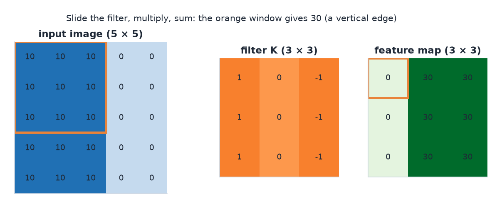
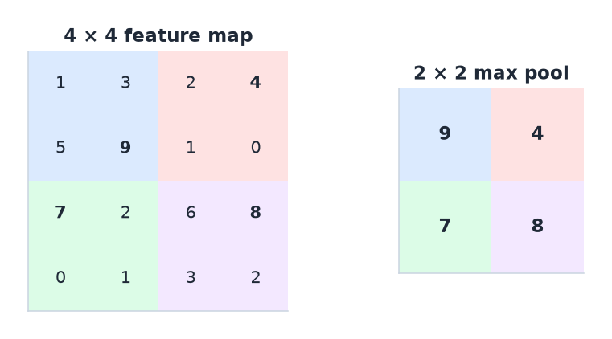
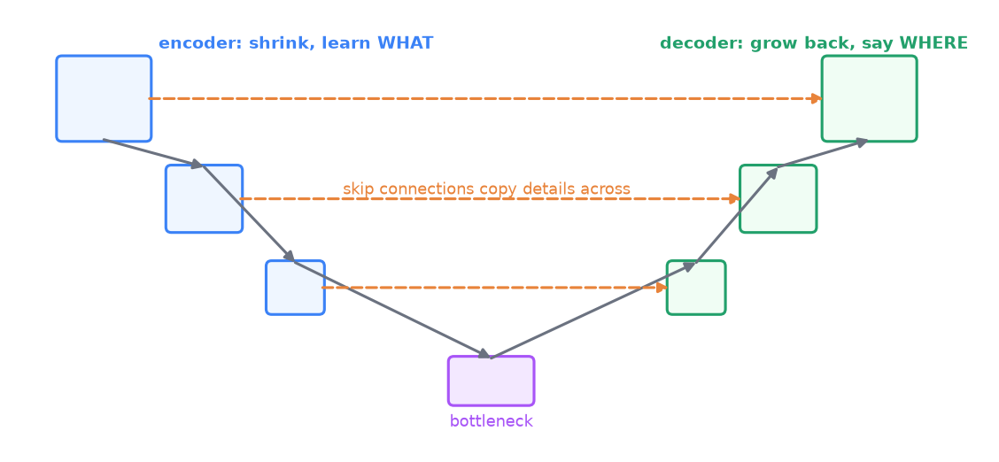

# 10 · Convolutional neural networks and computer vision

> [!NOTE]
> **Colour code for all formulas:** $\textcolor{#3b82f6}{\text{input / data}}$ · $\textcolor{#e8833a}{\text{learned weights}}$ · $\textcolor{#22a06b}{\text{model output}}$ · $\textcolor{#e5484d}{\text{true label}}$ · $\textcolor{#a855f7}{\text{setting you choose}}$

**The problem.** An image is a grid of numbers. A 224 × 224 colour image has 150,528 values. A fully connected layer with 1,000 neurons on this input needs 150 million weights. It would also have to learn "a cat in the top left" and "a cat in the bottom right" as two separate things. CNNs fix both problems by using the structure of images.

**Course material:** Week 4 slides (`Week 4/DeepLearninig_Lecture4_p1_2250.pdf`): *Sparse Connectivity*, *Parameter Sharing*, *2D Convolution*, *Padding*, *Stride*, *Multiple Input Channels*, *Pooling*, *Receptive Field*, *Dilated* and *Transpose Convolution*. Week 4 notebook (`Week 4/L4_Week4_PyTorch.ipynb`): MLP vs 1D conv vs 2D conv vs regularised model, error analysis. Week 5 slides (`Week 5/DeepLearninig_Lecture5_v2_2650.pdf`) and notebook (`Week 5/L5_Week5_TransferLearning.ipynb`) on transfer learning. Week 7 tutorial (`Week 7/COSC2779_Tute7_ans.pdf`) on segmentation with U-Net.

> [!TIP]
> **Play with it** (interactive, in the browser). Do this before or after reading; seeing it move is the fastest way in.
> - [CNN Explainer](https://poloclub.github.io/cnn-explainer/): click any neuron of a real CNN to see the convolution, ReLU and pooling it computes.
> - [3-D CNN visualisation (Adam Harley)](https://adamharley.com/nn_vis/cnn/3d.html): draw a digit and watch every layer light up.
> - [2-D CNN visualisation (Adam Harley)](https://www.cs.ryerson.ca/~aharley/vis/conv/): the flat version, easier to follow.

---

## 1. Two ideas that make CNNs work

**Sparse connectivity (local features).** A neuron looks only at a small patch of the input, for example 3 × 3 pixels. Edges, corners and textures are local, so this is enough for early layers.

**Parameter sharing.** The same small set of weights (a **filter** or **kernel**) slides over the whole image. The detector for a vertical edge is the same everywhere.

Together:
- far fewer weights than a fully connected layer;
- a pattern learned in one place is recognised everywhere;
- the network uses the spatial structure of images instead of ignoring it.

> [!NOTE]
> **From the course · Practice exam, A.1, B.1 and C.1 (a).** Which properties make CNNs better than fully connected layers for images?

<b>Show the answer</b>

**Sparse connectivity** (local features), **parameter sharing** (the same filter everywhere) and **pooling** (less redundancy, some shift invariance). Together they use the spatial structure of images and need far fewer parameters. Dense connectivity is a property of fully connected layers, not of CNNs.

## 2. The convolution operation

Slide a small filter over the image. At each position, multiply the filter values with the pixels under it and sum the products:

$$
\textcolor{#22a06b}{S(i, j)} = \sum_{m}\sum_{n} \textcolor{#3b82f6}{I(i+m,\ j+n)}\;\textcolor{#e8833a}{K(m, n)} + \textcolor{#e8833a}{b}
$$

$I$ = input image · $K$ = the filter (kernel), for example 3 × 3 learned weights · $(i, j)$ = position of the filter on the image · $(m, n)$ = position inside the filter · $S$ = output feature map. (Deep-learning libraries call this "convolution", though mathematically it is cross-correlation.)

**Worked example.** A 3 × 3 image patch and a vertical-edge filter:

$$
\underbrace{\begin{bmatrix} 10 & 10 & 0 \\ 10 & 10 & 0 \\ 10 & 10 & 0 \end{bmatrix}}_{\text{patch}}
\;\ast\;
\underbrace{\begin{bmatrix} 1 & 0 & -1 \\ 1 & 0 & -1 \\ 1 & 0 & -1 \end{bmatrix}}_{\text{filter}}
= (10+10+10)\cdot 1 + 0 + (0+0+0)\cdot(-1) = 30
$$

$\ast$ = convolution: multiply the numbers at the same positions and add everything up · left column of the patch × 1, middle × 0, right × (−1).

A strong response: there is a vertical edge (bright left, dark right).

The worked example on a full 5 × 5 image. Each output cell is one placement of the filter.

**Settings:**
- **Kernel size $k$:** for example 3 × 3 or 5 × 5.
- **Stride $s$:** how far the filter moves each step. Stride 2 halves the output size.
- **Padding $p$:** add zeros around the border so the output keeps the input size ("same" padding) and border pixels are used fully.
- **Channels:** a colour image has 3 input channels (red, green, blue). A filter spans all input channels.
- **Number of filters:** each filter produces one output channel. 64 filters give 64 feature maps.

**Output size** for one dimension:

$$
\boxed{\;W_{\text{out}} = \frac{W_{\text{in}} - \textcolor{#a855f7}{k} + 2\,\textcolor{#a855f7}{p}}{\textcolor{#a855f7}{s}} + 1\;}
$$

$W_{\text{in}}$ = input width (or height) · $k$ = kernel size · $p$ = padding on each side · $s$ = stride. Example: $W_{\text{in}} = 32, k = 3, p = 1, s = 1$ → $(32 - 3 + 2)/1 + 1 = 32$.

**Number of weights** in a conv layer:

$$
\#\text{params} = \textcolor{#a855f7}{C_{\text{out}}}\cdot\big(\textcolor{#a855f7}{k}\cdot\textcolor{#a855f7}{k}\cdot C_{\text{in}} + 1\big)
$$

$C_{\text{out}}$ = number of filters · $k \cdot k \cdot C_{\text{in}}$ = weights per filter (it spans all input channels) · $+1$ = one bias per filter.

Example: 64 filters of size 3 × 3 on a 3-channel input → $64 \cdot (3 \cdot 3 \cdot 3 + 1) = 1{,}792$ weights. A fully connected layer from a 32 × 32 × 3 image to 64 neurons needs $64 \cdot (3{,}072 + 1) = 196{,}672$.

> [!NOTE]
> **From the course · Week 5 tutorial, Q3 and Q4.** LeNet-style network on a 32 × 32 × 1 input: conv 6@5×5 → avg-pool 2 → conv 16@5×5 → avg-pool 2 → flatten → dense 120 → dense 84 → dense 10. Output shapes, parameters, and the receptive field of the second conv layer?

<b>Show the answer</b>

| Layer | Output shape | Parameters |
|---|---|---|
| conv 6@5×5 | 28 × 28 × 6 | 6 · (5·5·1 + 1) = 156 |
| avg-pool 2 | 14 × 14 × 6 | 0 |
| conv 16@5×5 | 10 × 10 × 16 | 16 · (5·5·6 + 1) = 2,416 |
| avg-pool 2 | 5 × 5 × 16 | 0 |
| flatten | 400 | 0 |
| dense 120 | 120 | 120 · (400 + 1) = 48,120 |
| dense 84 | 84 | 84 · (120 + 1) = 10,164 |
| dense 10 | 10 | 10 · (84 + 1) = 850 |

Total ≈ 61,706 parameters. Receptive field of the second conv: $5 + (2-1) + (5-1)\cdot 2 = 14$, so **14 × 14** pixels (18 × 18 if the first conv had dilation 2).

Reading the receptive-field sum: the first conv sees 5 pixels; the 2-wide pooling adds 1 more; the second conv adds $(5-1)$ more steps, and each step is now 2 original pixels wide because of the pooling stride, hence $\cdot 2$. "@" in "6@5×5" means "6 filters of size 5 × 5".

## 3. Stacking layers: from edges to objects

Each layer builds on the previous one:
- early layers detect edges and colours;
- middle layers detect textures and simple shapes;
- late layers detect object parts and whole objects.

The **receptive field** of a neuron is the area of the original image it can "see". It grows with each layer. Two stacked 3 × 3 convolutions (stride 1) already see a 5 × 5 area; three see 7 × 7. Deep networks therefore combine local details into global understanding.

## 4. Pooling

**Max pooling** takes the largest value in each small window, for example 2 × 2 with stride 2:

$$
\begin{bmatrix} 1 & 3 \\ 2 & 9 \end{bmatrix} \;\xrightarrow{\ \max\ }\; 9
$$

One 2 × 2 window of a feature map → its largest value.

2 × 2 max pooling: each coloured window keeps only its largest value.

- It halves the width and height, so later layers need less compute.
- Some **invariance to small shifts**: if a feature moves by one pixel, the maximum often stays the same.
> [!NOTE]
> **From the course · Week 5 tutorial, Q2.** Apply 3 × 3 max pooling with stride 2 to a 7 × 7 input. How large is the output?

<b>Show the answer</b>

$(7 - 3)/2 + 1 = 3$, so a **3 × 3** output. Each value is the maximum of one 3 × 3 window; the windows overlap by one row/column because the stride (2) is smaller than the window (3).

- **Average pooling** takes the mean instead. **Global average pooling** averages each feature map to one number at the end of the network.

Strided convolutions can replace pooling. They also shrink the maps, but with learned weights.

## 5. Special convolutions

- **1D convolution:** slides along one dimension. Used for signals, audio and sometimes text.
- **Dilated convolution:** the filter has gaps. It sees a larger area with the same number of weights.
- **Transpose convolution:** the reverse direction. It makes feature maps larger. Used in decoders that must output an image, for example in segmentation.

## 6. Architectures

- **LeNet:** an early small CNN for digits: conv → pool → conv → pool → fully connected.
- **Deeper CNNs (VGG, ResNet):** many stacked 3 × 3 convolutions. **ResNet** adds **residual connections**:

$$
\textcolor{#22a06b}{\mathbf{y}} = \textcolor{#3b82f6}{\mathbf{x}} + F(\textcolor{#3b82f6}{\mathbf{x}};\ \textcolor{#e8833a}{W})
$$

$F$ = a few conv layers · the input $\mathbf{x}$ is added to their output, so the layers only need to learn the *change*. Gradients can flow straight through the "+", which makes 100+ layers trainable. Transformers use the same trick.

> [!NOTE]
> **From the course · Week 6 tutorial, Q1–Q3.** (1) Why does Inception-v2 replace a 5 × 5 conv by two 3 × 3 convs? (2) How does ResNet shrink the spatial size? (3) Why do global-average-pooling models have far fewer parameters than VGG?

<b>Show the answer</b>

1. Two stacked 3 × 3 convs see the same 5 × 5 area but cost less (5·5 = 25 vs 2·9 = 18 weights per channel pair) and add an extra non-linearity.
2. Some residual blocks use **strided** convolutions, with a strided 1 × 1 conv on the skip path so the shapes still match.
3. GAP turns each feature map into one number, so the big bank of fully connected layers is replaced by one small layer.

- **Encoder–decoder / U-Net** for **segmentation** (a label for every pixel): the encoder shrinks the image into features, the decoder expands back to full size. **Skip connections** copy detailed features from the encoder to the decoder so boundaries stay sharp. U-Net works well with little data, for example in medical imaging.

U-Net: shrink to understand, grow back to locate, and copy details across with skip connections.

## 7. Vision tasks

| Task | Output | Typical model |
|---|---|---|
| Image classification | one label per image | CNN + global pooling + classifier |
| Object detection | boxes + labels | CNN backbone + detection head |
| Segmentation | one label per pixel | encoder–decoder (U-Net) |
| OCR (reading text in images) | a character sequence | CNN features + a sequence model |

Segmentation is the image version of token tagging: a label for every element instead of one per input.

## 8. Transfer learning for images

Training a deep CNN from scratch needs a lot of labelled images. Instead:
1. Take a CNN pretrained on ImageNet (1.2 million images, 1,000 classes).
2. Replace its last layer with a new head for your classes.
3. Freeze the pretrained layers and train the head.
4. Optionally unfreeze the top layers and fine-tune with a small learning rate.

Early layers (edges, textures) transfer to almost any image task. Late layers are more specific to ImageNet. With very different images (medical scans), fine-tune more layers.

> [!NOTE]
> **From the course · Week 7 tutorial, (b), (d) and (e).** Cell segmentation: which augmentations, which architecture and which loss?

<b>Show the answer</b>

- Augment with crops, noise, contrast changes, blur, flips and rotations (all keep the mask valid if applied to the mask too).
- Architecture: an encoder–decoder such as **U-Net**, which works well with little medical data.
- Loss: binary cross-entropy per pixel, **weighted** for class imbalance: $L = -\sum \big[\alpha_1 y\log\hat y + \alpha_0(1-y)\log(1-\hat y)\big]$.

$y$ = true pixel label (1 = cell, 0 = background) · $\hat y$ = predicted probability of "cell" · $\alpha_1$ = weight for cell pixels (larger, because they are rarer) · $\alpha_0$ = weight for background pixels · $\sum$ = over all pixels.

## 9. Data augmentation for images

Create new training images from existing ones, with the same label:
- flips, small rotations, crops, scaling;
- colour, brightness and contrast changes;
- noise or blur.

Only use changes that keep the label correct. A rotated "6" can become a "9".

## 10. Common mistakes

- Thinking a CNN is fully connected. It is sparse and shares parameters.
- Forgetting that a filter spans all input channels.
- Using augmentation that changes the meaning of the label.
- Training a big CNN from scratch on a few hundred images instead of using transfer learning.
- Using accuracy for segmentation with few foreground pixels. Use a per-pixel F1 or Dice score, and a weighted loss.

## 11. How this connects to other topics

- Residual connections return in Transformers (doc 04).
- Transfer learning returns for text in week 9 (doc 05).
- Grad-CAM explains CNNs using their feature maps (doc 08).
- U-Net returns as the denoiser in diffusion models (doc 11).
- Assignment 1 used CNNs and transfer learning on gesture images.

## Watch and read

- 3Blue1Brown, *But what is a convolution?*: https://www.youtube.com/watch?v=KuXjwB4LzSA
- StatQuest, *Image classification with convolutional neural networks*: https://www.youtube.com/watch?v=HGwBXDKFk9I
- deeplizard, *Convolutional neural networks explained*: https://www.youtube.com/watch?v=YRhxdVk_sIs
- CNN Explainer (interactive, in the browser): https://poloclub.github.io/cnn-explainer/
- Stanford CS231n notes, *Convolutional networks*: https://cs231n.github.io/convolutional-networks/
- Stanford CS231n notes, *Transfer learning*: https://cs231n.github.io/transfer-learning/
- *Dive into Deep Learning*, CNN chapter: https://d2l.ai/chapter_convolutional-neural-networks/index.html
- U-Net paper (Ronneberger et al., 2015): https://arxiv.org/abs/1505.04597
- ResNet paper (He et al., 2015): https://arxiv.org/abs/1512.03385

---

## Cheat sheet

> [!IMPORTANT]
> **The 9 things to remember**
> 1. CNN = **sparse connectivity + parameter sharing** → few weights, patterns found anywhere.
> 2. Output size $= (W - k + 2p)/s + 1$.
> 3. Params $= C_{\text{out}}(k \cdot k \cdot C_{\text{in}} + 1)$; a filter spans **all** input channels.
> 4. Layers go edges → textures → parts → objects; receptive field grows with depth.
> 5. Pooling: smaller maps + some shift invariance.
> 6. ResNet: $\mathbf{y} = \mathbf{x} + F(\mathbf{x})$ makes very deep nets trainable.
> 7. U-Net: encoder–decoder + skip connections → per-pixel labels (segmentation), works with little data.
> 8. Transfer learning: ImageNet backbone, new head, freeze, then fine-tune top layers with small LR.
> 9. Augment only in ways that keep the label true.

> [!TIP]
> **Memory hooks**
> - **A filter = a stamp you press everywhere on the page.** Same stamp (shared weights), small area (sparse).
> - **"Same padding keeps the Same size."**
> - **Pooling = squinting.** You lose detail but still see what is roughly where.
> - **ResNet = a shortcut road next to the construction site.** Traffic (gradients) flows even while the new road (the layers) is not finished.
> - **U-Net looks like a U:** down to understand *what*, up to say *where*, bridges across for the details.

> [!TIP]
> **How to learn this chapter**
> - **Compute** the output size for $W = 28, k = 5, p = 0, s = 1$ (→ 24), then after a 2 × 2 max pool (→ 12).
> - **Count parameters** of a 3 × 3 conv with 128 filters on 64 channels (→ 73,856).
> - **Draw a U-Net** with three levels and its skip connections.
