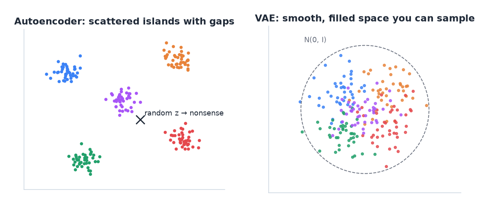
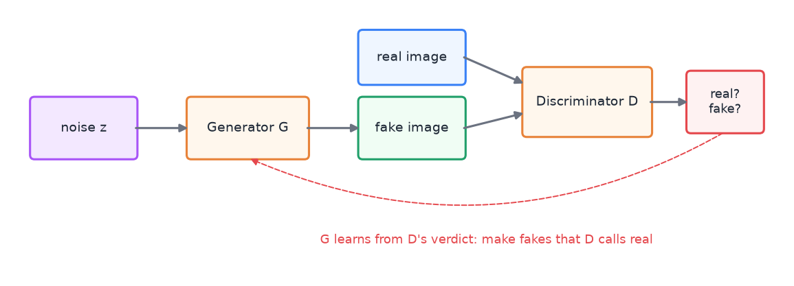
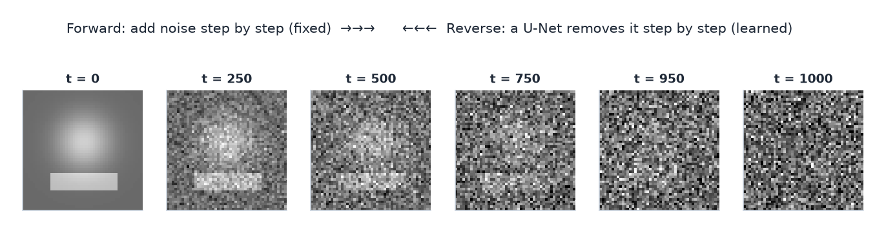

# 11 · Generative models: autoencoders, VAEs, GANs, diffusion

> [!NOTE]
> **Colour code for all formulas:** $\textcolor{#3b82f6}{\text{input / data}}$ · $\textcolor{#e8833a}{\text{learned weights / networks}}$ · $\textcolor{#22a06b}{\text{model output}}$ · $\textcolor{#e5484d}{\text{true label}}$ · $\textcolor{#a855f7}{\text{setting you choose}}$

**The problem.** Everything so far was supervised: input → label. Generative models learn the data itself. They can compress it, detect unusual examples and create new examples that look real.

**Course material:** Week 10 slides (`Week 10/main_week10_generative_diffusion.pdf`), the whole deck. Week 10 notebook (`Week 10/Lecture_Week10_Generative (1).ipynb`): *Part 1 Autoencoder*, *Part 2 Variational Autoencoder*, *Part 3 GAN*, *Part 4 Diffusion*, *Wrap-up: three ways to generate*. Week 10 lab (`Week 10/week10_generative_models_lab.ipynb`).

> [!TIP]
> **Play with it** (interactive, in the browser). Do this before or after reading; seeing it move is the fastest way in.
> - [GAN Lab](https://poloclub.github.io/ganlab/): train a small GAN in the browser and watch generator and discriminator fight.
> - [Diffusion Explainer](https://poloclub.github.io/diffusion-explainer/): step through how Stable Diffusion turns noise into an image from a prompt.
> - [TensorFlow Embedding Projector](https://projector.tensorflow.org/): explore what a latent space looks like in 3-D.

---

## 1. Supervised, unsupervised, generative

- **Supervised:** learn $p(y \mid x)$ from labelled pairs.
- **Unsupervised:** find structure in unlabelled data (clusters, compressed codes, anomalies).
- **Generative:** learn the data distribution $p(x)$, so you can sample new $x$.

Why generate? Create images, speech or text; fill in missing data; augment small datasets; detect anomalies (examples the model finds unlikely).

## 2. Autoencoders (AE)

An autoencoder has an **encoder** $e$ and a **decoder** $d$:

$$
\mathbf{z} = \textcolor{#e8833a}{e}(\textcolor{#3b82f6}{\mathbf{x}}), \qquad \textcolor{#22a06b}{\hat{\mathbf{x}}} = \textcolor{#e8833a}{d}(\mathbf{z}), \qquad
L_{\text{rec}} = \big\lVert \textcolor{#3b82f6}{\mathbf{x}} - \textcolor{#22a06b}{\hat{\mathbf{x}}} \big\rVert^2
$$

$\mathbf{x}$ = input · $\mathbf{z}$ = small code (the **bottleneck** or **latent** vector) · $\hat{\mathbf{x}}$ = reconstruction · $L_{\text{rec}}$ = reconstruction loss, the squared difference between input and reconstruction. The input is its own target, so no labels are needed.

Because $\mathbf{z}$ is small, the network must keep only the most important information. The encoder becomes a feature extractor.

> [!NOTE]
> **From the course · Week 10 lecture, ISS example.** Telemetry from the International Space Station: how can an autoencoder detect anomalies without anomaly labels?

<b>Show the answer</b>

Train it only on normal telemetry. Normal patterns reconstruct well. An unusual pattern was never seen, so it reconstructs badly. Flag inputs whose reconstruction error is above a threshold chosen on validation data.

**Uses:**
- **Anomaly detection.** Train on normal data only. A strange input reconstructs badly, so a high reconstruction error flags an anomaly. The Week 10 example uses telemetry data from the International Space Station.
- **Denoising autoencoder.** Feed a noisy input and train the model to output the clean version. It learns to remove noise.
- **Feature learning** for a later supervised task.
- **Convolutional autoencoders** for images use conv layers in the encoder and transpose convolutions in the decoder.

**Problems of a basic autoencoder:**
- It can **memorise** (overfit) the training data, especially with a large bottleneck.
- Its latent space has **no fixed structure**. Codes of training examples land anywhere, with gaps in between. A random $\mathbf{z}$ usually decodes to nonsense. So a plain AE cannot reliably **generate** new samples.

> [!NOTE]
> **From the course · Practice exam, A.4.** Which of these are issues of a basic autoencoder: it can memorise the data; it cannot reliably generate new samples; it cannot reconstruct its input; it needs adversarial training?

<b>Show the answer</b>

The first two. It **can** reconstruct (that is its job), and it does **not** need adversarial training (that is GANs). It can memorise, and its unstructured latent space makes random samples decode to nonsense.

## 3. Variational autoencoders (VAE)

A VAE fixes the latent space so that it can be sampled.
- The encoder outputs a **distribution** for $\mathbf{z}$, a mean $\boldsymbol\mu$ and a spread $\boldsymbol\sigma$, not a single point.
- During training, $\mathbf{z}$ is **sampled** from this distribution and decoded.
- An extra loss term pushes every encoded distribution towards a standard normal:

$$
L_{\text{VAE}} = \underbrace{\big\lVert \textcolor{#3b82f6}{\mathbf{x}} - \textcolor{#22a06b}{\hat{\mathbf{x}}} \big\rVert^2}_{\text{reconstruct well}} \;+\; \textcolor{#a855f7}{\beta}\;\underbrace{\mathrm{KL}\Big(\mathcal{N}(\boldsymbol\mu, \boldsymbol\sigma^2)\;\Big\Vert\;\mathcal{N}(\mathbf{0}, I)\Big)}_{\text{keep codes close to a standard normal}},
\qquad \mathbf{z} = \boldsymbol\mu + \boldsymbol\sigma \odot \boldsymbol\epsilon,\;\; \boldsymbol\epsilon \sim \mathcal{N}(\mathbf{0}, I)
$$

$\boldsymbol\mu, \boldsymbol\sigma$ = mean and spread output by the encoder · KL = Kullback–Leibler divergence, a distance between two distributions · $\beta$ = balance between the two goals (1 in the standard VAE) · $\mathbf{z} = \boldsymbol\mu + \boldsymbol\sigma\odot\boldsymbol\epsilon$ is the "reparameterisation trick": the randomness sits in $\boldsymbol\epsilon$, so gradients can still flow through $\boldsymbol\mu$ and $\boldsymbol\sigma$.

Result: the latent space becomes smooth and filled. Nearby points decode to similar outputs. To **generate**, sample $\mathbf{z} \sim \mathcal{N}(\mathbf{0}, I)$ and decode it.

Each colour is one kind of training example. Only the VAE's space is filled, so random samples decode to something sensible.

Trade-off: VAE samples are often a bit blurry compared to GANs.

## 4. Generative adversarial networks (GAN)

Two networks play a game:
- The **generator** $G$ turns random noise $\mathbf{z}$ into a fake sample $G(\mathbf{z})$.
- The **discriminator** $D$ gets real and fake samples and outputs the probability that a sample is real.

$$
\min_{\textcolor{#e8833a}{G}}\;\max_{\textcolor{#e8833a}{D}}\;\; \mathbb{E}_{\textcolor{#3b82f6}{\mathbf{x}} \sim \text{data}}\big[\log \textcolor{#e8833a}{D}(\textcolor{#3b82f6}{\mathbf{x}})\big] \;+\; \mathbb{E}_{\mathbf{z} \sim \mathcal{N}(0, I)}\big[\log\big(1 - \textcolor{#e8833a}{D}(\textcolor{#e8833a}{G}(\mathbf{z}))\big)\big]
$$

$D(\mathbf{x})$ = discriminator's probability that $\mathbf{x}$ is real · $G(\mathbf{z})$ = generated sample · $D$ wants both terms high (say "real" to real data, "fake" to fakes) · $G$ wants the second term low (make $D$ say "real" to its fakes) · $\mathbb{E}$ = average over examples.

The GAN game. Both networks train in turns.

Training alternates:
1. Update $D$ to tell real from fake better.
2. Update $G$ to fool $D$ better.

When it works, $G$ produces samples that $D$ cannot tell apart from real data.

- **Strengths:** sharp, realistic images.
- **Weaknesses:** unstable training (the two networks must stay balanced); **mode collapse** ($G$ produces only a few kinds of output); no direct reconstruction of a given input.
- **Conditional GAN:** give $G$ and $D$ a label as extra input, for example "generate a 7" or "turn this sketch into a photo".
- **Vector arithmetic in latent space:** for faces, $\mathbf{z}_{\text{man with glasses}} - \mathbf{z}_{\text{man}} + \mathbf{z}_{\text{woman}}$ can give a woman with glasses.

## 5. Diffusion models

The idea: destroying data with noise is easy. Learn to reverse it.

**Forward process (fixed, no learning).** Add Gaussian noise step by step. After step $t$:

$$
\mathbf{x}_t = \sqrt{\bar\alpha_t}\;\textcolor{#3b82f6}{\mathbf{x}_0} \;+\; \sqrt{1 - \bar\alpha_t}\;\boldsymbol\epsilon, \qquad \boldsymbol\epsilon \sim \mathcal{N}(\mathbf{0}, I)
$$

$\mathbf{x}_0$ = clean image · $\mathbf{x}_t$ = noisy image after $t$ steps · $\bar\alpha_t$ = a fixed schedule that goes from about 1 (almost clean) to about 0 (pure noise) as $t$ grows · $\boldsymbol\epsilon$ = the noise that was added.

Forward process on a toy image. Generation runs the same strip from right to left with the learned denoiser.

**Reverse process (learned).** A network $\epsilon_\theta$, usually a **U-Net**, learns to predict the noise that was added:

$$
L = \big\lVert\, \boldsymbol\epsilon - \textcolor{#e8833a}{\epsilon_\theta}(\mathbf{x}_t,\ t) \,\big\rVert^2
$$

$\epsilon_\theta(\mathbf{x}_t, t)$ = the network's guess of the noise in $\mathbf{x}_t$ at step $t$ · the loss is a simple squared error, which makes training stable.

- **Training:** take a real image, pick a random step $t$, add the matching noise, and train the network to predict that noise.
- **Sampling:** start from pure noise and apply the denoiser step by step until an image appears.
- **Conditional generation and guidance:** feed a text prompt or a class to the denoiser so it steers towards matching images. This is how text-to-image models work.
- **Latent diffusion** (Stable Diffusion): run the diffusion in the small latent space of an autoencoder instead of on full-size pixels. Much cheaper.

Weakness: sampling needs many steps, so it is slower than a GAN.

## 6. Comparison

| | Autoencoder | VAE | GAN | Diffusion |
|---|---|---|---|---|
| Main job | compress and reconstruct | generate by sampling the latent | generate | generate |
| Can sample new data? | not reliably | yes | yes | yes |
| Sample quality | — | often blurry | sharp | sharp and diverse |
| Training | stable | stable | unstable, mode collapse | stable |
| Sampling speed | — | fast | fast | slow (many steps) |

## 7. One-to-many problems

Some tasks have many correct outputs for one input: a sketch can become many photos, and a text can be spoken in many voices. A normal regression model would predict the average of all good answers, which is blurry or wrong. Generative models can sample one sharp answer at a time.

## 8. Common mistakes

- Saying a basic autoencoder is a good generator. Its latent space is unstructured.
- Thinking an autoencoder needs labels. It does not; the input is its own target.
- Mixing up the diffusion processes: the forward (noising) process is fixed; only the reverse (denoising) process is learned.
- Saying GANs train with a reconstruction loss. They train with the adversarial game.

## Watch and read

- Arxiv Insights, *Variational autoencoders*: https://www.youtube.com/watch?v=9zKuYvjFFS8
- Deepia, *Variational autoencoders, generative AI animated*: https://www.youtube.com/watch?v=qJeaCHQ1k2w
- Computerphile, *Generative adversarial networks (GANs)*: https://www.youtube.com/watch?v=Sw9r8CL98N0
- Luis Serrano, *A friendly introduction to GANs*: https://www.youtube.com/watch?v=8L11aMN5KY8
- Ari Seff, *What are diffusion models?*: https://www.youtube.com/watch?v=fbLgFrlTnGU
- Computerphile, *How AI image generators work (Stable Diffusion, DALL-E)*: https://www.youtube.com/watch?v=1CIpzeNxIhU
- MIT 6.S191, *Deep generative modeling* (lecture): https://www.youtube.com/watch?v=3G5hWM6jqPk
- Stanford CS231n, *Lecture 13: Generative models*: https://www.youtube.com/watch?v=5WoItGTWV54
- Lilian Weng, *From autoencoder to beta-VAE*: https://lilianweng.github.io/posts/2018-08-12-vae/
- Lilian Weng, *What are diffusion models?*: https://lilianweng.github.io/posts/2021-07-11-diffusion-models/
- Diffusion Explainer (interactive): https://poloclub.github.io/diffusion-explainer/
- *Dive into Deep Learning*, GANs: https://d2l.ai/chapter_generative-adversarial-networks/gan.html

---

## Cheat sheet

> [!IMPORTANT]
> **The 8 things to remember**
> 1. Generative = learn $p(x)$ and sample new data.
> 2. **AE:** encoder → bottleneck → decoder; loss $\lVert x - \hat x\rVert^2$; no labels. Good for anomaly detection and denoising.
> 3. AE weaknesses: can memorise; **unstructured latent space → cannot reliably generate**.
> 4. **VAE:** encoder outputs $\mu, \sigma$; loss = reconstruction + KL to $\mathcal{N}(0, I)$; sample $z \sim \mathcal{N}(0, I)$ to generate; often blurry.
> 5. **GAN:** generator vs discriminator game; sharp but unstable; mode collapse; conditional GANs take a label.
> 6. **Diffusion:** fixed forward noising, **learned** reverse denoising (U-Net predicts the noise); stable, high quality, slow sampling.
> 7. Latent diffusion = diffusion inside an autoencoder's latent space (cheaper).
> 8. One-to-many tasks need generative models; regression would average the answers.

> [!TIP]
> **Memory hooks**
> - **Autoencoder = packing a suitcase.** Only the essentials fit (bottleneck). Unpacking (decoder) rebuilds your wardrobe.
> - **VAE = packing into labelled zones** so a random grab from a zone still gives a sensible outfit.
> - **GAN = a forger vs a detective.** Both get better until the forgeries pass.
> - **Diffusion = a sculptor.** Start from a noisy block and remove a little noise at each step until a figure appears.
> - **"Forward is free, backward is learned"** (diffusion).

> [!TIP]
> **How to learn this chapter**
> - **Fill the comparison table** in section 6 from memory.
> - **Explain anomaly detection with an AE** in three sentences, as for an exam answer.
> - **Draw the GAN loop:** noise → G → fake → D ← real, with arrows for who updates when.
