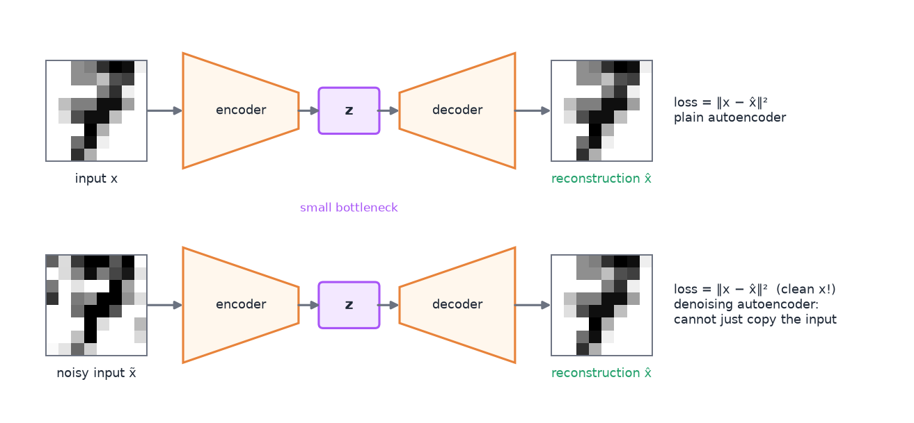
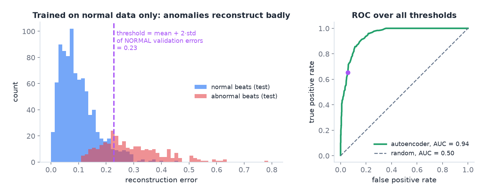
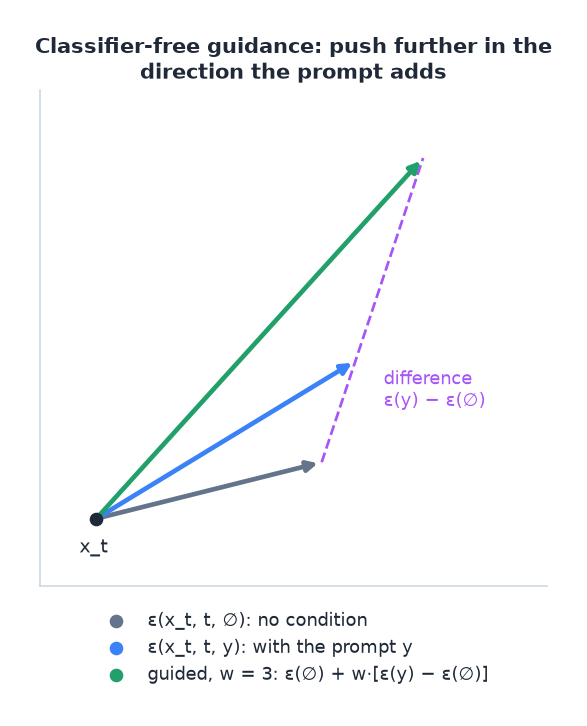
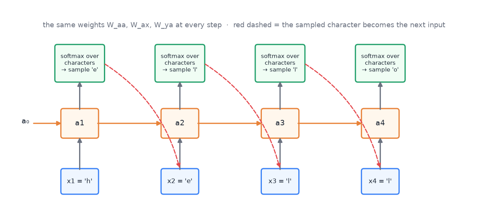
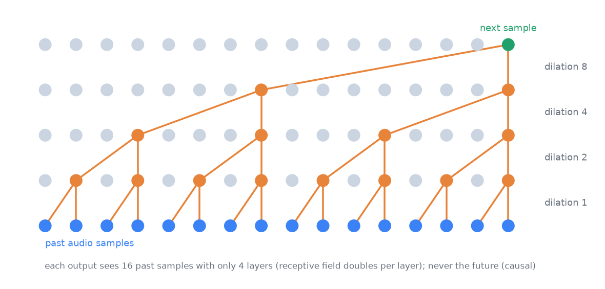

# 11 · Generative models: autoencoders, VAEs, GANs, diffusion

> [!NOTE]
> **Colour code for all formulas:** $\textcolor{#3b82f6}{\text{input / data}}$ · $\textcolor{#e8833a}{\text{learned weights / networks}}$ · $\textcolor{#22a06b}{\text{model output}}$ · $\textcolor{#e5484d}{\text{true label}}$ · $\textcolor{#a855f7}{\text{setting you choose}}$

**The problem.** Everything so far was supervised: input → label. Generative models learn the data itself. They can compress it, detect unusual examples and create new examples that look real.

**Course material:** Week 10 slides (`Week 10/main_week10_generative_diffusion.pdf`), the whole deck. Week 10 notebook (`Week 10/Lecture_Week10_Generative (1).ipynb`): *Part 1 Autoencoder*, *Part 2 Variational Autoencoder*, *Part 3 GAN*, *Part 4 Diffusion*, *Wrap-up: three ways to generate*. Week 10 lab (`Week 10/week10_generative_models_lab.ipynb`): bottleneck experiment, latent space, GAN failure modes, denoising. Week 10 tutorial, a full case study in exam style (saved under the wrong name as `Week 7/COSC2779_Tute7_questions_answers.pdf`; its title says "Week 10"). Week 11 lab (`Week 11/Lab11_Week11_RepresentationLearning.ipynb`): ECG anomaly detection with an autoencoder, masked autoencoder, representation transfer.

> [!TIP]
> **Play with it** (interactive, in the browser). Do this before or after reading; seeing it move is the fastest way in.
> - [GAN Lab](https://poloclub.github.io/ganlab/): train a small GAN in the browser and watch generator and discriminator fight.
> - [Diffusion Explainer](https://poloclub.github.io/diffusion-explainer/): step through how Stable Diffusion turns noise into an image from a prompt.
> - [TensorFlow Embedding Projector](https://projector.tensorflow.org/): explore what a latent space looks like in 3-D.

---

## 1. Supervised, unsupervised, generative

- **Supervised:** learn $p(y \mid x)$ from labelled pairs.
- **Unsupervised:** find structure in unlabelled data (clusters, compressed codes, anomalies).
- **Generative:** learn the data distribution $p(x)$, so you can sample new $x$.

Why generate? Create images, speech or text; fill in missing data; augment small datasets; detect anomalies (examples the model finds unlikely).

## 2. Autoencoders (AE)

An autoencoder has an **encoder** $e$ and a **decoder** $d$:

$$
\mathbf{z} = \textcolor{#e8833a}{e}(\textcolor{#3b82f6}{\mathbf{x}}), \qquad \textcolor{#22a06b}{\hat{\mathbf{x}}} = \textcolor{#e8833a}{d}(\mathbf{z}), \qquad
L_{\text{rec}} = \big\lVert \textcolor{#3b82f6}{\mathbf{x}} - \textcolor{#22a06b}{\hat{\mathbf{x}}} \big\rVert^2
$$

$\mathbf{x}$ = input · $\mathbf{z}$ = small code (the **bottleneck** or **latent** vector) · $\hat{\mathbf{x}}$ = reconstruction · $L_{\text{rec}}$ = reconstruction loss, the squared difference between input and reconstruction. The input is its own target, so no labels are needed.

**Simply put:** squeeze the input into a few numbers, then try to rebuild it from them.

Because $\mathbf{z}$ is small, the network must keep only the most important information. The encoder becomes a feature extractor.

Top: a plain autoencoder rebuilds its own input through a small code z. Bottom: a denoising autoencoder gets a noisy input but must output the clean one.

- Encoder and decoder can be any network: MLP, CNN (for images), RNN (for sequences), or 1-D CNN (for signals, as in the Week 11 ECG lab).
- **Think of JPEG:** a fixed encoder and decoder. An autoencoder *learns* both from data.
- **Link to PCA:** an autoencoder with linear layers and MSE loss learns the same subspace as PCA (doc 08). With non-linear layers it can learn curved structure.
- **Why the bottleneck must be small:** with a code as large as the input, the network could learn the **identity function** and copy the input. Then it learns nothing useful.
- **Bottleneck size is a trade-off** (Week 10 lab, Task 3.4): a smaller code compresses more but gives blurrier reconstructions; a larger code gives sharper ones but compresses less and can memorise.
- It only works well for inputs that are **similar to the training data**. That is exactly what anomaly detection uses.

> [!NOTE]
> **From the course · Week 10 lecture, ISS example.** Telemetry from the International Space Station: how can an autoencoder detect anomalies without anomaly labels?

<b>Show the answer</b>

Train it only on normal telemetry. Normal patterns reconstruct well. An unusual pattern was never seen, so it reconstructs badly. Flag inputs whose reconstruction error is above a threshold chosen on validation data.

**Uses:**
- **Anomaly detection.** Train on normal data only. A strange input reconstructs badly, so a high reconstruction error flags an anomaly. The Week 10 example uses telemetry data from the International Space Station: 10 years of data, over 5 trillion points, and almost no anomalies. A supervised classifier is hopeless there: anomalies are not a pattern you can learn; the only pattern is in the normal data.
- **Denoising autoencoder.** Feed a noisy input and train the model to output the **clean** version: $L = \lVert \mathbf{x} - d(e(\tilde{\mathbf{x}}))\rVert^2$ ($\tilde{\mathbf{x}}$ = the noisy input, $\mathbf{x}$ = the clean original). It cannot take the shortcut of copying its input, so it must learn the structure of the data. At test time it cleans corrupted inputs. Variants hide parts of the input instead of adding noise (**masked autoencoder**, inpainting). This is a form of **self-supervised learning** (doc 05).
- **Feature learning** for a later supervised task: keep the trained encoder, add a small head, and use transfer learning. This used to be a common pretraining technique; today large pretrained models usually take this role.
- **Image retrieval and clustering.** Encode every item once and store its code. For a query, encode it and return the items with the nearest codes (Euclidean or cosine distance). Similar inputs get nearby codes. The codes can also be clustered.
- **Convolutional autoencoders** for images use conv layers (with stride or pooling) in the encoder and transpose convolutions (or un-pooling) in the decoder.

**Anomaly detection step by step** (Week 11 lab, ECG heartbeats):
1. Train the autoencoder on **normal** beats only.
2. Compute the reconstruction error of held-out normal beats (validation).
3. Set a threshold, for example $\tau = \mu + 2\sigma$ of those normal errors ($\tau$ ("tau") = threshold · $\mu$ = mean · $\sigma$ = standard deviation of the normal validation errors).
4. At test time, flag every beat with an error above $\tau$.
5. Evaluate over **all** thresholds at once with the ROC curve and its AUC (doc 07).

Left: normal beats reconstruct well (small errors), abnormal beats badly. The purple threshold is mean + 2·std of normal validation errors. Right: the ROC curve over all thresholds; the purple dot is the chosen threshold. Synthetic data for illustration.

**Representation transfer** (Week 11 lab, Part 8). With only 100 labelled beats, the lab trains the same logistic regression on three inputs: the **pretrained encoder's codes**, a **random** encoder's codes, and the **raw signal**. The point to take away: an encoder trained without any labels usually gives the best features when labels are scarce. That is self-supervised pretraining in miniature (doc 05).

> [!NOTE]
> **From the course · Week 10 tutorial, (a).** A hospital has a large set of unlabelled chest X-rays. You train a plain autoencoder with a reconstruction loss. How can the same trained model serve (i) anomaly detection and (ii) image retrieval (find the most similar scans)? Name a suitable loss.

<b>Show the answer</b>

- **Anomaly detection:** the model reconstructs normal scans well and unusual ones poorly, so a high reconstruction error flags an anomaly (threshold it).
- **Retrieval:** encode every scan once to its bottleneck code $\mathbf z$ and store it. Encode the query scan and return the archive scans with the nearest codes (Euclidean or cosine distance). Similar images map to nearby codes.
- **Loss:** pixel reconstruction error, e.g. MSE (or binary cross-entropy for images scaled to [0, 1]).

**Problems of a basic autoencoder:**
- It can **memorise** (overfit) the training data, especially with a large bottleneck.
- Its latent space has **no fixed structure**. Codes of training examples land anywhere, with gaps in between. A random $\mathbf{z}$ usually decodes to nonsense. So a plain AE cannot reliably **generate** new samples.

> [!NOTE]
> **From the course · Practice exam, A.4.** Which of these are issues of a basic autoencoder: it can memorise the data; it cannot reliably generate new samples; it cannot reconstruct its input; it needs adversarial training?

<b>Show the answer</b>

The first two. It **can** reconstruct (that is its job), and it does **not** need adversarial training (that is GANs). It can memorise, and its unstructured latent space makes random samples decode to nonsense.

## 3. Variational autoencoders (VAE)

A VAE fixes the latent space so that it can be sampled.
- The encoder outputs a **distribution** for $\mathbf{z}$, a mean $\boldsymbol\mu$ and a spread $\boldsymbol\sigma$, not a single point.
- During training, $\mathbf{z}$ is **sampled** from this distribution and decoded.
- An extra loss term pushes every encoded distribution towards a standard normal:

$$
L_{\text{VAE}} = \underbrace{\big\lVert \textcolor{#3b82f6}{\mathbf{x}} - \textcolor{#22a06b}{\hat{\mathbf{x}}} \big\rVert^2}_{\text{reconstruct well}} \;+\; \textcolor{#a855f7}{\beta}\;\underbrace{\mathrm{KL}\Big(\mathcal{N}(\boldsymbol\mu, \boldsymbol\sigma^2)\;\Big\Vert\;\mathcal{N}(\mathbf{0}, I)\Big)}_{\text{keep codes close to a standard normal}},
\qquad \mathbf{z} = \boldsymbol\mu + \boldsymbol\sigma \odot \boldsymbol\epsilon,\;\; \boldsymbol\epsilon \sim \mathcal{N}(\mathbf{0}, I)
$$

$\boldsymbol\mu, \boldsymbol\sigma$ = mean and spread output by the encoder · KL = Kullback–Leibler divergence, a distance between two distributions · $\beta$ = balance between the two goals (1 in the standard VAE) · $\mathbf{z} = \boldsymbol\mu + \boldsymbol\sigma\odot\boldsymbol\epsilon$ is the "reparameterisation trick": the randomness sits in $\boldsymbol\epsilon$, so gradients can still flow through $\boldsymbol\mu$ and $\boldsymbol\sigma$.

**Simply put:** the encoder gives a fuzzy cloud instead of one point, and all clouds are pulled towards the same area. So the latent space has no holes, and a random point decodes to something sensible.

Result: the latent space becomes smooth and filled. Nearby points decode to similar outputs. To **generate**, sample $\mathbf{z} \sim \mathcal{N}(\mathbf{0}, I)$ and decode it.

**The reparameterisation trick.** Training must backpropagate from the decoder to the encoder. But between them sits a random draw, $\mathbf z \sim \mathcal N(\boldsymbol\mu, \boldsymbol\sigma^2)$, and you cannot take the gradient of "draw a random number". The trick moves the randomness out of the way: draw $\boldsymbol\epsilon \sim \mathcal N(\mathbf 0, I)$ separately and compute $\mathbf z = \boldsymbol\mu + \boldsymbol\sigma \odot \boldsymbol\epsilon$. Now $\mathbf z$ is an ordinary function of $\boldsymbol\mu$ and $\boldsymbol\sigma$, so gradients flow into the encoder. $\boldsymbol\epsilon$ is just an extra input.

> [!NOTE]
> **From the course · Week 10 tutorial, (b)–(d).** (b) Random codes decoded by a plain autoencoder give junk. Why? (c) Which two changes does a VAE make, and what does each loss term do? (d) What trick makes training possible, and why is it needed?

<b>Show the answer</b>

- (b) The autoencoder is only trained to reconstruct. Nothing constrains its latent space: codes sit in arbitrary regions with gaps and no consistent scale, so a random $\mathbf z$ usually lands where the decoder never trained. There is no distribution to sample from.
- (c) It encodes each input as a **distribution** $\mathcal N(\boldsymbol\mu, \boldsymbol\sigma^2)$ instead of a point, and adds a **KL term** that pulls these distributions towards $\mathcal N(\mathbf 0, I)$. The reconstruction term keeps decoded samples faithful to the input; the KL term makes the latent space smooth and gap-free, so sampling $\mathbf z \sim \mathcal N(\mathbf 0, I)$ gives new realistic scans.
- (d) The **reparameterisation trick**, $\mathbf z = \boldsymbol\mu + \boldsymbol\sigma \odot \boldsymbol\epsilon$ with $\boldsymbol\epsilon \sim \mathcal N(\mathbf 0, I)$. The randomness moves into $\boldsymbol\epsilon$, so $\mathbf z$ is differentiable in $\boldsymbol\mu$ and $\boldsymbol\sigma$ and gradients reach the encoder. You cannot backpropagate through a raw sampling step.

$\boldsymbol\mu, \boldsymbol\sigma$ = mean and spread from the encoder · $\mathcal N(\mathbf 0, I)$ = standard normal · KL = Kullback–Leibler divergence · $\odot$ = element-wise multiplication · $\boldsymbol\epsilon$ = random noise.

Each colour is one kind of training example. Only the VAE's space is filled, so random samples decode to something sensible.

Trade-off: VAE samples are often a bit blurry compared to GANs.

## 4. Generative adversarial networks (GAN)

Two networks play a game:
- The **generator** $G$ turns random noise $\mathbf{z}$ into a fake sample $G(\mathbf{z})$.
- The **discriminator** $D$ gets real and fake samples and outputs the probability that a sample is real.

$$
\min_{\textcolor{#e8833a}{G}}\;\max_{\textcolor{#e8833a}{D}}\;\; \mathbb{E}_{\textcolor{#3b82f6}{\mathbf{x}} \sim \text{data}}\big[\log \textcolor{#e8833a}{D}(\textcolor{#3b82f6}{\mathbf{x}})\big] \;+\; \mathbb{E}_{\mathbf{z} \sim \mathcal{N}(0, I)}\big[\log\big(1 - \textcolor{#e8833a}{D}(\textcolor{#e8833a}{G}(\mathbf{z}))\big)\big]
$$

$D(\mathbf{x})$ = discriminator's probability that $\mathbf{x}$ is real · $G(\mathbf{z})$ = generated sample · $D$ wants both terms high (say "real" to real data, "fake" to fakes) · $G$ wants the second term low (make $D$ say "real" to its fakes) · $\mathbb{E}$ = average over examples.

**Simply put:** a forger (G) and a detective (D). Each gets better by beating the other, until the detective cannot tell real from fake.

The GAN game. Both networks train in turns.

Training alternates (Goodfellow et al., 2014):
1. For $k$ steps: sample a batch of noise vectors and a batch of real images; update $D$ to tell real from fake better.
2. Sample new noise; update $G$ to fool $D$ better.
3. Repeat. After training, keep only $G$ and feed it noise to generate.

In practice $G$ **maximises** $\log D(G(\mathbf z))$ instead of minimising $\log(1 - D(G(\mathbf z)))$ ($D(G(\mathbf z))$ = D's probability that the fake is real). Both push in the same direction, but early in training, when $D$ easily rejects the fakes, the first version gives much stronger gradients.

When it works, $G$ produces samples that $D$ cannot tell apart from real data.

**Architecture: DCGAN rules** (Radford et al., 2016, Week 10 slides). The first GANs were very hard to train. These guidelines made convolutional GANs stable:
- no pooling: **strided convolutions** in $D$, **transpose convolutions** in $G$ (G is an upsampling network);
- **BatchNorm** in both networks;
- no fully connected hidden layers;
- **ReLU** in $G$ (but **tanh** at its output, so images lie in [−1, 1]) and **LeakyReLU** in $D$.

Better training methods are still an active research area: LSGAN, **Wasserstein GAN** (WGAN), improved WGAN, progressive GAN.

**Example scenario (Week 10 slides): face ageing.** A startup wants to turn a face photo into older versions of the same face. Supervised learning would need photos of the *same* person decades apart, which is impractical. But faces of 40-year-olds, 50-year-olds and so on are easy to collect. A **conditional GAN** does it: an encoder CNN turns the face into a code, the generator gets the code plus the target age, and the discriminator judges (image, age) pairs as real or fake.

- **Strengths:** sharp, realistic images.
- **Weaknesses:** unstable training (the two networks must stay balanced); **mode collapse** ($G$ produces only a few kinds of output); no direct reconstruction of a given input.
- **Conditional GAN:** give $G$ and $D$ a label as extra input, for example "generate a 7" or "turn this sketch into a photo".
- **Vector arithmetic in latent space:** for faces, $\mathbf{z}_{\text{man with glasses}} - \mathbf{z}_{\text{man}} + \mathbf{z}_{\text{woman}}$ can give a woman with glasses.
- **No inference:** a GAN cannot answer "how likely is this image?" ($p(\mathbf x)$) or "which code made it?" ($p(\mathbf z \mid \mathbf x)$). A VAE can (approximately).

> [!NOTE]
> **From the course · Week 10 tutorial, (e) and (f).** (e) VAE samples are realistic but blurry. Describe the two networks of a GAN and the objective they optimise. (f) The generator only ever produces a couple of very similar scans. What is this called, and why does it happen?

<b>Show the answer</b>

- (e) A generator $G$ maps noise $\mathbf z$ to images; a discriminator $D$ tries to tell real images from generated ones. They play the minimax game $\min_G \max_D\ \mathbb E_{\mathbf x}[\log D(\mathbf x)] + \mathbb E_{\mathbf z}[\log(1 - D(G(\mathbf z)))]$. $D$ learns to classify real vs fake; $G$ learns to fool $D$. The adversarial signal pushes $G$ towards sharp images (no pixel-averaging blur).
- (f) **Mode collapse**: $G$ maps many inputs to a few outputs and covers only part of the data. Those few samples are enough to fool the current $D$, so $G$ has no incentive to be diverse; the game gets stuck. GAN training is also generally unstable and hard to balance.

$\mathbb E_{\mathbf x}$ = average over real images · $\mathbb E_{\mathbf z}$ = average over noise vectors · $D(\cdot)$ = probability "real" · $\min_G \max_D$ = D maximises, G minimises the same expression.

## 5. Diffusion models

The idea: destroying data with noise is easy. Learn to reverse it.

**Simply put:** learn to remove a little noise at a time. Start from pure noise, denoise many times, and an image appears.

**Forward process (fixed, no learning).** Add Gaussian noise step by step. After step $t$:

$$
\mathbf{x}_t = \sqrt{\bar\alpha_t}\;\textcolor{#3b82f6}{\mathbf{x}_0} \;+\; \sqrt{1 - \bar\alpha_t}\;\boldsymbol\epsilon, \qquad \boldsymbol\epsilon \sim \mathcal{N}(\mathbf{0}, I)
$$

$\mathbf{x}_0$ = clean image · $\mathbf{x}_t$ = noisy image after $t$ steps · $\bar\alpha_t$ = a fixed schedule that goes from about 1 (almost clean) to about 0 (pure noise) as $t$ grows · $\boldsymbol\epsilon$ = the noise that was added.

Forward process on a toy image. Generation runs the same strip from right to left with the learned denoiser.

**Reverse process (learned).** A network $\epsilon_\theta$, usually a **U-Net**, learns to predict the noise that was added:

$$
L = \big\lVert\, \boldsymbol\epsilon - \textcolor{#e8833a}{\epsilon_\theta}(\mathbf{x}_t,\ t) \,\big\rVert^2
$$

$\epsilon_\theta(\mathbf{x}_t, t)$ = the network's guess of the noise in $\mathbf{x}_t$ at step $t$ · the loss is a simple squared error, which makes training stable.

- **Training:** take a real image, pick a random step $t$, add the matching noise, and train the network to predict that noise. One network handles all noise levels.
- **The step $t$ is an input too** (a timestep embedding), so the network knows how much noise to expect.
- **Why a U-Net?** Input and output are images of the same size (noisy image in, predicted noise out). The down-path captures context, the up-path restores resolution, and skip connections keep fine detail (doc 10). Modern U-Nets add self-attention at some resolutions.
- **Sampling:** start from pure noise and apply the denoiser step by step until an image appears. Hundreds or thousands of network calls. **Faster samplers** (DDIM, distillation) cut this to a handful of steps.
- **Latent diffusion** (Stable Diffusion): run the diffusion in the small latent space of an autoencoder instead of on full-size pixels. Much cheaper. A text encoder conditions the denoiser. DALL·E and Imagen use closely related ideas.

Weakness: sampling needs many steps, so it is slower than a GAN.

**Conditional generation and classifier-free guidance.** To get "a photo of a dog", give the denoiser the condition $y$ (a class or a text embedding): $\epsilon_\theta(\mathbf x_t, t, y)$. **Classifier-free guidance** makes the condition stronger. At each step, compute the prediction with and without the condition, and push further in the direction the condition adds:

$$
\tilde{\epsilon} = \epsilon_\theta(\mathbf{x}_t, t, \varnothing) + \textcolor{#a855f7}{w}\,\big[\epsilon_\theta(\mathbf{x}_t, t, y) - \epsilon_\theta(\mathbf{x}_t, t, \varnothing)\big]
$$

$\epsilon_\theta(\mathbf x_t, t, y)$ = predicted noise with the condition $y$ · $\epsilon_\theta(\mathbf x_t, t, \varnothing)$ = predicted noise with an empty condition ($\varnothing$ = "nothing") · the bracket = what the condition changes · $w$ = guidance weight: $w = 1$ is plain conditioning, $w > 1$ follows the prompt more closely but gives less diverse images · $\tilde\epsilon$ = the guided prediction used for the denoising step.

Guidance takes the difference between the conditional and the unconditional prediction and goes w times as far in that direction.

> [!NOTE]
> **From the course · Week 10 tutorial, (g)–(j).** (g) Describe the forward and the reverse process of a diffusion model; which one is learned? (h) What does the network predict in DDPM, with which loss, and why is that attractive compared with a GAN? (i) Which network is typically used, why, and what is the main practical drawback? (j) How do you make a generator produce a chosen class (for example "pneumonia")?

<b>Show the answer</b>

- (g) **Forward (fixed, not learned):** add Gaussian noise over $T$ steps until the image is almost pure noise; a simple, parameter-free schedule. **Reverse (learned):** a network removes a little noise at each step; starting from noise and denoising repeatedly gives a new sample.
- (h) It predicts the **noise** that was added at step $t$, with a simple regression loss $\lVert \boldsymbol\epsilon - \epsilon_\theta(\mathbf x_t, t)\rVert^2$. A stable MSE objective (no adversarial game, no posterior to approximate) with high quality and excellent diversity, avoiding mode collapse.
- (i) A **U-Net**: same-size image in and out, skip connections keep fine detail, the bottleneck captures context, $t$ enters as an embedding. Drawback: **slow sampling**, many sequential network evaluations (DDIM reduces this).
- (j) Make it **conditional**: feed the label or a text embedding $y$ into the generator. Conditional GAN: give $y$ to both $G$ and $D$. Conditional VAE or diffusion: condition the decoder or denoiser on $y$; diffusion often adds classifier-free guidance.

$\boldsymbol\epsilon$ = the true added noise · $\epsilon_\theta(\mathbf x_t, t)$ = the network's guess · $\mathbf x_t$ = noisy image at step $t$ · $T$ = number of steps.

## 6. Comparison

| | Autoencoder | VAE | GAN | Diffusion |
|---|---|---|---|---|
| Main job | compress and reconstruct | generate by sampling the latent | generate | generate |
| Can sample new data? | not reliably | yes | yes | yes |
| Sample quality | — | often blurry | sharp | sharp and diverse |
| Training | stable | stable | unstable, mode collapse | stable |
| Sampling speed | — | fast | fast | slow (many steps) |
| Useful latent / inference | yes, a code per input | yes, $q(\mathbf z \mid \mathbf x)$ | no | no single code |

> [!NOTE]
> **From the course · Week 10 tutorial, (k).** Rank VAE, GAN and diffusion on training stability, sample quality/diversity and sampling speed. Which would you recommend for generating synthetic scans to augment a small labelled dataset?

<b>Show the answer</b>

- **Stability:** VAE and diffusion stable; GAN unstable.
- **Quality/diversity:** diffusion best (sharp and diverse); GAN sharp but risks mode collapse; VAE diverse but blurry.
- **Speed:** VAE and GAN fast (one pass); diffusion slow (many steps).
- **Recommendation:** diffusion, because high-quality, diverse synthetic scans matter most and slow sampling is a one-off cost. If fast sampling or a usable latent space matters more, a GAN or a VAE respectively.

## 7. One-to-many problems

Some tasks have many correct outputs for one input: a sketch can become many photos, and a text can be spoken in many voices. A normal regression model would predict the average of all good answers, which is blurry or wrong. Generative models can sample one sharp answer at a time.

## 8. Generating text and speech

**Text, one character (or token) at a time** (Week 10 slides, "generating Shakespeare"). An RNN in one-to-many mode (doc 03):
- The input $\mathbf x_t$ is a one-hot vector over all characters. The output $\hat{\mathbf y}_t$ is a softmax over all characters: the probability of each possible next character.
- **Training:** the targets are simply the next characters of real text. No labels are needed.
- **Generation:** start with a first character. **Sample** a character from $\hat{\mathbf y}_t$, turn it into a one-hot vector, and feed it in as the next input $\mathbf x_{t+1}$. Repeat. The same weights are used at every step.

Each sampled character becomes the next input (red dashed arrows).

Sampling (instead of always taking the most likely character) gives varied text. The **temperature** sets how random: low temperature → safe and repetitive, high → creative but error-prone. Large language models do exactly this, with a Transformer decoder and sub-word tokens instead of an RNN and characters (next-token prediction, doc 05).

**Speech: WaveNet** (Google DeepMind). It generates raw audio **one sample at a time**, each sample conditioned on all earlier ones, and produced more natural speech than earlier text-to-speech systems. Audio has thousands of samples per second, so the model must see far back. WaveNet uses stacks of **dilated causal convolutions** (doc 10): "causal" = each output sees only the past; the dilation doubles every layer, so the receptive field grows exponentially with depth.

Four layers with dilation 1, 2, 4 and 8: the newest output sees the last 16 samples, and never the future.

## 9. Common mistakes

- Saying a basic autoencoder is a good generator. Its latent space is unstructured.
- Thinking an autoencoder needs labels. It does not; the input is its own target.
- Mixing up the diffusion processes: the forward (noising) process is fixed; only the reverse (denoising) process is learned.
- Saying GANs train with a reconstruction loss. They train with the adversarial game.
- Making the autoencoder's bottleneck as large as the input. It then learns to copy (identity function).
- Training an anomaly detector on normal **and** abnormal data. Train on normal data only; set the threshold on normal validation data.
- Forgetting why the reparameterisation trick exists: you cannot backpropagate through a random draw.

## Watch and read

**Official course videos** (from the Canvas week pages; Canvas Studio links need your RMIT login). Watch these first: the exam is built on this material.
- **Week 10 pre-recorded lectures** (autoencoders, GANs, diffusion models, text and speech generation): [part 1](https://rmit-arc.instructuremedia.com/embed/85124a23-dc0c-4744-b1d1-411786fd175d) · [part 2](https://rmit-arc.instructuremedia.com/embed/67d6eeb2-8222-44cf-b1c0-5162b0b60ff6) · [part 3](https://rmit-arc.instructuremedia.com/embed/0d9e22a2-51c2-4095-be8a-e0224cf21e62) · [part 4](https://rmit-arc.instructuremedia.com/embed/b11f235e-deb9-4da9-9123-dfe5d0379edc)
- Week 10: Ari Seff, *How ChatGPT is trained* (pretraining, then fine-tuning with human feedback): https://www.youtube.com/watch?v=VPRSBzXzavo
- Week 10: Ari Seff, *What are diffusion models?*: https://www.youtube.com/watch?v=fbLgFrlTnGU

**More videos and readings:**

- Arxiv Insights, *Variational autoencoders*: https://www.youtube.com/watch?v=9zKuYvjFFS8
- Deepia, *Variational autoencoders, generative AI animated*: https://www.youtube.com/watch?v=qJeaCHQ1k2w
- Computerphile, *Generative adversarial networks (GANs)*: https://www.youtube.com/watch?v=Sw9r8CL98N0
- Luis Serrano, *A friendly introduction to GANs*: https://www.youtube.com/watch?v=8L11aMN5KY8
- Computerphile, *How AI image generators work (Stable Diffusion, DALL-E)*: https://www.youtube.com/watch?v=1CIpzeNxIhU
- MIT 6.S191, *Deep generative modeling* (lecture): https://www.youtube.com/watch?v=3G5hWM6jqPk
- Stanford CS231n, *Lecture 13: Generative models*: https://www.youtube.com/watch?v=5WoItGTWV54
- Lilian Weng, *From autoencoder to beta-VAE*: https://lilianweng.github.io/posts/2018-08-12-vae/
- Lilian Weng, *What are diffusion models?*: https://lilianweng.github.io/posts/2021-07-11-diffusion-models/
- Diffusion Explainer (interactive): https://poloclub.github.io/diffusion-explainer/
- *Dive into Deep Learning*, GANs: https://d2l.ai/chapter_generative-adversarial-networks/gan.html
- DCGAN paper (Radford et al., 2016): https://arxiv.org/abs/1511.06434
- Classifier-free guidance (Ho and Salimans, 2022): https://arxiv.org/abs/2207.12598
- DeepMind, *WaveNet: a generative model for raw audio* (blog with audio samples): https://deepmind.google/discover/blog/wavenet-a-generative-model-for-raw-audio/ · paper: https://arxiv.org/abs/1609.03499
- Andrej Karpathy, *The unreasonable effectiveness of recurrent neural networks* (character-level text generation): https://karpathy.github.io/2015/05/21/rnn-effectiveness/

---

## Cheat sheet

> [!IMPORTANT]
> **The 13 things to remember**
> 1. Generative = learn $p(x)$ and sample new data.
> 2. **AE:** encoder → bottleneck → decoder; loss $\lVert x - \hat x\rVert^2$; no labels. Good for anomaly detection and denoising.
> 3. AE weaknesses: can memorise; **unstructured latent space → cannot reliably generate**.
> 4. **VAE:** encoder outputs $\mu, \sigma$; loss = reconstruction + KL to $\mathcal{N}(0, I)$; sample $z \sim \mathcal{N}(0, I)$ to generate; often blurry.
> 5. **GAN:** generator vs discriminator game; sharp but unstable; mode collapse; conditional GANs take a label.
> 6. **Diffusion:** fixed forward noising, **learned** reverse denoising (U-Net predicts the noise); stable, high quality, slow sampling.
> 7. Latent diffusion = diffusion inside an autoencoder's latent space (cheaper).
> 8. One-to-many tasks need generative models; regression would average the answers.
> 9. **AE uses:** anomaly detection (train on normal, threshold $\mu + 2\sigma$, judge with ROC/AUC), denoising (noisy in, clean target → no copying), retrieval/clustering by nearest codes, feature extractor for few labels.
> 10. **Reparameterisation:** $z = \mu + \sigma \odot \epsilon$, $\epsilon \sim \mathcal N(0, I)$ → gradients flow through the sampling step.
> 11. **GAN practice:** $k$ D-steps per G-step; G maximises $\log D(G(z))$; DCGAN rules (strided/transpose conv, BatchNorm, ReLU/tanh in G, LeakyReLU in D). Cannot compute $p(x)$.
> 12. **Classifier-free guidance:** $\tilde\epsilon = \epsilon(\varnothing) + w[\epsilon(y) - \epsilon(\varnothing)]$; larger $w$ = closer to the prompt, less diversity. DDIM = faster sampling.
> 13. **Text generation:** sample the next character/token, feed it back in. **WaveNet:** audio sample by sample with dilated causal convolutions.

> [!TIP]
> **Memory hooks**
> - **Autoencoder = packing a suitcase.** Only the essentials fit (bottleneck). Unpacking (decoder) rebuilds your wardrobe.
> - **VAE = packing into labelled zones** so a random grab from a zone still gives a sensible outfit.
> - **GAN = a forger vs a detective.** Both get better until the forgeries pass.
> - **Diffusion = a sculptor.** Start from a noisy block and remove a little noise at each step until a figure appears.
> - **"Forward is free, backward is learned"** (diffusion).

> [!TIP]
> **How to learn this chapter**
> - **Fill the comparison table** in section 6 from memory.
> - **Explain anomaly detection with an AE** in three sentences, as for an exam answer.
> - **Draw the GAN loop:** noise → G → fake → D ← real, with arrows for who updates when.
> - **Work through the Week 10 tutorial** (the file `Week 7/COSC2779_Tute7_questions_answers.pdf`) as a timed case study: 25 minutes, answers on paper, then compare.
> - **Explain in 2 sentences** why the reparameterisation trick is needed, without using the word "trick".
