# Cheat sheet · by topic flow

**Exam:** Tue 27 Oct 2026 · 12:30–14:50 · Building 80 · 120 min writing · **1 A4 side, handwritten**
Long version, sorted by how the topics build on each other (not by week). Each section starts with its **Core** in one line. The week and Lernen doc are under every heading.

| Symbol | Meaning |
|---|---|
| ★ | keep for the final A4 sheet |
| 🆕 | new in the updated practice test (`Lernen/Practice_Exam_DL (1).pdf`) |
| 📝 | already in the practice test |
| 🧮 | calculation: step list, just run it down |
| ✔ / ✘ | true / false statement (multiple-choice traps) |
| 🔧 | problem → cause → fix (short answers, case studies) |

Colours in worked examples: <span style="color:#3b82f6">input</span> · <span style="color:#e8833a">weight</span> · <span style="color:#22a06b">forward value / output</span> · <span style="color:#e5484d">target / error signal</span> · <span style="color:#a855f7">setting you choose</span>

### Map
```
A  How a network learns     1 neuron → 2 activation → 3 output + loss → 4 learning loop
B  Train it well            5 optimiser → 6 stable training → 7 overfitting
C  Measure it honestly      8 splits → 9 metrics → 10 workflow and learning curves
D  Images                   11 CNN blocks → 12 architectures, detection, transfer
E  Text and sequences       13 text → numbers → 14 RNN → 15 attention → 16 which head
F  Big pretrained models    17 self-supervised, adaptation, LoRA
G  Generate                 18 AE, VAE, GAN, diffusion
H  Trust it                 19 interpretability → 20 bias and shift
   Assignments · Numbers without a calculator
```

---

## 0 · Exam game plan

### How marks work
- **Part A, multiple choice:** several options can be right. A wrong tick costs as much as a right tick earns. Floor per question = 0.
- ★ Tick only when **> 50 % sure** (expected value = 2p − 1).
- ★ Check absolute words: *always · never · strictly · must · cannot · only · all*.
- **Part B, short answer:** 2–4 sentences.
- **Part C, case study:** sub-questions (a)–(e) build on each other.
- No calculator listed → numbers stay simple. Table at the end.

### ★ Answer templates
- **Short answer** = ① name it → ② mechanism (1 sentence) → ③ effect or fix.
- **"Why X instead of Y?"** = property of X → what it exploits → benefit (fewer params, better generalisation, faster).
- **Diagnosis (C)** = quote the numbers → name the problem → 2 fixes → how you would check.
- **"Which approach?"** = pick one → why it fits the constraint (data size, GPU, storage, latency, privacy) → how (steps).
- Asked for 2 things → give exactly 2 clear ones.

### 🆕 Practice test: what changed

| Q | Topic | Section here | Status |
|---|---|---|---|
| A.1 | CNN properties | 11 | same |
| A.2 | fine-tuning steps | 12, 17 | same |
| A.3 | RNN shape for music-genre clips | 14 | same |
| A.4 | issues of a basic autoencoder | 18 | same |
| **A.5** | sigmoid/ReLU: output range and gradient | 2 | 🆕 |
| **A.6** | GRU vs LSTM | 14 | 🆕 |
| **A.7** | GANs | 18 | 🆕 |
| **A.8** | diffusion models | 18 | 🆕 |
| B.1 | conv vs fully connected for images | 11 | same |
| B.2 | seq2seq bottleneck → attention | 14 | same |
| B.3 | feature extraction vs full fine-tuning | 17 | same |
| **B.4** | SGD loss oscillates, does not converge | 5, 10 | 🆕 |
| **B.5** | random z into a basic autoencoder | 18 | 🆕 |
| **B.6** | many tasks, too expensive to store → LoRA | 17 | 🆕 |
| C.1 (a–e) | CNN waste classifier: CNN vs FC, under/overfit, per-class eval, pretrained ResNet | 10, 11, 12 | same |

- ★ **Generative models are 4 of 15 items.** Know the AE / VAE / GAN / diffusion table cold.
- New MC items test **exact properties**: output range, where the gradient is ≈ 0, cell state yes/no, which network is needed at generation time, sampling speed, training stability.
- No calculation in the practice test. Calculations come from the tutorials (backprop, conv/shapes/receptive field, Shapley).
- Part B sample answers are always 3 sentences: problem → mechanism → fix.

---

# A · How a network learns

## 1 · Neuron, layer, weights
<sub>Week 2 · Lernen 01 §1–4 · Tute 3</sub>

**Core:** a neuron multiplies every incoming number by its own weight, adds them up, and puts the sum through an activation.

```
neuron:  a = f( w₁·x₁ + w₂·x₂ + … + b )
```

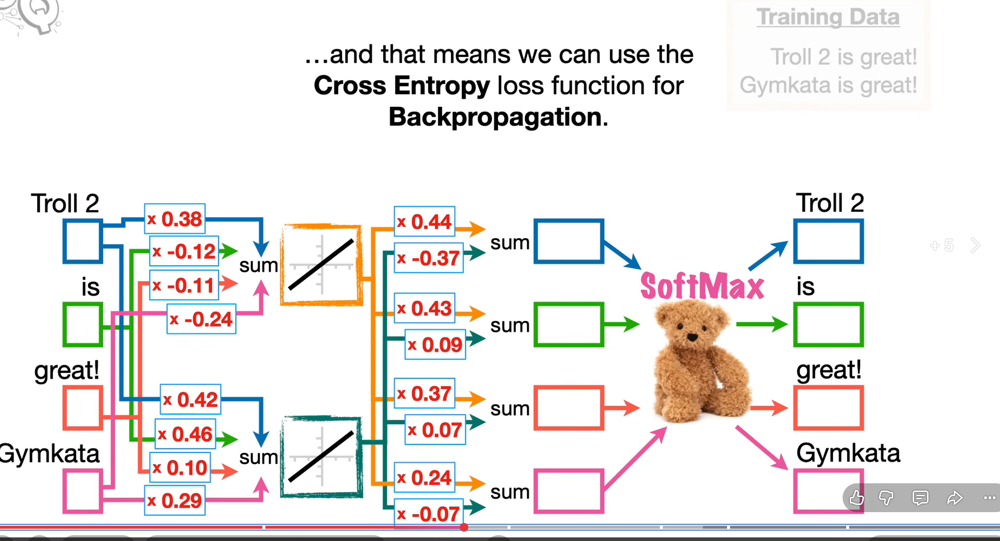

- ★ **Weights per neuron = number of values coming in.** Every neuron gets **all** values of the layer before.
- In the picture: 4 inputs → each of the 2 middle neurons has **4** weights. 2 middle values → each of the 4 output neurons has **2** weights.

```
4 input values                 [1, 0, 0, 0]
  ↓ 4 weights × 2 neurons = 8
2 sums → activation            0.38, 0.42
  ↓ 2 weights × 4 neurons = 8
4 sums (raw scores)            0.01, 0.20, 0.17, 0.06
  ↓ softmax                     → section 3
4 probabilities                0.23, 0.27, 0.26, 0.24
```

- ★ **No activation → linear ∘ linear = linear.** y = w₂(w₁x + b₁) + b₂ = (w₂w₁)·x + (w₂b₁ + b₂) → the deep net equals one layer (Tute 3 Q2).
- **UAT:** one hidden layer can approximate any function in theory. In practice, depth works better.

### 🧮 Count parameters (Tute 3 Q4)
```
weights between two layers = n_before × n_after
params of a dense layer    = (n_before + 1) × n_after        +1 = one bias per neuron
bits                       = params × bits per weight
```
> **Examples:** picture above (no bias): 4·2 + 2·4 = **16**.
> 64×64×3 image → 100 hidden → 1 output: 100·(12,288 + 1) + 1·(100 + 1) = **1,229,001** → × 64 bits.
> A lookup table instead would need 256^(64·64·3) entries → impossible (Tute 3 Q3).

### ✔ / ✘
- ✘ Stacking linear layers adds expressive power.
- ✔ Each neuron has one weight per incoming value (+ 1 bias).

---

## 2 · Activations
<sub>Week 2 · Lernen 01 §2 · 🆕 A.5</sub>

**Core:** the activation bends the sum, so stacked layers can learn curves. Its slope decides how well the gradient flows back.

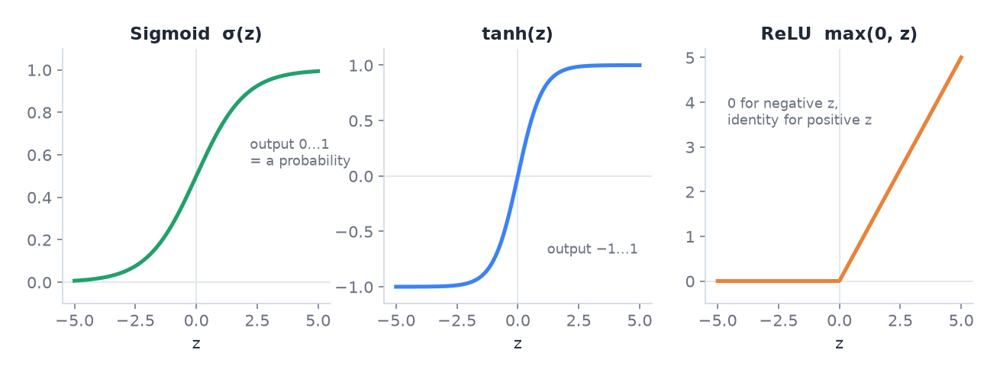

| | Output range | Gradient (slope) | Catch |
|---|---|---|---|
| sigmoid σ | **(0, 1) strictly** | max 0.25 at z = 0, **≈ 0 for large \|z\|** | saturates, not zero-centred |
| tanh | (−1, 1) | max 1 at z = 0, ≈ 0 for large \|z\| | saturates too: tanh(z) = 2σ(2z) − 1 |
| ReLU | **[0, ∞)** | **1 if z > 0, 0 if z < 0** | dead ReLU (stuck at 0) |
| Leaky ReLU | (−∞, ∞) | 1 or small slope | no dead units |
| identity | (−∞, ∞) | 1 | adds nothing (word2vec middle layer, regression output) |

- **Simply put:** sigmoid and tanh die at both ends. ReLU dies only on the left.
- Hidden layers → **ReLU** (default). Sigmoid/softmax belong at the **output** → section 3.
- Switching sigmoid → tanh does **not** fix saturation (Tute 3 Q5, Tute 4 Q4). tanh is zero-centred, which helps a little.

### ✔ / ✘ 🆕 A.5
- ✔ Sigmoid outputs are always strictly between 0 and 1. ★
- ✔ ReLU outputs are always ≥ 0. ★
- ✘ Sigmoid has a large gradient for large positive or negative z. ★ (≈ 0: saturation)
- ✘ ReLU has a large gradient for large negative z. ★ (exactly 0)
- ✘ Switching sigmoid → tanh fixes saturation.

---

## 3 · Output function + loss: always a pair ★★
<sub>Week 2 · Lernen 01 §4, 06 · Tute 3</sub>

**Core:** the label decides the output function. The output function decides what the output means. The loss can only compare that kind of output with the label. So one label type → one fixed pair.

### Step 1 · Look at the label, pick the row

| What is the label? | Example | Output function | Output means | Loss | Signal at z |
|---|---|---|---|---|---|
| **a number** | house price 312k | none (linear) | the number itself | **MSE** | 2(ŷ − y) |
| **yes / no** | spam? | **1 sigmoid** | P(yes) | **BCE** | p − y |
| **exactly one of K** | digit 0–9, next word | **K softmax** | P(class k), sum = 1 | **CE** | p − y per class |
| **any subset of K** | tags of a meme | **K sigmoids** | P(class k) each, no sum rule | **BCE per class** | p − y per class |

- "**Si**gmoid = **Se**veral, **So**ftmax = **Si**ngle."
- Cat and/or dog → 2 sigmoids + 2 BCE. (Softmax over none/cat/dog/both also works, but needs 2ᴷ classes.)

### Step 2 · Why exactly this loss: one rule for all

★ **Loss = −ln( probability the model gave to the true answer ).** Small when the model was sure and right. Huge when sure and wrong.

**Softmax → CE.** p = (0.23, <span style="color:#22a06b">0.27</span>, 0.26, 0.24), truth = "is" → −ln 0.27 = **1.30**. Only the true class counts.

**Sigmoid → BCE.** Sigmoid gives one number p = P(yes). The probability of the truth depends on the label:
```
truth = yes (y = 1):  probability of truth = p       → loss −ln p
truth = no  (y = 0):  probability of truth = 1 − p   → loss −ln(1 − p)
both in one line:     BCE = −[ y·ln p + (1 − y)·ln(1 − p) ]      (one term is always 0)
```
> p = 0.9: y = 1 → −ln 0.9 = **0.105** · y = 0 → −ln 0.1 = **2.30** (sure and wrong).

- ★ BCE = CE with 2 classes (yes, no).

**Linear → MSE.** A raw number is no probability, so −ln makes no sense. Measure the distance instead:
> ŷ = 300k, y = 312k → (300 − 312)² = **144** (in k²). (MSE is what the −ln rule gives when you assume Gaussian noise.)

### Step 3 · Why you cannot mix them

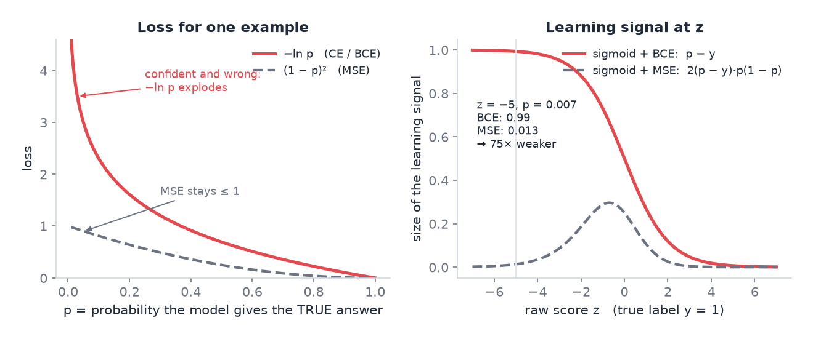

1. **The loss needs the right kind of input.** CE needs probabilities that sum to 1 → softmax. BCE needs a number in (0, 1) → sigmoid. −ln of a linear output like −3 → undefined.
2. **Matched pair = clean signal.** The slopes of output function and loss cancel. What is left at z is just **prediction − truth**: p − y.
3. **Wrong pair = weak signal.** Sigmoid + MSE: signal = 2(p − y)·**p(1 − p)**. The extra factor is the sigmoid slope, ≈ 0 when saturated.
   > z = −5, y = 1 → p = 0.007. BCE: 0.007 − 1 = **−0.99**. MSE: 2·(−0.99)·0.007·0.993 = **−0.013** → 75× weaker. Sure and wrong → learns almost nothing.
4. **Softmax on multi-label = wrong.** Probabilities must sum to 1 → three true tags cannot all be high:

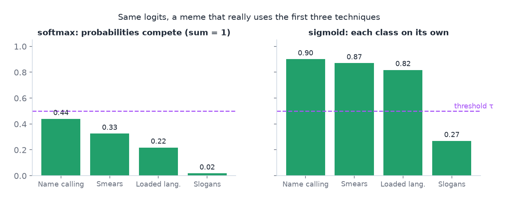

### 🧮 Run it down
```
softmax_k = e^(z_k) / Σ e^(z_j)
CE        = −ln p(true class)
BCE       = −[ y·ln p + (1 − y)·ln(1 − p) ]
MSE       = mean of (y − ŷ)²
```
1. Softmax: e^ every raw score → add them up → divide each by the sum.
2. CE: take p of the **true** class → −ln. The other classes do not matter.
3. BCE: y = 1 → −ln p. y = 0 → −ln(1 − p).

> Raw scores (2, 1, 0) → e = 7.39, 2.72, 1 → sum 11.11 → softmax **0.665, 0.245, 0.090**.

- Sanity check: untrained K-class net → CE ≈ ln K (10 classes → 2.30).
- PyTorch: `CrossEntropyLoss` and `BCEWithLogitsLoss` take the **raw scores**. Softmax/sigmoid is inside. Applying it yourself first = applied twice = bug.

### 🧮 Weighted BCE (rare positives) ★
```
L = −[ α₁·y·ln p + α₀·(1 − y)·ln(1 − p) ]        α₁ large for rare positives
A2: α₁ = √(N_neg / N_pos), α₀ = 1
```
> y = 1, p = 0.2, α₁ = 3 → 3·1.609 = **4.83** (unweighted 1.61) · N_pos = 100, N_neg = 900 → α₁ = √9 = **3**.

### ✔ / ✘
- ✘ Softmax output for multi-label tasks.
- ✘ MSE is a good loss for a sigmoid classifier. (weak signal when saturated)
- ✔ Softmax + CE and sigmoid + BCE both give the signal p − y at the raw score.
- ✔ Confident and wrong → very large CE.

---

## 4 · The learning loop: forward → loss → backward → update ★★
<sub>Weeks 2–3 · Lernen 01 §5 · Tute 4 Q1</sub>

**Core:** forward computes the loss. Backward asks for every weight: "if I nudge you up, does the loss go up or down?" Then each weight takes a small step in the direction that lowers the loss.

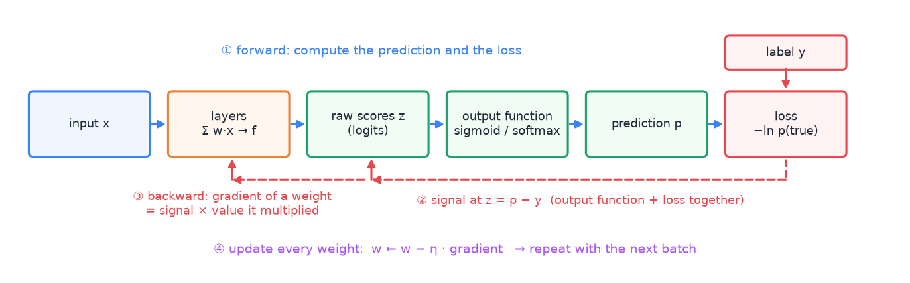

```
gradient of a weight = signal at its output end × the value it multiplied
signal one layer back = Σ ( signal × weight ) × slope of the activation
new weight           = old − η · gradient
```
- Gradient **negative** → weight goes **up**. Gradient positive → weight goes down.
- Only the **first** backward step depends on the loss (section 3, last column). After that, every loss is handled the same way.

### 🧮 Example 1 · word2vec, softmax + CE (picture in section 1)
Input "Troll 2", target <span style="color:#e5484d">"is"</span>, η = 0.1.

**Forward**
1. Middle: top = 1·<span style="color:#e8833a">0.38</span> + 0·… = 0.38 · bottom = 1·<span style="color:#e8833a">0.42</span> + 0·… = 0.42 → identity → <span style="color:#22a06b">(0.38, 0.42)</span> = embedding of "Troll 2".
2. Sum per output: "is" = 0.38·<span style="color:#e8833a">0.43</span> + 0.42·<span style="color:#e8833a">0.09</span> = 0.20 → all 4: <span style="color:#22a06b">(0.01, 0.20, 0.17, 0.06)</span>.
3. Softmax → <span style="color:#22a06b">(0.23, 0.27, 0.26, 0.24)</span>.
4. CE = −ln 0.27 = **1.30**.

**Backward**
1. Signal at the 4 sums = p − y = (0.23, 0.27, 0.26, 0.24) − (0, 1, 0, 0) = <span style="color:#e5484d">(0.23, −0.73, 0.26, 0.24)</span>.
2. Weight top → "is" (<span style="color:#e8833a">0.43</span>): gradient = −0.73 × 0.38 = −0.28 → new 0.43 + 0.028 = **0.458** ↑ → p("is") rises.
3. Weight top → "Troll 2" (<span style="color:#e8833a">0.44</span>): gradient = 0.23 × 0.38 = 0.087 → new **0.431** ↓.
4. Signal back to the top neuron = 0.23·0.44 − 0.73·0.43 + 0.26·0.37 + 0.24·0.24 = <span style="color:#e5484d">−0.06</span> (identity → × 1).
5. Input weight "Troll 2" → top (<span style="color:#e8833a">0.38</span>): gradient = −0.06 × 1 → new **0.386**. Weights of "is", "great!", "Gymkata": × 0 → **no change**. Only the input word's embedding moves.

### 🧮 Example 2 · regression, ReLU + MSE (Tute 4)

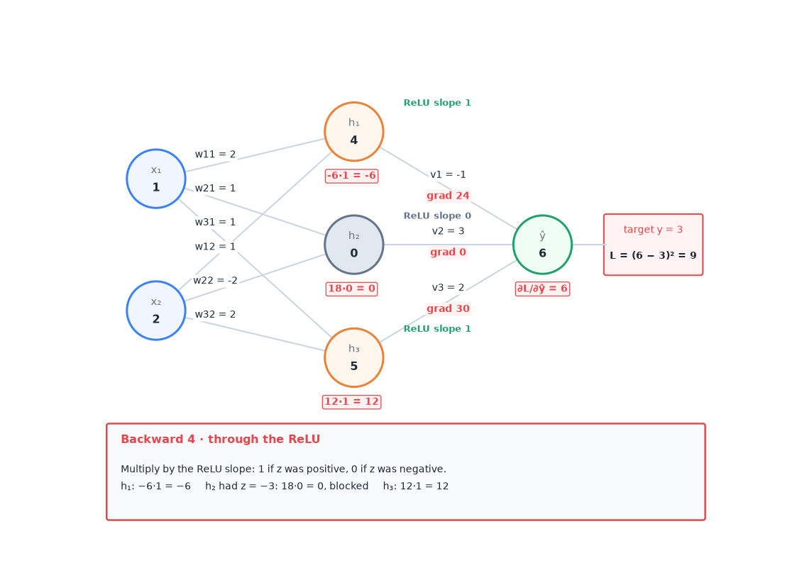

**Forward**
1. Each hidden neuron: z = Σ w·x + b → h = f(z) (ReLU: negative → 0).
2. ŷ = Σ v·h + b → L = (ŷ − y)².

**Backward**
1. Signal at ŷ: **2(ŷ − y)**. (L = ½(ŷ − y)² → ŷ − y.)
2. Output weight vᵢ: gradient = signal(ŷ) × hᵢ. Bias: × 1.
3. Signal to hidden output: signal(ŷ) × vᵢ.
4. Through the activation: ReLU → × 1 if z > 0, × 0 if z ≤ 0 · sigmoid → × σ(1 − σ) · tanh → × (1 − tanh²).
5. Hidden weight wᵢⱼ: gradient = signal(zᵢ) × xⱼ. Bias: × 1.

> <span style="color:#3b82f6">x = (1, 2)</span>, <span style="color:#e5484d">y = 3</span>, η = 0.1, hidden weights <span style="color:#e8833a">(2, 1), (1, −2), (1, 2)</span>, output weights <span style="color:#e8833a">(−1, 3, 2)</span>, biases 0.
> z = <span style="color:#22a06b">(4, −3, 5)</span> → h = <span style="color:#22a06b">(4, 0, 5)</span> → ŷ = −4 + 0 + 10 = <span style="color:#22a06b">6</span> → L = 9.
> Signal(ŷ) = 2·(6 − 3) = <span style="color:#e5484d">6</span> → grad v = (24, 0, 30), output bias 6.
> Signal(z) = 6·(−1, 3, 2), then ReLU → <span style="color:#e5484d">(−6, 0, 12)</span> → grad w₁ = (−6, −12), w₂ = (0, 0), w₃ = (12, 24), biases (−6, 0, 12).
> Update: v₁ = −1 − 2.4 = −3.4 · w₁₁ = 2 + 0.6 = 2.6 · …

- Neuron 2 had z < 0 → ReLU slope 0 → its weights get gradient 0 (dead for this example).

---

# B · Train it well

## 5 · Gradient descent and optimisers
<sub>Week 3 · Lernen 01 §6 · Tute 4 · 🆕 B.4</sub>

**Core:** repeat the learning loop on small batches. The learning rate η sets the step size and matters most.

- ★ **w ← w − η · ∂L/∂w.**
- We minimise the **empirical risk** = mean training loss + λ·penalty, not the true risk.
- **Batch:** many examples at once in one table. Gradient = average over the batch.
- **SGD** = gradient from a mini-batch: cheap and noisy. Noise helps escape saddle points, regularises a little. Shuffle every epoch.
- Batch × 4 → gradient noise only ÷ 2 (√n). Bigger batch = more memory.
- **Momentum:** running mean of gradients → removes zig-zag in narrow valleys.
- **RMSProp:** step ÷ running mean of squared gradients (own step size per weight). **Adam** = momentum + RMSProp, the default. **AdamW** = Adam + correct weight decay.
- Extra memory per weight: SGD 0 · momentum 1 · Adam 2.
- **Warm-up** (LR starts near 0, rises) then decay → protects pretrained weights.

### 🔧 Problem → fix ★ 🆕 B.4
| What you see | Cause | Fix |
|---|---|---|
| loss **oscillates**, does not converge | **LR too high**, steps overshoot | lower LR, LR schedule/decay, warm-up, clipping, bigger batch |
| loss falls very slowly, almost a straight line | LR too low | raise LR |
| loss explodes / NaN | exploding gradients, cliffs | gradient clipping, lower LR, BatchNorm, good init |
| stuck, gradient ≈ 0 | saddle point, plateau, saturated units | SGD noise, momentum/Adam, ReLU, BatchNorm |
| early layers of a deep net do not learn | vanishing gradients | ReLU, He init, BatchNorm, residual connections |

### Loss-landscape words
- Local minimum: lowest point nearby, not the global one.
- ★ **Saddle point:** gradient = 0, minimum in one direction, maximum in another. Common in high dimensions.
- Plateau: tiny gradient → slow. **Cliff:** sudden huge gradient → huge step → clipping.
- **Pathological curvature:** steep across, flat along → zig-zag → momentum.

### ✔ / ✘
- ✔ SGD noise can help escape saddle points.
- ✘ Gradient clipping fixes vanishing gradients. (exploding only)

---

## 6 · Stable training: initialisation and BatchNorm
<sub>Week 3 · Lernen 01 §7 · Tute 4 Q5</sub>

**Core:** keep the numbers in every layer at a sane size, so the gradient neither dies nor explodes.

- All weights 0 (or all equal) → all neurons identical forever (symmetry) → **random** init.
- Scale by fan-in: **Xavier** Var = 1/n_in (tanh, sigmoid) · **He** Var = 2/n_in (ReLU).
- **BatchNorm** per mini-batch: ẑ = (z − μ_B) / √(σ²_B + ε) → out = γ·ẑ + β (γ, β learned).
- At test time BN uses **running averages**, not the current batch.
- A bias before BN is useless: the mean subtraction removes it.
- BN: faster, more stable training, higher LR possible, slight regularisation.

### 🧮 BatchNorm numbers
> z = (1, 3, 5) → μ = 3 → σ² = (4 + 0 + 4)/3 = 2.67 → σ = 1.63 → ẑ = (−1.22, 0, 1.22) → out = γ·ẑ + β.

### ✔ / ✘
- ✘ BatchNorm uses the current batch statistics at test time.
- ✘ All-zero initialisation is fine.

---

## 7 · Overfitting: regularisation and bias–variance
<sub>Week 3 · Lernen 01 §8 · Tute 4 Q6–Q8, Tute 3 Q1</sub>

**Core:** more capacity fits the training data better but can memorise it. Regularisation trades a bit of training fit for better generalisation.

| Change | Bias | Variance |
|---|---|---|
| more capacity (wider, deeper) | ↓ | ↑ |
| L2 / L1 | ↑ | ↓ |
| dropout | ↑ | ↓ |
| more training data | = | ↓ |

- Error = bias² + variance + noise. High bias = underfit. High variance = overfit.
- **L2 / weight decay:** w ← (1 − ηλ)·w − η·∂L/∂w → every step shrinks w a bit. η = 0.1, λ = 0.01 → × 0.999.
- **L1:** pushes weights to exactly 0 (sparse).
- **Dropout:** random units off, **training only**. Ensemble of 2ᴴ sub-nets with shared weights, no co-adaptation. Off at test time.
- **Early stopping:** stop at the lowest validation loss.
- Data augmentation · more data · smaller model · freeze layers.

### ✔ / ✘
- ✘ Dropout is active at test time.
- ✘ More data reduces bias.
- ✔ Weight decay = L2 penalty, shrinks weights every step.
- ✔ Regularisation and dropout: bias ↑, variance ↓.

---

# C · Measure it honestly

## 8 · Data splits and leakage
<sub>Week 1 · Lernen 07 §0–3 · Tute 2</sub>

**Core:** the test set must look like deployment and must never influence training.

- ★ **ML** = improve at task **T**, measured by **P**, with experience **E**. (Weather: T = predict weather, P = share of correct forecasts, E = historical data.)
- Number to predict → **regression**. Category → **classification**. (→ section 3 for the head.)
- **Train** = fit weights · **Validation** = choose settings · ★ **Test** = once, at the end.
- ★ Val and test must look like **deployment**. Tute 7: client uses microscope C → val and test only C images, about 90/5/5, some C also in train.
- Tune λ on the training set → it picks λ = 0. Tune on validation.

### Which split?
- Small data → **k-fold CV**.
- ★ Same person/patient many times → **group k-fold** (split by person).
- ★ Time series → **forward chaining**: train [1] test [2] · train [1 2] test [3] … Never random.
- Multi-label → iterative stratification.

### ★ Leakage = test information sneaks into training
- same person or near-duplicates in train and test
- normalising with statistics of all data (use train statistics only)
- augmenting or oversampling (SMOTE) **before** the split
- future information in the features (time series)
- tuning on the test set

### ✔ / ✘
- ✘ Random k-fold is fine for time series.
- ✘ Augment before splitting.
- ✔ The test set is used once.

---

## 9 · Metrics and class imbalance
<sub>Week 1 · Lernen 07 §4–5 · Tute 2 Q7</sub>

**Core:** accuracy lies when one class dominates. Count the four boxes and read precision and recall.

### 🧮 Metrics from counts ★
```
Accuracy  = (TP + TN) / all
Precision = TP / (TP + FP)      "of my alarms, how many right?"
Recall    = TP / (TP + FN)      "of the real ones, how many found?"
F1        = 2·P·R / (P + R)
TPR = recall          FPR = FP / (FP + TN)
```
1. Fill the 2 × 2: **TP** said yes & is yes · **FP** said yes & is no · **FN** said no & is yes · **TN**.
2. P and R → F1.
3. Several classes: **micro** = add TP/FP/FN over all classes, then one F1 (big classes rule). **Macro** = F1 per class, then average (rare classes count).

> 20 true cases, model flags 25, 15 correct → TP 15, FP 10, FN 5 → P = **0.60** · R = **0.75** · F1 = 0.9/1.35 = **0.67**.

- **ROC** = TPR vs FPR over all thresholds. **AUC** 0.5 = random, 1.0 = perfect ranking.

### ★ Imbalance toolbox
- Right metric: precision, recall, F1, PR-AUC, confusion matrix. **Not accuracy** (95 % "never spam" = 95 % accuracy).
- Resample: oversample rare / undersample common · **SMOTE** (training split only). x_new = x_i + λ·(x_nn − x_i): (1, 2) and (3, 6), λ = 0.5 → (2, 4).
- **Weighted loss** (weighted BCE → section 3) · focal loss.
- Tune the decision **threshold** on validation.

### ✔ / ✘
- ✘ Accuracy is a good metric under strong imbalance.

---

## 10 · Workflow, learning curves, tuning
<sub>Week 6 · Lernen 07 §1, §6–8 · Tute 7 · 📝 C.1b–d · 🆕 B.4</sub>

**Core:** build a simple baseline, read the curves, change one thing, repeat.

1. Goal + metric + target value.
2. Baseline end-to-end (simple model, default loss and optimiser).
3. Instrument: learning curves, per-class metrics, look at errors.
4. Diagnose: underfit, overfit, learning rate, data.
5. Change **one** thing → repeat. Test set once.

### 🔧 Read the learning curves ★

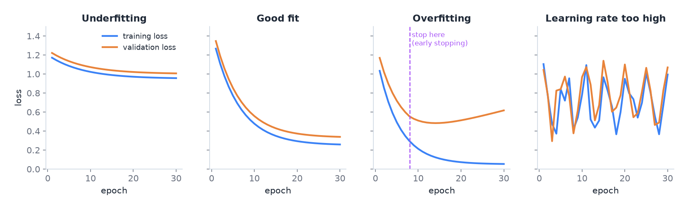

| What you see | Diagnosis | Fix |
|---|---|---|
| train and val both low, close (**72 % / 70 %**) | **underfit** (high bias) | bigger model, train longer, less regularisation, pretrained model, check LR |
| train high, big gap (**96 % / 78 %**), val loss rises | **overfit** (high variance) | augmentation, dropout, weight decay, early stopping, more data, smaller model, freeze layers |
| both losses zig-zag | LR too high | lower LR, schedule, warm-up |
| val loss < train loss | not a bug per se | dropout only in training · train loss averaged during the epoch · val easier · leakage |
| fine-tuning a big model: val loss rises after 1–2 epochs | overfit fast | lower LR, early stopping, freeze lower layers |

### Evaluate beyond one number ★ 📝 C.1d
- **Per-class** precision / recall / F1 · **confusion matrix** (which classes get mixed up) · look at errors.
- Segmentation with few cell pixels → pixel-wise **F1**; imbalanced → **weighted BCE**; architecture → U-Net (Tute 7).

### Tuning and comparing
- Tune on validation or CV, never on test. Learning rate first.
- Random search beats grid search. Log scale (10⁻¹ … 10⁻⁵). Coarse → fine.
- Fair comparison: same folds, several seeds, bootstrap confidence intervals.

### ✔ / ✘
- ✘ Underfitting → add dropout.
- ✘ Overfitting → train longer.
- ✔ Train 96 % / val 78 % = overfitting. ✔ Train 72 % / val 70 % = underfitting.
- ✘ Tune hyperparameters on the test set.

---

# D · Images

## 11 · CNN building blocks
<sub>Week 4 · Lernen 10 §1–5 · Tute 5 · 📝 A.1, B.1, C.1a</sub>

**Core:** one small filter slides over the image. Same weights everywhere → few parameters, and a pattern is found wherever it is.

- ★ **Sparse connectivity:** each output sees only a small local patch.
- ★ **Parameter sharing:** the same filter at every position.
- → far fewer weights than fully connected, uses neighbourhood structure → generalises better.
- ★ **Pooling:** smaller maps, some invariance to small shifts. 0 params.
- Fully connected on pixels: huge weight count, ignores neighbourhood, overfits.
- Layers learn edges → textures → parts → objects. Receptive field grows with depth.

### 🧮 Convolution by hand ★ (Tute 5 Q1)

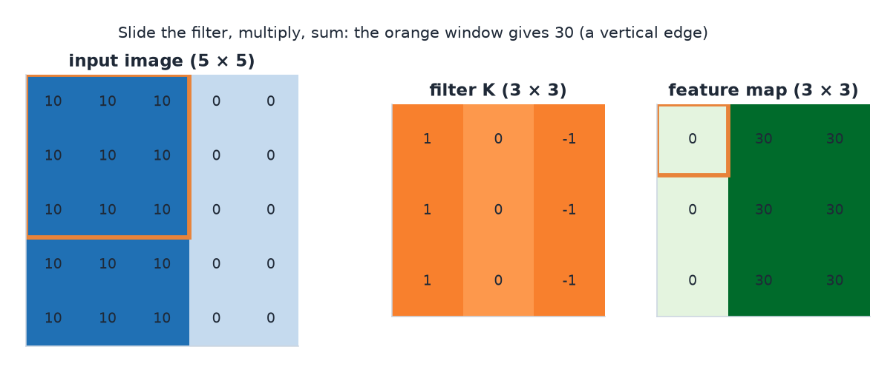

1. Output size first.
2. Kernel on the top-left patch → multiply cell by cell, add everything (+ bias).
3. Move by the stride → next cell. No kernel flip.

> Patch rows (10 10 0) × 3 with kernel rows (1 0 −1) × 3 → 30 − 0 = **30** → vertical edge.

- Kernel rows (1 1 1 / 0 0 0 / −1 −1 −1) = top − bottom → horizontal-edge detector. Flat area → 0.

### 🧮 Output size ★
```
W_out = floor( (W − k + 2p) / s ) + 1        pooling: same formula, p = 0
transposed conv: W_out = (W − 1)·s − 2p + k
```
- "valid" → p = 0. "same" with s = 1 → p = (k − 1)/2. Depth out = number of filters. Pooling keeps the depth.

> 28, k 5, p 0, s 1 → **24** → max-pool 2, s 2 → **12** · 32, k 3, p 1 → **32** · 7, pool 3, s 2 → **3**.

### 🧮 Parameters ★
```
conv  = C_out · (k·k·C_in + 1)        a filter spans ALL input channels, +1 bias
dense = n_out · (n_in + 1)            flatten size = H · W · C
pool, flatten = 0         BatchNorm = 2·C (γ, β)
depthwise separable = k·k·C_in + C_in·C_out
```
> 128 filters 3×3 on 64 channels → 128·(9·64 + 1) = **73,856**.

### 🧮 LeNet table ★ (Tute 5 Q3)
| Layer | Output | Params |
|---|---|---|
| conv 6@5×5, valid | 28×28×6 | 6·(25·1 + 1) = 156 |
| avg-pool 2, s 2 | 14×14×6 | 0 |
| conv 16@5×5 | 10×10×16 | 16·(25·6 + 1) = 2,416 |
| avg-pool 2, s 2 | 5×5×16 | 0 |
| flatten | 400 | 0 |
| dense 120 | 120 | 120·401 = 48,120 |
| dense 84 | 84 | 84·121 = 10,164 |
| dense 10 | 10 | 10·85 = 850 |
| **total** | | **61,706** (≈ 80 % in the first dense layer) |

### 🧮 Receptive field ★ (Tute 5 Q4–Q5)
```
start: RF = 1, J = 1
each layer (pooling too):  RF = RF + (k_eff − 1)·J   then   J = J·s
dilation d:                k_eff = k + (k − 1)(d − 1)
```
| Layer | RF | J |
|---|---|---|
| start | 1 | 1 |
| conv 5, s 1 | 1 + 4·1 = 5 | 1 |
| pool 2, s 2 | 5 + 1·1 = 6 | 2 |
| conv 5, s 1 | 6 + 4·2 = **14** | 2 |

- First conv with dilation 2: k_eff = 9 → 9 → 10 → **18**. Same params.
- Stacked 3×3 (s 1): two = 5×5 view, three = 7×7.

### Special convolutions
- **Dilated:** gaps → bigger receptive field, same params. **Transposed:** upsampling (decoders, GANs).
- **1×1:** mixes or reduces channels. **Strided:** downsampling. **1-D:** signals, audio, text.

### ✔ / ✘ 📝 A.1
- ✔ Sparse connectivity. ✔ Parameter sharing. ✔ Pooling gives some shift invariance.
- ✘ Dense connectivity (every output sees all inputs).
- ✘ CNNs are rotation- or scale-invariant by design (use augmentation).
- ✘ Pooling has learnable parameters. ✘ A filter looks at only one input channel.

---

## 12 · CNN architectures, detection, transfer learning
<sub>Week 5 · Lernen 10 §6–9, 05 §1 · Tute 6 · 📝 A.2, C.1e</sub>

**Core:** each famous net added one trick (depth, 1×1, skips). In practice you start from a pretrained net and retrain the head.

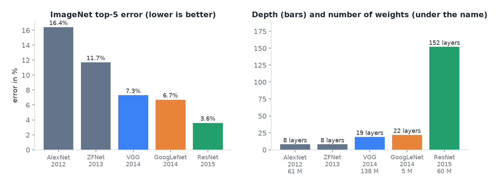

| Net | Key idea | Remember |
|---|---|---|
| LeNet | conv + pool + FC | digits |
| AlexNet 2012 | ReLU, dropout, augmentation, GPUs | 61 M params, most in the FC layers |
| VGG 2014 | only 3×3, deeper | three 3×3 = one 7×7 view, 27C² vs 49C² weights |
| GoogLeNet 2014 | Inception: parallel 1×1 / 3×3 / 5×5 / pool | 1×1 bottleneck, GAP, auxiliary classifiers, ≈ 5 M params |
| ResNet 2015 | skip: H(x) = F(x) + x | 152 layers trainable |
| MobileNet | depthwise separable conv | phones |
| ViT | 16×16 patches → Transformer | data-hungry |
| U-Net | encoder–decoder + skips | segmentation, little data |

- **GoogLeNet:** right kernel size unknown → use all in parallel. 1×1 first → fewer channels. ★ **Auxiliary classifiers:** extra gradient into early layers, L = CE_final + λ₁·CE₁ + λ₂·CE₂, removed at test. ★ **Global average pooling:** each map → 1 number → far fewer params.
- ★ **ResNet:** plain deep nets get worse **even on training data** → optimisation problem, not overfitting. Skip → layers learn the residual F(x) = H(x) − x, gradient flows through the shortcut.

### 🧮 1×1 bottleneck saving
> 28×28×256 input, 96 filters 5×5 → 5·5·256·96 = **614,400** weights. 1×1 to 64 first: 256·64 + 5·5·64·96 = **169,984** (≈ 3.6× less).

### Vision tasks
- **Classification + localisation:** class head (CE) + box head (4 numbers, L1/L2). L = L_cls + λ·L_box. (two heads → two losses, section 3)
- ★ **Two-stage:** region proposals → classify each (Faster R-CNN). Accurate, slower. ★ **One-stage:** grid/anchors in one pass (YOLO, SSD). Real time.
- **Segmentation:** semantic = class per pixel · instance = per object (Mask R-CNN). FCN, U-Net.

### 🧮 IoU and NMS ★

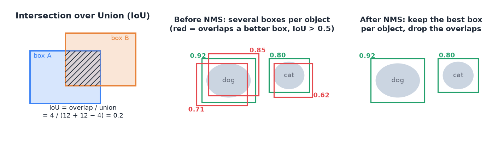

```
IoU = overlap / (area A + area B − overlap)
```
1. Overlap width = min(right edges) − max(left edges). Same for height. Negative → 0.
2. Union = A + B − overlap → divide.
- **NMS:** sort by score → keep the top box → delete boxes with IoU > ≈ 0.5 to it → repeat.

> A (0,0)–(4,4), B (2,2)–(6,6) → overlap 4 → union 16 + 16 − 4 = 28 → IoU = **0.14**.

### Transfer learning recipe ★ 📝 A.2, C.1e
1. ImageNet-pretrained backbone (e.g. ResNet).
2. Replace the head → K outputs (e.g. 6 waste classes, softmax + CE).
3. **Freeze** the backbone, train the head.
4. Optional: **unfreeze top layers**, train with a **smaller LR**.
- Small data, similar domain → freeze more. Big data or different domain → unfreeze more.
- Early layers = generic (edges) → keep. Late layers = task-specific → retrain.

### Augmentation ★
- Only changes that keep the label true: crop, small rotation, brightness, noise, blur, flip (if flip-safe).
- No flips for left/right gestures, text, digits 6/9. Training set only, after the split.

### ✔ / ✘ 📝 A.2
- ✔ Unfreeze some top layers. ✔ Smaller LR for them. ✔ Head and base can both be trained.
- ✘ All layers of the base must stay frozen during fine-tuning.
- ✘ ResNet skips mainly fix overfitting. (they fix optimisation)
- ✘ GAP adds parameters. ✔ Auxiliary classifiers fight vanishing gradients.
- ✔ One-stage detectors are faster than two-stage ones.

---

# E · Text and sequences

## 13 · Text → numbers
<sub>Week 7 · Lernen 02</sub>

The flow has four steps. Each step has one distinction you must know.

```
"I love unhappiness"
   ↓ 1 tokenise            text → pieces
[CLS] I love un ##happi ##ness [SEP]
   ↓ 2 vocabulary          piece → number
101  7  15  42  88  91  102
   ↓ 3 embedding           number → vector
[0.2, −0.1, …]  per token  (768 numbers: 768 is chosen, the values start random and are learned)
   ↓ 4 model (e.g. BERT)   vector → vector with context
[0.5, 0.3, …]   per token, depends on the sentence
```
(The IDs are made up.)

**1 · Tokenise: text → pieces.** Distinction: how big are the pieces?
```
             pieces                       vocabulary   problem
word         unhappiness                  huge         new word → [UNK]
character    u n h a p p …                ~100         sentences get very long
sub-word ★   un ##happi ##ness            ~30,000      none: common words whole, rare ones in pieces
```
Then the special tokens are added ([CLS], [SEP]), and short sentences are filled with [PAD] up to the batch length.

**2 · Vocabulary: piece → ID.** Just a lookup in a list: "love" = 15. The ID is a house number and has no meaning. ID 15 is not more similar to ID 16 than to ID 900.

**3 · Embedding: ID → vector.** Distinction: one-hot or embedding.
```
one-hot     "love" = [0 0 … 1 … 0]   length 30,000, a single 1
            all words equally far apart
embedding   "love" = row 15 of the table (30,000 × 768)
            short, learned, similar words close together
```
30,000 rows = one per token in the vocabulary. 768 numbers per token: the **768 is chosen** (BERT-base: 12 heads × 64), the **values start random and are learned**.

Both are linked: one-hot × weight matrix picks exactly one row. That is the word2vec picture (section 1): "Troll 2" = [1,0,0,0] takes its weights 0.38 and 0.42, and that is its embedding.

**4 · Static or contextual.**
```
static (word2vec, GloVe)    vector from step 3 is final
                            "bank" in "river bank" = "bank" in "bank account"
contextual (BERT)           vector from step 3 goes through attention
                            → "bank" gets a different vector in each sentence
```

**Core:** text is cut into sub-word pieces. Each piece gets a number, and the number fetches a row from the embedding table. In word2vec that is the final vector. In BERT, attention then mixes in the context.

### Batches, padding, attention mask ★
A batch = one table, one row per sentence. Rows need equal length → fill with [PAD]:
```
"I love it"                    → [CLS] I    love  it   [SEP]  [PAD]  [PAD]
"This movie was really great"  → [CLS] this movie was  really great  [SEP]
mask (row 1):                       1    1     1    1     1      0      0
```
- Mask 1 = real token, 0 = filler. How attention uses it → section 15.
- **Dynamic padding:** pad each batch only to its own longest sentence → less compute.

---

## 14 · RNNs, LSTM, GRU
<sub>Week 7 · Lernen 03 · 📝 A.3, B.2 · 🆕 A.6</sub>

**Core:** read the sequence one step at a time with the same weights and carry a memory h. Long sequences → the gradient fades.

### 📊 Task shapes ★ 📝 A.3

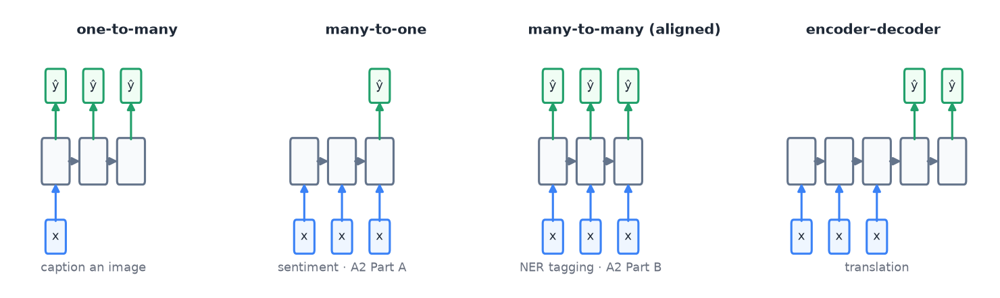

| Shape | Examples |
|---|---|
| one-to-one | image classification |
| one-to-many | image captioning, music generation |
| **many-to-one** | sentiment, spam, **genre of a variable-length clip** |
| many-to-many, aligned | POS/NER tagging, label every frame |
| many-to-many, encoder–decoder | translation, speech-to-text, summarising |

- Pick the shape by **counting the outputs**. Variable input length alone ≠ many-to-many.

### RNN
- **h_t = tanh(W_h·h_{t−1} + W_x·x_t + b).** Same weights at every step.
- Training = **BPTT**: backprop through the unrolled network.
- ★ **Vanishing / exploding:** gradient = product of many factors. 0.9⁵⁰ ≈ 0.005 · 1.1⁵⁰ ≈ 117.
- **Clipping → exploding only.** Gates (LSTM/GRU), attention, skips → vanishing.
- **Bidirectional:** reads both ways → tagging/classification yes, generation/real time no.

### 📊 LSTM vs GRU ★ 🆕 A.6

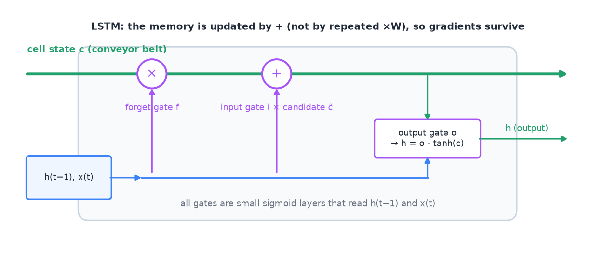

| | LSTM | GRU |
|---|---|---|
| memory | **cell state c** + hidden h | hidden h only, **no cell state** |
| gates | 3: forget, input, output | 2: update, reset |
| update | c_t = f ⊙ c_{t−1} + i ⊙ c̃_t (additive) | h_t = (1 − z) ⊙ h_{t−1} + z ⊙ h̃_t |
| weights | 4 blocks | 3 blocks → fewer, faster |

- **Both:** long-range dependencies, step by step, additive update keeps gradients alive.
- **Neither** has built-in attention. Both reduce vanishing gradients, they do not remove them.
- Gate = sigmoid "dimmer" 0…1. LSTM gates "FIO".

### 🧮 RNN parameter count
```
simple RNN = h·(h + x + 1)       LSTM = 4·h·(h + x + 1)       GRU ≈ 3·h·(h + x + 1)
+ output layer: K·(h + 1)
```
> x = 10, h = 20 → RNN **620** · LSTM **2,480** · GRU ≈ **1,860**.

### 🔧 Seq2seq bottleneck ★ 📝 B.2
- **Problem:** the decoder gets only the final encoder state → one fixed vector for the whole input → long inputs lose information.
- **Fix:** attention → the decoder looks at **all** encoder states, new weights for every output word.

### ✔ / ✘ 🆕 A.6
- ✘ Both GRU and LSTM have built-in attention. ★
- ✔ Both are designed to capture long-range dependencies. ★
- ✘ Neither has a cell state. (the LSTM has one) ★
- ✔ Both can process sequential data. ★
- ✘ A bidirectional RNN can generate text live.
- ✔ Genre of a variable-length clip = many-to-one.

---

## 15 · Attention and Transformers
<sub>Week 8 · Lernen 04 · Tute 8</sub>

**Core:** every token builds its new vector as a weighted mix of all tokens. The weights come from q · k scores and a softmax.

### 🧮 Scaled dot-product attention ★

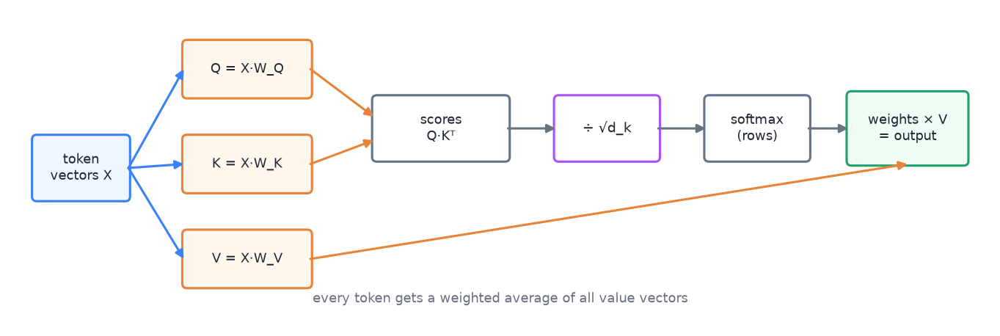

```
Attention(Q, K, V) = softmax( Q·Kᵀ / √d_k ) · V
```
1. **Scores:** q_i · k_j for every pair → n × n table. Row i = token being computed. Column j = token it reads from.
2. **Scale:** ÷ √d_k.
3. **Masks:** blocked cells → −∞.
4. **Softmax** per row → weights ≥ 0, sum = 1.
5. **Output** = Σ weight × v.

> d_k = 2, <span style="color:#3b82f6">q = (1, 0)</span>, k₁ = (1, 0), k₂ = (0, 1) → scores 1, 0 → ÷ 1.41 → 0.71, 0 → softmax <span style="color:#22a06b">0.67, 0.33</span> → output = 0.67·v₁ + 0.33·v₂.

### Padding mask: columns, not rows ★

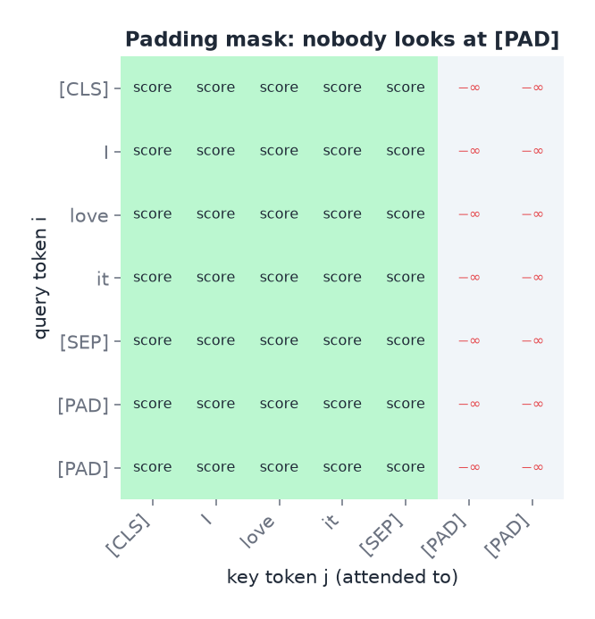

```
row "I":      scores [ 2.0   1.0   −∞   −∞ ]  → e^x [7.4  2.7  0  0] → weights [0.73  0.27  0  0]
row "[PAD]":  all −∞ would give e^x [0 0 0 0] → 0 / 0 → NaN → training breaks
```
- **Columns** of [PAD] → −∞ → real tokens read nothing from [PAD].
- **Rows** of [PAD] keep scores ([PAD] has an embedding, so it has a q). Their output is rubbish but never used: classification reads only [CLS], pooling and loss drop [PAD].
- **Causal mask** (decoder): column j > row i → −∞ → no peeking at future tokens.

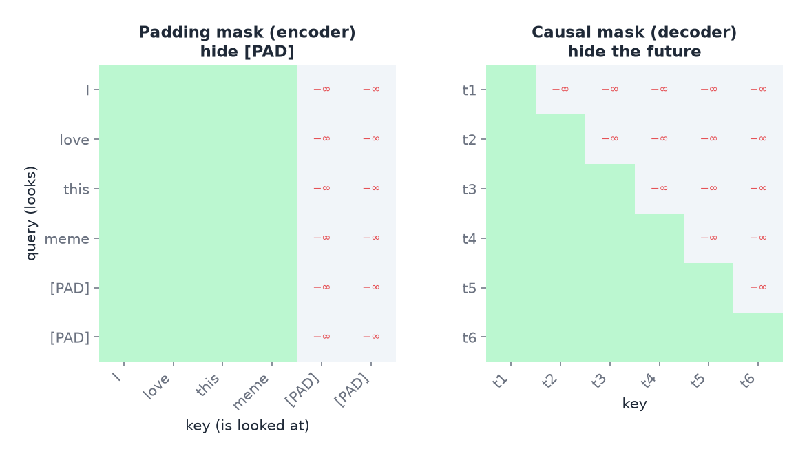

### Parts of the Transformer ★
- **Q** = what I look for · **K** = what I offer · **V** = what I pass on. Learned projections of the token vectors.
- **÷ √d_k:** dot products grow with d_k → softmax saturates (almost one-hot) → gradients ≈ 0.
- **Multi-head:** h heads, each d_k = d/h → concat → W_O. Several relations at once, same cost.
- ★ **Positional encoding:** attention alone ignores order → add sinusoidal, learned or relative positions.
- **Block** = multi-head attention + feed-forward net, each with **residual + LayerNorm**.

### 📊 Three families ★
| | Encoder-only | Decoder-only | Encoder–decoder |
|---|---|---|---|
| example | BERT | GPT | T5, original Transformer |
| attention | bidirectional | causal mask | encoder bidirectional + decoder causal + cross-attention |
| pretraining | masked tokens | next token | sequence-to-sequence |
| use | classify, tag (understand) | generate, chat | translate, summarise |

- **Cross-attention:** Q from the decoder, K and V from the encoder.
- "**E**ncoder = **E**xplain, **D**ecoder = **D**raft."

### 🧮 Transformer sizes
- d_k per head = d_model / h (768 / 12 = **64**).
- Attention ≈ 4·d² · FFN ≈ 8d² (d_ff = 4d) → one block ≈ **12·d²**.
- Attention matrix n × n → length × 2 → memory × 4.
- ViT tokens: (224/16)² = 196 + 1 [CLS] = **197**.

### 🔧 Transformer scenarios (Tute 8)
- **Why Transformer over RNN?** Parallel over positions (fast training) · path of length 1 between any two tokens (long range).
- **Long documents run out of memory** → O(n²) → truncate/chunk, sparse attention (Longformer).
- **Draft a reply** → decoder or encoder–decoder, causal mask, cross-attention.
- **Images** → ViT: patches + [CLS] + positions → encoder. Weak inductive bias → needs much data or pretraining.
- **Fine-tuning overfits after 1–2 epochs** → lower LR, early stopping, warm-up + decay, freeze lower layers.

### ✔ / ✘
- ✘ Transformers know word order without positional encoding.
- ✘ Transformers process tokens one after another. (all in parallel)
- ✔ The attention weights of one query sum to 1.
- ✘ BERT is the right choice for free text generation.
- ✘ Dividing by √d_k is for speed. (it stops softmax saturation)
- ✘ Self-attention cost grows linearly with sequence length.

---

## 16 · Which head for which text task
<sub>Week 8 · Lernen 06 · Tute 8</sub>

**Core:** same encoder, different head. The head follows the rule from section 3.

| Task | Take which vectors | Head | Loss |
|---|---|---|---|
| one label per text (sentiment) | [CLS] (or mean pooling) | linear + **softmax** | CE |
| several labels per text (meme techniques) | [CLS] | linear + **sigmoid each** + threshold per class | BCE per class |
| one tag per token (NER) | every token vector | same linear + softmax on each token | CE per token, [PAD] ignored |
| overlapping spans | every token vector | sigmoid per class per token | BCE |

- **BIO:** B = begin, I = inside, O = outside. One tag per token → no overlapping spans.
- **Multi-task:** one encoder, several heads, L = α·L₁ + λ·L₂. Risk of negative transfer.
- Threshold per class: tune on validation.

---

# F · Big pretrained models

## 17 · Self-supervised learning, adaptation, LoRA
<sub>Week 9 · Lernen 05 · Tute 9 · 📝 B.3 · 🆕 B.6</sub>

**Core:** pretrain once on huge unlabelled data, then adapt cheaply. The less you train, the cheaper and safer, but the less it adapts.

- ★ Self-supervised: labels come **from the data itself**. Masked token (BERT, 15 %), next token (GPT), image–text pairs (CLIP). Images: inpainting, rotation, jigsaw, colourisation.
- Recipe: pretext task on unlabelled data → keep the encoder → transfer to the real task with few labels.
- **Foundation model** = pretrained at scale, adapted to many tasks. Scaling law: loss falls as a power law of size/data/compute. Emergent abilities (in-context learning) at scale.

### 📊 Adaptation spectrum ★

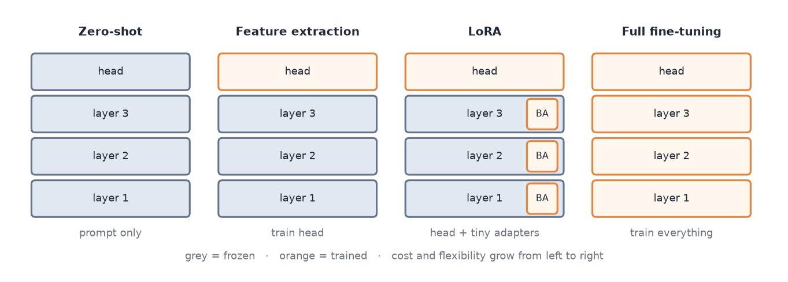

zero-shot / few-shot prompt → feature extraction (linear probe) → PEFT (LoRA, adapters) → full fine-tuning

| Situation | Pick | Why |
|---|---|---|
| no labels, quick baseline | zero-shot | no training; prompt-sensitive, usually weaker |
| small labelled set 📝 B.3 | **feature extraction** | freeze backbone, train only a head; fast, robust |
| many tasks, storage limited 🆕 B.6 | **LoRA / PEFT** | one frozen base + tiny per-task weights |
| lots of data, max accuracy | full fine-tuning | all weights; expensive, can forget, full copy per task |

- **Full fine-tuning:** − overfits small data, **catastrophic forgetting**, one full model per task.

### 🧮 LoRA ★ 🆕 B.6

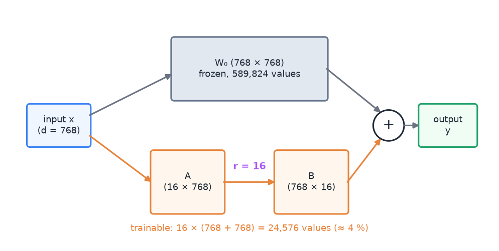

```
W = W₀ + B·A        W₀: d × k, frozen
B: d × r            A: r × k            r ≪ min(d, k)
full = d·k          LoRA = r·(d + k)
```
> d = k = 4096, r = 8 → 8·8192 = **65,536** vs 16.8 M = **0.39 %** · 1024 × 4096, r = 8 → **40,960**.

- B starts at **0** → training starts exactly at W₀.
- Merge W₀ + B·A after training → **no extra inference cost**.
- Many tasks: one base + one small (A, B) per task.
- **Other PEFT:** prompt tuning (virtual input tokens) · prefix tuning (K/V per layer) · adapters (small layers, small inference cost) · QLoRA (4-bit base).
- **Domain-adaptive pretraining:** more masked-token training on in-domain text. **Intermediate training:** first a related labelled task.

### Zero-shot LLM limits
- Prompt-sensitive · format breaks · stochastic · usually below a tuned model · contamination.
- **Privacy:** data goes to an external API.
- Few-shot = examples in the prompt, no weight update.

### ✔ / ✘
- ✘ LoRA adds inference latency. (merge) ✘ LoRA trains all weights.
- ✘ Feature extraction updates the backbone.
- ✘ Full fine-tuning is always best.
- ✔ Self-supervised learning needs no human labels. ✔ Zero-shot needs no task training.

---

# G · Generate

## 18 · Generative models
<sub>Week 10 · Lernen 11 · Tute 10 (file `Week 7/COSC2779_Tute7_questions_answers.pdf`) · 📝 A.4 · 🆕 A.7, A.8, B.5</sub>

**Core:** learn what the data looks like, then sample new data. Each model fixes a weakness of the one before.

> ★ **4 of 15 practice-test items.**

```
AE:        x → [encoder] → z → [decoder] → x̂              loss ‖x − x̂‖² (MSE, section 3)
VAE:       x → [encoder] → μ, σ → z = μ + σ·ε → [decoder] → x̂     loss recon + KL
GAN:       noise z → [G] → fake → [D] ← real   → "real or fake?"  (D = sigmoid + BCE)
Diffusion: x₀ → add noise T times → x_T           (fixed)
           x_T → [U-Net predicts noise] remove T times → x₀   (learned, MSE on the noise)
```

### Autoencoder ★ 📝 A.4

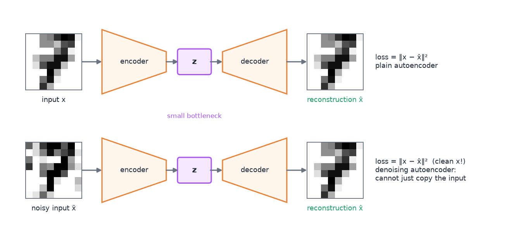

- Encoder → bottleneck z → decoder. No labels needed.
- Uses: compression, **denoising**, **anomaly detection** (train on normal data, high error = anomaly, τ = μ + 2σ), **retrieval** (nearest codes).
- ★ **Issues:** can memorise · latent space unconstrained, has gaps → random z gives junk → cannot reliably generate.

### 🔧 Problem → fix ★
| Problem | Cause | Fix |
|---|---|---|
| random z into a basic AE gives junk 🆕 B.5 | latent not constrained | **VAE**: encoder outputs a distribution, KL pulls it to N(0, I) → sample z ~ N(0, I) |
| VAE samples blurry | pixel loss averages | GAN or diffusion |
| GAN makes few similar images | **mode collapse** | diffusion or VAE; balance G/D |
| GAN training unstable | adversarial game | DCGAN rules, k D-steps per G-step, non-saturating G loss |
| diffusion too slow | many sequential steps | DDIM, latent diffusion |
| need a specific class | unconditional | conditional: feed label y (cGAN; diffusion + classifier-free guidance) |
| cannot backprop through sampling | random node | z = μ + σ·ε, ε ~ N(0, I) |

### VAE
- Encoder outputs **μ and σ**. Loss = reconstruction + **KL(q(z|x) ‖ N(0, I))**.
- Reparameterisation: randomness in ε → gradients reach μ, σ. μ = 1, σ = 0.5, ε = −2 → z = **0**.

### GAN ★ 🆕 A.7

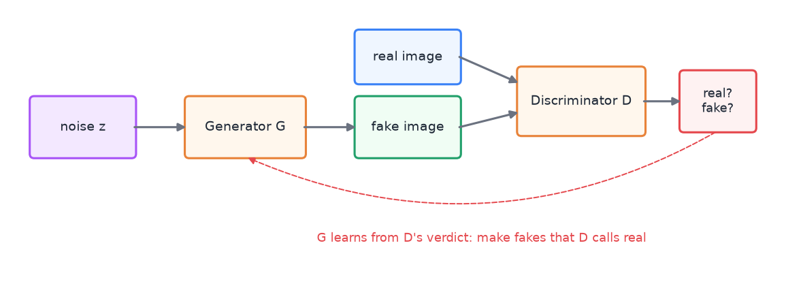

- **G:** noise → fake. **D:** real or fake? Train **both**, alternately.
- ★ **Generating needs only G.** ★ **CNNs in both** (DCGAN). ★ **Hard to train:** unstable, mode collapse.
- Sharp, fast sampling. No p(x), no encoder.

### Diffusion ★ 🆕 A.8

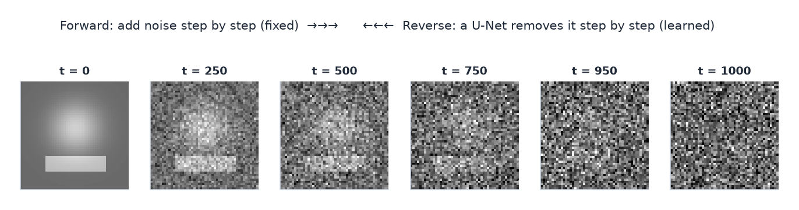

- **Forward (fixed):** add Gaussian noise over T steps. x_t = √ᾱ_t·x₀ + √(1 − ᾱ_t)·ε.
- **Reverse (learned):** U-Net ε_θ(x_t, t) predicts the noise. Loss ‖ε − ε_θ‖².
- ★ **Many denoising steps → slow.** ★ **Stable training.** ★ **More diverse than GANs.**
- Classifier-free guidance: ε̃ = ε(∅) + w·[ε(y) − ε(∅)]. Bigger w = closer to the prompt, less diverse.

### 📊 Compare ★
| | AE | VAE | GAN | Diffusion |
|---|---|---|---|---|
| can generate? | not reliably | yes | yes | yes |
| quality | – | blurry | sharp | sharp |
| diversity | – | good | mode-collapse risk | best |
| training | stable | stable | **unstable** | stable |
| sampling | – | fast | fast | **slow** |

- Synthetic training data → **diffusion**. Fast sampling → GAN. Usable latent → VAE.
- One-to-many tasks (sketch → photo): regression averages the answers → blurry → generative model.
- Text generation: sample the next token, feed it back in (autoregressive).
- WaveNet: audio sample by sample with dilated causal convolutions.
- Anomaly threshold: normal errors mean 0.02, std 0.01 → τ = 0.04 → error 0.07 = anomaly.

### ✔ / ✘
- ✔ A basic AE can memorise the training data. ★ 📝 A.4
- ✔ A basic AE cannot reliably generate new samples. ★ 📝 A.4
- ✘ A basic AE cannot reconstruct its input. ✘ It needs adversarial training. 📝 A.4
- ✔ Training a GAN trains a generator and a discriminator. ★ 🆕 A.7
- ✔ GANs are notoriously hard to train. ★ 🆕 A.7
- ✘ A trained GAN needs G and D to generate. ★ 🆕 A.7
- ✔ CNNs can be used in G and in D. ★ 🆕 A.7
- ✔ Diffusion generates through many denoising steps. ★ 🆕 A.8
- ✘ Diffusion models are unstable to train. ★ 🆕 A.8
- ✘ Sampling from diffusion models is fast. ★ 🆕 A.8
- ✔ Diffusion samples are more diverse than GAN samples. ★ 🆕 A.8
- ✘ The diffusion forward process is learned.

---

# H · Trust it

## 19 · Interpretability
<sub>Week 11 · Lernen 08 · Tute 11</sub>

**Core:** find out which input parts drove a prediction. With gradients if you have the model, by masking inputs if you only have an API.

- **Local** = one prediction (Grad-CAM). **Global** = whole model (TCAV, feature visualisation).
- **Post-hoc** vs **by design** (concept bottleneck). **Model-specific** (needs gradients) vs **model-agnostic** (only input → output).
- Why: trust, **debugging shortcuts** (ruler next to melanoma), fairness, high stakes.
- Feature visualisation: first-layer filters, activation maximisation, t-SNE/PCA of features (t-SNE keeps neighbours, not distances).

### 📊 Methods ★
| Method | Needs | Via API? | Idea |
|---|---|---|---|
| occlusion / leave-one-out | outputs | yes | remove a part, watch the drop |
| saliency, gradient × input | gradients | no | local slope; ≈ 0 when saturated |
| Grad-CAM | feature maps + gradients | no | class heatmap from the last conv layer; coarse |
| Integrated Gradients | gradients | no | gradients along baseline → input |
| LIME | outputs | yes | perturb, fit a sparse linear model |
| SHAP | outputs | yes | fair average marginal contribution |
| TCAV | activations | no | concept direction (global) |
| attention rollout | attention | no | multiply attention over layers (+ identity) |

- ★ **Attention ≠ explanation:** ignores values, residuals, FFN; different attention can give the same output.
- Better: **rollout** (all layers, class-agnostic) · **gradient-weighted attention** (class-specific) · IG or SHAP over tokens.
- **Probing:** classifier on a layer → what is encoded (decodable ≠ used). Logit lens. **Activation patching** = causal test.
- Attention rollout: Ã = product over layers of ½·(A + I). I = the residual connection.
- **VLM self-explanations:** plausible ≠ faithful.
- **Concept bottleneck:** image → concepts → label; a clinician can overwrite a wrong concept.

### 🔧 Problem → fix ★ (Tute 11)
| Problem | Fix |
|---|---|
| Grad-CAM highlights rulers, not the lesion → **shortcut** | crop/mask artefacts, balanced markings, retrain, evaluate with/without |
| model only as an API | **LIME / SHAP** |
| gradient × input ≈ 0 for confident predictions | **Integrated Gradients** |
| black patches are out-of-distribution | blur / mean / inpainting baselines |
| methods disagree | **faithfulness tests:** deletion, model randomisation, counterfactual edits |

### 🧮 Shapley values ★ (Tute 11 d)

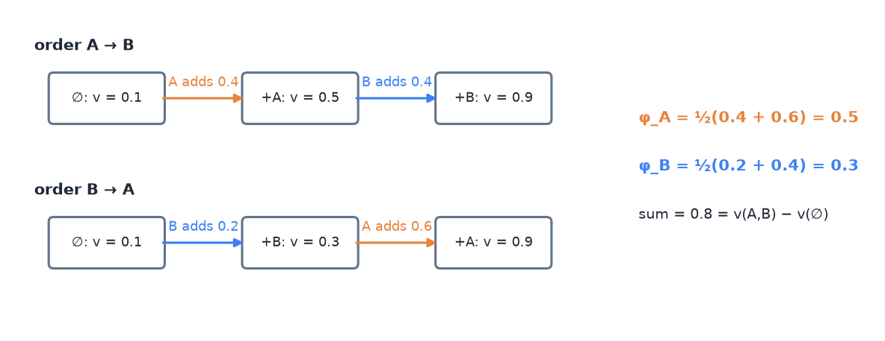

```
φ_A = ½ · [ (v(A) − v(∅)) + (v(AB) − v(B)) ]
φ_B = ½ · [ (v(B) − v(∅)) + (v(AB) − v(A)) ]
check: φ_A + φ_B = v(AB) − v(∅)
```
1. Write down v(∅), v(A), v(B), v(AB).
2. "A first": A adds v(A) − v(∅). "B first": A adds v(AB) − v(B). Average.
3. Check the sum. LOO_A = v(AB) − v(B) double-counts the interaction.

> v = 0.1 / 0.5 / 0.3 / 0.9 → φ_A = ½(0.4 + 0.6) = **0.5** · φ_B = ½(0.2 + 0.4) = **0.3** · sum 0.8 = 0.9 − 0.1 ✔. LOO: 0.6 + 0.4 = 1.0 > 0.8.

- 3 players: all 6 orders, average what each adds when it joins.

### 🧮 Integrated Gradients ★

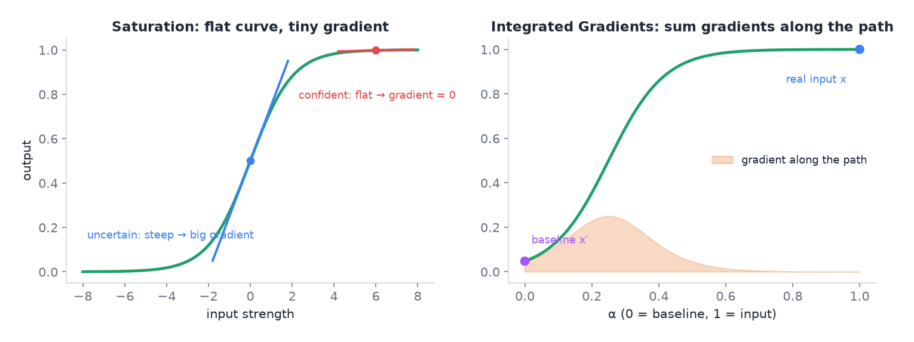

```
IG_i = (x_i − x'_i) · average of ∂f/∂x_i along the path x' → x
completeness: Σ IG_i = f(x) − f(x')
```
1. Baseline x' (black image; text: all tokens → [PAD]).
2. m points on the line x' → x, gradient at each, average.
3. × (x_i − x'_i). Check the sum.

> f(x) = x², x' = 0, x = 2 → gradient on the path = 4α → average 2 → IG = 2·2 = **4** = f(2) − f(0) ✔.

### ✔ / ✘
- ✘ Grad-CAM works on a black-box API. ✘ LIME needs gradients.
- ✔ SHAP values add up to f(x) − f(baseline).
- ✘ Attention weights = feature importance.
- ✔ IG depends on the baseline. ✔ LIME results can change between runs.
- ✘ A fluent LLM explanation proves how it reasoned.

---

## 20 · Bias, shift, deployment
<sub>Week 9 · Lernen 09 · Tute 9</sub>

**Core:** a good average score can hide groups where the model fails, and the world changes after deployment.

- Bias lives in **D**ata · **M**odel (shortcuts) · **D**eployment population.
- Measure per group: FPR and FNR with confidence intervals (**disaggregated metrics**).
- **Counterfactual swap:** change only the group word (name, party) → prediction should not change. **Template test:** neutral sentences with only a name.
- **Shift:** covariate (inputs change) · concept (meaning changes: "sick" = great) · temporal.
- No target labels → small probe set, OOV rate, confidence monitoring.
- Deployment: privacy, latency, stability, monitoring, **human in the loop**.
- Mitigation: disaggregated evaluation, curated/balanced data, human oversight.

### ✔ / ✘
- ✘ "No bias found" without a test that could have found it.

---

## Assignments

### A1 · gestures (5 frames, 2-D CNN only)

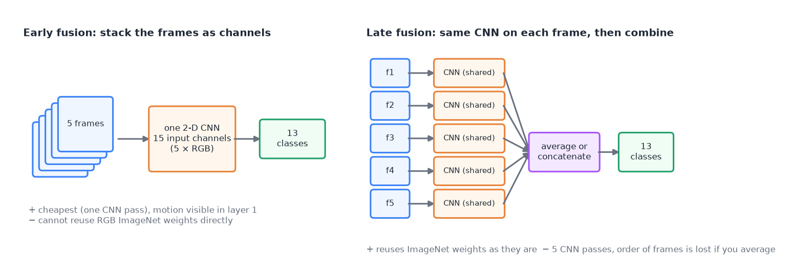

- **Early fusion:** stack 5 RGB frames → 15 channels. Motion from layer 1. First ImageNet layer must change.
- **Late fusion:** same CNN on every frame → average/concat features → classify. Averaging loses order.
- **Split by person** → no group leakage. Small backbone (MobileNet). No flips.

### A2 · persuasion techniques in memes
- **Part A:** multi-label → 20 sigmoids + BCE, one tuned threshold (section 3, row 4). **Part B:** span tagging, sigmoid per class per token.
- Weighted BCE for rare techniques. **Micro vs macro F1:** always "Loaded Language" → micro 0.38, macro 0.03.
- DeBERTa-v3 encoder. Frozen vs LoRA vs full fine-tuning on the same folds.
- 5-fold iterative stratified CV, test once, leakage fixed, bootstrap CIs.
- IG with a [PAD] baseline. Zero-shot LLMs score well but cannot be deployed (privacy).

---

## Numbers without a calculator

| ln | value | | e^ | value | | σ | value |
|---|---|---|---|---|---|---|---|
| ln 0.1 | −2.303 | | e^0.5 | 1.65 | | σ(0) | 0.50 |
| ln 0.2 | −1.609 | | e^1 | 2.72 | | σ(1) | 0.73 |
| ln 0.25 | −1.386 | | e^2 | 7.39 | | σ(2) | 0.88 |
| ln 0.5 | −0.693 | | e^3 | 20.1 | | σ(3) | 0.95 |
| ln 0.75 | −0.288 | | e^−1 | 0.37 | | σ(−1) | 0.27 |
| ln 0.8 | −0.223 | | e^−2 | 0.14 | | σ′(0) | 0.25 |
| ln 0.9 | −0.105 | | | | | | |
| ln 2 | 0.693 | | | | | | |
| ln 10 | 2.303 | | | | | | |

- √2 = 1.41 · √3 = 1.73 · √8 = 2.83 · √64 = 8 · √512 = 22.6
- 0.9⁵⁰ ≈ 0.005 · 1.1⁵⁰ ≈ 117 · 2¹⁰ = 1024
